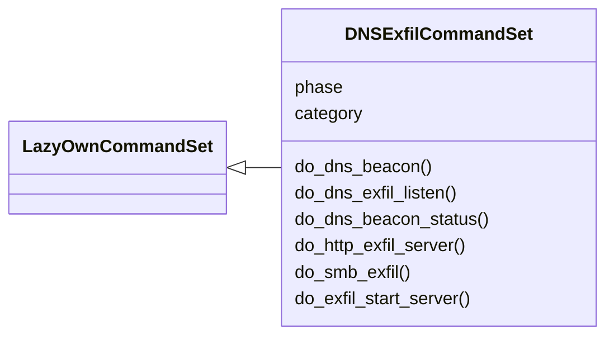
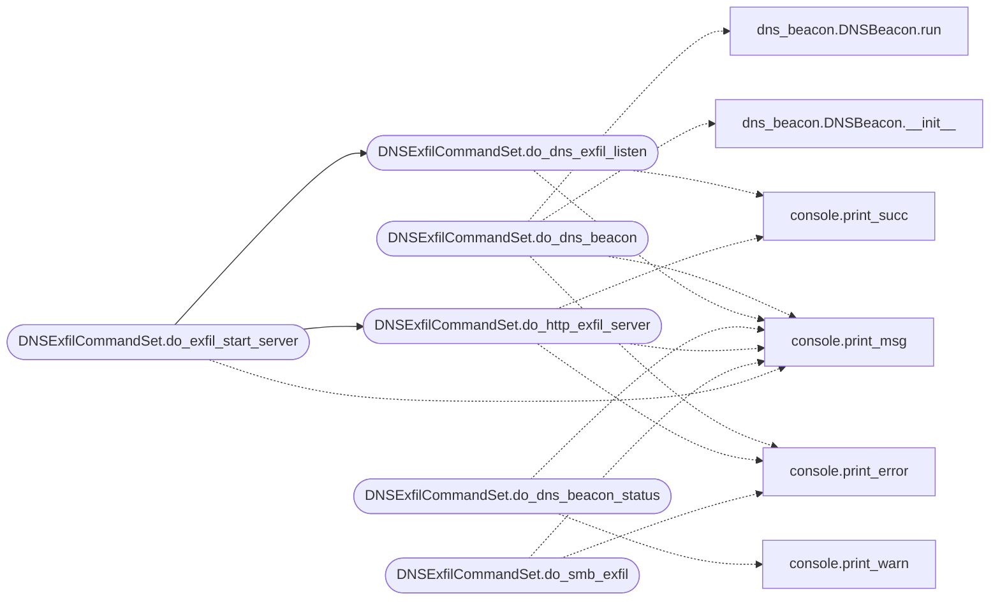

# `cli.commands.dns_exfil`

> Source: [cli/commands/dns_exfil.py:1](../../cli/commands/dns_exfil.py#L1) | language `py` | coverage 100.0% | [API index](../index.md)

DNS exfiltration and covert channel command set.

Phase 09 — commands for DNS tunneling exfiltration, DNS C2 beacon
management, and DNS query log monitoring.

## Contents

- **Classes:** [`DNSExfilCommandSet`](#dnsexfilcommandset)

## Type Diagram



## Call Graph

Solid arrows stay in this module, dashed arrows leave it.



## Classes

<a id="dnsexfilcommandset"></a>

### `DNSExfilCommandSet`

`class` | [cli/commands/dns_exfil.py:44](../../cli/commands/dns_exfil.py#L44)

```python
class DNSExfilCommandSet(LazyOwnCommandSet)
```

Bases: [`LazyOwnCommandSet`](cli.commands._base.py.md#lazyowncommandset)

DNS exfiltration and covert channel commands.

**Attributes**

| Name | Type | Default | Description |
|---|---|---|---|
| [`phase`](#dnsexfilcommandset-phase) |  | `'exfil'` |  |
| [`category`](#dnsexfilcommandset-category) |  | `exfiltration_category` |  |

**Members**

| Member | Kind | Summary |
|---|---|---|
| [`do_dns_beacon`](#dnsexfilcommandset-do_dns_beacon) | method | Start a DNS tunneling beacon. |
| [`do_dns_exfil_listen`](#dnsexfilcommandset-do_dns_exfil_listen) | method | Start a DNS exfiltration listener on UDP port 53. |
| [`do_dns_beacon_status`](#dnsexfilcommandset-do_dns_beacon_status) | method | Show status of all DNS beacons. |
| [`do_http_exfil_server`](#dnsexfilcommandset-do_http_exfil_server) | method | Start a minimal HTTP exfiltration receiver. |
| [`do_smb_exfil`](#dnsexfilcommandset-do_smb_exfil) | method | Exfiltrate files to an SMB share on the attacker machine. |
| [`do_exfil_start_server`](#dnsexfilcommandset-do_exfil_start_server) | method | Start all required exfiltration listeners. |

<a id="dnsexfilcommandset-do_dns_beacon"></a>

#### `DNSExfilCommandSet.do_dns_beacon`

`method` | [cli/commands/dns_exfil.py:51](../../cli/commands/dns_exfil.py#L51)

Decorators: `@cmd2.with_category(exfiltration_category)`

```python
def do_dns_beacon(self, line)
```

Start a DNS tunneling beacon.

Usage: dns_beacon --domain <c2.domain.com> [--type A|TXT|AAAA]
       [--sleep <seconds>] [--jitter <percent>] [--server <dns_server>]

The DNS beacon encodes heartbeats and command output as subdomain
DNS queries. Commands are received via DNS response records.
Requires a cooperating DNS server for the controlled domain.

**Parameters**

| Name | Type | Default | Description |
|---|---|---|---|
| `line` |  |  |  |

*Calls:* [`print_error`](core.console.py.md#print_error), [`print_msg`](core.console.py.md#print_msg), [`DNSBeacon.__init__`](modules.dns_beacon.py.md#dnsbeacon-__init__), [`DNSBeacon.run`](modules.dns_beacon.py.md#dnsbeacon-run)

<a id="dnsexfilcommandset-do_dns_exfil_listen"></a>

#### `DNSExfilCommandSet.do_dns_exfil_listen`

`method` | [cli/commands/dns_exfil.py:97](../../cli/commands/dns_exfil.py#L97)

Decorators: `@cmd2.with_category(exfiltration_category)`

```python
def do_dns_exfil_listen(self, line)
```

Start a DNS exfiltration listener on UDP port 53.

Usage: dns_exfil_listen [--port <port>] [--domain <domain>] [--output <dir>]

Listens for DNS queries containing encoded file data in subdomain
labels. Reconstructs files from base32-encoded, gzip-compressed
chunks. Supports A, TXT, and AAAA query types.

**Parameters**

| Name | Type | Default | Description |
|---|---|---|---|
| `line` |  |  |  |

*Calls:* [`print_msg`](core.console.py.md#print_msg), [`print_succ`](core.console.py.md#print_succ)

*Called by:* [`DNSExfilCommandSet.do_exfil_start_server`](#dnsexfilcommandset-do_exfil_start_server)

<a id="dnsexfilcommandset-do_dns_beacon_status"></a>

#### `DNSExfilCommandSet.do_dns_beacon_status`

`method` | [cli/commands/dns_exfil.py:183](../../cli/commands/dns_exfil.py#L183)

Decorators: `@cmd2.with_category(exfiltration_category)`

```python
def do_dns_beacon_status(self, line='')
```

Show status of all DNS beacons.

Reads beacon state from sessions/dns_beacons.json.

**Parameters**

| Name | Type | Default | Description |
|---|---|---|---|
| `line` |  | `''` |  |

*Calls:* [`print_msg`](core.console.py.md#print_msg), [`print_warn`](core.console.py.md#print_warn)

<a id="dnsexfilcommandset-do_http_exfil_server"></a>

#### `DNSExfilCommandSet.do_http_exfil_server`

`method` | [cli/commands/dns_exfil.py:204](../../cli/commands/dns_exfil.py#L204)

Decorators: `@cmd2.with_category(exfiltration_category)`

```python
def do_http_exfil_server(self, line)
```

Start a minimal HTTP exfiltration receiver.

Usage: http_exfil_server [--port <port>] [--output <dir>]

Listens for HTTP POST requests containing exfiltrated file data.
Supports chunked uploads with X-Chunk-* headers for reassembly.

**Parameters**

| Name | Type | Default | Description |
|---|---|---|---|
| `line` |  |  |  |

*Calls:* [`print_error`](core.console.py.md#print_error), [`print_msg`](core.console.py.md#print_msg), [`print_succ`](core.console.py.md#print_succ)

*Called by:* [`DNSExfilCommandSet.do_exfil_start_server`](#dnsexfilcommandset-do_exfil_start_server)

<a id="dnsexfilcommandset-do_smb_exfil"></a>

#### `DNSExfilCommandSet.do_smb_exfil`

`method` | [cli/commands/dns_exfil.py:304](../../cli/commands/dns_exfil.py#L304)

Decorators: `@cmd2.with_category(exfiltration_category)`

```python
def do_smb_exfil(self, line)
```

Exfiltrate files to an SMB share on the attacker machine.

Usage: smb_exfil <file_path> [--share <share_name>] [--host <smb_host>]

Copies a file to an SMB share. Requires an SMB server running
on the attacker machine (e.g., impacket-smbserver).

**Parameters**

| Name | Type | Default | Description |
|---|---|---|---|
| `line` |  |  |  |

*Calls:* [`print_error`](core.console.py.md#print_error), [`print_msg`](core.console.py.md#print_msg)

<a id="dnsexfilcommandset-do_exfil_start_server"></a>

#### `DNSExfilCommandSet.do_exfil_start_server`

`method` | [cli/commands/dns_exfil.py:338](../../cli/commands/dns_exfil.py#L338)

Decorators: `@cmd2.with_category(exfiltration_category)`

```python
def do_exfil_start_server(self, line)
```

Start all required exfiltration listeners.

Usage: exfil_start_server [--all] [--dns] [--http] [--smb]

Starts DNS (53/udp), HTTP (8888/tcp), and SMB (445/tcp) listeners
for receiving exfiltrated data via all transports.

**Parameters**

| Name | Type | Default | Description |
|---|---|---|---|
| `line` |  |  |  |

*Calls:* [`DNSExfilCommandSet.do_dns_exfil_listen`](#dnsexfilcommandset-do_dns_exfil_listen), [`DNSExfilCommandSet.do_http_exfil_server`](#dnsexfilcommandset-do_http_exfil_server), [`print_msg`](core.console.py.md#print_msg)

---
