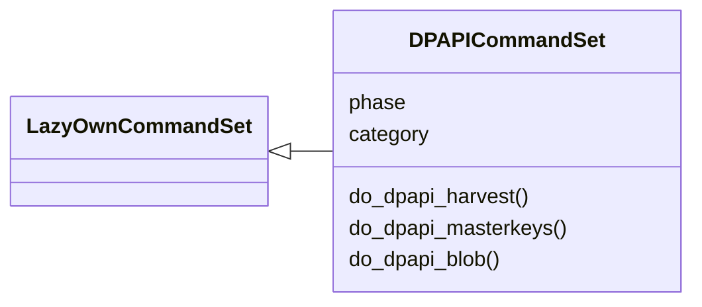
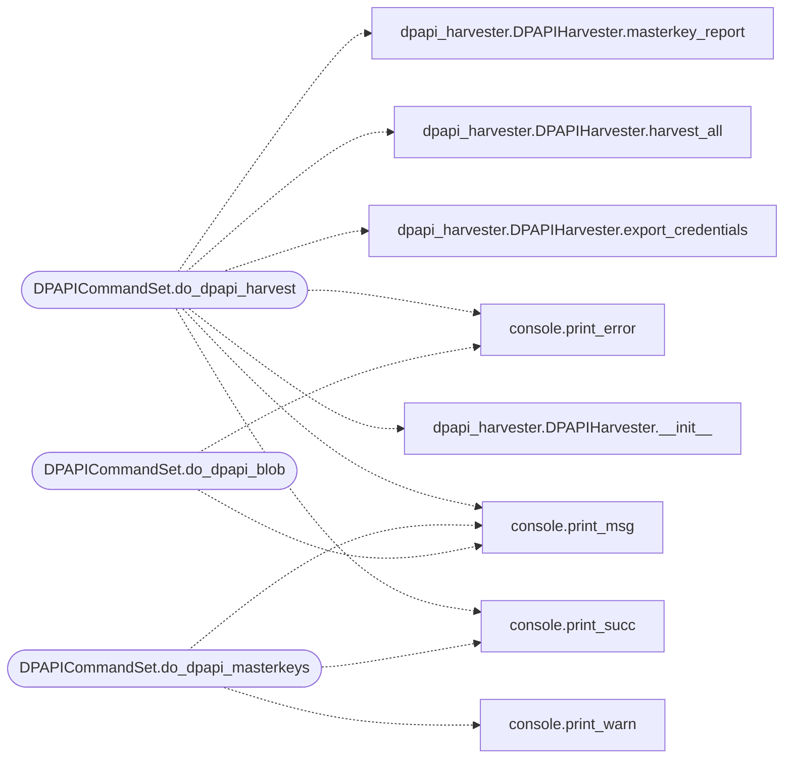

# `cli.commands.dpapi`

> Source: [cli/commands/dpapi.py:1](../../cli/commands/dpapi.py#L1) | language `py` | coverage 100.0% | [API index](../index.md)

DPAPI credential harvesting command set.

Phase 09 — commands for DPAPI master key extraction, credential manager
decryption, browser data harvesting, and offline DPAPI blob attacks.

## Contents

- **Classes:** [`DPAPICommandSet`](#dpapicommandset)

## Type Diagram



## Call Graph

Solid arrows stay in this module, dashed arrows leave it.



## Classes

<a id="dpapicommandset"></a>

### `DPAPICommandSet`

`class` | [cli/commands/dpapi.py:23](../../cli/commands/dpapi.py#L23)

```python
class DPAPICommandSet(LazyOwnCommandSet)
```

Bases: [`LazyOwnCommandSet`](cli.commands._base.py.md#lazyowncommandset)

DPAPI credential harvesting and decryption commands.

**Attributes**

| Name | Type | Default | Description |
|---|---|---|---|
| [`phase`](#dpapicommandset-phase) |  | `'exfil'` |  |
| [`category`](#dpapicommandset-category) |  | `exfiltration_category` |  |

**Members**

| Member | Kind | Summary |
|---|---|---|
| [`do_dpapi_harvest`](#dpapicommandset-do_dpapi_harvest) | method | Harvest all DPAPI-protected credentials from the local machine. |
| [`do_dpapi_masterkeys`](#dpapicommandset-do_dpapi_masterkeys) | method | List and extract DPAPI master keys. |
| [`do_dpapi_blob`](#dpapicommandset-do_dpapi_blob) | method | Decrypt a DPAPI blob offline. |

<a id="dpapicommandset-do_dpapi_harvest"></a>

#### `DPAPICommandSet.do_dpapi_harvest`

`method` | [cli/commands/dpapi.py:30](../../cli/commands/dpapi.py#L30)

Decorators: `@cmd2.with_category(exfiltration_category)`

```python
def do_dpapi_harvest(self, line='')
```

Harvest all DPAPI-protected credentials from the local machine.

Usage: dpapi_harvest [--sessions <dir>]

Collects:
- Master keys from %APPDATA%/Microsoft/Protect
- Credential Manager entries (cmdkey)
- Chrome/Edge passwords, cookies, payment methods
- Wi-Fi profiles with WPA keys
- RDP credential cache
- Windows Vault entries

Run from the implant or local Windows machine.

**Parameters**

| Name | Type | Default | Description |
|---|---|---|---|
| `line` |  | `''` |  |

*Calls:* [`print_error`](core.console.py.md#print_error), [`print_msg`](core.console.py.md#print_msg), [`print_succ`](core.console.py.md#print_succ), [`DPAPIHarvester.__init__`](modules.dpapi_harvester.py.md#dpapiharvester-__init__), [`DPAPIHarvester.export_credentials`](modules.dpapi_harvester.py.md#dpapiharvester-export_credentials), [`DPAPIHarvester.harvest_all`](modules.dpapi_harvester.py.md#dpapiharvester-harvest_all), [`DPAPIHarvester.masterkey_report`](modules.dpapi_harvester.py.md#dpapiharvester-masterkey_report)

<a id="dpapicommandset-do_dpapi_masterkeys"></a>

#### `DPAPICommandSet.do_dpapi_masterkeys`

`method` | [cli/commands/dpapi.py:66](../../cli/commands/dpapi.py#L66)

Decorators: `@cmd2.with_category(exfiltration_category)`

```python
def do_dpapi_masterkeys(self, line='')
```

List and extract DPAPI master keys.

Usage: dpapi_masterkeys [--path <masterkey_path>]

Lists GUIDs, SIDs, and file paths for all discovered master keys.
Use with dploot or dpapilab for offline decryption.

**Parameters**

| Name | Type | Default | Description |
|---|---|---|---|
| `line` |  | `''` |  |

*Calls:* [`print_msg`](core.console.py.md#print_msg), [`print_succ`](core.console.py.md#print_succ), [`print_warn`](core.console.py.md#print_warn)

<a id="dpapicommandset-do_dpapi_blob"></a>

#### `DPAPICommandSet.do_dpapi_blob`

`method` | [cli/commands/dpapi.py:113](../../cli/commands/dpapi.py#L113)

Decorators: `@cmd2.with_category(exfiltration_category)`

```python
def do_dpapi_blob(self, line)
```

Decrypt a DPAPI blob offline.

Usage: dpapi_blob <blob_hex> [--mk <masterkey_hex>] [--entropy <entropy_hex>]

Decrypts a raw DPAPI blob using the provided master key.
Format: hex string of the raw DPAPI ciphertext.

**Parameters**

| Name | Type | Default | Description |
|---|---|---|---|
| `line` |  |  |  |

*Calls:* [`print_error`](core.console.py.md#print_error), [`print_msg`](core.console.py.md#print_msg)

---
