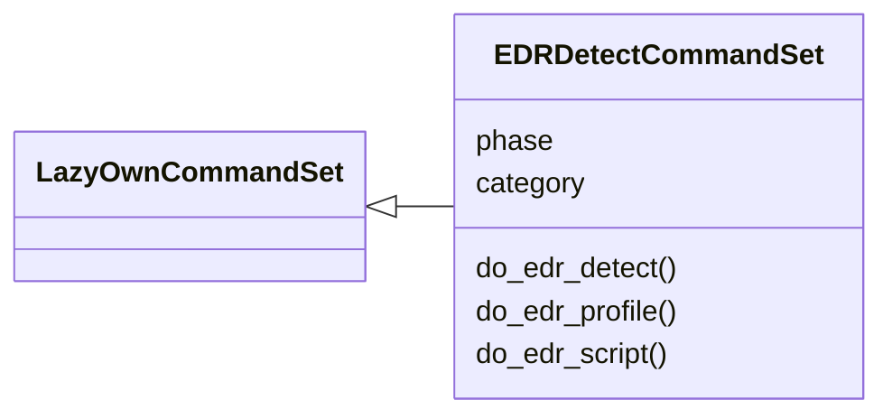
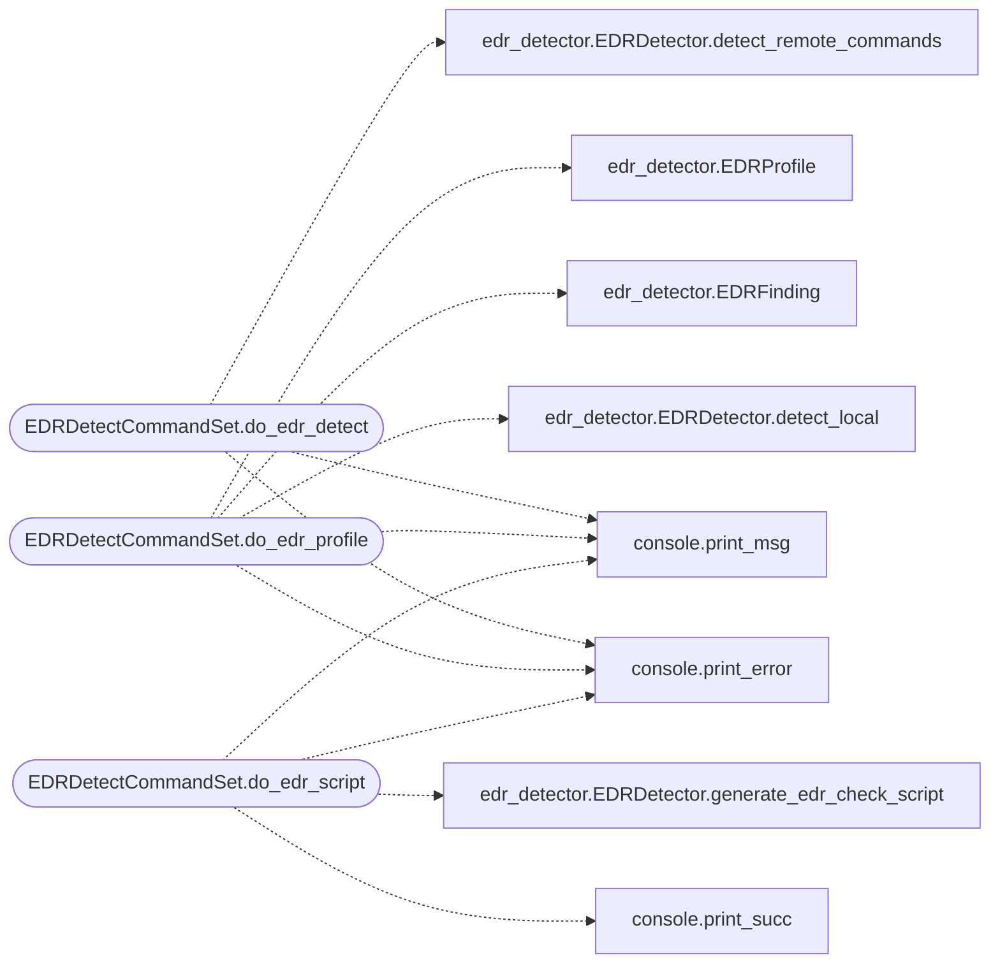

# `cli.commands.edr_detect`

> Source: [cli/commands/edr_detect.py:1](../../cli/commands/edr_detect.py#L1) | language `py` | coverage 100.0% | [API index](../index.md)

EDR Detection command set.

Phase 02 — commands for detecting endpoint security products on targets,
generating evasion profiles, and recommending bypass techniques.

## Contents

- **Classes:** [`EDRDetectCommandSet`](#edrdetectcommandset)

## Type Diagram



## Call Graph

Solid arrows stay in this module, dashed arrows leave it.



## Classes

<a id="edrdetectcommandset"></a>

### `EDRDetectCommandSet`

`class` | [cli/commands/edr_detect.py:27](../../cli/commands/edr_detect.py#L27)

```python
class EDRDetectCommandSet(LazyOwnCommandSet)
```

Bases: [`LazyOwnCommandSet`](cli.commands._base.py.md#lazyowncommandset)

EDR/AV detection and evasion profiling commands.

**Attributes**

| Name | Type | Default | Description |
|---|---|---|---|
| [`phase`](#edrdetectcommandset-phase) |  | `'recon'` |  |
| [`category`](#edrdetectcommandset-category) |  | `EDR_CATEGORY` |  |

**Members**

| Member | Kind | Summary |
|---|---|---|
| [`do_edr_detect`](#edrdetectcommandset-do_edr_detect) | method | Detect EDR/AV products on the target. |
| [`do_edr_profile`](#edrdetectcommandset-do_edr_profile) | method | Generate an evasion profile based on detected EDR. |
| [`do_edr_script`](#edrdetectcommandset-do_edr_script) | method | Generate a PowerShell EDR detection script. |

<a id="edrdetectcommandset-do_edr_detect"></a>

#### `EDRDetectCommandSet.do_edr_detect`

`method` | [cli/commands/edr_detect.py:34](../../cli/commands/edr_detect.py#L34)

Decorators: `@cmd2.with_category(EDR_CATEGORY)`

```python
def do_edr_detect(self, line)
```

Detect EDR/AV products on the target.

Usage:
    edr_detect                    Detect locally (from implant)
    edr_detect --target <ip>      Generate remote detection commands
    edr_detect --target <ip> --user <u> --password <p>  Execute remotely via CrackMapExec

Fingerprints 17 EDR/AV products and generates tailored bypass recommendations.

**Parameters**

| Name | Type | Default | Description |
|---|---|---|---|
| `line` |  |  |  |

*Calls:* [`print_error`](core.console.py.md#print_error), [`print_msg`](core.console.py.md#print_msg), [`EDRDetector.detect_remote_commands`](modules.edr_detector.py.md#edrdetector-detect_remote_commands)

<a id="edrdetectcommandset-do_edr_profile"></a>

#### `EDRDetectCommandSet.do_edr_profile`

`method` | [cli/commands/edr_detect.py:84](../../cli/commands/edr_detect.py#L84)

Decorators: `@cmd2.with_category(EDR_CATEGORY)`

```python
def do_edr_profile(self, line)
```

Generate an evasion profile based on detected EDR.

Usage: edr_profile [--product <name>]

Takes detected EDR product names and recommends specific bypass
techniques. With no arguments, shows bypasses for common EDRs.

**Parameters**

| Name | Type | Default | Description |
|---|---|---|---|
| `line` |  |  |  |

*Calls:* [`print_error`](core.console.py.md#print_error), [`print_msg`](core.console.py.md#print_msg), [`EDRDetector.detect_local`](modules.edr_detector.py.md#edrdetector-detect_local), [`EDRFinding`](modules.edr_detector.py.md#edrfinding), [`EDRProfile`](modules.edr_detector.py.md#edrprofile)

<a id="edrdetectcommandset-do_edr_script"></a>

#### `EDRDetectCommandSet.do_edr_script`

`method` | [cli/commands/edr_detect.py:140](../../cli/commands/edr_detect.py#L140)

Decorators: `@cmd2.with_category(EDR_CATEGORY)`

```python
def do_edr_script(self, line)
```

Generate a PowerShell EDR detection script.

Usage: edr_script [--output <path>]

Creates a comprehensive PowerShell script that detects 17+ EDR/AV
products via WMI, services, processes, registry, and drivers.
Saves to sessions/edr_detect.ps1 by default.

**Parameters**

| Name | Type | Default | Description |
|---|---|---|---|
| `line` |  |  |  |

*Calls:* [`print_error`](core.console.py.md#print_error), [`print_msg`](core.console.py.md#print_msg), [`print_succ`](core.console.py.md#print_succ), [`EDRDetector.generate_edr_check_script`](modules.edr_detector.py.md#edrdetector-generate_edr_check_script)

---
