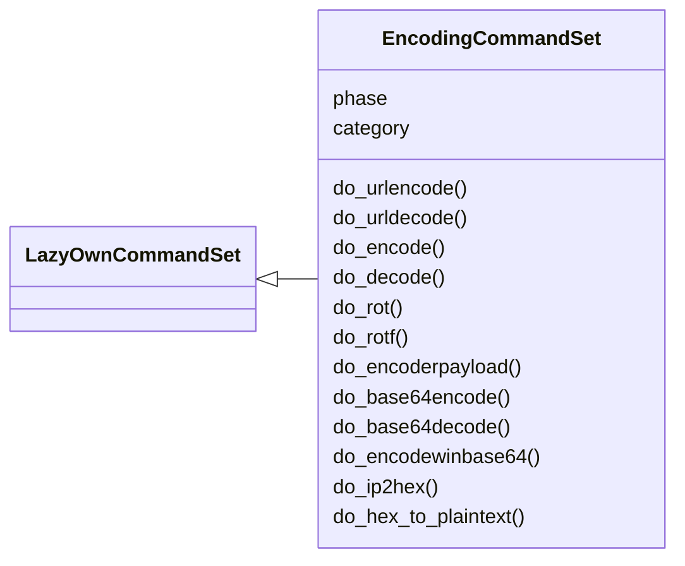
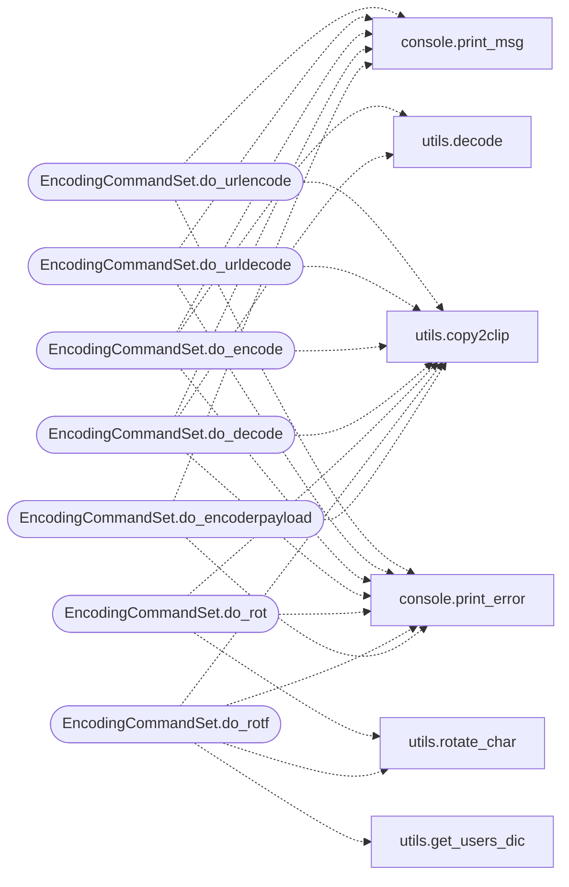

# `cli.commands.encoding`

> Source: [cli/commands/encoding.py:1](../../cli/commands/encoding.py#L1) | language `py` | coverage 100.0% | [API index](../index.md)

Encoding commands extracted from misc_migrated.py.

Phase misc cluster: URL/base64/rot/obfuscation helpers. Active: originals
deleted from ``cli/commands/misc_migrated.py`` and this set is registered
by `[`cli.registry`](cli.registry.py.md)`.

## Contents

- **Classes:** [`EncodingCommandSet`](#encodingcommandset)

## Type Diagram



## Call Graph

Solid arrows stay in this module, dashed arrows leave it.



## Classes

<a id="encodingcommandset"></a>

### `EncodingCommandSet`

`class` | [cli/commands/encoding.py:30](../../cli/commands/encoding.py#L30)

```python
class EncodingCommandSet(LazyOwnCommandSet)
```

Bases: [`LazyOwnCommandSet`](cli.commands._base.py.md#lazyowncommandset)

Encoding helpers (pending).

**Attributes**

| Name | Type | Default | Description |
|---|---|---|---|
| [`phase`](#encodingcommandset-phase) |  | `'misc'` |  |
| [`category`](#encodingcommandset-category) |  | `'12. Miscellaneous'` |  |

**Members**

| Member | Kind | Summary |
|---|---|---|
| [`do_urlencode`](#encodingcommandset-do_urlencode) | method | Encode a string for URL. |
| [`do_urldecode`](#encodingcommandset-do_urldecode) | method | Decode a URL-encoded string. |
| [`do_encode`](#encodingcommandset-do_encode) | method | Encodes a string using the specified shift value and substitution key. |
| [`do_decode`](#encodingcommandset-do_decode) | method | Decode a string using the specified shift value and substitution key. |
| [`do_rot`](#encodingcommandset-do_rot) | method | Apply a ROT (rotation) substitution cipher to the given string. |
| [`do_rotf`](#encodingcommandset-do_rotf) | method | Apply a ROT (rotation) substitution cipher to the given extension. |
| [`do_encoderpayload`](#encodingcommandset-do_encoderpayload) | method | Applies various obfuscations to a given command line string to create multiple obfuscated versions. |
| [`do_base64encode`](#encodingcommandset-do_base64encode) | method | Encodes a given string into Base64 format. |
| [`do_base64decode`](#encodingcommandset-do_base64decode) | method | Decodes a Base64 encoded string. |
| [`do_encodewinbase64`](#encodingcommandset-do_encodewinbase64) | method | Encodes a given payload into a Base64 encoded string suitable for Windows PowerShell execution. |
| [`do_ip2hex`](#encodingcommandset-do_ip2hex) | method | Convert an IPv4 address into its hexadecimal representation. |
| [`do_hex_to_plaintext`](#encodingcommandset-do_hex_to_plaintext) | method | Converts hexadecimal data from a file to plain text. |

<a id="encodingcommandset-do_urlencode"></a>

#### `EncodingCommandSet.do_urlencode`

`method` | [cli/commands/encoding.py:37](../../cli/commands/encoding.py#L37)

Decorators: `@cmd2.with_category('12. Miscellaneous')`

```python
def do_urlencode(self, line)
```

Encode a string for URL.

This function takes a string as input, encodes it for URL compatibility using the `quote` function, and prints the encoded result.

Usage:
    urlencode <string_to_encode>


Manual execution:
To manually run this task, provide a string to be URL-encoded as an argument. The function will encode it and print the result.

Note: If no input is provided or the input is only whitespace, an error message will be displayed.

**Parameters**

| Name | Type | Default | Description |
|---|---|---|---|
| `line` | `str` |  | The string to encode for URL. |

**Returns:** None

*Calls:* [`print_error`](core.console.py.md#print_error), [`print_msg`](core.console.py.md#print_msg), [`copy2clip`](utils.py.md#copy2clip)

<a id="encodingcommandset-do_urldecode"></a>

#### `EncodingCommandSet.do_urldecode`

`method` | [cli/commands/encoding.py:66](../../cli/commands/encoding.py#L66)

Decorators: `@cmd2.with_category('12. Miscellaneous')`

```python
def do_urldecode(self, line)
```

Decode a URL-encoded string.

This function takes a URL-encoded string as input, decodes it using the `unquote` function, and prints the decoded result.

Usage:
    urldecode <url_encoded_string>


Manual execution:
To manually run this task, provide a URL-encoded string as an argument. The function will decode it and print the result.

Note: If no input is provided or the input is only whitespace, an error message will be displayed.

**Parameters**

| Name | Type | Default | Description |
|---|---|---|---|
| `line` | `str` |  | The URL-encoded string to decode. |

**Returns:** None

*Calls:* [`print_error`](core.console.py.md#print_error), [`print_msg`](core.console.py.md#print_msg), [`copy2clip`](utils.py.md#copy2clip)

<a id="encodingcommandset-do_encode"></a>

#### `EncodingCommandSet.do_encode`

`method` | [cli/commands/encoding.py:95](../../cli/commands/encoding.py#L95)

Decorators: `@cmd2.with_category('12. Miscellaneous')`

```python
def do_encode(self, line)
```

Encodes a string using the specified shift value and substitution key.

This function encodes the given string by applying a shift value and a substitution key.

Usage:
    encode <shift_value> <substitution_key> <string>


Manual execution:
To manually run this task, provide a shift value (integer), a substitution key, and the string to encode in the format `encode <shift_value> <substitution_key> <string>`.

Note: The function assumes the shift value is an integer. If the shift value is not an integer, it will print an error message.

**Parameters**

| Name | Type | Default | Description |
|---|---|---|---|
| `line` | `str` |  | The input string containing the shift value, substitution key, and the string to be encoded. The format should be '<shift_value> <substitution_key> <string>'. |

**Returns:** None

*Calls:* [`print_error`](core.console.py.md#print_error), [`print_msg`](core.console.py.md#print_msg), [`copy2clip`](utils.py.md#copy2clip), [`decode`](utils.py.md#decode)

<a id="encodingcommandset-do_decode"></a>

#### `EncodingCommandSet.do_decode`

`method` | [cli/commands/encoding.py:135](../../cli/commands/encoding.py#L135)

Decorators: `@cmd2.with_category('12. Miscellaneous')`

```python
def do_decode(self, line)
```

Decode a string using the specified shift value and substitution key.

This function decodes the given string by applying a shift value and a substitution key to reverse the encoding process.

Usage:
    decode <shift_value> <substitution_key> <string>


Manual execution:
To manually run this task, provide a shift value (integer), a substitution key, and the string to decode in the format `decode <shift_value> <substitution_key> <string>`.

Note: The function assumes the shift value is an integer. If the shift value is not an integer, it will print an error message.

**Parameters**

| Name | Type | Default | Description |
|---|---|---|---|
| `line` | `str` |  | The input string containing the shift value, substitution key, and the string to be decoded. The format should be '<shift_value> <substitution_key> <string>'. |

**Returns:** None

*Calls:* [`print_error`](core.console.py.md#print_error), [`print_msg`](core.console.py.md#print_msg), [`copy2clip`](utils.py.md#copy2clip), [`decode`](utils.py.md#decode)

<a id="encodingcommandset-do_rot"></a>

#### `EncodingCommandSet.do_rot`

`method` | [cli/commands/encoding.py:173](../../cli/commands/encoding.py#L173)

Decorators: `@cmd2.with_category('12. Miscellaneous')`

```python
def do_rot(self, line)
```

Apply a ROT (rotation) substitution cipher to the given string.

This function rotates each character in the input string by the specified number of positions in the alphabet. It supports rotation values between 1 and 27.

Usage:
    rot <number> '<string>'


Manual execution:
To manually run this task, provide a number (rotation amount) and a string in the format `rot <number> '<string>'`. Ensure the number is between 1 and 27.

Note: The function assumes that the rotation number is an integer between 1 and 27. If the number is out of range or not a valid integer, it will print an error message.

**Parameters**

| Name | Type | Default | Description |
|---|---|---|---|
| `line` | `str` |  | The input string containing the number and the text to be rotated. The format should be '<number> '<string>' where <number> is the rotation amount and <string> is the text to be ciphered. |

**Returns:** None

**Raises**

- `ValueError`: (raised in the body, not documented)

*Calls:* [`print_error`](core.console.py.md#print_error), [`copy2clip`](utils.py.md#copy2clip), [`rotate_char`](utils.py.md#rotate_char)

<a id="encodingcommandset-do_rotf"></a>

#### `EncodingCommandSet.do_rotf`

`method` | [cli/commands/encoding.py:213](../../cli/commands/encoding.py#L213)

Decorators: `@cmd2.with_category('12. Miscellaneous')`

```python
def do_rotf(self, line)
```

Apply a ROT (rotation) substitution cipher to the given extension.

This function rotates each character in the input extension by the specified number of positions in the alphabet. It supports rotation values between 1 and 27.

Usage:
    rot <number> '<extension>'


Manual execution:
To manually run this task, provide a number (rotation amount) and a extension in the format `rot <number> '<extension>'`. Ensure the number is between 1 and 27.

Note: The function assumes that the rotation number is an integer between 1 and 27. If the number is out of range or not a valid integer, it will print an error message.

**Parameters**

| Name | Type | Default | Description |
|---|---|---|---|
| `line` | `str` |  | The input extension containing the number and the text to be rotated. The format should be '<number> '<extension>' where <number> is the rotation amount and <extension> is the text to be ciphered. |

**Returns:** None

**Raises**

- `ValueError`: (raised in the body, not documented)

*Calls:* [`print_error`](core.console.py.md#print_error), [`copy2clip`](utils.py.md#copy2clip), [`get_users_dic`](utils.py.md#get_users_dic), [`rotate_char`](utils.py.md#rotate_char)

<a id="encodingcommandset-do_encoderpayload"></a>

#### `EncodingCommandSet.do_encoderpayload`

`method` | [cli/commands/encoding.py:259](../../cli/commands/encoding.py#L259)

Decorators: `@cmd2.with_category('12. Miscellaneous')`

```python
def do_encoderpayload(self, line)
```

Applies various obfuscations to a given command line string to create multiple obfuscated versions.

1. Defines a helper function `double_base64_encode(cmd)` that performs double Base64 encoding on a given command.
2. Defines the `apply_obfuscations(cmd)` function to create a list of obfuscated commands using different techniques.
3. Applies these obfuscations to the provided [`line`](modules.defense_eval.py.md#evaluation-line) argument and prints each obfuscated command.


Manual execution:
To manually run these tasks, you would:
- Provide the command you want to obfuscate as the argument to this function.
- The function will generate various obfuscated versions of the command and print them.

Note: Ensure that the command is properly formatted and valid to avoid errors during obfuscation. The obfuscations may involve different encoding and string manipulation techniques.

**Parameters**

| Name | Type | Default | Description |
|---|---|---|---|
| `line` | `str` |  | The command line string to be obfuscated. |

**Returns:** None

*Calls:* [`print_error`](core.console.py.md#print_error), [`print_msg`](core.console.py.md#print_msg), [`copy2clip`](utils.py.md#copy2clip)

<a id="encodingcommandset-do_base64encode"></a>

#### `EncodingCommandSet.do_base64encode`

`method` | [cli/commands/encoding.py:361](../../cli/commands/encoding.py#L361)

Decorators: `@cmd2.with_category('12. Miscellaneous')`

```python
def do_base64encode(self, line)
```

Encodes a given string into Base64 format.

1. Encodes the input string:
    - Uses the `base64` library to encode the provided string into Base64 format.

2. Displays the encoded string:
    - Prints the Base64 encoded string to the terminal.


Manual execution:
To manually encode a string in Base64:
- Provide the string to the command and it will print the Base64 encoded result.
Example usage: `base64encode HelloWorld`

**Parameters**

| Name | Type | Default | Description |
|---|---|---|---|
| `line` | `str` |  | The string to encode in Base64 format. |

**Returns:** None

*Calls:* [`print_error`](core.console.py.md#print_error), [`print_msg`](core.console.py.md#print_msg)

<a id="encodingcommandset-do_base64decode"></a>

#### `EncodingCommandSet.do_base64decode`

`method` | [cli/commands/encoding.py:389](../../cli/commands/encoding.py#L389)

Decorators: `@cmd2.with_category('12. Miscellaneous')`

```python
def do_base64decode(self, line)
```

Decodes a Base64 encoded string.

1. Decodes the Base64 string:
    - Uses the `base64` library to decode the provided Base64 encoded string back to its original form.

2. Displays the decoded string:
    - Prints the decoded string to the terminal.


Manual execution:
To manually decode a Base64 encoded string:
- Provide the Base64 encoded string to the command and it will print the decoded result.
Example usage: `base64decode SGVsbG9Xb3JsZA==`

**Parameters**

| Name | Type | Default | Description |
|---|---|---|---|
| `line` | `str` |  | The Base64 encoded string to decode. |

**Returns:** None

*Calls:* [`print_error`](core.console.py.md#print_error), [`print_msg`](core.console.py.md#print_msg)

<a id="encodingcommandset-do_encodewinbase64"></a>

#### `EncodingCommandSet.do_encodewinbase64`

`method` | [cli/commands/encoding.py:420](../../cli/commands/encoding.py#L420)

Decorators: `@cmd2.with_category('12. Miscellaneous')`

```python
def do_encodewinbase64(self, line)
```

Encodes a given payload into a Base64 encoded string suitable for Windows PowerShell execution.

This function takes a payload as input, encodes it into UTF-16 Little Endian format,
and then encodes the resulting bytes into a Base64 string. It then constructs PowerShell
commands that can execute the encoded payload. The final commands are printed and
copied to the clipboard for easy use.

**Parameters**

| Name | Type | Default | Description |
|---|---|---|---|
| `line` | `str` |  | The payload to be encoded. If not provided, the function will prompt the user to enter a payload, defaulting to 'whoami' if no input is given. |

**Returns:** None

**Example**

```pycon
>>> encoder = Encoder()
>>> encoder.do_encodewinbase64('Get-Process')
[Outputs the encoded PowerShell commands and copies the final command to the clipboard]
```

*Calls:* [`print_msg`](core.console.py.md#print_msg), [`copy2clip`](utils.py.md#copy2clip)

<a id="encodingcommandset-do_ip2hex"></a>

#### `EncodingCommandSet.do_ip2hex`

`method` | [cli/commands/encoding.py:483](../../cli/commands/encoding.py#L483)

Decorators: `@cmd2.with_category('12. Miscellaneous')`

```python
def do_ip2hex(self, line)
```

Convert an IPv4 address into its hexadecimal representation.

This function takes an IPv4 address in standard dotted-decimal format
(e.g., '192.168.1.1') and converts each of its four octets into a hexadecimal
number. The resulting hexadecimal string is concatenated without separators,
providing the full hexadecimal equivalent of the IP address.

The input IP address is expected to be a string in the format 'X.X.X.X',
where X is an integer between 0 and 255.

line (str): The input string representing the IPv4 address in dotted-decimal format.

None: The hexadecimal equivalent of the IP address is printed to the console.

**Parameters**

| Name | Type | Default | Description |
|---|---|---|---|
| `line` |  |  |  |

*Calls:* [`print_error`](core.console.py.md#print_error), [`print_msg`](core.console.py.md#print_msg)

<a id="encodingcommandset-do_hex_to_plaintext"></a>

#### `EncodingCommandSet.do_hex_to_plaintext`

`method` | [cli/commands/encoding.py:509](../../cli/commands/encoding.py#L509)

Decorators: `@cmd2.with_category('12. Miscellaneous')`

```python
def do_hex_to_plaintext(self, line)
```

Converts hexadecimal data from a file to plain text.

Opens a text editor for the user to paste hexadecimal data into a file.
Then reads the file, processes the hexadecimal data, and writes the plain text to a new file.

**Parameters**

| Name | Type | Default | Description |
|---|---|---|---|
| `line` | `str` |  | Name of the file containing hexadecimal data (without extension). Defaults to 'request.txt' if not provided. |

**Returns:** None

*Calls:* [`print_msg`](core.console.py.md#print_msg)

---
