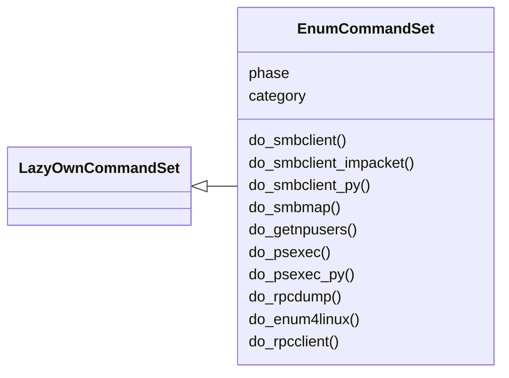
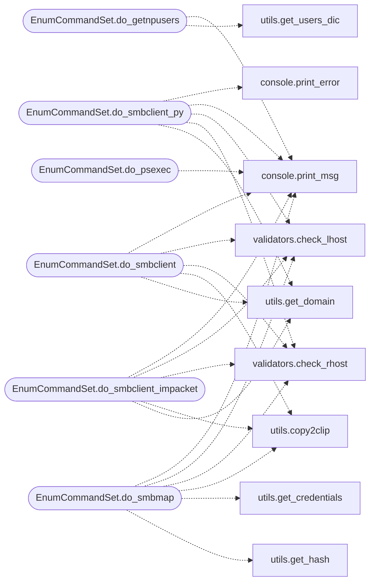

# `cli.commands.enum`

> Source: [cli/commands/enum.py:1](../../cli/commands/enum.py#L1) | language `py` | coverage 100.0% | [API index](../index.md)

Enumeration command set.

Service enumeration commands: SMB, RPC, LDAP quick checks, and related
impacket tools.

## Contents

- **Classes:** [`EnumCommandSet`](#enumcommandset)

## Type Diagram



## Call Graph

Solid arrows stay in this module, dashed arrows leave it.



## Classes

<a id="enumcommandset"></a>

### `EnumCommandSet`

`class` | [cli/commands/enum.py:31](../../cli/commands/enum.py#L31)

```python
class EnumCommandSet(LazyOwnCommandSet)
```

Bases: [`LazyOwnCommandSet`](cli.commands._base.py.md#lazyowncommandset)

Enumeration phase commands.

**Attributes**

| Name | Type | Default | Description |
|---|---|---|---|
| [`phase`](#enumcommandset-phase) |  | `'enum'` |  |
| [`category`](#enumcommandset-category) |  | `'02. Scanning & Enumeration'` |  |

**Members**

| Member | Kind | Summary |
|---|---|---|
| [`do_smbclient`](#enumcommandset-do_smbclient) | method | Interacts with SMB shares using the `smbclient` command to perform the following operations: |
| [`do_smbclient_impacket`](#enumcommandset-do_smbclient_impacket) | method | Interacts with SMB shares using the `smbclient` command to perform the following operations: |
| [`do_smbclient_py`](#enumcommandset-do_smbclient_py) | method | Interacts with SMB shares using the `smbclient.py` command to perform the following operations: |
| [`do_smbmap`](#enumcommandset-do_smbmap) | method | smbmap -H 10.10.10.3 [OPTIONS] Uses the `smbmap` tool to interact with SMB shares on a remote host: |
| [`do_getnpusers`](#enumcommandset-do_getnpusers) | method | sudo impacket-GetNPUsers mist.htb/ -no-pass -usersfile sessions/users.txt Executes the `impacket-GetNPUsers` command to enumerate users with Kerberos... |
| [`do_psexec`](#enumcommandset-do_psexec) | method | Executes the Impacket PSExec tool to attempt remote execution on the specified target. |
| [`do_psexec_py`](#enumcommandset-do_psexec_py) | method | Executes the Impacket PSExec tool to attempt remote execution on the specified target. |
| [`do_rpcdump`](#enumcommandset-do_rpcdump) | method | Executes the `rpcdump.py` script to dump RPC services from a target host. |
| [`do_enum4linux`](#enumcommandset-do_enum4linux) | method | Performs enumeration of information from a target Linux/Unix system using `enum4linux`. |
| [`do_rpcclient`](#enumcommandset-do_rpcclient) | method | Executes the `rpcclient` command to interact with a remote Windows system over RPC (Remote Procedure Call) using anonymous credentials. |

<a id="enumcommandset-do_smbclient"></a>

#### `EnumCommandSet.do_smbclient`

`method` | [cli/commands/enum.py:38](../../cli/commands/enum.py#L38)

Decorators: `@cmd2.with_category(scanning_category)`

```python
def do_smbclient(self, line)
```

Interacts with SMB shares using the `smbclient` command to perform the following operations:

1. Checks if `rhost` (remote host) and `lhost` (local host) are assign; if not, an error message is displayed.
2. If [`line`](modules.defense_eval.py.md#evaluation-line) (share name) is provided:
- Attempts to access the specified SMB share on the remote host using the command: `smbclient -N \\{rhost}\{line}`
3. If [`line`](modules.defense_eval.py.md#evaluation-line) is not provided:
- Lists available SMB shares on the remote host with the command: `smbclient -N -L \\{rhost}`
4. Suggests a potential SMB exploit if possible by mounting the share from the local host using: `mount -t cifs "//{lhost}/share" /mnt/smb`

**Parameters**

| Name | Type | Default | Description |
|---|---|---|---|
| `line` |  |  | The name of the SMB share to access on the remote host. If not provided, the function will list all available shares. |

**Returns:** None

*Calls:* [`print_msg`](core.console.py.md#print_msg), [`check_lhost`](core.validators.py.md#check_lhost), [`check_rhost`](core.validators.py.md#check_rhost), [`copy2clip`](utils.py.md#copy2clip), [`get_domain`](utils.py.md#get_domain)

<a id="enumcommandset-do_smbclient_impacket"></a>

#### `EnumCommandSet.do_smbclient_impacket`

`method` | [cli/commands/enum.py:108](../../cli/commands/enum.py#L108)

Decorators: `@cmd2.with_category(scanning_category)`

```python
def do_smbclient_impacket(self, line)
```

Interacts with SMB shares using the `smbclient` command to perform the following operations:

1. Checks if `rhost` (remote host) and `lhost` (local host) are assign; if not, an error message is displayed.
2. If [`line`](modules.defense_eval.py.md#evaluation-line) (share name) is provided:
- Attempts to access the specified SMB share on the remote host using the command: `smbclient -N \\{rhost}\{line}`
3. If [`line`](modules.defense_eval.py.md#evaluation-line) is not provided:
- Lists available SMB shares on the remote host with the command: `smbclient -N -L \\{rhost}`
4. Suggests a potential SMB exploit if possible by mounting the share from the local host using: `mount -t cifs "//{lhost}/share" /mnt/smb`

**Parameters**

| Name | Type | Default | Description |
|---|---|---|---|
| `line` |  |  | The name of the SMB share to access on the remote host. If not provided, the function will list all available shares. |

**Returns:** None

*Calls:* [`print_msg`](core.console.py.md#print_msg), [`check_lhost`](core.validators.py.md#check_lhost), [`check_rhost`](core.validators.py.md#check_rhost), [`copy2clip`](utils.py.md#copy2clip), [`get_domain`](utils.py.md#get_domain)

<a id="enumcommandset-do_smbclient_py"></a>

#### `EnumCommandSet.do_smbclient_py`

`method` | [cli/commands/enum.py:178](../../cli/commands/enum.py#L178)

Decorators: `@cmd2.with_category(scanning_category)`

```python
def do_smbclient_py(self, line)
```

Interacts with SMB shares using the `smbclient.py` command to perform the following operations:

1. Checks if `rhost` (remote host) and `lhost` (local host) are assign; if not, an error message is displayed.
2. If [`line`](modules.defense_eval.py.md#evaluation-line) (share name) is provided:
- Attempts to access the specified SMB share on the remote host using the command: `smbclient.py -N \\{rhost}\{line}`
3. If [`line`](modules.defense_eval.py.md#evaluation-line) is not provided:
- Lists available SMB shares on the remote host with the command: `smbclient.py -N -L \\{rhost}`
4. Suggests a potential SMB exploit if possible by mounting the share from the local host using: `mount -t cifs "//{lhost}/share" /mnt/smb`

**Parameters**

| Name | Type | Default | Description |
|---|---|---|---|
| `line` |  |  | The name of the SMB share to access on the remote host. If not provided, the function will list all available shares. |

**Returns:** None

*Calls:* [`print_error`](core.console.py.md#print_error), [`print_msg`](core.console.py.md#print_msg), [`check_lhost`](core.validators.py.md#check_lhost), [`check_rhost`](core.validators.py.md#check_rhost), [`get_domain`](utils.py.md#get_domain)

<a id="enumcommandset-do_smbmap"></a>

#### `EnumCommandSet.do_smbmap`

`method` | [cli/commands/enum.py:225](../../cli/commands/enum.py#L225)

Decorators: `@cmd2.with_category(scanning_category)`

```python
def do_smbmap(self, line)
```

smbmap -H 10.10.10.3 [OPTIONS] Uses the `smbmap` tool to interact with SMB shares on a remote host:

1. Checks if `rhost` (remote host) and `lhost` (local host) are assign; if not, an error message is displayed.
2. If no [`line`](modules.defense_eval.py.md#evaluation-line) (share name or options) is provided:
- Attempts to access SMB shares on the remote host with a default user `deefbeef` using the command: `smbmap -H {rhost} -u 'deefbeef'`
3. If [`line`](modules.defense_eval.py.md#evaluation-line) is provided:
- Executes `smbmap` with the specified options or share name using the command: `smbmap -H {rhost} -R {line}`
4. Suggests a potential SMB exploit if possible by mounting the share from the local host using: `mount -t cifs "//{lhost}/documents" /mnt/smb`

**Parameters**

| Name | Type | Default | Description |
|---|---|---|---|
| `line` |  |  | Options or share name to use with `smbmap`. If not provided, uses a default user to list shares. |

**Returns:** None

*Calls:* [`print_msg`](core.console.py.md#print_msg), [`check_lhost`](core.validators.py.md#check_lhost), [`check_rhost`](core.validators.py.md#check_rhost), [`copy2clip`](utils.py.md#copy2clip), [`get_credentials`](utils.py.md#get_credentials), [`get_hash`](utils.py.md#get_hash)

<a id="enumcommandset-do_getnpusers"></a>

#### `EnumCommandSet.do_getnpusers`

`method` | [cli/commands/enum.py:345](../../cli/commands/enum.py#L345)

Decorators: `@cmd2.with_category(scanning_category)`

```python
def do_getnpusers(self, line)
```

sudo impacket-GetNPUsers mist.htb/ -no-pass -usersfile sessions/users.txt Executes the `impacket-GetNPUsers` command to enumerate users with Kerberos pre-authentication disabled.

1. Checks if the [`line`](modules.defense_eval.py.md#evaluation-line) (domain) argument is provided; if not, an error message is displayed, instructing the user to provide a domain.
2. Executes `impacket-GetNPUsers` with the following options:
- `-no-pass`: Skips password prompt.
- `-usersfile sessions/users.txt`: Specifies the file containing the list of users to check.


Manual execution:
To manually run this command, use the following syntax:
    sudo impacket-GetNPUsers <domain> -no-pass -usersfile sessions/users.txt
Replace `<domain>` with the actual domain name you want to query.

**Parameters**

| Name | Type | Default | Description |
|---|---|---|---|
| `line` |  |  | The domain to query. Must be provided in the format `domain.com`. Example usage: `getnpusers domain.com` |

**Returns:** None

*Calls:* [`print_msg`](core.console.py.md#print_msg), [`get_users_dic`](utils.py.md#get_users_dic)

<a id="enumcommandset-do_psexec"></a>

#### `EnumCommandSet.do_psexec`

`method` | [cli/commands/enum.py:390](../../cli/commands/enum.py#L390)

Decorators: `@cmd2.with_category(exploitation_category)`

```python
def do_psexec(self, line)
```

Executes the Impacket PSExec tool to attempt remote execution on the specified target.

This function performs the following actions:
1. Checks if the provided target host (`rhost`) is valid.
2. If the [`line`](modules.defense_eval.py.md#evaluation-line) argument is "pass", it searches for credential files with the pattern `credentials*.txt`
and allows the user to select which file to use for executing the command.
3. If the [`line`](modules.defense_eval.py.md#evaluation-line) argument is not "pass", it assumes execution without a password (using the current credentials).
4. Copies the `rhost` IP address to the clipboard for ease of use.

line (str): A command argument to determine the action.
            If "pass", the function searches for credential files and authenticates using the selected file.
            Otherwise, it executes PSExec without a password using the `rhost` IP.

None

**Parameters**

| Name | Type | Default | Description |
|---|---|---|---|
| `line` |  |  |  |

*Calls:* [`print_msg`](core.console.py.md#print_msg), [`check_rhost`](core.validators.py.md#check_rhost), [`get_credentials`](utils.py.md#get_credentials), [`get_hash`](utils.py.md#get_hash)

<a id="enumcommandset-do_psexec_py"></a>

#### `EnumCommandSet.do_psexec_py`

`method` | [cli/commands/enum.py:446](../../cli/commands/enum.py#L446)

Decorators: `@cmd2.with_category(exploitation_category)`

```python
def do_psexec_py(self, line)
```

Executes the Impacket PSExec tool to attempt remote execution on the specified target.

This function performs the following actions:
1. Checks if the provided target host (`rhost`) is valid.
2. If the [`line`](modules.defense_eval.py.md#evaluation-line) argument is "pass", it searches for credential files with the pattern `credentials*.txt`
and allows the user to select which file to use for executing the command.
3. If the [`line`](modules.defense_eval.py.md#evaluation-line) argument is not "pass", it assumes execution without a password (using the current credentials).
4. Copies the `rhost` IP address to the clipboard for ease of use.

line (str): A command argument to determine the action.
            If "pass", the function searches for credential files and authenticates using the selected file.
            Otherwise, it executes PSExec without a password using the `rhost` IP.

None

**Parameters**

| Name | Type | Default | Description |
|---|---|---|---|
| `line` |  |  |  |

*Calls:* [`print_msg`](core.console.py.md#print_msg), [`check_rhost`](core.validators.py.md#check_rhost), [`get_credentials`](utils.py.md#get_credentials), [`get_hash`](utils.py.md#get_hash)

<a id="enumcommandset-do_rpcdump"></a>

#### `EnumCommandSet.do_rpcdump`

`method` | [cli/commands/enum.py:502](../../cli/commands/enum.py#L502)

Decorators: `@cmd2.with_category(scanning_category)`

```python
def do_rpcdump(self, line)
```

Executes the `rpcdump.py` script to dump RPC services from a target host.

1. Retrieves the target host IP from the `rhost` parameter.
2. Checks if the `rhost` parameter is valid using [`check_rhost`](core.validators.py.md#check_rhost). If invalid, the function returns early.
3. Executes the `rpcdump.py` script on port 135 and 593 to gather RPC service information from the target host.


Manual execution:
To manually run this command, use the following syntax:
    rpcdump.py -p 135 <target_host>
    rpcdump.py -p 593 <target_host>
Replace `<target_host>` with the IP address or hostname of the target machine.

**Parameters**

| Name | Type | Default | Description |
|---|---|---|---|
| `line` |  |  | This parameter is not used in this command but is included for consistency with other methods. |

**Returns:** None

*Calls:* [`print_msg`](core.console.py.md#print_msg), [`check_rhost`](core.validators.py.md#check_rhost)

<a id="enumcommandset-do_enum4linux"></a>

#### `EnumCommandSet.do_enum4linux`

`method` | [cli/commands/enum.py:528](../../cli/commands/enum.py#L528)

Decorators: `@cmd2.with_category(scanning_category)`

```python
def do_enum4linux(self, line)
```

Performs enumeration of information from a target Linux/Unix system using `enum4linux`.

1. Executes the `enum4linux` command with the `-a` option to gather extensive information from the specified target.


Manual execution:
To manually enumerate information from a Linux/Unix system, use the following command:
    enum4linux -a <target_host>

Replace `<target_host>` with the IP address or hostname of the target system.

For example:
    enum4linux -a 192.168.1.10

**Parameters**

| Name | Type | Default | Description |
|---|---|---|---|
| `line` |  |  | This parameter is not used in the current implementation but could be used to pass additional options or arguments if needed. |

**Returns:** None

*Calls:* [`print_msg`](core.console.py.md#print_msg)

<a id="enumcommandset-do_rpcclient"></a>

#### `EnumCommandSet.do_rpcclient`

`method` | [cli/commands/enum.py:558](../../cli/commands/enum.py#L558)

Decorators: `@cmd2.with_category(scanning_category)`

```python
def do_rpcclient(self, line)
```

Executes the `rpcclient` command to interact with a remote Windows system over RPC (Remote Procedure Call) using anonymous credentials.

1. Runs `rpcclient` with the `-U ''` (empty username) and `-N` (no password) options to connect to the target host specified by `rhost`.


Manual execution:
To manually interact with a remote Windows system using RPC, use the following command:
    rpcclient -U '' -N <target_ip>

Replace `<target_ip>` with the IP address of the target system. For example:
    rpcclient -U '' -N 10.10.10.10

**Parameters**

| Name | Type | Default | Description |
|---|---|---|---|
| `line` |  |  | This parameter is not used in the current implementation but could be used to specify additional options or arguments if needed. |

**Returns:** None

*Calls:* [`print_error`](core.console.py.md#print_error), [`print_msg`](core.console.py.md#print_msg)

---
