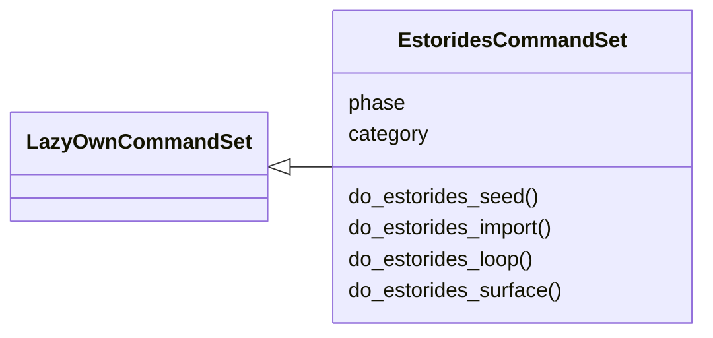

# `cli.commands.estorides`

> Source: [cli/commands/estorides.py:1](../../cli/commands/estorides.py#L1) | language `py` | coverage 100.0% | [API index](../index.md)

Estorides integration commands — bidirectional feedback loop with passive OSINT.

Commands:
    estorides_seed     Feed LazyOwn hosts into Estorides for passive discovery.
    estorides_import   Import Estorides-discovered entities into LazyOwn DB/scope.
    estorides_loop     Run the full bidirectional feedback loop (N iterations).
    estorides_surface  Show the combined active + passive attack surface.

## Contents

- **Classes:** [`EstoridesCommandSet`](#estoridescommandset)

## Type Diagram



## Call Graph

Solid arrows stay in this module, dashed arrows leave it.

```mermaid
flowchart LR
    n_cli_commands_estorides_py__EstoridesCommandSet_do_estorides_seed(["EstoridesCommandSet.do_estorides_seed"])
    n_core_console_py__print_msg["console.print_msg"]
    n_core_console_py__print_warn["console.print_warn"]
    n_modules_estorides_importer_py__extract_seeds_from_db["estorides_importer.extract_seeds_from_db"]
    n_modules_estorides_importer_py__extract_seeds_from_hosts_file["estorides_importer.extract_seeds_from_hosts_file"]
    n_modules_estorides_importer_py__extract_seeds_from_scope["estorides_importer.extract_seeds_from_scope"]
    n_modules_estorides_importer_py__extract_seeds_from_world_model["estorides_importer.extract_seeds_from_world_model"]
    n_modules_estorides_importer_py__run_estorides_discover["estorides_importer.run_estorides_discover"]
    n_cli_commands_estorides_py__EstoridesCommandSet_do_estorides_import(["EstoridesCommandSet.do_estorides_import"])
    n_modules_estorides_importer_py__EstoridesCaseReader___init__["estorides_importer.EstoridesCaseReader.__init__"]
    n_modules_estorides_importer_py__EstoridesCaseReader_close["estorides_importer.EstoridesCaseReader.close"]
    n_modules_estorides_importer_py__EstoridesCaseReader_get_host_entities["estorides_importer.EstoridesCaseReader.get_host_entities"]
    n_modules_estorides_importer_py__EstoridesCaseReader_stats["estorides_importer.EstoridesCaseReader.stats"]
    n_modules_estorides_importer_py__EstoridesStixParser___init__["estorides_importer.EstoridesStixParser.__init__"]
    n_modules_estorides_importer_py__EstoridesStixParser_parse["estorides_importer.EstoridesStixParser.parse"]
    n_modules_estorides_importer_py__EstoridesStixParser_parse_by_type["estorides_importer.EstoridesStixParser.parse_by_type"]
    n_modules_estorides_importer_py__EstoridesToLazyOwnBridge___init__["estorides_importer.EstoridesToLazyOwnBridge.__init__"]
    n_modules_estorides_importer_py__EstoridesToLazyOwnBridge_import_entities["estorides_importer.EstoridesToLazyOwnBridge.import_entities"]
    n_modules_estorides_importer_py__LanBundleReader___init__["estorides_importer.LanBundleReader.__init__"]
    n_modules_estorides_importer_py__LanBundleReader_attack_targets["estorides_importer.LanBundleReader.attack_targets"]
    n_modules_estorides_importer_py__LanBundleReader_parse["estorides_importer.LanBundleReader.parse"]
    n_modules_estorides_importer_py__LanBundleReader_read_devices["estorides_importer.LanBundleReader.read_devices"]
    n_cli_commands_estorides_py__EstoridesCommandSet_do_estorides_loop(["EstoridesCommandSet.do_estorides_loop"])
    n_modules_estorides_importer_py__FeedbackLoop___init__["estorides_importer.FeedbackLoop.__init__"]
    n_cli_commands_estorides_py__EstoridesCommandSet_do_estorides_seed -.-> n_core_console_py__print_msg
    n_cli_commands_estorides_py__EstoridesCommandSet_do_estorides_seed -.-> n_core_console_py__print_warn
    n_cli_commands_estorides_py__EstoridesCommandSet_do_estorides_seed -.-> n_modules_estorides_importer_py__extract_seeds_from_db
    n_cli_commands_estorides_py__EstoridesCommandSet_do_estorides_seed -.-> n_modules_estorides_importer_py__extract_seeds_from_hosts_file
    n_cli_commands_estorides_py__EstoridesCommandSet_do_estorides_seed -.-> n_modules_estorides_importer_py__extract_seeds_from_scope
    n_cli_commands_estorides_py__EstoridesCommandSet_do_estorides_seed -.-> n_modules_estorides_importer_py__extract_seeds_from_world_model
    n_cli_commands_estorides_py__EstoridesCommandSet_do_estorides_seed -.-> n_modules_estorides_importer_py__run_estorides_discover
    n_cli_commands_estorides_py__EstoridesCommandSet_do_estorides_import -.-> n_core_console_py__print_msg
    n_cli_commands_estorides_py__EstoridesCommandSet_do_estorides_import -.-> n_core_console_py__print_warn
    n_cli_commands_estorides_py__EstoridesCommandSet_do_estorides_import -.-> n_modules_estorides_importer_py__EstoridesCaseReader___init__
    n_cli_commands_estorides_py__EstoridesCommandSet_do_estorides_import -.-> n_modules_estorides_importer_py__EstoridesCaseReader_close
    n_cli_commands_estorides_py__EstoridesCommandSet_do_estorides_import -.-> n_modules_estorides_importer_py__EstoridesCaseReader_get_host_entities
    n_cli_commands_estorides_py__EstoridesCommandSet_do_estorides_import -.-> n_modules_estorides_importer_py__EstoridesCaseReader_stats
    n_cli_commands_estorides_py__EstoridesCommandSet_do_estorides_import -.-> n_modules_estorides_importer_py__EstoridesStixParser___init__
    n_cli_commands_estorides_py__EstoridesCommandSet_do_estorides_import -.-> n_modules_estorides_importer_py__EstoridesStixParser_parse
    n_cli_commands_estorides_py__EstoridesCommandSet_do_estorides_import -.-> n_modules_estorides_importer_py__EstoridesStixParser_parse_by_type
    n_cli_commands_estorides_py__EstoridesCommandSet_do_estorides_import -.-> n_modules_estorides_importer_py__EstoridesToLazyOwnBridge___init__
    n_cli_commands_estorides_py__EstoridesCommandSet_do_estorides_import -.-> n_modules_estorides_importer_py__EstoridesToLazyOwnBridge_import_entities
    n_cli_commands_estorides_py__EstoridesCommandSet_do_estorides_import -.-> n_modules_estorides_importer_py__LanBundleReader___init__
    n_cli_commands_estorides_py__EstoridesCommandSet_do_estorides_import -.-> n_modules_estorides_importer_py__LanBundleReader_attack_targets
    n_cli_commands_estorides_py__EstoridesCommandSet_do_estorides_import -.-> n_modules_estorides_importer_py__LanBundleReader_parse
    n_cli_commands_estorides_py__EstoridesCommandSet_do_estorides_import -.-> n_modules_estorides_importer_py__LanBundleReader_read_devices
    n_cli_commands_estorides_py__EstoridesCommandSet_do_estorides_loop -.-> n_core_console_py__print_msg
    n_cli_commands_estorides_py__EstoridesCommandSet_do_estorides_loop -.-> n_modules_estorides_importer_py__FeedbackLoop___init__
```



## Classes

<a id="estoridescommandset"></a>

### `EstoridesCommandSet`

`class` | [cli/commands/estorides.py:51](../../cli/commands/estorides.py#L51)

```python
class EstoridesCommandSet(LazyOwnCommandSet)
```

Bases: [`LazyOwnCommandSet`](cli.commands._base.py.md#lazyowncommandset)

Bidirectional Estorides <-> LazyOwn integration commands.

**Attributes**

| Name | Type | Default | Description |
|---|---|---|---|
| [`phase`](#estoridescommandset-phase) |  | `'recon'` |  |
| [`category`](#estoridescommandset-category) |  | `'01. Reconnaissance'` |  |

**Members**

| Member | Kind | Summary |
|---|---|---|
| [`do_estorides_seed`](#estoridescommandset-do_estorides_seed) | method | Feed LazyOwn hosts/domains into Estorides for passive OSINT discovery. |
| [`do_estorides_import`](#estoridescommandset-do_estorides_import) | method | Import Estorides-discovered entities into LazyOwn database and scope. |
| [`do_estorides_loop`](#estoridescommandset-do_estorides_loop) | method | Run the bidirectional Estorides <-> LazyOwn feedback loop. |
| [`do_estorides_surface`](#estoridescommandset-do_estorides_surface) | method | Show the combined active + passive attack surface. |

<a id="estoridescommandset-do_estorides_seed"></a>

#### `EstoridesCommandSet.do_estorides_seed`

`method` | [cli/commands/estorides.py:73](../../cli/commands/estorides.py#L73)

Decorators: `@cmd2.with_category(recon_category)`

```python
def do_estorides_seed(self, line: str) -> None
```

Feed LazyOwn hosts/domains into Estorides for passive OSINT discovery.

Usage:
    estorides_seed [--source <src>] [--max-depth <n>] [--max-steps <n>]

Seed sources:
    all          - All available sources (default)
    world_model  - From sessions/world_model.json
    hosts_file   - From sessions/hostsdiscovery.txt
    db           - From lazyown.db hosts table
    scope        - From payload.json scope list
    <ip/domain>  - Manual seed value

**Parameters**

| Name | Type | Default | Description |
|---|---|---|---|
| `line` | `str` |  |  |

**Example**

```python
estorides_seed                          # seed all sources
estorides_seed --source hosts_file      # only from hostsdiscovery.txt
estorides_seed --source scope --max-depth 3
estorides_seed 10.10.14.141             # manual seed
```

*Calls:* [`print_msg`](core.console.py.md#print_msg), [`print_warn`](core.console.py.md#print_warn), [`extract_seeds_from_db`](modules.estorides_importer.py.md#extract_seeds_from_db), [`extract_seeds_from_hosts_file`](modules.estorides_importer.py.md#extract_seeds_from_hosts_file), [`extract_seeds_from_scope`](modules.estorides_importer.py.md#extract_seeds_from_scope), [`extract_seeds_from_world_model`](modules.estorides_importer.py.md#extract_seeds_from_world_model), [`run_estorides_discover`](modules.estorides_importer.py.md#run_estorides_discover)

<a id="estoridescommandset-do_estorides_import"></a>

#### `EstoridesCommandSet.do_estorides_import`

`method` | [cli/commands/estorides.py:189](../../cli/commands/estorides.py#L189)

Decorators: `@cmd2.with_category(recon_category)`

```python
def do_estorides_import(self, line: str) -> None
```

Import Estorides-discovered entities into LazyOwn database and scope.

Usage:
    estorides_import [--from <source>] [--case-id <id>] [--no-scope] [--no-db]

Import sources:
    case        - Read from estorides case store (SQLite)
    stix        - Parse STIX 2.1 bundles from estorides data/
    lan         - Read Estorides LAN bundle (data/lan_output or
                  sessions/lan_inventory.json) into DB + scope
    all         - All available sources (default)

Options:
    --from <s>      Source to import from (case, stix, lan, all)
    --case-id <id>  Import a specific case by ID
    --no-scope      Do not add discovered assets to payload.json scope
    --no-db         Do not add discovered assets to lazyown.db
    --preview       Preview entities only, do not import

**Parameters**

| Name | Type | Default | Description |
|---|---|---|---|
| `line` | `str` |  |  |

**Example**

```python
estorides_import                          # import all
estorides_import --from stix              # from STIX bundles
estorides_import --from case --case-id a1b2c3d4
estorides_import --preview                # preview only
```

*Calls:* [`print_msg`](core.console.py.md#print_msg), [`print_warn`](core.console.py.md#print_warn), [`EstoridesCaseReader.__init__`](modules.estorides_importer.py.md#estoridescasereader-__init__), [`EstoridesCaseReader.close`](modules.estorides_importer.py.md#estoridescasereader-close), [`EstoridesCaseReader.get_host_entities`](modules.estorides_importer.py.md#estoridescasereader-get_host_entities), [`EstoridesCaseReader.stats`](modules.estorides_importer.py.md#estoridescasereader-stats), [`EstoridesStixParser.__init__`](modules.estorides_importer.py.md#estoridesstixparser-__init__), [`EstoridesStixParser.parse`](modules.estorides_importer.py.md#estoridesstixparser-parse), [`EstoridesStixParser.parse_by_type`](modules.estorides_importer.py.md#estoridesstixparser-parse_by_type), [`EstoridesToLazyOwnBridge.__init__`](modules.estorides_importer.py.md#estoridestolazyownbridge-__init__), [`EstoridesToLazyOwnBridge.import_entities`](modules.estorides_importer.py.md#estoridestolazyownbridge-import_entities), [`LanBundleReader.__init__`](modules.estorides_importer.py.md#lanbundlereader-__init__) and 3 more

<a id="estoridescommandset-do_estorides_loop"></a>

#### `EstoridesCommandSet.do_estorides_loop`

`method` | [cli/commands/estorides.py:337](../../cli/commands/estorides.py#L337)

Decorators: `@cmd2.with_category(recon_category)`

```python
def do_estorides_loop(self, line: str) -> None
```

Run the bidirectional Estorides <-> LazyOwn feedback loop.

Each iteration:
  1. Extract seeds from LazyOwn (world model, scope, DB, hosts files)
  2. Feed each seed into Estorides discover for passive OSINT
  3. Import new entities back into LazyOwn DB + scope
  4. New entities become seeds for the next iteration
  5. Runs lazynmap / nuclei if operator opts in on new targets

The loop converges when no new assets are discovered or max
iterations is reached.

Usage:
    estorides_loop [--iter <n>] [--depth <n>] [--auto-scan]

Options:
    --iter <n>       Max iterations (default: 3)
    --depth <n>      Discovery depth per seed (default: 2)
    --auto-scan      Automatically run lazynmap on new IPs discovered
                     by Estorides (requires active scanning permission)

**Parameters**

| Name | Type | Default | Description |
|---|---|---|---|
| `line` | `str` |  |  |

**Example**

```python
estorides_loop                    # 3 iterations, passive only
estorides_loop --iter 5 --depth 3 # 5 iterations, deeper discovery
estorides_loop --auto-scan        # auto-scan new IPs from OSINT
```

*Calls:* [`print_msg`](core.console.py.md#print_msg), [`FeedbackLoop.__init__`](modules.estorides_importer.py.md#feedbackloop-__init__), [`FeedbackLoop.run`](modules.estorides_importer.py.md#feedbackloop-run)

<a id="estoridescommandset-do_estorides_surface"></a>

#### `EstoridesCommandSet.do_estorides_surface`

`method` | [cli/commands/estorides.py:441](../../cli/commands/estorides.py#L441)

Decorators: `@cmd2.with_category(recon_category)`

```python
def do_estorides_surface(self, line: str) -> None
```

Show the combined active + passive attack surface.

Aggregates targets from:
  - LazyOwn database (lazyown.db hosts table)
  - LazyOwn scope (payload.json)
  - LazyOwn world model (sessions/world_model.json)
  - Estorides case store (estorides_cases.sqlite)
  - Estorides STIX bundles

Usage:
    estorides_surface [--json] [--export <path>]

Options:
    --json          Output as JSON
    --export <path> Export combined surface to JSON file

**Parameters**

| Name | Type | Default | Description |
|---|---|---|---|
| `line` | `str` |  |  |

**Example**

```python
estorides_surface
estorides_surface --json
estorides_surface --export sessions/combined_surface.json
```

*Calls:* [`print_msg`](core.console.py.md#print_msg), [`EstoridesCaseReader.__init__`](modules.estorides_importer.py.md#estoridescasereader-__init__), [`EstoridesCaseReader.close`](modules.estorides_importer.py.md#estoridescasereader-close), [`EstoridesCaseReader.get_host_entities`](modules.estorides_importer.py.md#estoridescasereader-get_host_entities), [`EstoridesStixParser.__init__`](modules.estorides_importer.py.md#estoridesstixparser-__init__), [`EstoridesStixParser.parse_by_type`](modules.estorides_importer.py.md#estoridesstixparser-parse_by_type), [`EstoridesToLazyOwnBridge.__init__`](modules.estorides_importer.py.md#estoridestolazyownbridge-__init__), [`EstoridesToLazyOwnBridge.get_combined_surface`](modules.estorides_importer.py.md#estoridestolazyownbridge-get_combined_surface)

---
