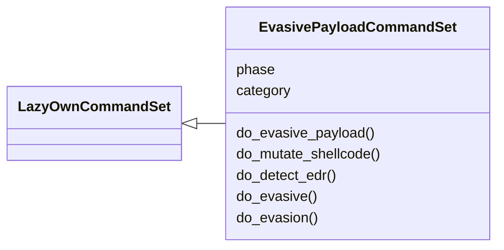
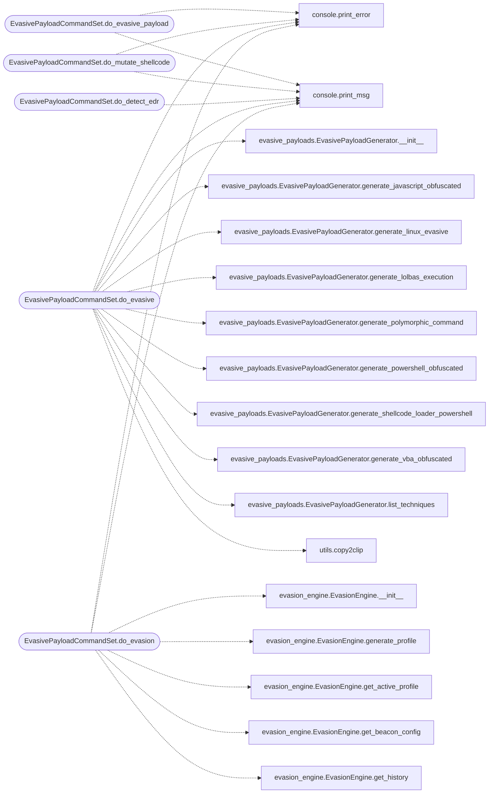

# `cli.commands.evasive_payload`

> Source: [cli/commands/evasive_payload.py:1](../../cli/commands/evasive_payload.py#L1) | language `py` | coverage 100.0% | [API index](../index.md)

Auto-Adaptive Payload command set.

Detects target defenses (AV/EDR), selects optimal bypass techniques,
and generates evasive payloads with polymorphic shellcode mutation.

## Contents

- **Classes:** [`EvasivePayloadCommandSet`](#evasivepayloadcommandset)

## Type Diagram



## Call Graph

Solid arrows stay in this module, dashed arrows leave it.



## Classes

<a id="evasivepayloadcommandset"></a>

### `EvasivePayloadCommandSet`

`class` | [cli/commands/evasive_payload.py:248](../../cli/commands/evasive_payload.py#L248)

```python
class EvasivePayloadCommandSet(LazyOwnCommandSet)
```

Bases: [`LazyOwnCommandSet`](cli.commands._base.py.md#lazyowncommandset)

Auto-adaptive payload generation with AV/EDR evasion.

**Attributes**

| Name | Type | Default | Description |
|---|---|---|---|
| [`phase`](#evasivepayloadcommandset-phase) |  | `'exploit'` |  |
| [`category`](#evasivepayloadcommandset-category) |  | `PAYLOAD_CATEGORY` |  |

**Members**

| Member | Kind | Summary |
|---|---|---|
| [`do_evasive_payload`](#evasivepayloadcommandset-do_evasive_payload) | method | Generate an evasive payload with automatic AV/EDR bypass. |
| [`do_mutate_shellcode`](#evasivepayloadcommandset-do_mutate_shellcode) | method | Apply polymorphic mutation to shellcode for signature evasion. |
| [`do_detect_edr`](#evasivepayloadcommandset-do_detect_edr) | method | Generate commands to detect EDR/AV on the target. |
| [`do_evasive`](#evasivepayloadcommandset-do_evasive) | method | Generate detection-evading payloads with multiple obfuscation strategies. |
| [`do_evasion`](#evasivepayloadcommandset-do_evasion) | method | Generate and manage C2 evasion profiles. |

<a id="evasivepayloadcommandset-do_evasive_payload"></a>

#### `EvasivePayloadCommandSet.do_evasive_payload`

`method` | [cli/commands/evasive_payload.py:255](../../cli/commands/evasive_payload.py#L255)

Decorators: `@cmd2.with_category(PAYLOAD_CATEGORY)`

```python
def do_evasive_payload(self, line)
```

Generate an evasive payload with automatic AV/EDR bypass.

Usage: evasive_payload [--lhost <ip>] [--lport <port>] [--os <windows|linux>] [--arch <x64|x86>] [--format <raw|hex|c|ps1|py|vba>] [--bypass <technique>]

Auto-selects the optimal bypass technique based on target OS.
Supports: syscall, unhook, process_inject, ppid_spoof, dll_sideload,
reflective_dll, early_bird, thread_hijack, mutation, encryption.

**Parameters**

| Name | Type | Default | Description |
|---|---|---|---|
| `line` |  |  |  |

*Calls:* [`print_error`](core.console.py.md#print_error), [`print_msg`](core.console.py.md#print_msg)

<a id="evasivepayloadcommandset-do_mutate_shellcode"></a>

#### `EvasivePayloadCommandSet.do_mutate_shellcode`

`method` | [cli/commands/evasive_payload.py:307](../../cli/commands/evasive_payload.py#L307)

Decorators: `@cmd2.with_category(PAYLOAD_CATEGORY)`

```python
def do_mutate_shellcode(self, line)
```

Apply polymorphic mutation to shellcode for signature evasion.

Usage: mutate_shellcode <shellcode_file> [--iterations <n>] [--output <path>]

Applies N rounds of: XOR re-encoding, NOP sled insertion,
register randomization, and instruction reordering.

**Parameters**

| Name | Type | Default | Description |
|---|---|---|---|
| `line` |  |  |  |

*Calls:* [`print_error`](core.console.py.md#print_error), [`print_msg`](core.console.py.md#print_msg)

<a id="evasivepayloadcommandset-do_detect_edr"></a>

#### `EvasivePayloadCommandSet.do_detect_edr`

`method` | [cli/commands/evasive_payload.py:360](../../cli/commands/evasive_payload.py#L360)

Decorators: `@cmd2.with_category(PAYLOAD_CATEGORY)`

```python
def do_detect_edr(self, line)
```

Generate commands to detect EDR/AV on the target.

Usage: detect_edr [--target <ip>] [--user <username>] [--password <password>]

Queries Windows for installed AV/EDR products via WMI, registry,
and process enumeration.

**Parameters**

| Name | Type | Default | Description |
|---|---|---|---|
| `line` |  |  |  |

*Calls:* [`print_msg`](core.console.py.md#print_msg)

<a id="evasivepayloadcommandset-do_evasive"></a>

#### `EvasivePayloadCommandSet.do_evasive`

`method` | [cli/commands/evasive_payload.py:415](../../cli/commands/evasive_payload.py#L415)

Decorators: `@cmd2.with_category(PAYLOAD_CATEGORY)`

```python
def do_evasive(self, line: str) -> None
```

Generate detection-evading payloads with multiple obfuscation strategies.

Usage:
    evasive ps <raw_payload>   Obfuscate a PowerShell payload (AMSI bypass + encoding)
    evasive js <raw_payload>   Obfuscate a JavaScript payload
    evasive vba <raw_payload>  Obfuscate a VBA macro payload
    evasive rev <rhost> <rport> [python|bash|node]  Evasive reverse shell
    evasive sc <b64_shellcode> [early_bird|virtualalloc]  Shellcode loader
    evasive lolbas <payload_url> [technique]  LOLBAS execution
    evasive poly <command> [iterations]  Polymorphic command mutation
    evasive tech                 List all evasion techniques

**Parameters**

| Name | Type | Default | Description |
|---|---|---|---|
| `line` | `str` |  |  |

*Calls:* [`print_error`](core.console.py.md#print_error), [`print_msg`](core.console.py.md#print_msg), [`EvasivePayloadGenerator.__init__`](modules.evasive_payloads.py.md#evasivepayloadgenerator-__init__), [`EvasivePayloadGenerator.generate_javascript_obfuscated`](modules.evasive_payloads.py.md#evasivepayloadgenerator-generate_javascript_obfuscated), [`EvasivePayloadGenerator.generate_linux_evasive`](modules.evasive_payloads.py.md#evasivepayloadgenerator-generate_linux_evasive), [`EvasivePayloadGenerator.generate_lolbas_execution`](modules.evasive_payloads.py.md#evasivepayloadgenerator-generate_lolbas_execution), [`EvasivePayloadGenerator.generate_polymorphic_command`](modules.evasive_payloads.py.md#evasivepayloadgenerator-generate_polymorphic_command), [`EvasivePayloadGenerator.generate_powershell_obfuscated`](modules.evasive_payloads.py.md#evasivepayloadgenerator-generate_powershell_obfuscated), [`EvasivePayloadGenerator.generate_shellcode_loader_powershell`](modules.evasive_payloads.py.md#evasivepayloadgenerator-generate_shellcode_loader_powershell), [`EvasivePayloadGenerator.generate_vba_obfuscated`](modules.evasive_payloads.py.md#evasivepayloadgenerator-generate_vba_obfuscated), [`EvasivePayloadGenerator.list_techniques`](modules.evasive_payloads.py.md#evasivepayloadgenerator-list_techniques), [`copy2clip`](utils.py.md#copy2clip)

<a id="evasivepayloadcommandset-do_evasion"></a>

#### `EvasivePayloadCommandSet.do_evasion`

`method` | [cli/commands/evasive_payload.py:533](../../cli/commands/evasive_payload.py#L533)

Decorators: `@cmd2.with_category(PAYLOAD_CATEGORY)`

```python
def do_evasion(self, line)
```

Generate and manage C2 evasion profiles.

Usage:
    evasion generate [windows|linux|mac]   Generate a new evasion profile
    evasion rotate                          Rotate to a fresh profile
    evasion status                          Show active profile
    evasion history                         Show profile history

**Parameters**

| Name | Type | Default | Description |
|---|---|---|---|
| `line` |  |  |  |

*Calls:* [`print_error`](core.console.py.md#print_error), [`print_msg`](core.console.py.md#print_msg), [`EvasionEngine.__init__`](modules.evasion_engine.py.md#evasionengine-__init__), [`EvasionEngine.generate_profile`](modules.evasion_engine.py.md#evasionengine-generate_profile), [`EvasionEngine.get_active_profile`](modules.evasion_engine.py.md#evasionengine-get_active_profile), [`EvasionEngine.get_beacon_config`](modules.evasion_engine.py.md#evasionengine-get_beacon_config), [`EvasionEngine.get_history`](modules.evasion_engine.py.md#evasionengine-get_history), [`EvasionEngine.profile_to_json`](modules.evasion_engine.py.md#evasionengine-profile_to_json), [`EvasionEngine.rotate_profile`](modules.evasion_engine.py.md#evasionengine-rotate_profile)

---
