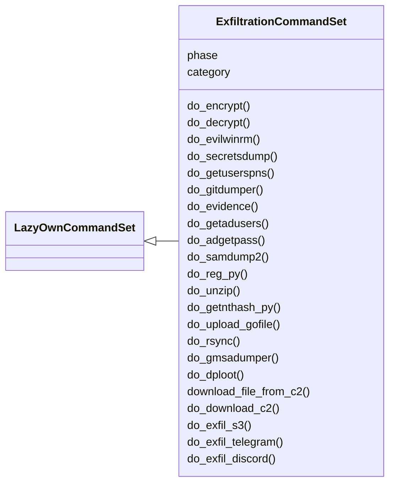
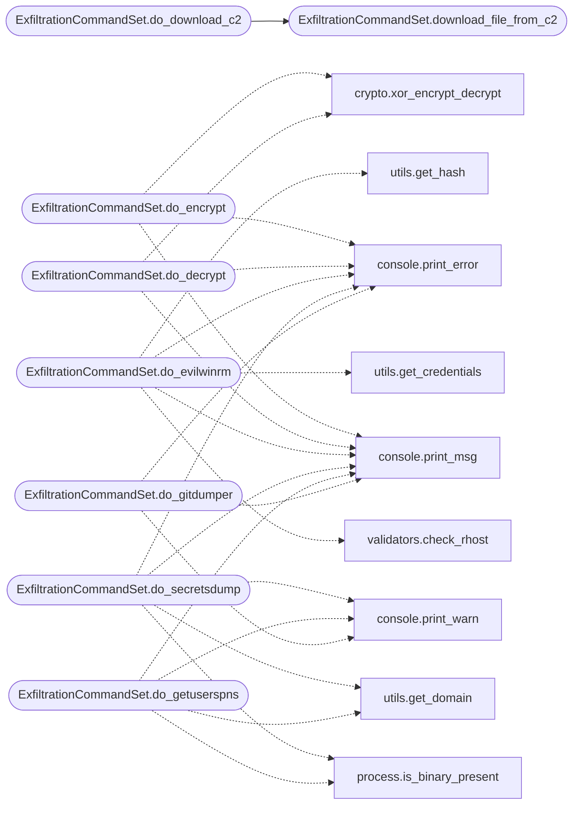

# `cli.commands.exfiltration`

> Source: [cli/commands/exfiltration.py:1](../../cli/commands/exfiltration.py#L1) | language `py` | coverage 100.0% | [API index](../index.md)

Data Exfiltration command set.

Covers data-out operations: XOR file encrypt/decrypt, Evil-WinRM
authentication, Active Directory dumpers (secretsdump, GetUserSPNs,
GetADUsers, gMSADumper, dploot, samdump2, reg.py, getnthash.py,
adgetpass), Git tree dumping, rsync deployment, infinitestorage video
evidence, Gofile uploads, cloud exfiltration (S3, GCS, Telegram,
Discord), DNS/ICMP covert channels, staged multi-channel exfil, and
the C2 implant download helpers.

## Contents

- **Classes:** [`ExfiltrationCommandSet`](#exfiltrationcommandset)

## Type Diagram



## Call Graph

Solid arrows stay in this module, dashed arrows leave it.



## Classes

<a id="exfiltrationcommandset"></a>

### `ExfiltrationCommandSet`

`class` | [cli/commands/exfiltration.py:327](../../cli/commands/exfiltration.py#L327)

```python
class ExfiltrationCommandSet(LazyOwnCommandSet)
```

Bases: [`LazyOwnCommandSet`](cli.commands._base.py.md#lazyowncommandset)

Pending phase module for the Data Exfiltration commands.

**Attributes**

| Name | Type | Default | Description |
|---|---|---|---|
| [`phase`](#exfiltrationcommandset-phase) |  | `'exfil'` |  |
| [`category`](#exfiltrationcommandset-category) |  | `exfiltration_category` |  |

**Members**

| Member | Kind | Summary |
|---|---|---|
| [`do_encrypt`](#exfiltrationcommandset-do_encrypt) | method | Encrypt a file with XOR using a caller-supplied key. |
| [`do_decrypt`](#exfiltrationcommandset-do_decrypt) | method | Decrypt an XOR-encrypted file using the matching key. |
| [`do_evilwinrm`](#exfiltrationcommandset-do_evilwinrm) | method | Drive Evil-WinRM through password, hash or kerberos-only auth. |
| [`do_secretsdump`](#exfiltrationcommandset-do_secretsdump) | method | Run impacket-secretsdump for SAM, credentials, or NTDS payloads. |
| [`do_getuserspns`](#exfiltrationcommandset-do_getuserspns) | method | Run impacket-GetUserSPNs to request roastable service tickets. |
| [`do_gitdumper`](#exfiltrationcommandset-do_gitdumper) | method | Install ``git-dumper`` if missing and pull a remote ``.git`` tree. |
| [`do_evidence`](#exfiltrationcommandset-do_evidence) | method | Encode the ``sessions/`` tree into a video file or decode one back. |
| [`do_getadusers`](#exfiltrationcommandset-do_getadusers) | method | Run impacket-GetADUsers to enumerate AD accounts on the DC. |
| [`do_adgetpass`](#exfiltrationcommandset-do_adgetpass) | method | Generate a PowerShell script to extract Azure AD Connect credentials. |
| [`do_samdump2`](#exfiltrationcommandset-do_samdump2) | method | Run samdump2 against ``sessions/SYSTEM`` and ``sessions/SAM``. |
| [`do_reg_py`](#exfiltrationcommandset-do_reg_py) | method | Query a remote registry hive with impacket-reg.py over hash auth. |
| [`do_unzip`](#exfiltrationcommandset-do_unzip) | method | Extract a zip archive located under ``sessions/``. |
| [`do_getnthash_py`](#exfiltrationcommandset-do_getnthash_py) | method | Recover the NT hash from a Kerberos U2U TGS via PKINITtools. |
| [`do_upload_gofile`](#exfiltrationcommandset-do_upload_gofile) | method | Upload a file from ``sessions/`` to Gofile via its HTTP API. |
| [`do_rsync`](#exfiltrationcommandset-do_rsync) | method | Push the ``sessions/`` tree to ``rhost`` over SCP with sshpass. |
| [`do_gmsadumper`](#exfiltrationcommandset-do_gmsadumper) | method | Run gMSADumper to read gMSA password blobs visible to the user. |
| [`do_dploot`](#exfiltrationcommandset-do_dploot) | method | Run dploot to loot DPAPI-protected secrets. |
| [`download_file_from_c2`](#exfiltrationcommandset-download_file_from_c2) | method | Download a file from the C2 implant upload queue. |
| [`do_download_c2`](#exfiltrationcommandset-do_download_c2) | method | Download a file from the C2 implant via the upload command. |
| [`do_exfil_s3`](#exfiltrationcommandset-do_exfil_s3) | method | Upload a file to an AWS S3 bucket. |
| [`do_exfil_telegram`](#exfiltrationcommandset-do_exfil_telegram) | method | Exfiltrate a file via Telegram Bot API. |
| [`do_exfil_discord`](#exfiltrationcommandset-do_exfil_discord) | method | Exfiltrate a file via Discord webhook. |
| [`do_exfil_gcs`](#exfiltrationcommandset-do_exfil_gcs) | method | Upload a file to Google Cloud Storage. |
| [`do_exfil_dns`](#exfiltrationcommandset-do_exfil_dns) | method | Exfiltrate data via DNS tunneling. |
| [`do_exfil_http`](#exfiltrationcommandset-do_exfil_http) | method | Exfiltrate a file via HTTP POST to a controlled server. |
| [`do_exfil_auto`](#exfiltrationcommandset-do_exfil_auto) | method | Auto-detect flags and sensitive files, then exfiltrate. |
| [`do_stage`](#exfiltrationcommandset-do_stage) | method | Stage data for exfiltration: compress, encrypt, and split. |

<a id="exfiltrationcommandset-do_encrypt"></a>

#### `ExfiltrationCommandSet.do_encrypt`

`method` | [cli/commands/exfiltration.py:334](../../cli/commands/exfiltration.py#L334)

Decorators: `@cmd2.with_category(exfiltration_category)`

```python
def do_encrypt(self, line)
```

Encrypt a file with XOR using a caller-supplied key.

**Parameters**

| Name | Type | Default | Description |
|---|---|---|---|
| `line` |  |  | Whitespace-separated ``<file_path> <key>``. Anything else triggers a usage error. |

**Returns:** None.

*Calls:* [`print_error`](core.console.py.md#print_error), [`print_msg`](core.console.py.md#print_msg), [`xor_encrypt_decrypt`](core.crypto.py.md#xor_encrypt_decrypt)

<a id="exfiltrationcommandset-do_decrypt"></a>

#### `ExfiltrationCommandSet.do_decrypt`

`method` | [cli/commands/exfiltration.py:361](../../cli/commands/exfiltration.py#L361)

Decorators: `@cmd2.with_category(exfiltration_category)`

```python
def do_decrypt(self, line)
```

Decrypt an XOR-encrypted file using the matching key.

**Parameters**

| Name | Type | Default | Description |
|---|---|---|---|
| `line` |  |  | Whitespace-separated ``<file_path> <key>``. Anything else triggers a usage error. The ``.enc`` suffix is stripped from the output filename when present. |

**Returns:** None.

*Calls:* [`print_error`](core.console.py.md#print_error), [`print_msg`](core.console.py.md#print_msg), [`xor_encrypt_decrypt`](core.crypto.py.md#xor_encrypt_decrypt)

<a id="exfiltrationcommandset-do_evilwinrm"></a>

#### `ExfiltrationCommandSet.do_evilwinrm`

`method` | [cli/commands/exfiltration.py:389](../../cli/commands/exfiltration.py#L389)

Decorators: `@cmd2.with_category(exfiltration_category)`

```python
def do_evilwinrm(self, line)
```

Drive Evil-WinRM through password, hash or kerberos-only auth.

Modes:
    `[`pass`](scripts.validate_agent_contract.sh.md#pass)` reuses entries from ``sessions/credentials*.txt``.
    ``hash`` reads ``sessions/hash.txt`` for an NT hash and
    prompts for a username (default ``Administrator``).
    ``nopass`` connects to ``<subdomain>.<domain>`` without
    credentials.

**Parameters**

| Name | Type | Default | Description |
|---|---|---|---|
| `line` |  |  | Sub-command starting with `[`pass`](scripts.validate_agent_contract.sh.md#pass)`, ``hash`` or ``nopass``, optionally followed by counter / PowerShell flags for `[`pass`](scripts.validate_agent_contract.sh.md#pass)`. |

**Returns:** None.

*Calls:* [`print_error`](core.console.py.md#print_error), [`print_msg`](core.console.py.md#print_msg), [`check_rhost`](core.validators.py.md#check_rhost), [`get_credentials`](utils.py.md#get_credentials), [`get_hash`](utils.py.md#get_hash)

<a id="exfiltrationcommandset-do_secretsdump"></a>

#### `ExfiltrationCommandSet.do_secretsdump`

`method` | [cli/commands/exfiltration.py:460](../../cli/commands/exfiltration.py#L460)

Decorators: `@cmd2.with_category(exfiltration_category)`

```python
def do_secretsdump(self, line)
```

Run impacket-secretsdump for SAM, credentials, or NTDS payloads.

Sub-commands:
    ``sam``     parses local ``sessions/SAM`` + ``sessions/SYSTEM``
    `[`creds`](cli.session_hud.py.md#hudsnapshot-creds)`   iterates ``sessions/credentials.txt`` pairs
    ``system``  parses live ``ntds.dit`` + registry hives

**Parameters**

| Name | Type | Default | Description |
|---|---|---|---|
| `line` |  |  | Sub-command from the list above. Empty input prints the usage error. |

**Returns:** None.

*Calls:* [`print_error`](core.console.py.md#print_error), [`print_msg`](core.console.py.md#print_msg), [`print_warn`](core.console.py.md#print_warn), [`is_binary_present`](core.process.py.md#is_binary_present), [`get_domain`](utils.py.md#get_domain)

<a id="exfiltrationcommandset-do_getuserspns"></a>

#### `ExfiltrationCommandSet.do_getuserspns`

`method` | [cli/commands/exfiltration.py:534](../../cli/commands/exfiltration.py#L534)

Decorators: `@cmd2.with_category(exfiltration_category)`

```python
def do_getuserspns(self, line)
```

Run impacket-GetUserSPNs to request roastable service tickets.

**Parameters**

| Name | Type | Default | Description |
|---|---|---|---|
| `line` |  |  | Optional username to use in place of the first entry from ``sessions/credentials.txt``. |

**Returns:** None.

*Calls:* [`print_msg`](core.console.py.md#print_msg), [`print_warn`](core.console.py.md#print_warn), [`is_binary_present`](core.process.py.md#is_binary_present), [`get_domain`](utils.py.md#get_domain)

<a id="exfiltrationcommandset-do_gitdumper"></a>

#### `ExfiltrationCommandSet.do_gitdumper`

`method` | [cli/commands/exfiltration.py:568](../../cli/commands/exfiltration.py#L568)

Decorators: `@cmd2.with_category(exfiltration_category)`

```python
def do_gitdumper(self, line)
```

Install ``git-dumper`` if missing and pull a remote ``.git`` tree.

**Parameters**

| Name | Type | Default | Description |
|---|---|---|---|
| `line` |  |  | Unused; an interactive prompt collects the repo URL. |

**Returns:** None.

*Calls:* [`print_error`](core.console.py.md#print_error), [`print_msg`](core.console.py.md#print_msg), [`print_warn`](core.console.py.md#print_warn), [`get_domain`](utils.py.md#get_domain), [`is_package_installed`](utils.py.md#is_package_installed)

<a id="exfiltrationcommandset-do_evidence"></a>

#### `ExfiltrationCommandSet.do_evidence`

`method` | [cli/commands/exfiltration.py:593](../../cli/commands/exfiltration.py#L593)

Decorators: `@cmd2.with_category(exfiltration_category)`

```python
def do_evidence(self, line='')
```

Encode the ``sessions/`` tree into a video file or decode one back.

Default invocation compresses ``sessions/`` to
``sessions.zip`` and renders ``sessions/encoded_output.avi`` via
the infinitestorage helper. Pass ``decode`` to pick a video and
recover its original payload.

**Parameters**

| Name | Type | Default | Description |
|---|---|---|---|
| `line` |  | `''` | ``decode`` to enter decode mode; anything else encodes. |

**Returns:** None.

*Calls:* [`print_error`](core.console.py.md#print_error), [`print_msg`](core.console.py.md#print_msg)

<a id="exfiltrationcommandset-do_getadusers"></a>

#### `ExfiltrationCommandSet.do_getadusers`

`method` | [cli/commands/exfiltration.py:673](../../cli/commands/exfiltration.py#L673)

Decorators: `@cmd2.with_category(exfiltration_category)`

```python
def do_getadusers(self, line)
```

Run impacket-GetADUsers to enumerate AD accounts on the DC.

When ``sessions/credentials.txt`` is present the helper iterates
each pair authenticated to ``rhost``. Otherwise it offers the
list of ``.txt`` files under ``sessions/`` so the operator can
select a username list and brute-force kerberos pre-auth.

**Parameters**

| Name | Type | Default | Description |
|---|---|---|---|
| `line` |  |  | Unused. |

**Returns:** None.

*Calls:* [`print_error`](core.console.py.md#print_error), [`print_msg`](core.console.py.md#print_msg), [`copy2clip`](utils.py.md#copy2clip), [`get_credentials`](utils.py.md#get_credentials)

<a id="exfiltrationcommandset-do_adgetpass"></a>

#### `ExfiltrationCommandSet.do_adgetpass`

`method` | [cli/commands/exfiltration.py:734](../../cli/commands/exfiltration.py#L734)

Decorators: `@cmd2.with_category(exfiltration_category)`

```python
def do_adgetpass(self, line)
```

Generate a PowerShell script to extract Azure AD Connect credentials.

Renders the standard ``mcrypt.dll`` key-manager script with
operator-provided GUIDs and SQL identifiers, writing it to
``sessions/adconnect.ps1`` for upload to the target.

**Parameters**

| Name | Type | Default | Description |
|---|---|---|---|
| `line` |  |  | Space-separated ``server database keyset_id instance_id entropy``. Each missing positional triggers an interactive prompt. |

**Returns:** None.

*Calls:* [`print_msg`](core.console.py.md#print_msg)

<a id="exfiltrationcommandset-do_samdump2"></a>

#### `ExfiltrationCommandSet.do_samdump2`

`method` | [cli/commands/exfiltration.py:799](../../cli/commands/exfiltration.py#L799)

Decorators: `@cmd2.with_category(exfiltration_category)`

```python
def do_samdump2(self, line)
```

Run samdump2 against ``sessions/SYSTEM`` and ``sessions/SAM``.

**Parameters**

| Name | Type | Default | Description |
|---|---|---|---|
| `line` |  |  | Unused. |

**Returns:** None.

*Calls:* [`print_error`](core.console.py.md#print_error), [`print_msg`](core.console.py.md#print_msg), [`print_warn`](core.console.py.md#print_warn), [`is_binary_present`](core.process.py.md#is_binary_present)

<a id="exfiltrationcommandset-do_reg_py"></a>

#### `ExfiltrationCommandSet.do_reg_py`

`method` | [cli/commands/exfiltration.py:824](../../cli/commands/exfiltration.py#L824)

Decorators: `@cmd2.with_category(exfiltration_category)`

```python
def do_reg_py(self, line)
```

Query a remote registry hive with impacket-reg.py over hash auth.

**Parameters**

| Name | Type | Default | Description |
|---|---|---|---|
| `line` |  |  | Unused. |

**Returns:** None.

*Calls:* [`print_msg`](core.console.py.md#print_msg), [`print_warn`](core.console.py.md#print_warn), [`is_binary_present`](core.process.py.md#is_binary_present), [`get_hash`](utils.py.md#get_hash)

<a id="exfiltrationcommandset-do_unzip"></a>

#### `ExfiltrationCommandSet.do_unzip`

`method` | [cli/commands/exfiltration.py:851](../../cli/commands/exfiltration.py#L851)

Decorators: `@cmd2.with_category(exfiltration_category)`

```python
def do_unzip(self, line)
```

Extract a zip archive located under ``sessions/``.

**Parameters**

| Name | Type | Default | Description |
|---|---|---|---|
| `line` |  |  | Optional zip filename. Empty input picks the first ``*.zip`` discovered via [`get_users_dic`](utils.py.md#get_users_dic). |

**Returns:** None.

*Calls:* [`print_error`](core.console.py.md#print_error), [`print_msg`](core.console.py.md#print_msg), [`get_users_dic`](utils.py.md#get_users_dic)

<a id="exfiltrationcommandset-do_getnthash_py"></a>

#### `ExfiltrationCommandSet.do_getnthash_py`

`method` | [cli/commands/exfiltration.py:873](../../cli/commands/exfiltration.py#L873)

Decorators: `@cmd2.with_category(exfiltration_category)`

```python
def do_getnthash_py(self, line)
```

Recover the NT hash from a Kerberos U2U TGS via PKINITtools.

**Parameters**

| Name | Type | Default | Description |
|---|---|---|---|
| `line` |  |  | Unused; the helper iterates ``sessions/credentials.txt``. |

**Returns:** None.

*Calls:* [`print_error`](core.console.py.md#print_error), [`print_msg`](core.console.py.md#print_msg), [`get_credentials`](utils.py.md#get_credentials)

<a id="exfiltrationcommandset-do_upload_gofile"></a>

#### `ExfiltrationCommandSet.do_upload_gofile`

`method` | [cli/commands/exfiltration.py:905](../../cli/commands/exfiltration.py#L905)

Decorators: `@cmd2.with_category(exfiltration_category)`

```python
def do_upload_gofile(self, line)
```

Upload a file from ``sessions/`` to Gofile via its HTTP API.

The helper enumerates non-excluded files under ``sessions/``, asks
the operator to pick one, posts it to ``store1.gofile.io``, and
prints the resulting metadata.

**Parameters**

| Name | Type | Default | Description |
|---|---|---|---|
| `line` |  |  | Unused. |

**Returns:** None.

*Calls:* [`print_error`](core.console.py.md#print_error), [`print_msg`](core.console.py.md#print_msg), [`print_warn`](core.console.py.md#print_warn)

<a id="exfiltrationcommandset-do_rsync"></a>

#### `ExfiltrationCommandSet.do_rsync`

`method` | [cli/commands/exfiltration.py:967](../../cli/commands/exfiltration.py#L967)

Decorators: `@cmd2.with_category(exfiltration_category)`

```python
def do_rsync(self, line)
```

Push the ``sessions/`` tree to ``rhost`` over SCP with sshpass.

**Parameters**

| Name | Type | Default | Description |
|---|---|---|---|
| `line` |  |  | Optional alternate source path; defaults to ``<self.path>/sessions``. |

**Returns:** None.

*Calls:* [`print_msg`](core.console.py.md#print_msg), [`set_sshpass_env`](core.hardening.py.md#set_sshpass_env), [`get_users_dic`](utils.py.md#get_users_dic)

<a id="exfiltrationcommandset-do_gmsadumper"></a>

#### `ExfiltrationCommandSet.do_gmsadumper`

`method` | [cli/commands/exfiltration.py:1004](../../cli/commands/exfiltration.py#L1004)

Decorators: `@cmd2.with_category(exfiltration_category)`

```python
def do_gmsadumper(self, line)
```

Run gMSADumper to read gMSA password blobs visible to the user.

**Parameters**

| Name | Type | Default | Description |
|---|---|---|---|
| `line` |  |  | Unused. |

**Returns:** None.

*Calls:* [`print_error`](core.console.py.md#print_error), [`print_msg`](core.console.py.md#print_msg), [`get_users_dic`](utils.py.md#get_users_dic)

<a id="exfiltrationcommandset-do_dploot"></a>

#### `ExfiltrationCommandSet.do_dploot`

`method` | [cli/commands/exfiltration.py:1043](../../cli/commands/exfiltration.py#L1043)

Decorators: `@cmd2.with_category(exfiltration_category)`

```python
def do_dploot(self, line)
```

Run dploot to loot DPAPI-protected secrets.

Actions: ``backupkey``, ``blob``, ``browser``, ``certificates``,
``credentials``, ``machinecertificates``, ``machinecredentials``,
``machinemasterkeys``, ``machinevaults``, ``masterkeys``,
``mobaxterm``, ``rdg``, ``sccm``, ``vaults``, ``wam``, ``wifi``.

**Parameters**

| Name | Type | Default | Description |
|---|---|---|---|
| `line` |  |  | First token is the action; missing input prompts for it. |

**Returns:** None.

*Calls:* [`print_error`](core.console.py.md#print_error), [`print_msg`](core.console.py.md#print_msg), [`get_users_dic`](utils.py.md#get_users_dic)

<a id="exfiltrationcommandset-download_file_from_c2"></a>

#### `ExfiltrationCommandSet.download_file_from_c2`

`method` | [cli/commands/exfiltration.py:1125](../../cli/commands/exfiltration.py#L1125)

Decorators: `@cmd2.with_category(exfiltration_category)`

```python
def download_file_from_c2(self, file_name, clientid='')
```

Download a file from the C2 implant upload queue.

Posts an ``upload:<file_name>`` command to the implant identified
by ``clientid`` and writes the response body under
``sessions/temp_uploads/<file_name>``.

**Parameters**

| Name | Type | Default | Description |
|---|---|---|---|
| `file_name` |  |  | Remote filename relative to the implant's working directory. |
| `clientid` |  | `''` | Implant identifier. Empty input prompts the operator with the current ``c2_clientid`` as default. |

**Returns:** None.

*Calls:* [`print_error`](core.console.py.md#print_error), [`print_msg`](core.console.py.md#print_msg)

*Called by:* [`ExfiltrationCommandSet.do_download_c2`](#exfiltrationcommandset-do_download_c2)

<a id="exfiltrationcommandset-do_download_c2"></a>

#### `ExfiltrationCommandSet.do_download_c2`

`method` | [cli/commands/exfiltration.py:1164](../../cli/commands/exfiltration.py#L1164)

Decorators: `@cmd2.with_category(exfiltration_category)`

```python
def do_download_c2(self, line)
```

Download a file from the C2 implant via the upload command.

**Parameters**

| Name | Type | Default | Description |
|---|---|---|---|
| `line` |  |  | Remote path of the file to download. An empty input returns an error matching the live `[`LazyOwnShell`](lazyown.py.md#lazyownshell)` behaviour. |

**Returns:** None.

*Calls:* [`ExfiltrationCommandSet.download_file_from_c2`](#exfiltrationcommandset-download_file_from_c2), [`print_error`](core.console.py.md#print_error)

<a id="exfiltrationcommandset-do_exfil_s3"></a>

#### `ExfiltrationCommandSet.do_exfil_s3`

`method` | [cli/commands/exfiltration.py:1181](../../cli/commands/exfiltration.py#L1181)

Decorators: `@cmd2.with_category(exfiltration_category)`

```python
def do_exfil_s3(self, line)
```

Upload a file to an AWS S3 bucket.

Usage: exfil_s3 <file_path> --bucket <name> --key <access_key> --secret <secret_key> [--region <region>] [--prefix <prefix>]

Requires boto3 to be installed. Falls back to a presigned-URL
approach using requests when boto3 is not available.

**Parameters**

| Name | Type | Default | Description |
|---|---|---|---|
| `line` |  |  |  |

*Calls:* [`print_error`](core.console.py.md#print_error), [`print_msg`](core.console.py.md#print_msg), [`print_warn`](core.console.py.md#print_warn)

<a id="exfiltrationcommandset-do_exfil_telegram"></a>

#### `ExfiltrationCommandSet.do_exfil_telegram`

`method` | [cli/commands/exfiltration.py:1226](../../cli/commands/exfiltration.py#L1226)

Decorators: `@cmd2.with_category(exfiltration_category)`

```python
def do_exfil_telegram(self, line)
```

Exfiltrate a file via Telegram Bot API.

Usage: exfil_telegram <file_path> --token <bot_token> --chat <chat_id>

The file is sent as a document to the specified Telegram chat.
Files larger than 50MB are automatically split into chunks.

**Parameters**

| Name | Type | Default | Description |
|---|---|---|---|
| `line` |  |  |  |

*Calls:* [`print_error`](core.console.py.md#print_error), [`print_msg`](core.console.py.md#print_msg)

<a id="exfiltrationcommandset-do_exfil_discord"></a>

#### `ExfiltrationCommandSet.do_exfil_discord`

`method` | [cli/commands/exfiltration.py:1271](../../cli/commands/exfiltration.py#L1271)

Decorators: `@cmd2.with_category(exfiltration_category)`

```python
def do_exfil_discord(self, line)
```

Exfiltrate a file via Discord webhook.

Usage: exfil_discord <file_path> --webhook <webhook_url>

Files larger than 25MB are automatically split into chunks.

**Parameters**

| Name | Type | Default | Description |
|---|---|---|---|
| `line` |  |  |  |

*Calls:* [`print_error`](core.console.py.md#print_error), [`print_msg`](core.console.py.md#print_msg)

<a id="exfiltrationcommandset-do_exfil_gcs"></a>

#### `ExfiltrationCommandSet.do_exfil_gcs`

`method` | [cli/commands/exfiltration.py:1314](../../cli/commands/exfiltration.py#L1314)

Decorators: `@cmd2.with_category(exfiltration_category)`

```python
def do_exfil_gcs(self, line)
```

Upload a file to Google Cloud Storage.

Usage: exfil_gcs <file_path> --bucket <name> --key <access_key_json_path>

The --key flag expects the path to a GCP service account JSON file.

**Parameters**

| Name | Type | Default | Description |
|---|---|---|---|
| `line` |  |  |  |

*Calls:* [`print_error`](core.console.py.md#print_error), [`print_msg`](core.console.py.md#print_msg)

<a id="exfiltrationcommandset-do_exfil_dns"></a>

#### `ExfiltrationCommandSet.do_exfil_dns`

`method` | [cli/commands/exfiltration.py:1356](../../cli/commands/exfiltration.py#L1356)

Decorators: `@cmd2.with_category(exfiltration_category)`

```python
def do_exfil_dns(self, line)
```

Exfiltrate data via DNS tunneling.

Usage: exfil_dns <file_path> --domain <dns_domain> [--server <dns_server>]

Encodes file content as Base32 hex and sends via DNS A-record queries.
Requires a cooperating DNS server that logs queries.

**Parameters**

| Name | Type | Default | Description |
|---|---|---|---|
| `line` |  |  |  |

*Calls:* [`print_error`](core.console.py.md#print_error), [`print_msg`](core.console.py.md#print_msg), [`print_warn`](core.console.py.md#print_warn)

<a id="exfiltrationcommandset-do_exfil_http"></a>

#### `ExfiltrationCommandSet.do_exfil_http`

`method` | [cli/commands/exfiltration.py:1415](../../cli/commands/exfiltration.py#L1415)

Decorators: `@cmd2.with_category(exfiltration_category)`

```python
def do_exfil_http(self, line)
```

Exfiltrate a file via HTTP POST to a controlled server.

Usage: exfil_http <file_path> --url <upload_url> [--param <field_name>] [--chunked] [--ssl false]

Posts the file as multipart form data. With --chunked, splits and
sends in chunks with sequence headers for reassembly.

**Parameters**

| Name | Type | Default | Description |
|---|---|---|---|
| `line` |  |  |  |

*Calls:* [`print_error`](core.console.py.md#print_error), [`print_msg`](core.console.py.md#print_msg)

<a id="exfiltrationcommandset-do_exfil_auto"></a>

#### `ExfiltrationCommandSet.do_exfil_auto`

`method` | [cli/commands/exfiltration.py:1485](../../cli/commands/exfiltration.py#L1485)

Decorators: `@cmd2.with_category(exfiltration_category)`

```python
def do_exfil_auto(self, line)
```

Auto-detect flags and sensitive files, then exfiltrate.

Usage: exfil_auto --method <telegram|discord|s3|gcs|http|gofile> [method flags...]

Scans common flag locations (root.txt, user.txt, /home/*/user.txt,
/root/root.txt, C:\Users\*\Desktop\*.txt) and exfiltrates them.
Supports all exfil_* --flags for the selected method.

**Parameters**

| Name | Type | Default | Description |
|---|---|---|---|
| `line` |  |  |  |

*Calls:* [`print_error`](core.console.py.md#print_error), [`print_msg`](core.console.py.md#print_msg), [`print_warn`](core.console.py.md#print_warn)

<a id="exfiltrationcommandset-do_stage"></a>

#### `ExfiltrationCommandSet.do_stage`

`method` | [cli/commands/exfiltration.py:1543](../../cli/commands/exfiltration.py#L1543)

Decorators: `@cmd2.with_category(exfiltration_category)`

```python
def do_stage(self, line)
```

Stage data for exfiltration: compress, encrypt, and split.

Usage: stage <file_or_directory> [--encrypt <key>] [--split <size_mb>] [--output <dir>]

Creates a staged package: gzip compress -> optional XOR encrypt -> split into chunks.
Outputs a manifest.json with reassembly instructions.

**Parameters**

| Name | Type | Default | Description |
|---|---|---|---|
| `line` |  |  |  |

*Calls:* [`print_error`](core.console.py.md#print_error), [`print_msg`](core.console.py.md#print_msg), [`xor_encrypt_decrypt`](core.crypto.py.md#xor_encrypt_decrypt)

---
