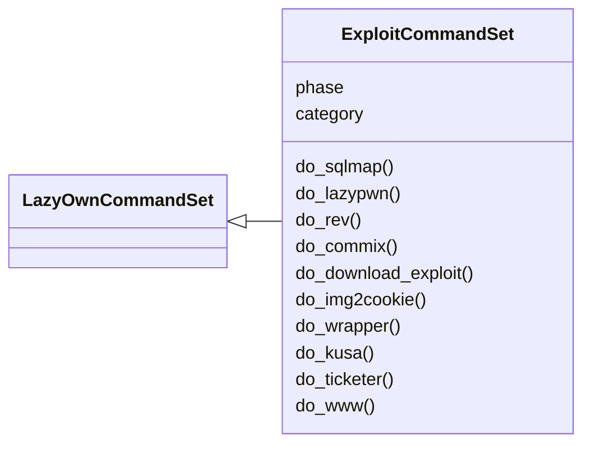
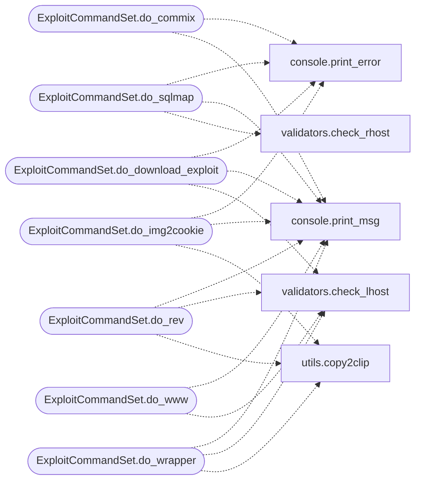

# `cli.commands.exploit`

> Source: [cli/commands/exploit.py:1](../../cli/commands/exploit.py#L1) | language `py` | coverage 100.0% | [API index](../index.md)

Exploitation command set (pending activation).

Commands migrated from ``lazyown.py`` that belong to the exploitation
phase (category ``03. Exploitation``). Inherits from
[`PendingCommandSet`](cli.commands._dormancy.py.md#pendingcommandset) because the originals still live in
``lazyown.py``. Once the originals are deleted, switch the base to
[`LazyOwnCommandSet`](cli.commands._base.py.md#lazyowncommandset).

## Contents

- **Classes:** [`ExploitCommandSet`](#exploitcommandset)

## Type Diagram



## Call Graph

Solid arrows stay in this module, dashed arrows leave it.



## Classes

<a id="exploitcommandset"></a>

### `ExploitCommandSet`

`class` | [cli/commands/exploit.py:29](../../cli/commands/exploit.py#L29)

```python
class ExploitCommandSet(LazyOwnCommandSet)
```

Bases: [`LazyOwnCommandSet`](cli.commands._base.py.md#lazyowncommandset)

Exploitation phase commands.

Status: pending — originals still in ``lazyown.py``.

**Attributes**

| Name | Type | Default | Description |
|---|---|---|---|
| [`phase`](#exploitcommandset-phase) |  | `'exploit'` |  |
| [`category`](#exploitcommandset-category) |  | `'03. Exploitation'` |  |

**Members**

| Member | Kind | Summary |
|---|---|---|
| [`do_sqlmap`](#exploitcommandset-do_sqlmap) | method | Runs SQLMap against the target URL for SQL injection testing. |
| [`do_lazypwn`](#exploitcommandset-do_lazypwn) | method | Executes the LazyPwn automated exploitation script. |
| [`do_rev`](#exploitcommandset-do_rev) | method | Copies a reverse shell one-liner to the clipboard. |
| [`do_commix`](#exploitcommandset-do_commix) | method | Runs commix for command injection testing. |
| [`do_download_exploit`](#exploitcommandset-do_download_exploit) | method | Downloads and sets up an exploit, optionally serving via HTTP. |
| [`do_img2cookie`](#exploitcommandset-do_img2cookie) | method | Generates an XSS payload that steals cookies via an image tag. |
| [`do_wrapper`](#exploitcommandset-do_wrapper) | method | Copies LFI php-wrapper payloads to the clipboard. |
| [`do_kusa`](#exploitcommandset-do_kusa) | method | Runs the Kusanagi payload generator. |
| [`do_ticketer`](#exploitcommandset-do_ticketer) | method | Runs Impacket ticketer for golden/silver ticket creation. |
| [`do_www`](#exploitcommandset-do_www) | method | Starts a simple HTTP server on the configured port to serve payloads. |

<a id="exploitcommandset-do_sqlmap"></a>

#### `ExploitCommandSet.do_sqlmap`

`method` | [cli/commands/exploit.py:39](../../cli/commands/exploit.py#L39)

Decorators: `@cmd2.with_category(exploitation_category)`

```python
def do_sqlmap(self, line)
```

Runs SQLMap against the target URL for SQL injection testing.

Usage:
    sqlmap

**Parameters**

| Name | Type | Default | Description |
|---|---|---|---|
| `line` |  |  | Optional extra arguments for sqlmap. |

**Returns:** None

*Calls:* [`print_error`](core.console.py.md#print_error), [`print_msg`](core.console.py.md#print_msg), [`check_rhost`](core.validators.py.md#check_rhost)

<a id="exploitcommandset-do_lazypwn"></a>

#### `ExploitCommandSet.do_lazypwn`

`method` | [cli/commands/exploit.py:64](../../cli/commands/exploit.py#L64)

Decorators: `@cmd2.with_category(exploitation_category)`

```python
def do_lazypwn(self, line)
```

Executes the LazyPwn automated exploitation script.

**Parameters**

| Name | Type | Default | Description |
|---|---|---|---|
| `line` |  |  |  |

<a id="exploitcommandset-do_rev"></a>

#### `ExploitCommandSet.do_rev`

`method` | [cli/commands/exploit.py:69](../../cli/commands/exploit.py#L69)

Decorators: `@cmd2.with_category(exploitation_category)`

```python
def do_rev(self, line)
```

Copies a reverse shell one-liner to the clipboard.

Uses the lhost and lport from the payload configuration.

**Parameters**

| Name | Type | Default | Description |
|---|---|---|---|
| `line` |  |  |  |

**Returns:** None

*Calls:* [`print_msg`](core.console.py.md#print_msg), [`check_lhost`](core.validators.py.md#check_lhost), [`copy2clip`](utils.py.md#copy2clip)

<a id="exploitcommandset-do_commix"></a>

#### `ExploitCommandSet.do_commix`

`method` | [cli/commands/exploit.py:86](../../cli/commands/exploit.py#L86)

Decorators: `@cmd2.with_category(exploitation_category)`

```python
def do_commix(self, line)
```

Runs commix for command injection testing.

**Parameters**

| Name | Type | Default | Description |
|---|---|---|---|
| `line` |  |  | Target URL or extra arguments. |

**Returns:** None

*Calls:* [`print_error`](core.console.py.md#print_error), [`print_msg`](core.console.py.md#print_msg)

<a id="exploitcommandset-do_download_exploit"></a>

#### `ExploitCommandSet.do_download_exploit`

`method` | [cli/commands/exploit.py:105](../../cli/commands/exploit.py#L105)

Decorators: `@cmd2.with_category(exploitation_category)`

```python
def do_download_exploit(self, line)
```

Downloads and sets up an exploit, optionally serving via HTTP.

**Parameters**

| Name | Type | Default | Description |
|---|---|---|---|
| `line` |  |  | Exploit search term or download URL. |

**Returns:** None

*Calls:* [`print_error`](core.console.py.md#print_error), [`print_msg`](core.console.py.md#print_msg), [`check_lhost`](core.validators.py.md#check_lhost)

<a id="exploitcommandset-do_img2cookie"></a>

#### `ExploitCommandSet.do_img2cookie`

`method` | [cli/commands/exploit.py:126](../../cli/commands/exploit.py#L126)

Decorators: `@cmd2.with_category(exploitation_category)`

```python
def do_img2cookie(self, line)
```

Generates an XSS payload that steals cookies via an image tag.

**Parameters**

| Name | Type | Default | Description |
|---|---|---|---|
| `line` |  |  | URL for the cookie-stealing endpoint. |

**Returns:** None

*Calls:* [`print_error`](core.console.py.md#print_error), [`print_msg`](core.console.py.md#print_msg), [`copy2clip`](utils.py.md#copy2clip)

<a id="exploitcommandset-do_wrapper"></a>

#### `ExploitCommandSet.do_wrapper`

`method` | [cli/commands/exploit.py:150](../../cli/commands/exploit.py#L150)

Decorators: `@cmd2.with_category(exploitation_category)`

```python
def do_wrapper(self, line)
```

Copies LFI php-wrapper payloads to the clipboard.

**Parameters**

| Name | Type | Default | Description |
|---|---|---|---|
| `line` |  |  | Optional custom arguments. |

**Returns:** None

*Calls:* [`print_msg`](core.console.py.md#print_msg), [`check_lhost`](core.validators.py.md#check_lhost), [`copy2clip`](utils.py.md#copy2clip)

<a id="exploitcommandset-do_kusa"></a>

#### `ExploitCommandSet.do_kusa`

`method` | [cli/commands/exploit.py:168](../../cli/commands/exploit.py#L168)

Decorators: `@cmd2.with_category(exploitation_category)`

```python
def do_kusa(self, line)
```

Runs the Kusanagi payload generator.

**Parameters**

| Name | Type | Default | Description |
|---|---|---|---|
| `line` |  |  | Arguments to pass to kusanagi. |

**Returns:** None

<a id="exploitcommandset-do_ticketer"></a>

#### `ExploitCommandSet.do_ticketer`

`method` | [cli/commands/exploit.py:178](../../cli/commands/exploit.py#L178)

Decorators: `@cmd2.with_category(exploitation_category)`

```python
def do_ticketer(self, line)
```

Runs Impacket ticketer for golden/silver ticket creation.

**Parameters**

| Name | Type | Default | Description |
|---|---|---|---|
| `line` |  |  | Arguments to pass to ticketer. |

**Returns:** None

<a id="exploitcommandset-do_www"></a>

#### `ExploitCommandSet.do_www`

`method` | [cli/commands/exploit.py:192](../../cli/commands/exploit.py#L192)

Decorators: `@cmd2.with_category(exploitation_category)`

```python
def do_www(self, line)
```

Starts a simple HTTP server on the configured port to serve payloads.

**Parameters**

| Name | Type | Default | Description |
|---|---|---|---|
| `line` |  |  | Optional custom port. |

**Returns:** None

*Calls:* [`print_msg`](core.console.py.md#print_msg), [`check_lhost`](core.validators.py.md#check_lhost)

---
