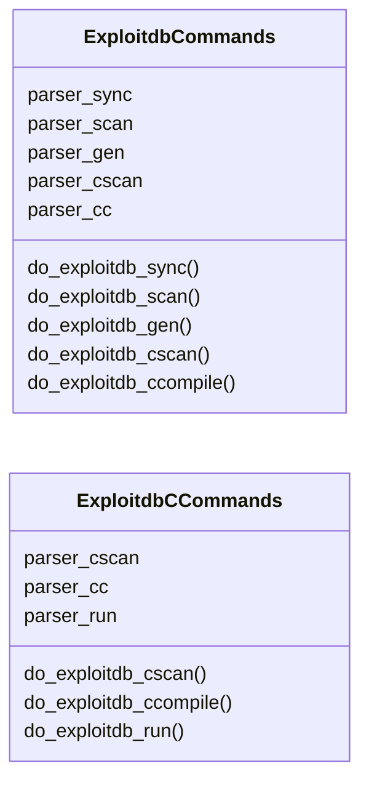
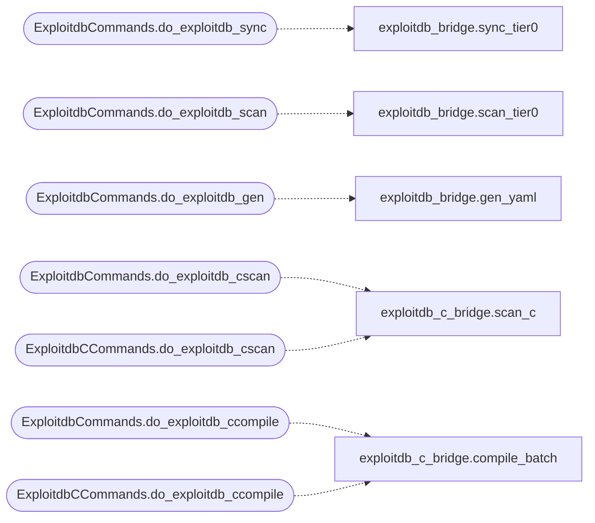

# `cli.commands.exploitdb`

> Source: [cli/commands/exploitdb.py:1](../../cli/commands/exploitdb.py#L1) | language `py` | coverage 0.0% | [API index](../index.md)

## Contents

- **Classes:** [`ExploitdbCommands`](#exploitdbcommands), [`ExploitdbCCommands`](#exploitdbccommands)

## Type Diagram



## Call Graph

Solid arrows stay in this module, dashed arrows leave it.



## Classes

<a id="exploitdbcommands"></a>

### `ExploitdbCommands`

`class` | [cli/commands/exploitdb.py:14](../../cli/commands/exploitdb.py#L14)

Decorators: `@with_category('ExploitDB')`

```python
class ExploitdbCommands
```

**Attributes**

| Name | Type | Default | Description |
|---|---|---|---|
| [`parser_sync`](#exploitdbcommands-parser_sync) |  | `argparse.ArgumentParser(description='Sync Tier0 exploits from ExploitDB (scripts, no compile)')` |  |
| [`parser_scan`](#exploitdbcommands-parser_scan) |  | `argparse.ArgumentParser(description='Scan Tier0 candidates')` |  |
| [`parser_gen`](#exploitdbcommands-parser_gen) |  | `argparse.ArgumentParser(description='Generate YAML for a single EDB id')` |  |
| [`parser_cscan`](#exploitdbcommands-parser_cscan) |  | `argparse.ArgumentParser(description='Scan ExploitDB C remote/webapps')` |  |
| [`parser_cc`](#exploitdbcommands-parser_cc) |  | `argparse.ArgumentParser(description='Compile batch of C exploits')` |  |

**Members**

| Member | Kind | Summary |
|---|---|---|
| [`do_exploitdb_sync`](#exploitdbcommands-do_exploitdb_sync) | method |  |
| [`do_exploitdb_scan`](#exploitdbcommands-do_exploitdb_scan) | method |  |
| [`do_exploitdb_gen`](#exploitdbcommands-do_exploitdb_gen) | method |  |
| [`do_exploitdb_cscan`](#exploitdbcommands-do_exploitdb_cscan) | method |  |
| [`do_exploitdb_ccompile`](#exploitdbcommands-do_exploitdb_ccompile) | method |  |

<a id="exploitdbcommands-do_exploitdb_sync"></a>

#### `ExploitdbCommands.do_exploitdb_sync`

`method` | [cli/commands/exploitdb.py:22](../../cli/commands/exploitdb.py#L22)

Decorators: `@with_argparser(parser_sync)`

```python
def do_exploitdb_sync(self, args)
```

**Parameters**

| Name | Type | Default | Description |
|---|---|---|---|
| `args` |  |  |  |

*Calls:* [`sync_tier0`](modules.exploitdb_bridge.py.md#sync_tier0)

<a id="exploitdbcommands-do_exploitdb_scan"></a>

#### `ExploitdbCommands.do_exploitdb_scan`

`method` | [cli/commands/exploitdb.py:36](../../cli/commands/exploitdb.py#L36)

Decorators: `@with_argparser(parser_scan)`

```python
def do_exploitdb_scan(self, args)
```

**Parameters**

| Name | Type | Default | Description |
|---|---|---|---|
| `args` |  |  |  |

*Calls:* [`scan_tier0`](modules.exploitdb_bridge.py.md#scan_tier0)

<a id="exploitdbcommands-do_exploitdb_gen"></a>

#### `ExploitdbCommands.do_exploitdb_gen`

`method` | [cli/commands/exploitdb.py:48](../../cli/commands/exploitdb.py#L48)

Decorators: `@with_argparser(parser_gen)`

```python
def do_exploitdb_gen(self, args)
```

**Parameters**

| Name | Type | Default | Description |
|---|---|---|---|
| `args` |  |  |  |

*Calls:* [`gen_yaml`](modules.exploitdb_bridge.py.md#gen_yaml)

<a id="exploitdbcommands-do_exploitdb_cscan"></a>

#### `ExploitdbCommands.do_exploitdb_cscan`

`method` | [cli/commands/exploitdb.py:79](../../cli/commands/exploitdb.py#L79)

Decorators: `@with_argparser(parser_cscan)`

```python
def do_exploitdb_cscan(self, args)
```

**Parameters**

| Name | Type | Default | Description |
|---|---|---|---|
| `args` |  |  |  |

*Calls:* [`scan_c`](modules.exploitdb_c_bridge.py.md#scan_c)

<a id="exploitdbcommands-do_exploitdb_ccompile"></a>

#### `ExploitdbCommands.do_exploitdb_ccompile`

`method` | [cli/commands/exploitdb.py:91](../../cli/commands/exploitdb.py#L91)

Decorators: `@with_argparser(parser_cc)`

```python
def do_exploitdb_ccompile(self, args)
```

**Parameters**

| Name | Type | Default | Description |
|---|---|---|---|
| `args` |  |  |  |

*Calls:* [`compile_batch`](modules.exploitdb_c_bridge.py.md#compile_batch)

---

<a id="exploitdbccommands"></a>

### `ExploitdbCCommands`

`class` | [cli/commands/exploitdb.py:100](../../cli/commands/exploitdb.py#L100)

```python
class ExploitdbCCommands
```

**Attributes**

| Name | Type | Default | Description |
|---|---|---|---|
| [`parser_cscan`](#exploitdbccommands-parser_cscan) |  | `argparse.ArgumentParser(description='Scan ExploitDB C remote/webapps')` |  |
| [`parser_cc`](#exploitdbccommands-parser_cc) |  | `argparse.ArgumentParser(description='Compile batch of C exploits')` |  |
| [`parser_run`](#exploitdbccommands-parser_run) |  | `argparse.ArgumentParser(description='Run exploit via atomic_exploit bridge')` |  |

**Members**

| Member | Kind | Summary |
|---|---|---|
| [`do_exploitdb_cscan`](#exploitdbccommands-do_exploitdb_cscan) | method |  |
| [`do_exploitdb_ccompile`](#exploitdbccommands-do_exploitdb_ccompile) | method |  |
| [`do_exploitdb_run`](#exploitdbccommands-do_exploitdb_run) | method |  |

<a id="exploitdbccommands-do_exploitdb_cscan"></a>

#### `ExploitdbCCommands.do_exploitdb_cscan`

`method` | [cli/commands/exploitdb.py:105](../../cli/commands/exploitdb.py#L105)

Decorators: `@with_argparser(parser_cscan)`

```python
def do_exploitdb_cscan(self, args)
```

**Parameters**

| Name | Type | Default | Description |
|---|---|---|---|
| `args` |  |  |  |

*Calls:* [`scan_c`](modules.exploitdb_c_bridge.py.md#scan_c)

<a id="exploitdbccommands-do_exploitdb_ccompile"></a>

#### `ExploitdbCCommands.do_exploitdb_ccompile`

`method` | [cli/commands/exploitdb.py:117](../../cli/commands/exploitdb.py#L117)

Decorators: `@with_argparser(parser_cc)`

```python
def do_exploitdb_ccompile(self, args)
```

**Parameters**

| Name | Type | Default | Description |
|---|---|---|---|
| `args` |  |  |  |

*Calls:* [`compile_batch`](modules.exploitdb_c_bridge.py.md#compile_batch)

<a id="exploitdbccommands-do_exploitdb_run"></a>

#### `ExploitdbCCommands.do_exploitdb_run`

`method` | [cli/commands/exploitdb.py:131](../../cli/commands/exploitdb.py#L131)

Decorators: `@with_argparser(parser_run)`

```python
def do_exploitdb_run(self, args)
```

**Parameters**

| Name | Type | Default | Description |
|---|---|---|---|
| `args` |  |  |  |

---
