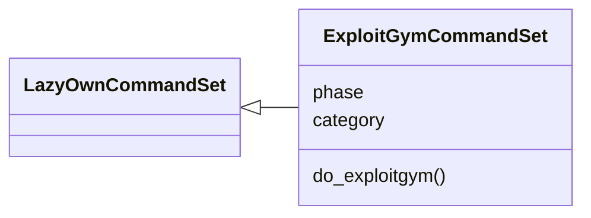
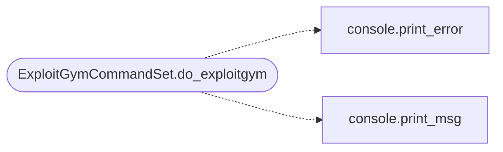

# `cli.commands.exploitgym`

> Source: [cli/commands/exploitgym.py:1](../../cli/commands/exploitgym.py#L1) | language `py` | coverage 100.0% | [API index](../index.md)

ExploitGym CLI command set — real-world exploit benchmark harness.

Wraps the sunblaze-ucb/exploitgym benchmark (userspace, V8, Linux kernel
tasks) behind LazyOwn. The wrapper is adaptive: it detects whether the
ExploitGym harness is installed and ready, guides setup when it is not, and
reuses the Red Team Gym ELO/leaderboard pipeline for scored results.

The harness is dual-use and MUST be run only against ExploitGym's own
containerised, network-isolated task environments.

## Contents

- **Classes:** [`ExploitGymCommandSet`](#exploitgymcommandset)

## Type Diagram



## Call Graph

Solid arrows stay in this module, dashed arrows leave it.



## Classes

<a id="exploitgymcommandset"></a>

### `ExploitGymCommandSet`

`class` | [cli/commands/exploitgym.py:36](../../cli/commands/exploitgym.py#L36)

```python
class ExploitGymCommandSet(LazyOwnCommandSet)
```

Bases: [`LazyOwnCommandSet`](cli.commands._base.py.md#lazyowncommandset)

ExploitGym — realistic vulnerability-to-exploit benchmark tasks.

**Attributes**

| Name | Type | Default | Description |
|---|---|---|---|
| [`phase`](#exploitgymcommandset-phase) |  | `'exploit'` |  |
| [`category`](#exploitgymcommandset-category) |  | `miscellaneous_category` |  |

**Members**

| Member | Kind | Summary |
|---|---|---|
| [`do_exploitgym`](#exploitgymcommandset-do_exploitgym) | method | ExploitGym — real-world exploit benchmark via containerised tasks. |

<a id="exploitgymcommandset-do_exploitgym"></a>

#### `ExploitGymCommandSet.do_exploitgym`

`method` | [cli/commands/exploitgym.py:43](../../cli/commands/exploitgym.py#L43)

Decorators: `@cmd2.with_category(miscellaneous_category)`

```python
def do_exploitgym(self, line)
```

ExploitGym — real-world exploit benchmark via containerised tasks.

Usage:
    exploitgym status                 — check harness readiness
    exploitgym setup [step ...]       — automate install (clone/deps/data/validate/squid/images)
    exploitgym list [domain] [--limit N]
    exploitgym pull <task_id>         — pull the task Docker image
    exploitgym run <task_id> [--model M] [--no-mitigations]
    exploitgym verify <task_id>       — check a captured flag on record
    exploitgym score <task_id> [--failed] [--techniques t1,t2]
    exploitgym docs                   — open the evaluation docs

Domain filter: userspace | v8 | kernel.

**Parameters**

| Name | Type | Default | Description |
|---|---|---|---|
| `line` |  |  |  |

**Example**

```python
exploitgym status
exploitgym list kernel --limit 5
exploitgym pull cve-2021-XXXX
exploitgym run cve-2021-XXXX --model claude --no-mitigations
exploitgym score cve-2021-XXXX
```

*Calls:* [`print_error`](core.console.py.md#print_error), [`print_msg`](core.console.py.md#print_msg)

---
