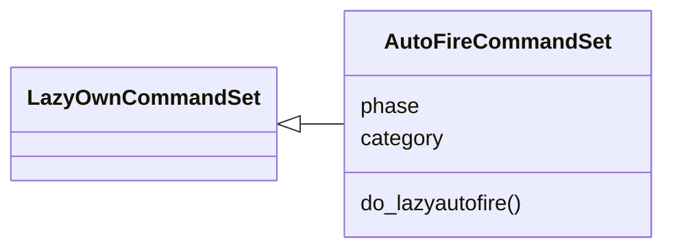
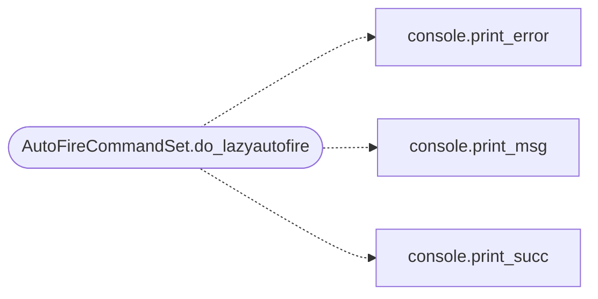

# `cli.commands.exposure_autofire`

> Source: [cli/commands/exposure_autofire.py:1](../../cli/commands/exposure_autofire.py#L1) | language `py` | coverage 100.0% | [API index](../index.md)

Autofire command set: intelligence closing the loop into chains.

## Contents

- **Classes:** [`AutoFireCommandSet`](#autofirecommandset)

## Type Diagram



## Call Graph

Solid arrows stay in this module, dashed arrows leave it.



## Classes

<a id="autofirecommandset"></a>

### `AutoFireCommandSet`

`class` | [cli/commands/exposure_autofire.py:13](../../cli/commands/exposure_autofire.py#L13)

```python
class AutoFireCommandSet(LazyOwnCommandSet)
```

Bases: [`LazyOwnCommandSet`](cli.commands._base.py.md#lazyowncommandset)

Exposure fire-tier matches into confirmation chains.

**Attributes**

| Name | Type | Default | Description |
|---|---|---|---|
| [`phase`](#autofirecommandset-phase) |  | `'recon'` |  |
| [`category`](#autofirecommandset-category) |  | `miscellaneous_category` |  |

**Members**

| Member | Kind | Summary |
|---|---|---|
| [`do_lazyautofire`](#autofirecommandset-do_lazyautofire) | method | Turn fire exposure into read-only confirmation chains. |

<a id="autofirecommandset-do_lazyautofire"></a>

#### `AutoFireCommandSet.do_lazyautofire`

`method` | [cli/commands/exposure_autofire.py:20](../../cli/commands/exposure_autofire.py#L20)

Decorators: `@cmd2.with_category(miscellaneous_category)`

```python
def do_lazyautofire(self, line: str) -> None
```

Turn fire exposure into read-only confirmation chains.

Usage:
    lazyautofire status
    lazyautofire fire <target> [--report <path>] [--armed|--unarmed] [--json]
    lazyautofire sweep

Chains are only written when ``payload.json`` says
``assign autofire true``; otherwise the chain data papers as a
proposal and nothing is persisted. `[`fire`](modules.conditional_hooks.py.md#hookengine-fire)` reads the saved
``sessions/lazy_intel_<target>.json`` report. ``sweep`` prunes
expired cooldown entries.

**Parameters**

| Name | Type | Default | Description |
|---|---|---|---|
| `line` | `str` |  |  |

*Calls:* [`print_error`](core.console.py.md#print_error), [`print_msg`](core.console.py.md#print_msg), [`print_succ`](core.console.py.md#print_succ)

---
