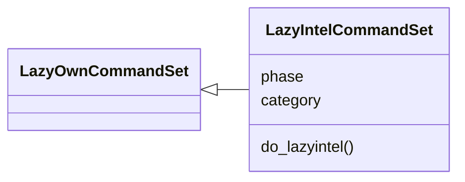
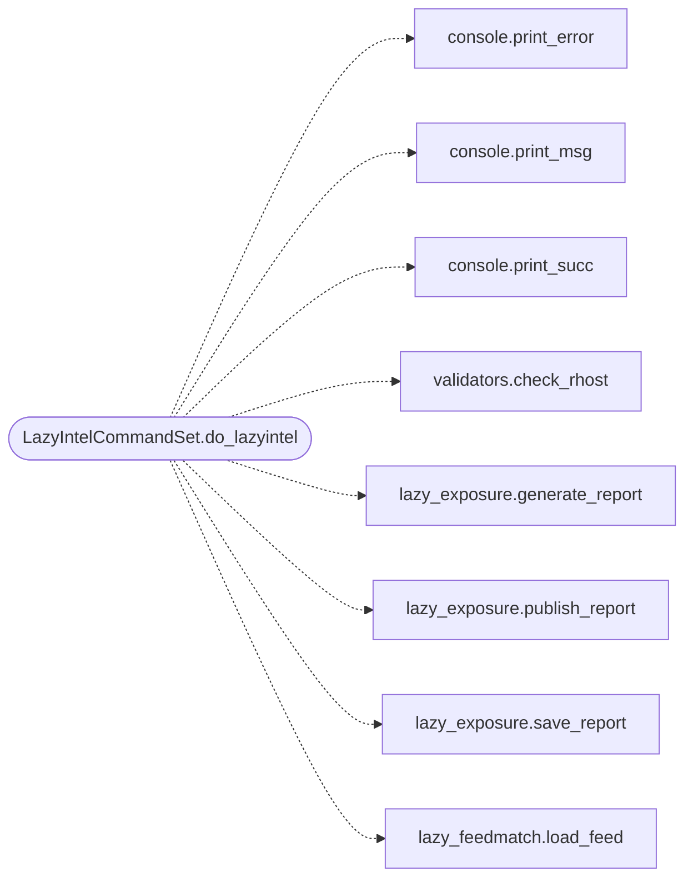

# `cli.commands.exposure_intel`

> Source: [cli/commands/exposure_intel.py:1](../../cli/commands/exposure_intel.py#L1) | language `py` | coverage 100.0% | [API index](../index.md)

Target-aware exploit-intelligence exposure command set.

``lazyintel`` binds the discovered world-model services to a local exploit
feed with hard-evidence policy, prints the ranked exposure report and
publishes its outcome through the [`modules.outcome_bus`](modules.outcome_bus.py.md) fan-out so
the C2 surfaces, intel graph and reports stay current.

Subcommands:
    lazyintel [target]                  ranked exposure report
    lazyintel [target] --check          rendered read-only validation commands
    lazyintel --feed <path>             feed override for this run

## Contents

- **Classes:** [`LazyIntelCommandSet`](#lazyintelcommandset)

## Type Diagram



## Call Graph

Solid arrows stay in this module, dashed arrows leave it.



## Classes

<a id="lazyintelcommandset"></a>

### `LazyIntelCommandSet`

`class` | [cli/commands/exposure_intel.py:32](../../cli/commands/exposure_intel.py#L32)

```python
class LazyIntelCommandSet(LazyOwnCommandSet)
```

Bases: [`LazyOwnCommandSet`](cli.commands._base.py.md#lazyowncommandset)

Expose lazy_intel to the operator.

**Attributes**

| Name | Type | Default | Description |
|---|---|---|---|
| [`phase`](#lazyintelcommandset-phase) |  | `'recon'` |  |
| [`category`](#lazyintelcommandset-category) |  | `miscellaneous_category` |  |

**Members**

| Member | Kind | Summary |
|---|---|---|
| [`do_lazyintel`](#lazyintelcommandset-do_lazyintel) | method | Rank discovered services against local exploit intelligence. |

<a id="lazyintelcommandset-do_lazyintel"></a>

#### `LazyIntelCommandSet.do_lazyintel`

`method` | [cli/commands/exposure_intel.py:39](../../cli/commands/exposure_intel.py#L39)

Decorators: `@cmd2.with_category(miscellaneous_category)`

```python
def do_lazyintel(self, line: str) -> None
```

Rank discovered services against local exploit intelligence.

Usage:
    lazyintel [target] [--check] [--feed <path>] [--json] [--quiet]

Without a target the current ``rhost`` is used. The feed defaults to
``sessions/intel/exploit_feed.json`` (or ``intel_feed`` from
``payload.json``) and cisa KEV dumps are accepted as-is.

**Parameters**

| Name | Type | Default | Description |
|---|---|---|---|
| `line` | `str` |  |  |

*Calls:* [`print_error`](core.console.py.md#print_error), [`print_msg`](core.console.py.md#print_msg), [`print_succ`](core.console.py.md#print_succ), [`check_rhost`](core.validators.py.md#check_rhost), [`generate_report`](modules.lazy_exposure.py.md#generate_report), [`publish_report`](modules.lazy_exposure.py.md#publish_report), [`save_report`](modules.lazy_exposure.py.md#save_report), [`load_feed`](modules.lazy_feedmatch.py.md#load_feed)

---
