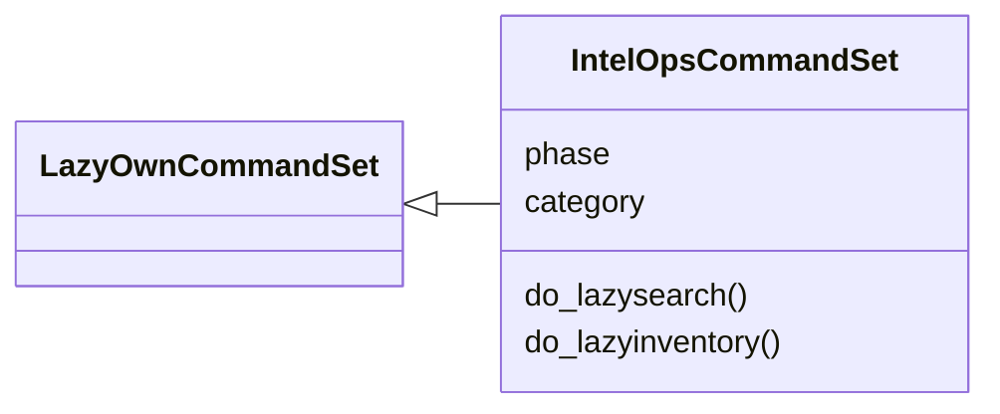
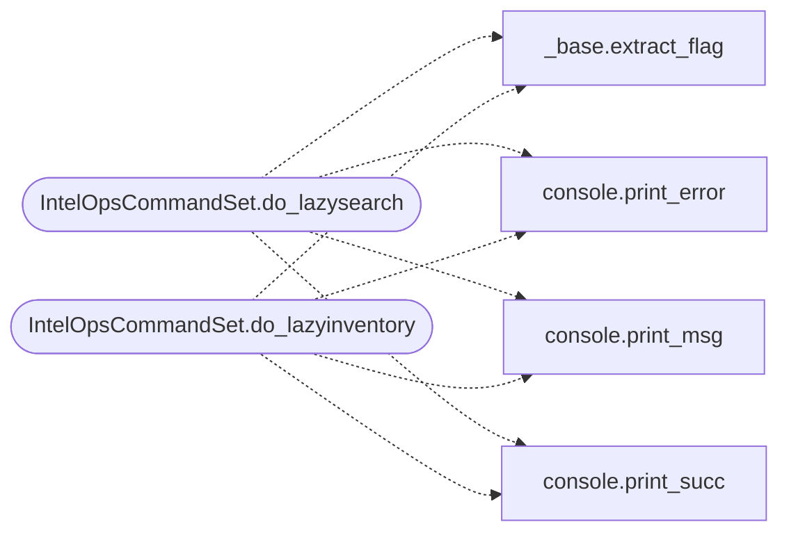

# `cli.commands.exposure_inventory`

> Source: [cli/commands/exposure_inventory.py:1](../../cli/commands/exposure_inventory.py#L1) | language `py` | coverage 100.0% | [API index](../index.md)

Exploit intelligence feeding command set: lazy_search and lazyinventory.

## Contents

- **Classes:** [`IntelOpsCommandSet`](#intelopscommandset)

## Type Diagram



## Call Graph

Solid arrows stay in this module, dashed arrows leave it.



## Classes

<a id="intelopscommandset"></a>

### `IntelOpsCommandSet`

`class` | [cli/commands/exposure_inventory.py:16](../../cli/commands/exposure_inventory.py#L16)

```python
class IntelOpsCommandSet(LazyOwnCommandSet)
```

Bases: [`LazyOwnCommandSet`](cli.commands._base.py.md#lazyowncommandset)

Saved-search grammar and the host-reported inventory.

``lazysearch`` runs the Shodan-lite grammar over the engagement
database. ``lazyinventory`` renders a read-only collector blob (posix
or PowerShell) and ingests its output back as host-source sightings
so the feed matcher can promote an unversioned lead into a matched
with harm evidence.

**Attributes**

| Name | Type | Default | Description |
|---|---|---|---|
| [`phase`](#intelopscommandset-phase) |  | `'recon'` |  |
| [`category`](#intelopscommandset-category) |  | `miscellaneous_category` |  |

**Members**

| Member | Kind | Summary |
|---|---|---|
| [`do_lazysearch`](#intelopscommandset-do_lazysearch) | method | Query the engagement database with the saved-search grammar. |
| [`do_lazyinventory`](#intelopscommandset-do_lazyinventory) | method | Collect and ingest host-reported packages (source=host). |

<a id="intelopscommandset-do_lazysearch"></a>

#### `IntelOpsCommandSet.do_lazysearch`

`method` | [cli/commands/exposure_inventory.py:30](../../cli/commands/exposure_inventory.py#L30)

Decorators: `@cmd2.with_category(miscellaneous_category)`

```python
def do_lazysearch(self, line: str) -> None
```

Query the engagement database with the saved-search grammar.

Usage:
    lazysearch port:3389 -host:vpn tech:"apache tomcat" sev:high
    lazysearch --json --db <path> --workspace <name> <query...>

Spot keys: host|ip, port, service, product|tech, version, os,
state, sev|severity, cve, user. Untagged words search any text
column. Every token AND-composed; ``-`` prefix excludes.

**Parameters**

| Name | Type | Default | Description |
|---|---|---|---|
| `line` | `str` |  |  |

*Calls:* [`extract_flag`](cli.commands._base.py.md#extract_flag), [`print_error`](core.console.py.md#print_error), [`print_msg`](core.console.py.md#print_msg), [`print_succ`](core.console.py.md#print_succ)

<a id="intelopscommandset-do_lazyinventory"></a>

#### `IntelOpsCommandSet.do_lazyinventory`

`method` | [cli/commands/exposure_inventory.py:71](../../cli/commands/exposure_inventory.py#L71)

Decorators: `@cmd2.with_category(miscellaneous_category)`

```python
def do_lazyinventory(self, line: str) -> None
```

Collect and ingest host-reported packages (source=host).

Usage:
    lazyinventory command [linux|windows] [--export <path>]
    lazyinventory ingest <file> [--target <ip>] [--platform auto|linux|windows] [--feed <path>] [--json]

``command`` prints the read-only collector blob to paste into a
beacon session or a terminal. `[`ingest`](modules.lesson_ingestor.py.md#lessoningestor-ingest)` parses its stdout back,
builds ``source: host`` sightings and regenerates the exposure
report for the target.

**Parameters**

| Name | Type | Default | Description |
|---|---|---|---|
| `line` | `str` |  |  |

*Calls:* [`extract_flag`](cli.commands._base.py.md#extract_flag), [`print_error`](core.console.py.md#print_error), [`print_msg`](core.console.py.md#print_msg), [`print_succ`](core.console.py.md#print_succ)

---
