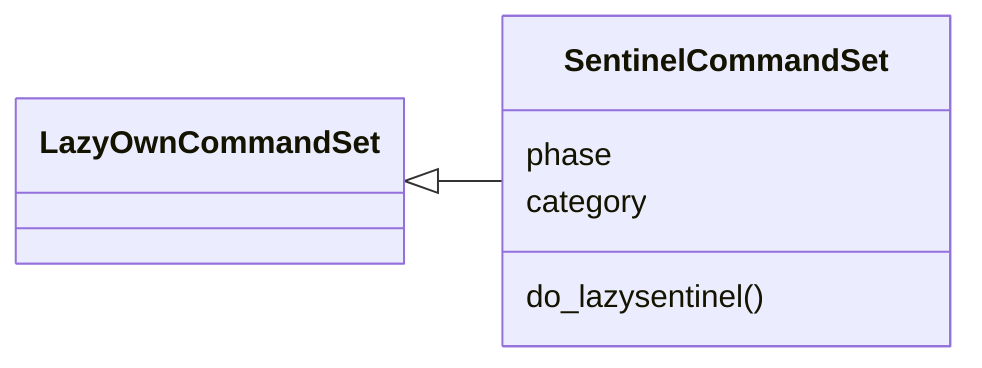
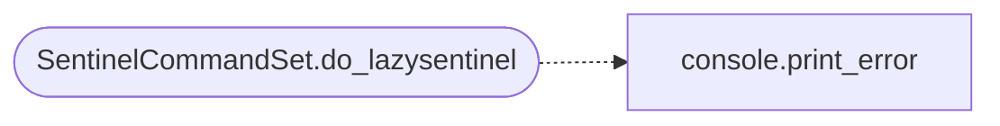

# `cli.commands.exposure_sentinel`

> Source: [cli/commands/exposure_sentinel.py:1](../../cli/commands/exposure_sentinel.py#L1) | language `py` | coverage 100.0% | [API index](../index.md)

Internal sentinel command set: provision, dispatch, ingest, checks.

## Contents

- **Classes:** [`SentinelCommandSet`](#sentinelcommandset)

## Type Diagram



## Call Graph

Solid arrows stay in this module, dashed arrows leave it.



## Classes

<a id="sentinelcommandset"></a>

### `SentinelCommandSet`

`class` | [cli/commands/exposure_sentinel.py:14](../../cli/commands/exposure_sentinel.py#L14)

```python
class SentinelCommandSet(LazyOwnCommandSet)
```

Bases: [`LazyOwnCommandSet`](cli.commands._base.py.md#lazyowncommandset)

Expose the internal-network sentinel to the operator.

**Attributes**

| Name | Type | Default | Description |
|---|---|---|---|
| [`phase`](#sentinelcommandset-phase) |  | `'recon'` |  |
| [`category`](#sentinelcommandset-category) |  | `miscellaneous_category` |  |

**Members**

| Member | Kind | Summary |
|---|---|---|
| [`do_lazysentinel`](#sentinelcommandset-do_lazysentinel) | method | Run the internal sentinel lifecycle. |

<a id="sentinelcommandset-do_lazysentinel"></a>

#### `SentinelCommandSet.do_lazysentinel`

`method` | [cli/commands/exposure_sentinel.py:21](../../cli/commands/exposure_sentinel.py#L21)

Decorators: `@cmd2.with_category(miscellaneous_category)`

```python
def do_lazysentinel(self, line: str) -> None
```

Run the internal sentinel lifecycle.

Usage:
    lazysentinel provision <cidr>... [--spool-in <path>]
    lazysentinel dispatch <client_id> [--from-provision <id>] [--send]
    lazysentinel ingest <spool path> [--feed <path>] [--json]
    lazysentinel checks <target> [--feed <path>]

``provision`` renders one read-only copy-paste blob that sweeps a
private range from inside the network (beacon, or any box with
nmap). ``dispatch`` wraps the blob in a c2_exec line. `[`ingest`](modules.lesson_ingestor.py.md#lessoningestor-ingest)`
parses the spool back into sightings, generates exposure reports
per host and considers autofire. `[`checks`](cli.doctor.py.md#doctorreport-checks)` renders read-only
validation commands for the ingested services.

**Parameters**

| Name | Type | Default | Description |
|---|---|---|---|
| `line` | `str` |  |  |

*Calls:* [`print_error`](core.console.py.md#print_error)

---
