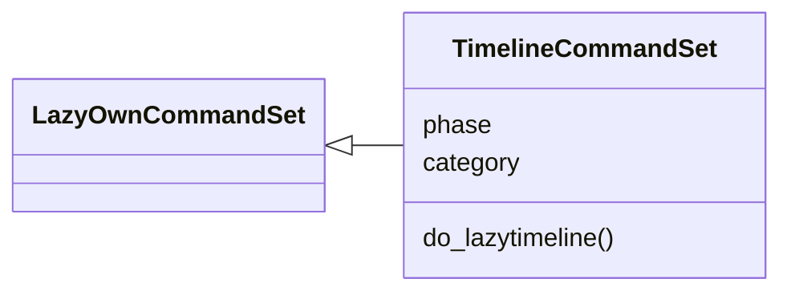
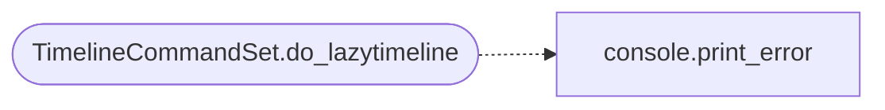

# `cli.commands.exposure_timeline`

> Source: [cli/commands/exposure_timeline.py:1](../../cli/commands/exposure_timeline.py#L1) | language `py` | coverage 100.0% | [API index](../index.md)

Engagement timeline command set: snapshots, diffs and zombies.

## Contents

- **Classes:** [`TimelineCommandSet`](#timelinecommandset)

## Type Diagram



## Call Graph

Solid arrows stay in this module, dashed arrows leave it.



## Classes

<a id="timelinecommandset"></a>

### `TimelineCommandSet`

`class` | [cli/commands/exposure_timeline.py:24](../../cli/commands/exposure_timeline.py#L24)

```python
class TimelineCommandSet(LazyOwnCommandSet)
```

Bases: [`LazyOwnCommandSet`](cli.commands._base.py.md#lazyowncommandset)

World-model snapshots worth reading between rounds.

**Attributes**

| Name | Type | Default | Description |
|---|---|---|---|
| [`phase`](#timelinecommandset-phase) |  | `'recon'` |  |
| [`category`](#timelinecommandset-category) |  | `miscellaneous_category` |  |

**Members**

| Member | Kind | Summary |
|---|---|---|
| [`do_lazytimeline`](#timelinecommandset-do_lazytimeline) | method | Record world-model snapshots and read their diffs. |

<a id="timelinecommandset-do_lazytimeline"></a>

#### `TimelineCommandSet.do_lazytimeline`

`method` | [cli/commands/exposure_timeline.py:31](../../cli/commands/exposure_timeline.py#L31)

Decorators: `@cmd2.with_category(miscellaneous_category)`

```python
def do_lazytimeline(self, line: str) -> None
```

Record world-model snapshots and read their diffs.

Usage:
    lazytimeline record [--dns <domain>]... [--dir <path>] [--state <path>] [--json]
    lazytimeline show [--last N]
    lazytimeline diff [--dir <path>] [--a <path> --b <path>] [--json]
    lazytimeline zombie [--dir <path>]

``record`` snapshots the world model (optionally tracking DNS
names for zombie detection). `[`diff`](modules.lazy_timeline.py.md#diff)` compares the two most
recent snapshots unless overridden. ``zombie`` lists hosts whose
DNS stopped resolving while services still answer.

**Parameters**

| Name | Type | Default | Description |
|---|---|---|---|
| `line` | `str` |  |  |

*Calls:* [`print_error`](core.console.py.md#print_error)

---
