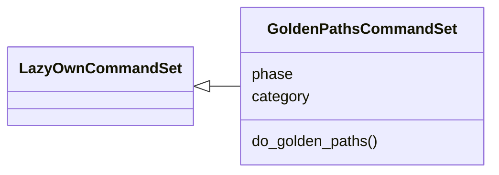
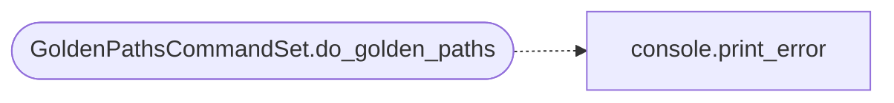

# `cli.commands.golden_paths`

> Source: [cli/commands/golden_paths.py:1](../../cli/commands/golden_paths.py#L1) | language `py` | coverage 100.0% | [API index](../index.md)

Golden-path solver commands.

Builds deterministic attack paths from the current world model, stores
them in ``sessions/attack_paths.json``, and pushes each path into the
objective queue for the autonomous loop.

Usage:
    golden_paths build [N]
    golden_paths show
    golden_paths push

## Contents

- **Classes:** [`GoldenPathsCommandSet`](#goldenpathscommandset)

## Type Diagram



## Call Graph

Solid arrows stay in this module, dashed arrows leave it.



## Classes

<a id="goldenpathscommandset"></a>

### `GoldenPathsCommandSet`

`class` | [cli/commands/golden_paths.py:35](../../cli/commands/golden_paths.py#L35)

```python
class GoldenPathsCommandSet(LazyOwnCommandSet)
```

Bases: [`LazyOwnCommandSet`](cli.commands._base.py.md#lazyowncommandset)

Deterministic attack-path solver commands.

**Attributes**

| Name | Type | Default | Description |
|---|---|---|---|
| [`phase`](#goldenpathscommandset-phase) |  | `'exploit'` |  |
| [`category`](#goldenpathscommandset-category) |  | `reporting_category` |  |

**Members**

| Member | Kind | Summary |
|---|---|---|
| [`do_golden_paths`](#goldenpathscommandset-do_golden_paths) | method | Build, show, or push attack paths from the world model. |

<a id="goldenpathscommandset-do_golden_paths"></a>

#### `GoldenPathsCommandSet.do_golden_paths`

`method` | [cli/commands/golden_paths.py:42](../../cli/commands/golden_paths.py#L42)

Decorators: `@cmd2.with_category(reporting_category)`

```python
def do_golden_paths(self, line)
```

Build, show, or push attack paths from the world model.

**Parameters**

| Name | Type | Default | Description |
|---|---|---|---|
| `line` |  |  | 'build [top_k]' \| 'show' \| 'push'. |

*Calls:* [`print_error`](core.console.py.md#print_error)

---
