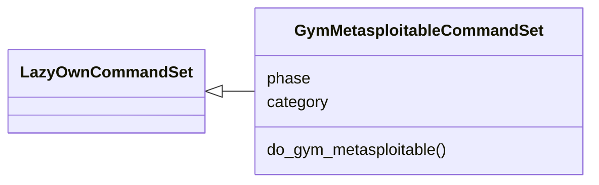
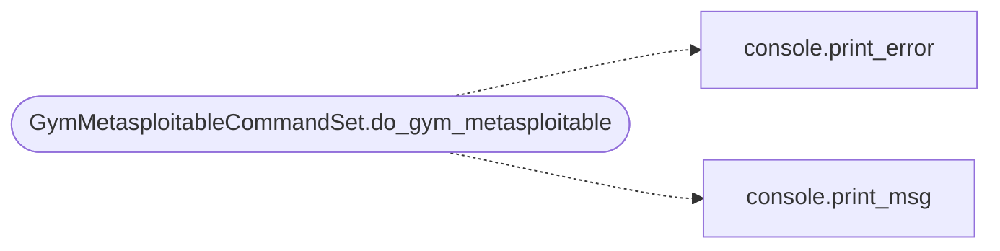

# `cli.commands.gym_matrix`

> Source: [cli/commands/gym_matrix.py:1](../../cli/commands/gym_matrix.py#L1) | language `py` | coverage 100.0% | [API index](../index.md)

Metasploitable 2 gym matrix commands.

Runs every indexed gym vector against the configured victim in severity
order, verifying each capture into ``sessions/ctf/``, and summarises the
result for the final CVE report.

Usage:
    gym_metasploitable plan [N] [--only a,b]
    gym_metasploitable run [N] [--only a,b] [--dry-run]
    gym_metasploitable report

## Contents

- **Classes:** [`GymMetasploitableCommandSet`](#gymmetasploitablecommandset)

## Type Diagram



## Call Graph

Solid arrows stay in this module, dashed arrows leave it.



## Classes

<a id="gymmetasploitablecommandset"></a>

### `GymMetasploitableCommandSet`

`class` | [cli/commands/gym_matrix.py:72](../../cli/commands/gym_matrix.py#L72)

```python
class GymMetasploitableCommandSet(LazyOwnCommandSet)
```

Bases: [`LazyOwnCommandSet`](cli.commands._base.py.md#lazyowncommandset)

MS2 gym matrix: plan, run and report deterministic attack paths.

**Attributes**

| Name | Type | Default | Description |
|---|---|---|---|
| [`phase`](#gymmetasploitablecommandset-phase) |  | `'exploit'` |  |
| [`category`](#gymmetasploitablecommandset-category) |  | `exploitation_category` |  |

**Members**

| Member | Kind | Summary |
|---|---|---|
| [`do_gym_metasploitable`](#gymmetasploitablecommandset-do_gym_metasploitable) | method | Plan, run, and report the Metasploitable 2 gym matrix. |

<a id="gymmetasploitablecommandset-do_gym_metasploitable"></a>

#### `GymMetasploitableCommandSet.do_gym_metasploitable`

`method` | [cli/commands/gym_matrix.py:79](../../cli/commands/gym_matrix.py#L79)

Decorators: `@cmd2.with_category(exploitation_category)`

```python
def do_gym_metasploitable(self, line)
```

Plan, run, and report the Metasploitable 2 gym matrix.

**Parameters**

| Name | Type | Default | Description |
|---|---|---|---|
| `line` |  |  | 'plan [N] [--only list]' \| 'run [N] [--only list] ' '[--dry-run]' \| 'report' \| 'verify <vuln_id>'. |

*Calls:* [`print_error`](core.console.py.md#print_error), [`print_msg`](core.console.py.md#print_msg)

---
