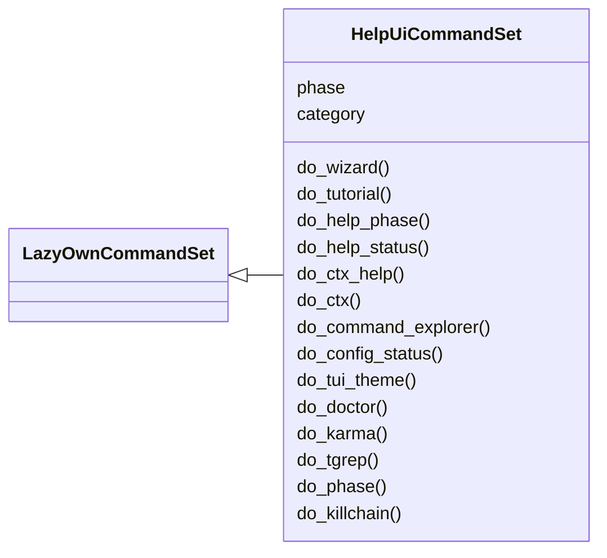
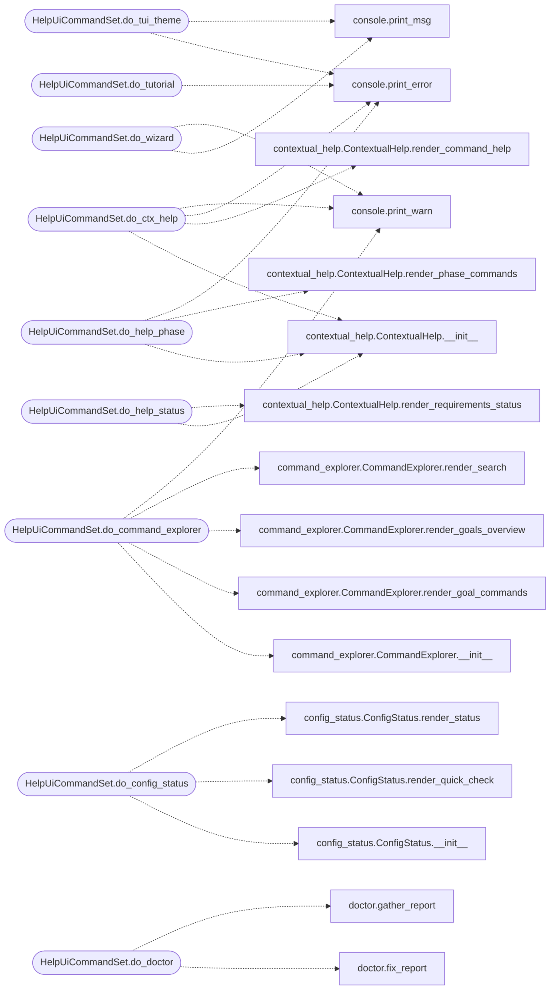

# `cli.commands.help_ui`

> Source: [cli/commands/help_ui.py:1](../../cli/commands/help_ui.py#L1) | language `py` | coverage 100.0% | [API index](../index.md)

Help, tutorial and phase guidance extracted from the miscellaneous cluster.

Pending status: originals deleted from ``cli/commands/misc_migrated.py``;
this set is registered by `[`cli.registry`](cli.registry.py.md)`.

## Contents

- **Classes:** [`HelpUiCommandSet`](#helpuicommandset)

## Type Diagram



## Call Graph

Solid arrows stay in this module, dashed arrows leave it.



## Classes

<a id="helpuicommandset"></a>

### `HelpUiCommandSet`

`class` | [cli/commands/help_ui.py:29](../../cli/commands/help_ui.py#L29)

```python
class HelpUiCommandSet(LazyOwnCommandSet)
```

Bases: [`LazyOwnCommandSet`](cli.commands._base.py.md#lazyowncommandset)

Help, tutorial and phase guidance.

**Attributes**

| Name | Type | Default | Description |
|---|---|---|---|
| [`phase`](#helpuicommandset-phase) |  | `'misc'` |  |
| [`category`](#helpuicommandset-category) |  | `'12. Miscellaneous'` |  |

**Members**

| Member | Kind | Summary |
|---|---|---|
| [`do_wizard`](#helpuicommandset-do_wizard) | method | Guided first-run setup wizard — configure rhost, lhost, domain, wordlists and more. |
| [`do_tutorial`](#helpuicommandset-do_tutorial) | method | Interactive tutorial that walks you through the golden path. |
| [`do_help_phase`](#helpuicommandset-do_help_phase) | method | List all commands for a given kill-chain phase. |
| [`do_help_status`](#helpuicommandset-do_help_status) | method | Show which session requirements are met (rhost, creds, domain, OS). |
| [`do_ctx_help`](#helpuicommandset-do_ctx_help) | method | Show contextual help for a command: description, phase, requirements, tips. |
| [`do_ctx`](#helpuicommandset-do_ctx) | method | Print a single-line operator context: rhost, lhost, domain, phase, os, creds. |
| [`do_command_explorer`](#helpuicommandset-do_command_explorer) | method | Interactive command explorer organized by goals and phases. |
| [`do_config_status`](#helpuicommandset-do_config_status) | method | Show configuration status grouped by category with set/missing indicators. |
| [`do_tui_theme`](#helpuicommandset-do_tui_theme) | method | Switch the TUI colour theme used by the splash and styled output. |
| [`do_doctor`](#helpuicommandset-do_doctor) | method | Preflight environment health check — verify the install is ready. |
| [`do_karma`](#helpuicommandset-do_karma) | method | Show ELO score, karma rank and exploration progress for this operator. |
| [`do_tgrep`](#helpuicommandset-do_tgrep) | method | Search across all previous command outputs and session logs. |
| [`do_phase`](#helpuicommandset-do_phase) | method | Get or set the current kill-chain phase. |
| [`do_killchain`](#helpuicommandset-do_killchain) | method | Show the unified kill-chain progress and control auto-refresh. |

<a id="helpuicommandset-do_wizard"></a>

#### `HelpUiCommandSet.do_wizard`

`method` | [cli/commands/help_ui.py:36](../../cli/commands/help_ui.py#L36)

Decorators: `@cmd2.with_category('12. Miscellaneous')`

```python
def do_wizard(self, line)
```

Guided first-run setup wizard — configure rhost, lhost, domain, wordlists and more.

Walks the operator through the seven essential configuration values with
auto-detection (lhost from routing table, wordlist paths from SecLists),
live ping validation for rhost, and a readiness summary at the end.

Usage:
    ``wizard``            — start interactive setup
    ``wizard --tutorial`` — extended help text for first-time operators
    ``wizard --check``    — show readiness summary only, no prompts
    ``wizard --show``     — show current values only, no prompts
    ``wizard --only=rhost,lhost`` — edit selected fields only
    ``wizard --quick``    — auto-detect defaults without any prompts
    ``wizard --non-interactive [--rhost X] [--lhost Y] [--domain Z]``
                           — apply values without prompting (Docker/CI)

Both novice and experienced operators can use this:
- Novices: step-by-step prompts with clear descriptions; pass
  ``--tutorial`` for in-depth explanations of every field.
- Experts: press Enter to accept auto-detected values; Ctrl-C to abort.

**Parameters**

| Name | Type | Default | Description |
|---|---|---|---|
| `line` |  |  |  |

*Calls:* [`print_msg`](core.console.py.md#print_msg), [`print_warn`](core.console.py.md#print_warn)

<a id="helpuicommandset-do_tutorial"></a>

#### `HelpUiCommandSet.do_tutorial`

`method` | [cli/commands/help_ui.py:151](../../cli/commands/help_ui.py#L151)

Decorators: `@cmd2.with_category('12. Miscellaneous')`

```python
def do_tutorial(self, line)
```

Interactive tutorial that walks you through the golden path.

Guides a new operator step-by-step through:
    ping -> lazynmap -> auto_populate -> facts_show -> recommend_next

Usage:
    ``tutorial``         — run the tutorial (skips if already completed)
    ``tutorial --force`` — replay even if already completed

**Parameters**

| Name | Type | Default | Description |
|---|---|---|---|
| `line` |  |  |  |

*Calls:* [`print_error`](core.console.py.md#print_error)

<a id="helpuicommandset-do_help_phase"></a>

#### `HelpUiCommandSet.do_help_phase`

`method` | [cli/commands/help_ui.py:175](../../cli/commands/help_ui.py#L175)

Decorators: `@cmd2.with_category('12. Miscellaneous')`

```python
def do_help_phase(self, line)
```

List all commands for a given kill-chain phase.

Usage:
    ``help_phase recon``       — list recon commands
    ``help_phase exploit``     — list exploit commands
    ``help_phase``             — list all available phases

Available phases: recon, enum, exploit, postexp, persist, privesc,
cred, lateral, exfil, c2, report, misc.

**Parameters**

| Name | Type | Default | Description |
|---|---|---|---|
| `line` |  |  |  |

*Calls:* [`ContextualHelp.__init__`](cli.contextual_help.py.md#contextualhelp-__init__), [`ContextualHelp.render_phase_commands`](cli.contextual_help.py.md#contextualhelp-render_phase_commands), [`print_error`](core.console.py.md#print_error)

<a id="helpuicommandset-do_help_status"></a>

#### `HelpUiCommandSet.do_help_status`

`method` | [cli/commands/help_ui.py:208](../../cli/commands/help_ui.py#L208)

Decorators: `@cmd2.with_category('12. Miscellaneous')`

```python
def do_help_status(self, line)
```

Show which session requirements are met (rhost, creds, domain, OS).

Useful to quickly check what is configured before running a command.

Usage: ``help_status``

**Parameters**

| Name | Type | Default | Description |
|---|---|---|---|
| `line` |  |  |  |

*Calls:* [`ContextualHelp.__init__`](cli.contextual_help.py.md#contextualhelp-__init__), [`ContextualHelp.render_requirements_status`](cli.contextual_help.py.md#contextualhelp-render_requirements_status)

<a id="helpuicommandset-do_ctx_help"></a>

#### `HelpUiCommandSet.do_ctx_help`

`method` | [cli/commands/help_ui.py:221](../../cli/commands/help_ui.py#L221)

Decorators: `@cmd2.with_category('12. Miscellaneous')`

```python
def do_ctx_help(self, line)
```

Show contextual help for a command: description, phase, requirements, tips.

Unlike plain 'help', this shows whether the command needs rhost,
credentials, or domain, and gives phase-specific tips.

Usage:
    ``ctx_help lazynmap``     — contextual help for lazynmap
    ``ctx_help evil``         — contextual help for evil-winrm

**Parameters**

| Name | Type | Default | Description |
|---|---|---|---|
| `line` |  |  |  |

*Calls:* [`ContextualHelp.__init__`](cli.contextual_help.py.md#contextualhelp-__init__), [`ContextualHelp.render_command_help`](cli.contextual_help.py.md#contextualhelp-render_command_help), [`print_error`](core.console.py.md#print_error), [`print_warn`](core.console.py.md#print_warn)

<a id="helpuicommandset-do_ctx"></a>

#### `HelpUiCommandSet.do_ctx`

`method` | [cli/commands/help_ui.py:242](../../cli/commands/help_ui.py#L242)

Decorators: `@cmd2.with_category('12. Miscellaneous')`

```python
def do_ctx(self, line)
```

Print a single-line operator context: rhost, lhost, domain, phase, os, creds.

No arguments. Reads payload.json and sessions/world_model.json. Fast —
suitable to run between every command for situational awareness.

Usage:
    ``ctx``

**Parameters**

| Name | Type | Default | Description |
|---|---|---|---|
| `line` |  |  |  |

<a id="helpuicommandset-do_command_explorer"></a>

#### `HelpUiCommandSet.do_command_explorer`

`method` | [cli/commands/help_ui.py:254](../../cli/commands/help_ui.py#L254)

Decorators: `@cmd2.with_category('12. Miscellaneous')`

```python
def do_command_explorer(self, line)
```

Interactive command explorer organized by goals and phases.

Browse commands by what you want to accomplish, not by category.
Shows command names, descriptions, and aliases for quick discovery.

Usage:
    ``command_explorer``            — show all goals
    ``command_explorer web``        — show web-related commands
    ``command_explorer smb_windows`` — show SMB/Windows commands
    ``command_explorer search nmap`` — search commands by keyword

**Parameters**

| Name | Type | Default | Description |
|---|---|---|---|
| `line` |  |  |  |

*Calls:* [`CommandExplorer.__init__`](cli.command_explorer.py.md#commandexplorer-__init__), [`CommandExplorer.render_goal_commands`](cli.command_explorer.py.md#commandexplorer-render_goal_commands), [`CommandExplorer.render_goals_overview`](cli.command_explorer.py.md#commandexplorer-render_goals_overview), [`CommandExplorer.render_search`](cli.command_explorer.py.md#commandexplorer-render_search), [`print_warn`](core.console.py.md#print_warn)

<a id="helpuicommandset-do_config_status"></a>

#### `HelpUiCommandSet.do_config_status`

`method` | [cli/commands/help_ui.py:287](../../cli/commands/help_ui.py#L287)

Decorators: `@cmd2.with_category('12. Miscellaneous')`

```python
def do_config_status(self, line)
```

Show configuration status grouped by category with set/missing indicators.

Replaces the raw 'get' (payload.json dump) with a human-friendly
overview showing which fields are configured, which need attention,
and how to set them.

Usage:
    ``config_status``           — full grouped status
    ``config_status --quick``   — show only missing required fields

**Parameters**

| Name | Type | Default | Description |
|---|---|---|---|
| `line` |  |  |  |

*Calls:* [`ConfigStatus.__init__`](cli.config_status.py.md#configstatus-__init__), [`ConfigStatus.render_quick_check`](cli.config_status.py.md#configstatus-render_quick_check), [`ConfigStatus.render_status`](cli.config_status.py.md#configstatus-render_status)

<a id="helpuicommandset-do_tui_theme"></a>

#### `HelpUiCommandSet.do_tui_theme`

`method` | [cli/commands/help_ui.py:308](../../cli/commands/help_ui.py#L308)

Decorators: `@cmd2.with_category('12. Miscellaneous')`

```python
def do_tui_theme(self, line)
```

Switch the TUI colour theme used by the splash and styled output.

Themes change the accent palette of LazyOwn's rich output (the
first-run splash overlay and any semantic styled panels). The
selection persists to ``payload.json`` under ``tui_theme`` so it
survives shell restarts.

Usage:
    ``tui_theme``          — list available themes, mark the active one
    ``tui_theme <name>``   — switch to a named theme (case-insensitive)
    ``tui_theme cycle``    — advance to the next theme in order
    ``tui_theme prev``     — step back to the previous theme
    ``tui_theme reset``    — return to the default theme

**Parameters**

| Name | Type | Default | Description |
|---|---|---|---|
| `line` |  |  |  |

*Calls:* [`print_error`](core.console.py.md#print_error), [`print_msg`](core.console.py.md#print_msg)

<a id="helpuicommandset-do_doctor"></a>

#### `HelpUiCommandSet.do_doctor`

`method` | [cli/commands/help_ui.py:334](../../cli/commands/help_ui.py#L334)

Decorators: `@cmd2.with_category('12. Miscellaneous')`

```python
def do_doctor(self, line)
```

Preflight environment health check — verify the install is ready.

Complements ``wizard``. Where ``wizard --check`` validates your
configuration (payload.json values), ``doctor`` validates the
installation itself: Python version, active virtual environment,
importability of the third-party packages install.sh provisions, the
C2 TLS certificates, payload.json, SecLists, and external kill-chain
tooling.

Usage:
    ``doctor``       — run every check and print a status table
    ``doctor --fix`` — interactively offer to install missing packages
    ``doctor -y``    — auto-fix all issues without prompting

Blocking failures (missing required packages, payload.json, or an
unsupported Python) are highlighted in red; warnings cover optional
features that will simply be skipped at runtime.

**Parameters**

| Name | Type | Default | Description |
|---|---|---|---|
| `line` |  |  |  |

*Calls:* [`fix_report`](cli.doctor.py.md#fix_report), [`gather_report`](cli.doctor.py.md#gather_report), [`render_report`](cli.doctor.py.md#render_report)

<a id="helpuicommandset-do_karma"></a>

#### `HelpUiCommandSet.do_karma`

`method` | [cli/commands/help_ui.py:369](../../cli/commands/help_ui.py#L369)

Decorators: `@cmd2.with_category('12. Miscellaneous')`

```python
def do_karma(self, line)
```

Show ELO score, karma rank and exploration progress for this operator.

Reads ``sessions/engagement_state.json`` (curiosity + VRI engine) and
prints the operator's ELO, karma name (Noob → Godlike), commands
discovered, phases entered, and steps remaining until the next VRI
reward.  Useful to gauge progress on the curiosity-driven adoption
loop without re-running another command.

Usage:
    ``karma``

**Parameters**

| Name | Type | Default | Description |
|---|---|---|---|
| `line` |  |  |  |

*Calls:* [`get_state_snapshot`](cli.engagement_hooks.py.md#get_state_snapshot), [`print_error`](core.console.py.md#print_error)

<a id="helpuicommandset-do_tgrep"></a>

#### `HelpUiCommandSet.do_tgrep`

`method` | [cli/commands/help_ui.py:404](../../cli/commands/help_ui.py#L404)

Decorators: `@cmd2.with_category('12. Miscellaneous')`

```python
def do_tgrep(self, line)
```

Search across all previous command outputs and session logs.

Searches in: sessions/_cli_transcript.jsonl (full outputs),
sessions/LazyOwn_session_report.csv (command list), and
sessions/logs/*.txt (tool output files). Useful for recalling
credentials, open ports, or any string from earlier in the session.

Usage:
    ``tgrep <pattern>``
    ``tgrep password``
    ``tgrep '10\.10\.11'``
    ``tgrep Administrator``

**Parameters**

| Name | Type | Default | Description |
|---|---|---|---|
| `line` |  |  |  |

<a id="helpuicommandset-do_phase"></a>

#### `HelpUiCommandSet.do_phase`

`method` | [cli/commands/help_ui.py:421](../../cli/commands/help_ui.py#L421)

Decorators: `@cmd2.with_category('12. Miscellaneous')`

```python
def do_phase(self, line)
```

Get or set the current kill-chain phase.

When called without arguments, shows the current phase and the
full kill-chain progress bar. When called with a phase name,
updates sessions/world_model.json — the dashboard reflects the
change on its next refresh (within 5 s).

Valid phases: recon scan enum exploit privesc lateral exfil report

Usage:
    `[`phase`](#helpuicommandset-phase)`               — show current phase and progress bar
    ``phase exploit``       — move to exploit phase
    ``phase privesc``       — advance to privilege escalation

The phase drives the inline hints and the kill-chain panel in the
operator dashboard. Advancing a phase also marks the previous one
as completed in the dashboard progress bar.

**Parameters**

| Name | Type | Default | Description |
|---|---|---|---|
| `line` |  |  |  |

*Calls:* [`print_error`](core.console.py.md#print_error), [`print_msg`](core.console.py.md#print_msg)

<a id="helpuicommandset-do_killchain"></a>

#### `HelpUiCommandSet.do_killchain`

`method` | [cli/commands/help_ui.py:455](../../cli/commands/help_ui.py#L455)

Decorators: `@cmd2.with_category('12. Miscellaneous')`

```python
def do_killchain(self, line)
```

Show the unified kill-chain progress and control auto-refresh.

Displays every kill-chain phase with its status derived from the
WorldModel (the single source of truth), plus the operator-set
override when it differs.

A compact progress bar can also be surfaced automatically after
commands. Use ``killchain auto on|off|N`` to enable it every N
commands, or set the phase-change trigger that fires whenever the
active phase advances.

Usage:
    `[`killchain`](lazygui.panels.registry.py.md#panelregistry-killchain)`            — show unified kill-chain progress bar
    ``killchain auto on``    — show bar periodically after commands
    ``killchain auto off``   — disable auto-refresh
    ``killchain auto 5``     — show bar every 5 commands

**Parameters**

| Name | Type | Default | Description |
|---|---|---|---|
| `line` |  |  |  |

*Calls:* [`get_world_model`](modules.world_model.py.md#get_world_model)

---
