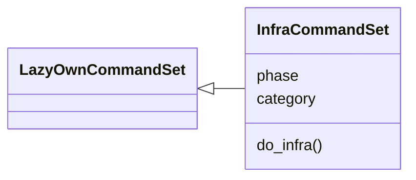
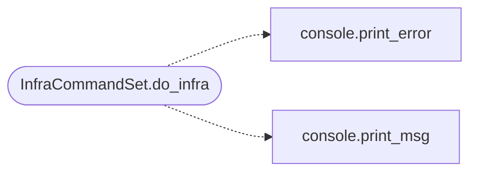

# `cli.commands.infra`

> Source: [cli/commands/infra.py:1](../../cli/commands/infra.py#L1) | language `py` | coverage 100.0% | [API index](../index.md)

Disposable infrastructure commands -- redirectors, C2, cloud IaC.

Provides ``infra redirector``, ``infra deploy`` and ``infra destroy``
workflows on top of ``deploy/`` assets. Local Docker is the default;
cloud providers (DigitalOcean/AWS) run through Terraform when available.

Discovery is automatic: `[`cli.registry.register_command_sets`](cli.registry.py.md#register_command_sets)` finds this
``CommandSet`` because it subclasses `[`LazyOwnCommandSet`](cli.commands._base.py.md#lazyowncommandset)`.

## Contents

- **Classes:** [`InfraCommandSet`](#infracommandset)

## Type Diagram



## Call Graph

Solid arrows stay in this module, dashed arrows leave it.



## Classes

<a id="infracommandset"></a>

### `InfraCommandSet`

`class` | [cli/commands/infra.py:93](../../cli/commands/infra.py#L93)

```python
class InfraCommandSet(LazyOwnCommandSet)
```

Bases: [`LazyOwnCommandSet`](cli.commands._base.py.md#lazyowncommandset)

Manage disposable C2 infrastructure and redirectors.

**Attributes**

| Name | Type | Default | Description |
|---|---|---|---|
| [`phase`](#infracommandset-phase) |  | `'c2'` |  |
| [`category`](#infracommandset-category) |  | `command_and_control_category` |  |

**Members**

| Member | Kind | Summary |
|---|---|---|
| [`do_infra`](#infracommandset-do_infra) | method | Manage disposable C2 infrastructure. |

<a id="infracommandset-do_infra"></a>

#### `InfraCommandSet.do_infra`

`method` | [cli/commands/infra.py:136](../../cli/commands/infra.py#L136)

Decorators: `@cmd2.with_category(command_and_control_category)`

```python
def do_infra(self, line)
```

Manage disposable C2 infrastructure.

Usage:
    infra redirector spawn [--count N] [--port PORT]
    infra redirector list
    infra redirector kill --all
    infra deploy --provider local|docker|digitalocean|aws [--region nyc1]
    infra destroy --provider local|docker|digitalocean|aws
    infra status

**Parameters**

| Name | Type | Default | Description |
|---|---|---|---|
| `line` |  |  |  |

**Example**

```python
infra redirector spawn --count 2
infra deploy --provider local
infra deploy --provider digitalocean --region nyc1
infra destroy --provider local
```

*Calls:* [`print_error`](core.console.py.md#print_error), [`print_msg`](core.console.py.md#print_msg)

---
