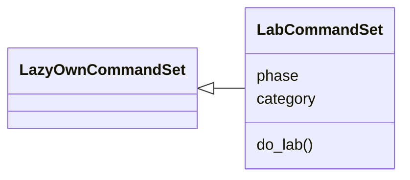

# `cli.commands.lab`

> Source: [cli/commands/lab.py:1](../../cli/commands/lab.py#L1) | language `py` | coverage 100.0% | [API index](../index.md)

Lab environment commands -- spin up vulnerable practice targets.

Provides on-demand CTF-style lab scenarios powered by Docker containers.
Operators can practice techniques against realistic targets without
risking production systems.

## Contents

- **Classes:** [`LabCommandSet`](#labcommandset)
- **Constants:** [`BASE_DIR`](#base_dir), [`LAB_COMPOSE`](#lab_compose), [`RANGE_DIR`](#range_dir), [`RANGE_PROFILES`](#range_profiles), [`LAB_SCENARIOS`](#lab_scenarios), [`REGISTRY_PREFIX`](#registry_prefix)

## Type Diagram



## Call Graph

Solid arrows stay in this module, dashed arrows leave it.


## Classes

<a id="labcommandset"></a>

### `LabCommandSet`

`class` | [cli/commands/lab.py:81](../../cli/commands/lab.py#L81)

```python
class LabCommandSet(LazyOwnCommandSet)
```

Bases: [`LazyOwnCommandSet`](cli.commands._base.py.md#lazyowncommandset)

Manage local CTF lab environments via Docker.

**Attributes**

| Name | Type | Default | Description |
|---|---|---|---|
| [`phase`](#labcommandset-phase) |  | `'lab'` |  |
| [`category`](#labcommandset-category) |  | `'12. Miscellaneous'` |  |

**Members**

| Member | Kind | Summary |
|---|---|---|
| [`do_lab`](#labcommandset-do_lab) | method | Manage local CTF practice labs. |

<a id="labcommandset-do_lab"></a>

#### `LabCommandSet.do_lab`

`method` | [cli/commands/lab.py:119](../../cli/commands/lab.py#L119)

Decorators: `@cmd2.with_category(miscellaneous_category)`

```python
def do_lab(self, line)
```

Manage local CTF practice labs.

Usage:
    lab list                     — show available scenarios
    lab start <scenario>         — spin up a vulnerable target
    lab stop <scenario>          — tear down a running scenario
    lab status                   — show running labs
    lab range start <profile>    — start a cyber range (ad-mini)
    lab range stop <profile>     — stop a cyber range
    lab range status             — range container status
    lab range verify <profile>   — fire a real exploit to prove it works

**Parameters**

| Name | Type | Default | Description |
|---|---|---|---|
| `line` |  |  |  |

**Example**

```python
lab start metasploitable
    lab start wordpress
    lab list
    lab status
    lab stop metasploitable
    lab range start ad-mini

Requires Docker. Lab containers are isolated and safe for practice.
```

*Calls:* [`print_error`](core.console.py.md#print_error), [`print_msg`](core.console.py.md#print_msg)

---

## Constants

<a id="base_dir"></a>

### `BASE_DIR`

`constant` | [cli/commands/lab.py:26](../../cli/commands/lab.py#L26)

```python
BASE_DIR = Path(__file__).resolve().parent.parent.parent
```

---

<a id="lab_compose"></a>

### `LAB_COMPOSE`

`constant` | [cli/commands/lab.py:27](../../cli/commands/lab.py#L27)

```python
LAB_COMPOSE = BASE_DIR / 'deploy' / 'lab' / 'docker-compose.yml'
```

---

<a id="range_dir"></a>

### `RANGE_DIR`

`constant` | [cli/commands/lab.py:28](../../cli/commands/lab.py#L28)

```python
RANGE_DIR = BASE_DIR / 'deploy' / 'range'
```

---

<a id="range_profiles"></a>

### `RANGE_PROFILES`

`constant` | [cli/commands/lab.py:30](../../cli/commands/lab.py#L30)

```python
RANGE_PROFILES: dict[str, dict]
```

---

<a id="lab_scenarios"></a>

### `LAB_SCENARIOS`

`constant` | [cli/commands/lab.py:39](../../cli/commands/lab.py#L39)

```python
LAB_SCENARIOS: dict[str, dict]
```

---

<a id="registry_prefix"></a>

### `REGISTRY_PREFIX`

`constant` | [cli/commands/lab.py:78](../../cli/commands/lab.py#L78)

```python
REGISTRY_PREFIX = 'lazyown-lab-'
```

---
