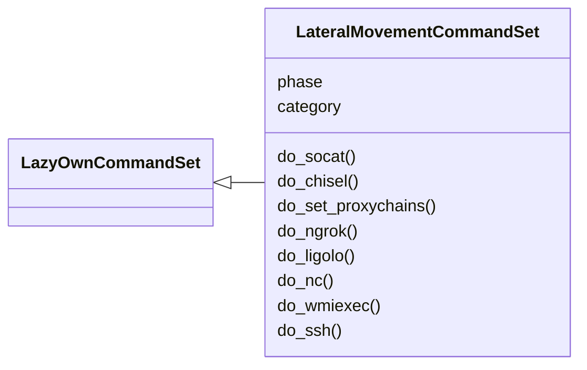
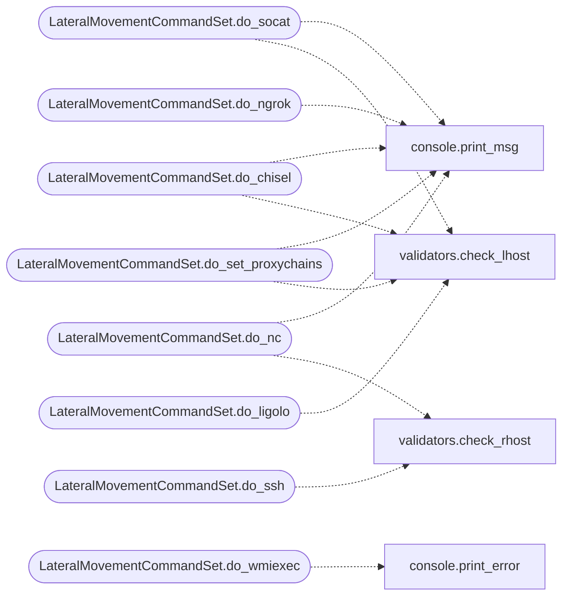

# `cli.commands.lateral`

> Source: [cli/commands/lateral.py:1](../../cli/commands/lateral.py#L1) | language `py` | coverage 100.0% | [API index](../index.md)

Lateral Movement command set (pending).

Phase 08 — commands for lateral movement: tunneling, pivoting,
remote execution, and protocol-specific lateral movement tools.

Pending status: inherits from [`PendingCommandSet`](cli.commands._dormancy.py.md#pendingcommandset). Promote to
[`LazyOwnCommandSet`](cli.commands._base.py.md#lazyowncommandset) once originals are deleted from ``lazyown.py``.

## Contents

- **Classes:** [`LateralMovementCommandSet`](#lateralmovementcommandset)

## Type Diagram



## Call Graph

Solid arrows stay in this module, dashed arrows leave it.



## Classes

<a id="lateralmovementcommandset"></a>

### `LateralMovementCommandSet`

`class` | [cli/commands/lateral.py:24](../../cli/commands/lateral.py#L24)

```python
class LateralMovementCommandSet(LazyOwnCommandSet)
```

Bases: [`LazyOwnCommandSet`](cli.commands._base.py.md#lazyowncommandset)

Lateral Movement phase commands (pending).

**Attributes**

| Name | Type | Default | Description |
|---|---|---|---|
| [`phase`](#lateralmovementcommandset-phase) |  | `'lateral'` |  |
| [`category`](#lateralmovementcommandset-category) |  | `'08. Lateral Movement'` |  |

**Members**

| Member | Kind | Summary |
|---|---|---|
| [`do_socat`](#lateralmovementcommandset-do_socat) | method | Run socat for port forwarding. |
| [`do_chisel`](#lateralmovementcommandset-do_chisel) | method | Run chisel for quick tunneling. |
| [`do_set_proxychains`](#lateralmovementcommandset-do_set_proxychains) | method | Configure proxychains for the current session. |
| [`do_ngrok`](#lateralmovementcommandset-do_ngrok) | method | Start ngrok tunnel. |
| [`do_ligolo`](#lateralmovementcommandset-do_ligolo) | method | Run Ligolo-ng for advanced pivoting. |
| [`do_nc`](#lateralmovementcommandset-do_nc) | method | Netcat listener or connect. |
| [`do_wmiexec`](#lateralmovementcommandset-do_wmiexec) | method | Execute commands via WMI. |
| [`do_ssh`](#lateralmovementcommandset-do_ssh) | method | SSH to a remote host (custom port). |

<a id="lateralmovementcommandset-do_socat"></a>

#### `LateralMovementCommandSet.do_socat`

`method` | [cli/commands/lateral.py:31](../../cli/commands/lateral.py#L31)

Decorators: `@cmd2.with_category(lateral_movement_category)`

```python
def do_socat(self, line)
```

Run socat for port forwarding.

**Parameters**

| Name | Type | Default | Description |
|---|---|---|---|
| `line` |  |  |  |

*Calls:* [`print_msg`](core.console.py.md#print_msg), [`check_lhost`](core.validators.py.md#check_lhost)

<a id="lateralmovementcommandset-do_chisel"></a>

#### `LateralMovementCommandSet.do_chisel`

`method` | [cli/commands/lateral.py:43](../../cli/commands/lateral.py#L43)

Decorators: `@cmd2.with_category(lateral_movement_category)`

```python
def do_chisel(self, line)
```

Run chisel for quick tunneling.

**Parameters**

| Name | Type | Default | Description |
|---|---|---|---|
| `line` |  |  |  |

*Calls:* [`print_msg`](core.console.py.md#print_msg), [`check_lhost`](core.validators.py.md#check_lhost)

<a id="lateralmovementcommandset-do_set_proxychains"></a>

#### `LateralMovementCommandSet.do_set_proxychains`

`method` | [cli/commands/lateral.py:59](../../cli/commands/lateral.py#L59)

Decorators: `@cmd2.with_category(lateral_movement_category)`

```python
def do_set_proxychains(self, line)
```

Configure proxychains for the current session.

**Parameters**

| Name | Type | Default | Description |
|---|---|---|---|
| `line` |  |  |  |

*Calls:* [`print_msg`](core.console.py.md#print_msg), [`check_lhost`](core.validators.py.md#check_lhost)

<a id="lateralmovementcommandset-do_ngrok"></a>

#### `LateralMovementCommandSet.do_ngrok`

`method` | [cli/commands/lateral.py:72](../../cli/commands/lateral.py#L72)

Decorators: `@cmd2.with_category(lateral_movement_category)`

```python
def do_ngrok(self, line)
```

Start ngrok tunnel.

**Parameters**

| Name | Type | Default | Description |
|---|---|---|---|
| `line` |  |  |  |

*Calls:* [`print_msg`](core.console.py.md#print_msg)

<a id="lateralmovementcommandset-do_ligolo"></a>

#### `LateralMovementCommandSet.do_ligolo`

`method` | [cli/commands/lateral.py:79](../../cli/commands/lateral.py#L79)

Decorators: `@cmd2.with_category(lateral_movement_category)`

```python
def do_ligolo(self, line)
```

Run Ligolo-ng for advanced pivoting.

**Parameters**

| Name | Type | Default | Description |
|---|---|---|---|
| `line` |  |  |  |

*Calls:* [`check_lhost`](core.validators.py.md#check_lhost)

<a id="lateralmovementcommandset-do_nc"></a>

#### `LateralMovementCommandSet.do_nc`

`method` | [cli/commands/lateral.py:91](../../cli/commands/lateral.py#L91)

Decorators: `@cmd2.with_category(lateral_movement_category)`

```python
def do_nc(self, line)
```

Netcat listener or connect.

**Parameters**

| Name | Type | Default | Description |
|---|---|---|---|
| `line` |  |  |  |

*Calls:* [`print_msg`](core.console.py.md#print_msg), [`check_rhost`](core.validators.py.md#check_rhost)

<a id="lateralmovementcommandset-do_wmiexec"></a>

#### `LateralMovementCommandSet.do_wmiexec`

`method` | [cli/commands/lateral.py:106](../../cli/commands/lateral.py#L106)

Decorators: `@cmd2.with_category(lateral_movement_category)`

```python
def do_wmiexec(self, line)
```

Execute commands via WMI.

**Parameters**

| Name | Type | Default | Description |
|---|---|---|---|
| `line` |  |  |  |

*Calls:* [`print_error`](core.console.py.md#print_error)

<a id="lateralmovementcommandset-do_ssh"></a>

#### `LateralMovementCommandSet.do_ssh`

`method` | [cli/commands/lateral.py:114](../../cli/commands/lateral.py#L114)

Decorators: `@cmd2.with_category(lateral_movement_category)`

```python
def do_ssh(self, line)
```

SSH to a remote host (custom port).

**Parameters**

| Name | Type | Default | Description |
|---|---|---|---|
| `line` |  |  |  |

*Calls:* [`check_rhost`](core.validators.py.md#check_rhost)

---
