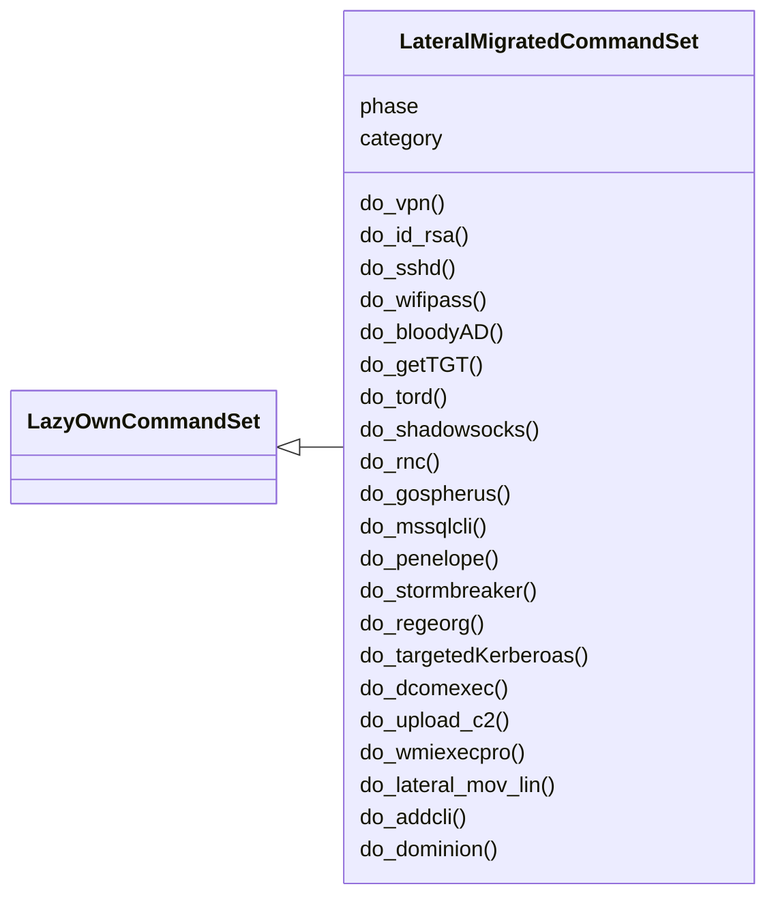
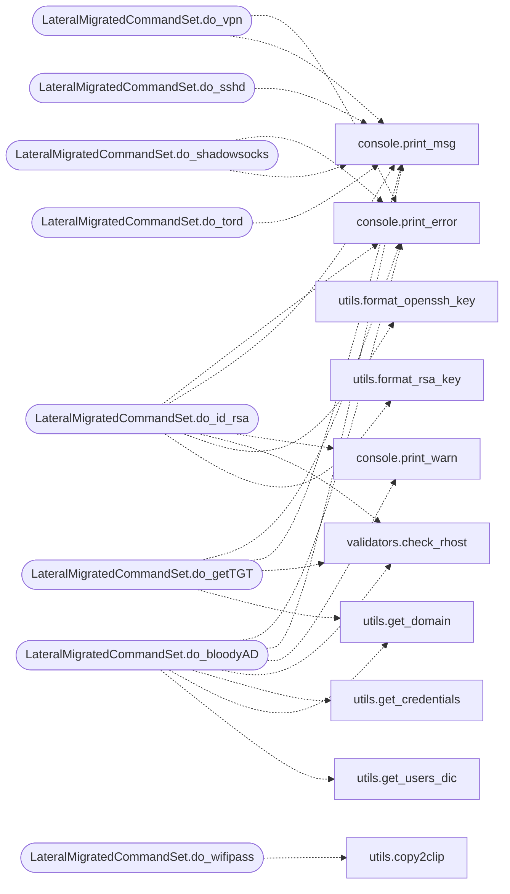

# `cli.commands.lateral_migrated`

> Source: [cli/commands/lateral_migrated.py:1](../../cli/commands/lateral_migrated.py#L1) | language `py` | coverage 95.7% | [API index](../index.md)

lateral commands migrated from lazyown.py.

Auto-generated by scripts/migrate_lazyown.py.

## Contents

- **Classes:** [`LateralMigratedCommandSet`](#lateralmigratedcommandset)

## Type Diagram



## Call Graph

Solid arrows stay in this module, dashed arrows leave it.



## Classes

<a id="lateralmigratedcommandset"></a>

### `LateralMigratedCommandSet`

`class` | [cli/commands/lateral_migrated.py:24](../../cli/commands/lateral_migrated.py#L24)

```python
class LateralMigratedCommandSet(LazyOwnCommandSet)
```

Bases: [`LazyOwnCommandSet`](cli.commands._base.py.md#lazyowncommandset)

**Attributes**

| Name | Type | Default | Description |
|---|---|---|---|
| [`phase`](#lateralmigratedcommandset-phase) |  | `'lateral'` |  |
| [`category`](#lateralmigratedcommandset-category) |  | `'08. Lateral Movement'` |  |

**Members**

| Member | Kind | Summary |
|---|---|---|
| [`do_vpn`](#lateralmigratedcommandset-do_vpn) | method | Connect to a VPN by selecting from available .ovpn files. |
| [`do_id_rsa`](#lateralmigratedcommandset-do_id_rsa) | method | Create an SSH private key file and connect to a remote host using SSH. |
| [`do_sshd`](#lateralmigratedcommandset-do_sshd) | method | Starts the SSH service and displays its status. |
| [`do_wifipass`](#lateralmigratedcommandset-do_wifipass) | method | This function generates a PowerShell script that retrieves saved Wi-Fi passwords on a Windows system. |
| [`do_bloodyAD`](#lateralmigratedcommandset-do_bloodyad) | method | Execute the bloodyAD.py command for a specific user or all users listed in the users.txt file. |
| [`do_getTGT`](#lateralmigratedcommandset-do_gettgt) | method | Requests a Ticket Granting Ticket (TGT) using the Impacket tool with provided credentials. |
| [`do_tord`](#lateralmigratedcommandset-do_tord) | method | Execute the tor.sh script with the specified port or default to port 80 if no port is provided. |
| [`do_shadowsocks`](#lateralmigratedcommandset-do_shadowsocks) | method | Execute the Shadowsocks tool to create a secure tunnel for network traffic. |
| [`do_rnc`](#lateralmigratedcommandset-do_rnc) | method | Runs `nc` with rlwrap the specified port for listening. |
| [`do_gospherus`](#lateralmigratedcommandset-do_gospherus) | method | Command gospherus: Clones and uses the Gopherus tool to generate gopher payloads for various services. |
| [`do_mssqlcli`](#lateralmigratedcommandset-do_mssqlcli) | method | Attempts to connect to an MSSQL server using the mssqlclient.py tool with Windows authentication. |
| [`do_penelope`](#lateralmigratedcommandset-do_penelope) | method | Command penelope: Installs and runs Penelope for handling reverse and bind shells. |
| [`do_stormbreaker`](#lateralmigratedcommandset-do_stormbreaker) | method | Command stormbreaker: Automates the installation and usage of Storm-Breaker for performing various network attacks. |
| [`do_regeorg`](#lateralmigratedcommandset-do_regeorg) | method | Executes the reGeorg tool for HTTP(s) tunneling through a SOCKS proxy. |
| [`do_targetedKerberoas`](#lateralmigratedcommandset-do_targetedkerberoas) | method | Executes the targetedKerberoast tool for extracting Kerberos service tickets. |
| [`do_dcomexec`](#lateralmigratedcommandset-do_dcomexec) | method | Executes the Impacket dcomexec tool to run commands on a remote system using DCOM. |
| [`do_upload_c2`](#lateralmigratedcommandset-do_upload_c2) | method | upload command in the client using the C2 to upload a file |
| [`do_wmiexecpro`](#lateralmigratedcommandset-do_wmiexecpro) | method | Executes wmiexec-pro with various options for WMI operations. |
| [`do_lateral_mov_lin`](#lateralmigratedcommandset-do_lateral_mov_lin) | method | Perform lateral movement by downloading and installing LazyOwn on a remote Linux machine. |
| [`do_addcli`](#lateralmigratedcommandset-do_addcli) | method | Add a client to execute c2 commands |
| [`do_dominion`](#lateralmigratedcommandset-do_dominion) | method | Execute a fully automated Active Directory domain takeover. |

<a id="lateralmigratedcommandset-do_vpn"></a>

#### `LateralMigratedCommandSet.do_vpn`

`method` | [cli/commands/lateral_migrated.py:29](../../cli/commands/lateral_migrated.py#L29)

Decorators: `@cmd2.with_category('08. Lateral Movement')`

```python
def do_vpn(self, line)
```

Connect to a VPN by selecting from available .ovpn files.

This function performs the following actions:
1. Lists all `.ovpn` files in the current directory, sorted alphabetically.
2. Handles cases with and without arguments:
- Without arguments: Lists available `.ovpn` files and prompts the user to select one by number.
- With a single argument: Treats the argument as a number and attempts to connect to the corresponding `.ovpn` file.
3. Connects to the selected `.ovpn` file using `openvpn` and displays appropriate messages.
4. Handles invalid input with error messages.

Usage:
    vpn           # List available .ovpn files and select one to connect to
    vpn <number>  # Connect directly to the .ovpn file corresponding to the number


Manual execution:
To manually use this function:
1. Run the function with no arguments to list available `.ovpn` files.
2. Choose a file by entering the corresponding number.
3. Alternatively, run the function with a number argument to connect directly to the specified `.ovpn` file.

Note: Ensure you have the necessary permissions and the `openvpn` command is available on your system.

**Parameters**

| Name | Type | Default | Description |
|---|---|---|---|
| `line` | `str` |  | The number of the .ovpn file to connect to, or an empty string to list available files. |

**Returns:** None

*Calls:* [`print_error`](core.console.py.md#print_error), [`print_msg`](core.console.py.md#print_msg)

<a id="lateralmigratedcommandset-do_id_rsa"></a>

#### `LateralMigratedCommandSet.do_id_rsa`

`method` | [cli/commands/lateral_migrated.py:101](../../cli/commands/lateral_migrated.py#L101)

Decorators: `@cmd2.with_category('08. Lateral Movement')`

```python
def do_id_rsa(self, line)
```

Create an SSH private key file and connect to a remote host using SSH.

This function performs the following actions:
1. Checks if the provided remote host (`self.params['rhost']`) is valid.
2. Verifies that a username is provided as an argument.
3. Creates an SSH private key file in the `sessions` directory with a name based on the provided username.
4. Opens the created file in the `nano` text editor for the user to paste the private key.
5. Sets the file permissions to read-only for the owner (600).
6. Optionally formats the key if the user chooses to.
7. Connects to the remote host via SSH using the created private key.
8. Displays a warning message when the SSH connection is closed.

Usage:
    id_rsa <username>


Manual execution:
To manually use this function:
1. Run the function with the username argument, e.g., `id_rsa myuser`.
2. Paste the private key into the `nano` editor when prompted.
3. Save and exit the editor.
4. The SSH connection will be established using the private key.

Note: Ensure you have the necessary permissions to create files and connect via SSH.

**Parameters**

| Name | Type | Default | Description |
|---|---|---|---|
| `line` | `str` |  | The username for SSH connection and private key file naming. |

**Returns:** None

*Calls:* [`print_error`](core.console.py.md#print_error), [`print_msg`](core.console.py.md#print_msg), [`print_warn`](core.console.py.md#print_warn), [`check_rhost`](core.validators.py.md#check_rhost), [`format_openssh_key`](utils.py.md#format_openssh_key), [`format_rsa_key`](utils.py.md#format_rsa_key)

<a id="lateralmigratedcommandset-do_sshd"></a>

#### `LateralMigratedCommandSet.do_sshd`

`method` | [cli/commands/lateral_migrated.py:172](../../cli/commands/lateral_migrated.py#L172)

Decorators: `@cmd2.with_category('08. Lateral Movement')`

```python
def do_sshd(self, line)
```

Starts the SSH service and displays its status.

1. Executes the command to start the SSH service:
- Runs `sudo systemctl start ssh` to initiate the SSH service.

2. Displays the status of the SSH service:
- Runs `sudo systemctl status ssh` to show the current status of the SSH service.


Manual execution:
To manually run these tasks, you would need to:
- Execute `sudo systemctl start ssh` to start the SSH service.
- Run `sudo systemctl status ssh` to check the status of the SSH service.

Note: Ensure that you have the necessary permissions to start services using `sudo` and that the SSH service is installed on your system.

**Parameters**

| Name | Type | Default | Description |
|---|---|---|---|
| `line` | `str` |  | Not used in this function. |

**Returns:** None

*Calls:* [`print_msg`](core.console.py.md#print_msg)

<a id="lateralmigratedcommandset-do_wifipass"></a>

#### `LateralMigratedCommandSet.do_wifipass`

`method` | [cli/commands/lateral_migrated.py:199](../../cli/commands/lateral_migrated.py#L199)

Decorators: `@cmd2.with_category('08. Lateral Movement')`

```python
def do_wifipass(self, line)
```

This function generates a PowerShell script that retrieves saved Wi-Fi passwords on a Windows system.

The script gathers the Wi-Fi profiles, extracts their passwords, and saves the information in a text file named 'wifi_passwords.txt' in the directory where the script is executed. The generated PowerShell command is copied to the clipboard for easy execution.

line (str): This parameter is not used within the function but is required for the command interface.

The function does not return any value.

**Parameters**

| Name | Type | Default | Description |
|---|---|---|---|
| `line` |  |  |  |

*Calls:* [`copy2clip`](utils.py.md#copy2clip)

<a id="lateralmigratedcommandset-do_bloodyad"></a>

#### `LateralMigratedCommandSet.do_bloodyAD`

`method` | [cli/commands/lateral_migrated.py:229](../../cli/commands/lateral_migrated.py#L229)

Decorators: `@cmd2.with_category('08. Lateral Movement')`

```python
def do_bloodyAD(self, line)
```

Execute the bloodyAD.py command for a specific user or all users listed in the users.txt file.

This function interacts with BloodyAD to add users to a group in an Active Directory environment.
It allows the user to select a specific user from the list or execute the command for all users.
(use download_external option 48 to clone the repo)
Workflow:
    1. Extract parameters and set up paths.
    2. Check the reachability of the remote host.
    3. Prompt the user for a CN if not provided.
    4. Check if the users.txt file exists and read the list of users.
    5. Display the list of users and prompt the user to select a specific user.
    6. Execute the bloodyAD.py command for the selected user or all users.

**Parameters**

| Name | Type | Default | Description |
|---|---|---|---|
| `line` | `str` |  | The organizational unit (OU) in the format 'CN=EXAMPLE,DC=DOMAIN,DC=EXT'. If not provided, the user is prompted to enter it. |

**Returns:** None

**Raises**

- `FileNotFoundError`: If the users.txt file does not exist.

**Example**

```python
To execute the command for a specific user:
>>> do_bloodyAD("")

To execute the command for all users:
>>> do_bloodyAD("")
```

*Calls:* [`print_error`](core.console.py.md#print_error), [`print_msg`](core.console.py.md#print_msg), [`print_warn`](core.console.py.md#print_warn), [`check_rhost`](core.validators.py.md#check_rhost), [`get_credentials`](utils.py.md#get_credentials), [`get_domain`](utils.py.md#get_domain), [`get_users_dic`](utils.py.md#get_users_dic)

<a id="lateralmigratedcommandset-do_gettgt"></a>

#### `LateralMigratedCommandSet.do_getTGT`

`method` | [cli/commands/lateral_migrated.py:321](../../cli/commands/lateral_migrated.py#L321)

Decorators: `@cmd2.with_category('08. Lateral Movement')`

```python
def do_getTGT(self, line)
```

Requests a Ticket Granting Ticket (TGT) using the Impacket tool with provided credentials.

This function performs the following actions:
1. Checks if the provided target host (`self.params['rhost']`) is valid.
2. Reads credentials from the `credentials.txt` file.
3. Uses each credential (username and password) to request a TGT with the Impacket tool.
4. Constructs and executes the Impacket command to obtain a TGT for each set of credentials.

line (str): A command line argument, not used in this implementation.

None

**Parameters**

| Name | Type | Default | Description |
|---|---|---|---|
| `line` |  |  |  |

*Calls:* [`print_error`](core.console.py.md#print_error), [`print_msg`](core.console.py.md#print_msg), [`check_rhost`](core.validators.py.md#check_rhost), [`get_domain`](utils.py.md#get_domain)

<a id="lateralmigratedcommandset-do_tord"></a>

#### `LateralMigratedCommandSet.do_tord`

`method` | [cli/commands/lateral_migrated.py:369](../../cli/commands/lateral_migrated.py#L369)

Decorators: `@cmd2.with_category('08. Lateral Movement')`

```python
def do_tord(self, line)
```

Execute the tor.sh script with the specified port or default to port 80 if no port is provided.

This function constructs a command to run the `tor.sh` script with superuser privileges,
it defaults to port 80.
The command is then printed and executed.

line (str): Defaults to "80"

None

Ensure that the `tor.sh` script exists in the `sessions` directory and that you have the
necessary permissions to execute scripts with `sudo`.

**Parameters**

| Name | Type | Default | Description |
|---|---|---|---|
| `line` |  |  |  |

**Example**

```pycon
>>> do_tord(self, "")
sudo bash sessions/tor.sh

>>> do_tord(self, "")
sudo bash sessions/tor.sh
```

*Calls:* [`print_msg`](core.console.py.md#print_msg)

<a id="lateralmigratedcommandset-do_shadowsocks"></a>

#### `LateralMigratedCommandSet.do_shadowsocks`

`method` | [cli/commands/lateral_migrated.py:404](../../cli/commands/lateral_migrated.py#L404)

Decorators: `@cmd2.with_category('08. Lateral Movement')`

```python
def do_shadowsocks(self, line)
```

Execute the Shadowsocks tool to create a secure tunnel for network traffic.

This function allows the user to specify various parameters for configuring and running the Shadowsocks client
or server. It handles user input for server address, port, password, encryption method, and other options,
constructs the command, and executes it.

**Parameters**

| Name | Type | Default | Description |
|---|---|---|---|
| `line` |  |  | Not used in this implementation. |

**Returns:** None

*Calls:* [`print_error`](core.console.py.md#print_error), [`print_msg`](core.console.py.md#print_msg), [`print_warn`](core.console.py.md#print_warn), [`is_binary_present`](core.process.py.md#is_binary_present), [`copy2clip`](utils.py.md#copy2clip)

<a id="lateralmigratedcommandset-do_rnc"></a>

#### `LateralMigratedCommandSet.do_rnc`

`method` | [cli/commands/lateral_migrated.py:477](../../cli/commands/lateral_migrated.py#L477)

Decorators: `@cmd2.with_category('08. Lateral Movement')`

```python
def do_rnc(self, line)
```

Runs `nc` with rlwrap  the specified port for listening.

This function starts a `nc` listener with rlwrap  on the specified local port. It can use a port defined in the `lport` parameter or a port provided as an argument.

Usage:
    rnc <port>


Manual execution:
1. Ensure that `nc` is installed and accessible from your command line.
2. The port number can either be provided as an argument or be set in the `lport` parameter of the function.
3. Run the function to start `nc` on the specified port.

If no port is provided as an argument, the function will use the port specified in the `lport` parameter. If a port is provided, it overrides the `lport` value.

After starting the listener, the function prints a message indicating that `nc` is running on the specified port and another message when the session is closed.

Dependencies:
- `nc`: A tool used for creating reverse shells or bind shells.

**Parameters**

| Name | Type | Default | Description |
|---|---|---|---|
| `line` | `str` |  | The port number to use for the `nc` listener. If not provided, it defaults to the `lport` parameter. |

**Returns:** None

*Calls:* [`print_error`](core.console.py.md#print_error), [`print_msg`](core.console.py.md#print_msg)

<a id="lateralmigratedcommandset-do_gospherus"></a>

#### `LateralMigratedCommandSet.do_gospherus`

`method` | [cli/commands/lateral_migrated.py:543](../../cli/commands/lateral_migrated.py#L543)

Decorators: `@cmd2.with_category('08. Lateral Movement')`

```python
def do_gospherus(self, line)
```

Command gospherus: Clones and uses the Gopherus tool to generate gopher payloads for various services.

Use the command template_helper_serializer to generate the serialization payload. more info help template_helper_serializer

This function performs the following tasks:
0. Install Python2 (Old protocol, old t00l, old python)
1. Checks if Gopherus is already cloned in the external/.exploit directory.
2. Clones the Gopherus repository if not already present.
3. Enumerates the possible exploits and prompts the user to choose one.
4. Runs the selected exploit using Gopherus.

**Parameters**

| Name | Type | Default | Description |
|---|---|---|---|
| `line` | `str` |  | Optional argument for specifying the chosen exploit. |

**Returns:** None

**Example**

```python
gospherus 2
```

*Calls:* [`print_msg`](core.console.py.md#print_msg), [`print_warn`](core.console.py.md#print_warn)

<a id="lateralmigratedcommandset-do_mssqlcli"></a>

#### `LateralMigratedCommandSet.do_mssqlcli`

`method` | [cli/commands/lateral_migrated.py:613](../../cli/commands/lateral_migrated.py#L613)

Decorators: `@cmd2.with_category('08. Lateral Movement')`

```python
def do_mssqlcli(self, line)
```

Attempts to connect to an MSSQL server using the mssqlclient.py tool with Windows authentication.

The function retrieves the necessary parameters (remote host and self.params['domain']) from the
instance's parameter dictionary. If a credentials file exists in the 'sessions_dir',
it reads the file and uses the username/password combinations found there. If the file
does not exist, it prompts the user for a username and password.

The password is copied to the clipboard for convenience. A command is constructed using
the mssqlclient.py tool, and it is then executed to initiate the connection to the MSSQL
server.

**Parameters**

| Name | Type | Default | Description |
|---|---|---|---|
| `line` | `str` |  | The password input from the command line or an empty string if not provided. |

**Returns:** None

*Calls:* [`print_error`](core.console.py.md#print_error), [`print_msg`](core.console.py.md#print_msg), [`copy2clip`](utils.py.md#copy2clip), [`get_credentials`](utils.py.md#get_credentials)

<a id="lateralmigratedcommandset-do_penelope"></a>

#### `LateralMigratedCommandSet.do_penelope`

`method` | [cli/commands/lateral_migrated.py:666](../../cli/commands/lateral_migrated.py#L666)

Decorators: `@cmd2.with_category('08. Lateral Movement')`

```python
def do_penelope(self, line)
```

Command penelope: Installs and runs Penelope for handling reverse and bind shells.

This function performs the following tasks:
1. Checks if Penelope is already cloned in the external/.exploit directory.
2. Clones the Penelope repository if not present.
3. Prompts the user for various options to configure and run Penelope.
4. Executes Penelope with the specified options, supporting multiple features like reverse shell, bind shell, file server, etc.

**Parameters**

| Name | Type | Default | Description |
|---|---|---|---|
| `line` | `str` |  | Optional argument for specifying the port and other Penelope options. |

**Returns:** None

**Example**

```python
penelope 5555 -i eth0
```

*Calls:* [`print_msg`](core.console.py.md#print_msg)

<a id="lateralmigratedcommandset-do_stormbreaker"></a>

#### `LateralMigratedCommandSet.do_stormbreaker`

`method` | [cli/commands/lateral_migrated.py:777](../../cli/commands/lateral_migrated.py#L777)

Decorators: `@cmd2.with_category('08. Lateral Movement')`

```python
def do_stormbreaker(self, line)
```

Command stormbreaker: Automates the installation and usage of Storm-Breaker for performing various network attacks.

This function performs the following tasks:
1. Clones and installs Storm-Breaker if not already installed.
2. Prompts the user for optional parameters and target configuration.
3. Executes Storm-Breaker to perform various attacks using the target configuration.

**Parameters**

| Name | Type | Default | Description |
|---|---|---|---|
| `line` | `str` |  | Optional argument for specifying additional Storm-Breaker options. |

**Returns:** None

**Example**

```python
stormbreaker --verbose
```

*Calls:* [`print_msg`](core.console.py.md#print_msg)

<a id="lateralmigratedcommandset-do_regeorg"></a>

#### `LateralMigratedCommandSet.do_regeorg`

`method` | [cli/commands/lateral_migrated.py:823](../../cli/commands/lateral_migrated.py#L823)

Decorators: `@cmd2.with_category('08. Lateral Movement')`

```python
def do_regeorg(self, line)
```

Executes the reGeorg tool for HTTP(s) tunneling through a SOCKS proxy.

This function performs the following actions:
1. Checks if the reGeorg tool is installed; if not, it clones the repository and sets up the environment.
2. Validates the command line arguments, specifically the port and URL required for the SOCKS proxy.
3. Constructs the command to run the reGeorg SOCKS proxy with the specified options and executes it.
4. Provides usage instructions in case of incorrect command line argument formats.

line (str): Command argument specifying the parameters for the reGeorg execution.
            - The expected format is: "<port> <url>", where <port> is the listening port and <url> is the URL
            containing the tunnel script.

None

**Parameters**

| Name | Type | Default | Description |
|---|---|---|---|
| `line` |  |  |  |

*Calls:* [`print_error`](core.console.py.md#print_error), [`print_msg`](core.console.py.md#print_msg)

<a id="lateralmigratedcommandset-do_targetedkerberoas"></a>

#### `LateralMigratedCommandSet.do_targetedKerberoas`

`method` | [cli/commands/lateral_migrated.py:871](../../cli/commands/lateral_migrated.py#L871)

Decorators: `@cmd2.with_category('08. Lateral Movement')`

```python
def do_targetedKerberoas(self, line)
```

Executes the targetedKerberoast tool for extracting Kerberos service tickets.

This function performs the following actions:
1. Verifies the presence of the targetedKerberoast tool; if not installed, it clones the repository and installs dependencies.
2. Prompts for parameters such as the self.params['domain'], username, and other configurations required by targetedKerberoast.
3. Executes the targetedKerberoast tool with specified options for obtaining "kerberoastable" hashes.

line (str): Command arguments specifying the user, self.params['domain'], and options.
            Expected format:
                - self.params['domain'] user hash or password [optional parameters]

None

**Parameters**

| Name | Type | Default | Description |
|---|---|---|---|
| `line` |  |  |  |

*Calls:* [`print_msg`](core.console.py.md#print_msg), [`print_warn`](core.console.py.md#print_warn), [`get_credentials`](utils.py.md#get_credentials), [`get_hash`](utils.py.md#get_hash)

<a id="lateralmigratedcommandset-do_dcomexec"></a>

#### `LateralMigratedCommandSet.do_dcomexec`

`method` | [cli/commands/lateral_migrated.py:931](../../cli/commands/lateral_migrated.py#L931)

Decorators: `@cmd2.with_category('08. Lateral Movement')`

```python
def do_dcomexec(self, line)
```

Executes the Impacket dcomexec tool to run commands on a remote system using DCOM.

This function performs the following actions:
1. Validates the target host (self.params['rhost']) and self.params['domain'] parameters.
2. If the line argument is "pass", it searches for credential files with the pattern `credentials*.txt`,
allows the user to select credentials, and constructs the dcomexec command using them.
3. If the line argument is "hash", it searches for a hash file, prompts the user for a username, and
constructs the dcomexec command using the hash.
4. If line does not match "pass" or "hash", it displays an error message with usage instructions.

line (str): A command argument to determine the authentication mode.
            If "pass", the function searches for credential files and authenticates using the selected file.
            If "hash", it uses a hash file for authentication.
            If neither, it prints an error message with usage instructions.

None

**Parameters**

| Name | Type | Default | Description |
|---|---|---|---|
| `line` |  |  |  |

*Calls:* [`print_error`](core.console.py.md#print_error), [`print_msg`](core.console.py.md#print_msg), [`print_warn`](core.console.py.md#print_warn), [`is_binary_present`](core.process.py.md#is_binary_present), [`check_rhost`](core.validators.py.md#check_rhost), [`get_credentials`](utils.py.md#get_credentials), [`get_hash`](utils.py.md#get_hash)

<a id="lateralmigratedcommandset-do_upload_c2"></a>

#### `LateralMigratedCommandSet.do_upload_c2`

`method` | [cli/commands/lateral_migrated.py:1002](../../cli/commands/lateral_migrated.py#L1002)

Decorators: `@cmd2.with_category('08. Lateral Movement')`

```python
def do_upload_c2(self, line)
```

upload command in the client using the C2 to upload a file

command (str): client_id [optional], Command to exec.

None

**Parameters**

| Name | Type | Default | Description |
|---|---|---|---|
| `line` |  |  |  |

*Calls:* [`print_error`](core.console.py.md#print_error), [`print_msg`](core.console.py.md#print_msg)

<a id="lateralmigratedcommandset-do_wmiexecpro"></a>

#### `LateralMigratedCommandSet.do_wmiexecpro`

`method` | [cli/commands/lateral_migrated.py:1031](../../cli/commands/lateral_migrated.py#L1031)

Decorators: `@cmd2.with_category('08. Lateral Movement')`

```python
def do_wmiexecpro(self, line)
```

Executes wmiexec-pro with various options for WMI operations.

This function handles the installation of wmiexec-pro and its dependencies,
and allows the user to execute various WMI operations with minimal input.
It reads credentials from a specified file and constructs the necessary
commands to interact with the target system.


The function performs the following steps:
1. Checks if wmiexec-pro and its dependencies are installed. If not, it
installs them in specified directories.
2. Reads credentials from a file.
3. Constructs and executes the wmiexec-pro command based on user input.
4. Enumerates available modules and actions for each module, allowing the
user to select them interactively.
5. Enumerates available options for each action, allowing the user to select
them interactively.

Example usage:
```
do_wmiexecpro("enum -run")
```

This will execute the enumeration module with the `-run` action.

If no specific command is provided, the function will prompt the user to
select a module and action interactively.

**Parameters**

| Name | Type | Default | Description |
|---|---|---|---|
| `line` |  |  | Command line input from the user. This input is used to determine the module and action to be executed. |

**Returns:** None

*Calls:* [`print_error`](core.console.py.md#print_error), [`print_msg`](core.console.py.md#print_msg), [`print_warn`](core.console.py.md#print_warn), [`is_binary_present`](core.process.py.md#is_binary_present), [`get_credentials`](utils.py.md#get_credentials)

<a id="lateralmigratedcommandset-do_lateral_mov_lin"></a>

#### `LateralMigratedCommandSet.do_lateral_mov_lin`

`method` | [cli/commands/lateral_migrated.py:1247](../../cli/commands/lateral_migrated.py#L1247)

Decorators: `@cmd2.with_category('08. Lateral Movement')`

```python
def do_lateral_mov_lin(self, line)
```

Perform lateral movement by downloading and installing LazyOwn on a remote Linux machine.

This function automates the process of setting up an APT and PIP proxy, downloading the LazyOwn package,
transferring it to a remote machine, and installing it. The function ensures that all necessary directories
are created and that the package is correctly installed on the remote machine.

**Parameters**

| Name | Type | Default | Description |
|---|---|---|---|
| `line` | `str` |  | The command line input, which is not used in this function. |

**Returns:** None

*Calls:* [`print_error`](core.console.py.md#print_error), [`set_sshpass_env`](core.hardening.py.md#set_sshpass_env)

<a id="lateralmigratedcommandset-do_addcli"></a>

#### `LateralMigratedCommandSet.do_addcli`

`method` | [cli/commands/lateral_migrated.py:1302](../../cli/commands/lateral_migrated.py#L1302)

Decorators: `@cmd2.with_category('08. Lateral Movement')`

```python
def do_addcli(self, line)
```

Add a client to execute c2 commands

**Parameters**

| Name | Type | Default | Description |
|---|---|---|---|
| `line` | `str` |  | The command line input, which is not used in this function. |

**Returns:** None

<a id="lateralmigratedcommandset-do_dominion"></a>

#### `LateralMigratedCommandSet.do_dominion`

`method` | [cli/commands/lateral_migrated.py:1317](../../cli/commands/lateral_migrated.py#L1317)

Decorators: `@cmd2.with_category('08. Lateral Movement')`

```python
def do_dominion(self, line)
```

Execute a fully automated Active Directory domain takeover.

Runs the complete AD kill-chain: domain enumeration, user discovery,
credential extraction (AS-REP roasting, Kerberoasting), lateral movement
via PsExec/WMIExec/Pass-the-Hash, DCSync privilege escalation, and
persistence mechanisms.

Usage:
    dominion <domain> <dc_ip> [username] [password]
    dominion corp.local 10.10.11.5
    dominion corp.local 10.10.11.5 admin Password123!
    dominion corp.local 10.10.11.5 admin :ntlm_hash

All credentials, sessions, and findings are persisted under
``sessions/``. Use `[`creds`](cli.session_hud.py.md#hudsnapshot-creds)` to view captured credentials afterwards.

**Parameters**

| Name | Type | Default | Description |
|---|---|---|---|
| `line` | `str` |  | Domain, DC IP, optional credentials. |

**Returns:** None

*Calls:* [`print_error`](core.console.py.md#print_error), [`print_msg`](core.console.py.md#print_msg), [`DomainDominance.__init__`](modules.domain_dominance.py.md#domaindominance-__init__), [`DomainDominance.dominate`](modules.domain_dominance.py.md#domaindominance-dominate)

---
