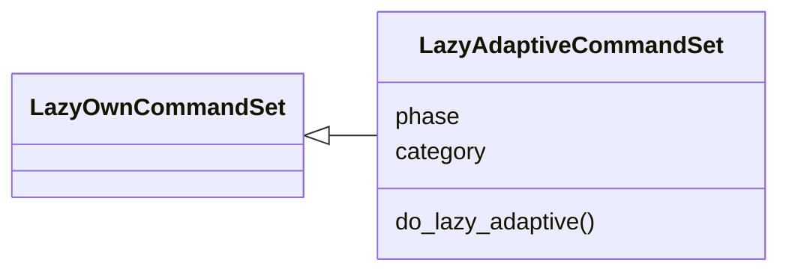
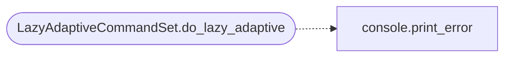

# `cli.commands.lazy_adaptive`

> Source: [cli/commands/lazy_adaptive.py:1](../../cli/commands/lazy_adaptive.py#L1) | language `py` | coverage 100.0% | [API index](../index.md)

LazyAdaptive policy inspector for the `[`adaptive`](cli.apt_chain_support.py.md#chainargs-adaptive)` fallback contract.

Read-only operator surface over `[`modules.failure_verdict`](modules.failure_verdict.py.md)` and
`[`modules.lazy_fallback`](modules.lazy_fallback.py.md)`: shows the verdict taxonomy, the action matrix
and the curated fallback graph with Atomic-catalogue presence marks.
Behaviour arming stays on ``apt_chain ... --adaptive``.

## Contents

- **Classes:** [`LazyAdaptiveCommandSet`](#lazyadaptivecommandset)

## Type Diagram



## Call Graph

Solid arrows stay in this module, dashed arrows leave it.



## Classes

<a id="lazyadaptivecommandset"></a>

### `LazyAdaptiveCommandSet`

`class` | [cli/commands/lazy_adaptive.py:18](../../cli/commands/lazy_adaptive.py#L18)

Decorators: `@cmd2.with_category('12. Miscellaneous')`

```python
class LazyAdaptiveCommandSet(LazyOwnCommandSet)
```

Bases: [`LazyOwnCommandSet`](cli.commands._base.py.md#lazyowncommandset)

Inspect the failure-verdict policy and the fallback graph.

**Attributes**

| Name | Type | Default | Description |
|---|---|---|---|
| [`phase`](#lazyadaptivecommandset-phase) |  | `'ai'` |  |
| [`category`](#lazyadaptivecommandset-category) |  | `'AI Autonomous Loop'` |  |

**Members**

| Member | Kind | Summary |
|---|---|---|
| [`do_lazy_adaptive`](#lazyadaptivecommandset-do_lazy_adaptive) | method | LazyAdaptive policy inspector. |

<a id="lazyadaptivecommandset-do_lazy_adaptive"></a>

#### `LazyAdaptiveCommandSet.do_lazy_adaptive`

`method` | [cli/commands/lazy_adaptive.py:24](../../cli/commands/lazy_adaptive.py#L24)

```python
def do_lazy_adaptive(self, line: str) -> None
```

LazyAdaptive policy inspector.

Usage:
    lazy_adaptive              Verdict taxonomy and action matrix
    lazy_adaptive graph        Curated fallback graph + catalogue marks

**Parameters**

| Name | Type | Default | Description |
|---|---|---|---|
| `line` | `str` |  |  |

*Calls:* [`print_error`](core.console.py.md#print_error)

---
