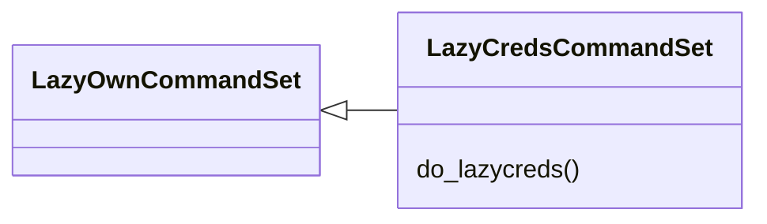
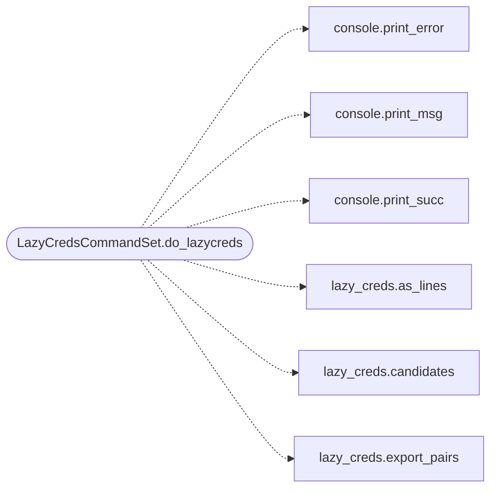

# `cli.commands.lazy_creds`

> Source: [cli/commands/lazy_creds.py:1](../../cli/commands/lazy_creds.py#L1) | language `py` | coverage 100.0% | [API index](../index.md)

LazyCreds shell commands: default-credential knowledge base lookups.

## Contents

- **Classes:** [`LazyCredsCommandSet`](#lazycredscommandset)

## Type Diagram



## Call Graph

Solid arrows stay in this module, dashed arrows leave it.



## Classes

<a id="lazycredscommandset"></a>

### `LazyCredsCommandSet`

`class` | [cli/commands/lazy_creds.py:21](../../cli/commands/lazy_creds.py#L21)

```python
class LazyCredsCommandSet(LazyOwnCommandSet)
```

Bases: [`LazyOwnCommandSet`](cli.commands._base.py.md#lazyowncommandset)

Expose the default-credential knowledge base to the operator.

**Members**

| Member | Kind | Summary |
|---|---|---|
| [`do_lazycreds`](#lazycredscommandset-do_lazycreds) | method | Search the default-credential knowledge base. |

<a id="lazycredscommandset-do_lazycreds"></a>

#### `LazyCredsCommandSet.do_lazycreds`

`method` | [cli/commands/lazy_creds.py:25](../../cli/commands/lazy_creds.py#L25)

Decorators: `@cmd2.with_category(miscellaneous_category)`

```python
def do_lazycreds(self, line)
```

Search the default-credential knowledge base.

Usage:
    lazycreds <query>          search vendor/username substring
    lazycreds --top <n>        most repeated user:pass pairs
    lazycreds --export <file>  write user:pass pairs for sprayers

**Parameters**

| Name | Type | Default | Description |
|---|---|---|---|
| `line` |  |  |  |

*Calls:* [`print_error`](core.console.py.md#print_error), [`print_msg`](core.console.py.md#print_msg), [`print_succ`](core.console.py.md#print_succ), [`as_lines`](modules.lazy_creds.py.md#as_lines), [`candidates`](modules.lazy_creds.py.md#candidates), [`export_pairs`](modules.lazy_creds.py.md#export_pairs)

---
