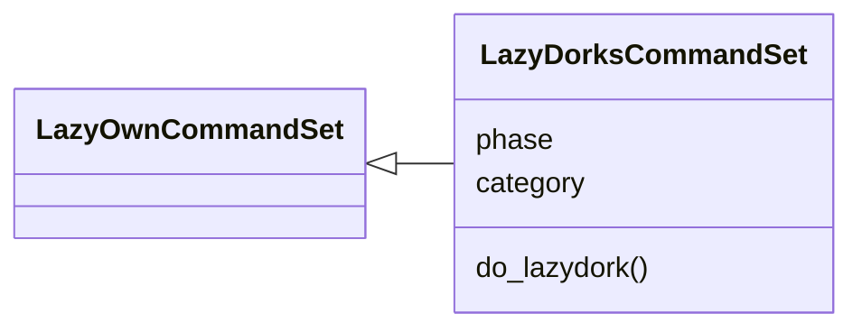
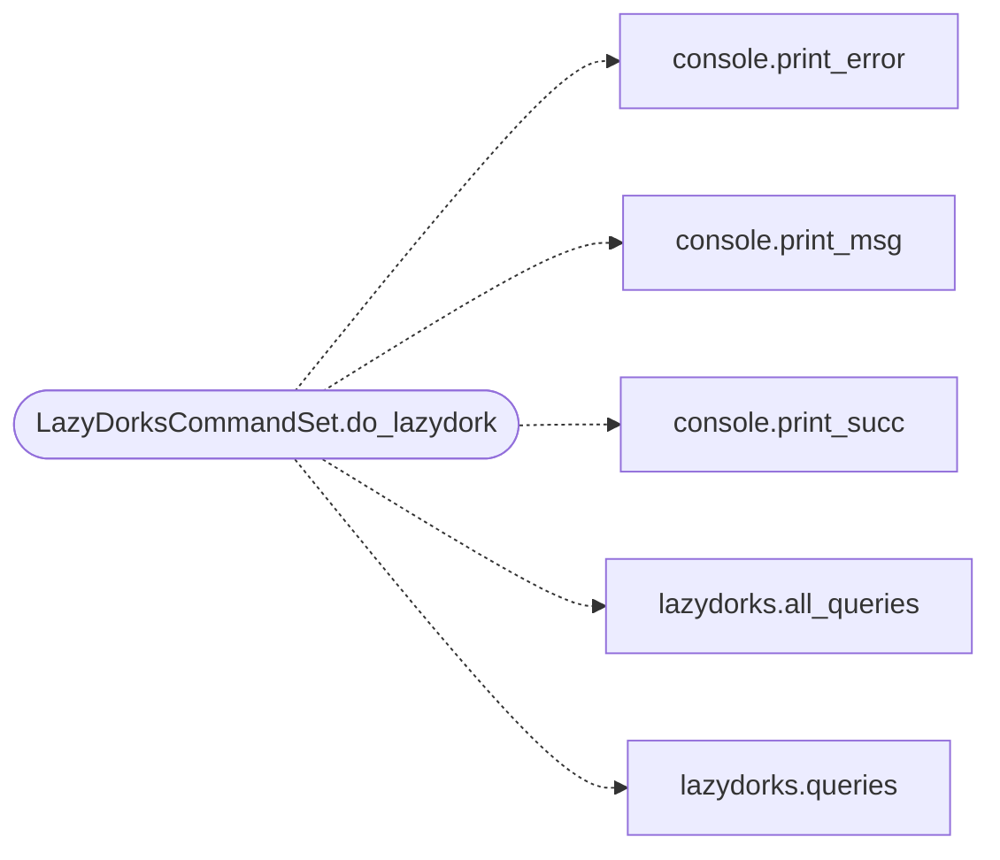

# `cli.commands.lazy_dorks`

> Source: [cli/commands/lazy_dorks.py:1](../../cli/commands/lazy_dorks.py#L1) | language `py` | coverage 100.0% | [API index](../index.md)

LazyDorks shell command: render target dork playbooks into session artefacts.

## Contents

- **Classes:** [`LazyDorksCommandSet`](#lazydorkscommandset)
- **Constants:** [`SESSIONS_DIR`](#sessions_dir), [`DORK_REPORT_TEMPLATE`](#dork_report_template)

## Type Diagram



## Call Graph

Solid arrows stay in this module, dashed arrows leave it.



## Classes

<a id="lazydorkscommandset"></a>

### `LazyDorksCommandSet`

`class` | [cli/commands/lazy_dorks.py:30](../../cli/commands/lazy_dorks.py#L30)

```python
class LazyDorksCommandSet(LazyOwnCommandSet)
```

Bases: [`LazyOwnCommandSet`](cli.commands._base.py.md#lazyowncommandset)

Expose the LazyDorks generator to the operator.

**Attributes**

| Name | Type | Default | Description |
|---|---|---|---|
| [`phase`](#lazydorkscommandset-phase) |  | `'recon'` |  |
| [`category`](#lazydorkscommandset-category) |  | `miscellaneous_category` |  |

**Members**

| Member | Kind | Summary |
|---|---|---|
| [`do_lazydork`](#lazydorkscommandset-do_lazydork) | method | Search the dork grammar for one target. |

<a id="lazydorkscommandset-do_lazydork"></a>

#### `LazyDorksCommandSet.do_lazydork`

`method` | [cli/commands/lazy_dorks.py:37](../../cli/commands/lazy_dorks.py#L37)

Decorators: `@cmd2.with_category(miscellaneous_category)`

```python
def do_lazydork(self, line)
```

Search the dork grammar for one target.

Usage:
    lazydork <domain> [--org <github-org>] [--cat <category>]
    lazydork <domain> --export <file>

Without --export the full report is rendered and persisted to
``sessions/lazydorks_<domain>.md``. Little data is fetched here:
the list stays pure text to drive your own engine, review before
running anything noisy.

**Parameters**

| Name | Type | Default | Description |
|---|---|---|---|
| `line` |  |  |  |

*Calls:* [`print_error`](core.console.py.md#print_error), [`print_msg`](core.console.py.md#print_msg), [`print_succ`](core.console.py.md#print_succ), [`all_queries`](modules.lazydorks.py.md#all_queries), [`queries`](modules.lazydorks.py.md#queries)

---

## Constants

<a id="sessions_dir"></a>

### `SESSIONS_DIR`

`constant` | [cli/commands/lazy_dorks.py:13](../../cli/commands/lazy_dorks.py#L13)

```python
SESSIONS_DIR = 'sessions'
```

---

<a id="dork_report_template"></a>

### `DORK_REPORT_TEMPLATE`

`constant` | [cli/commands/lazy_dorks.py:14](../../cli/commands/lazy_dorks.py#L14)

```python
DORK_REPORT_TEMPLATE = '{sessions_dir}/lazydorks_{slug}.md'
```

---
