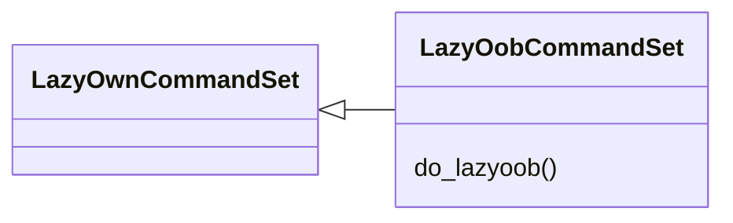
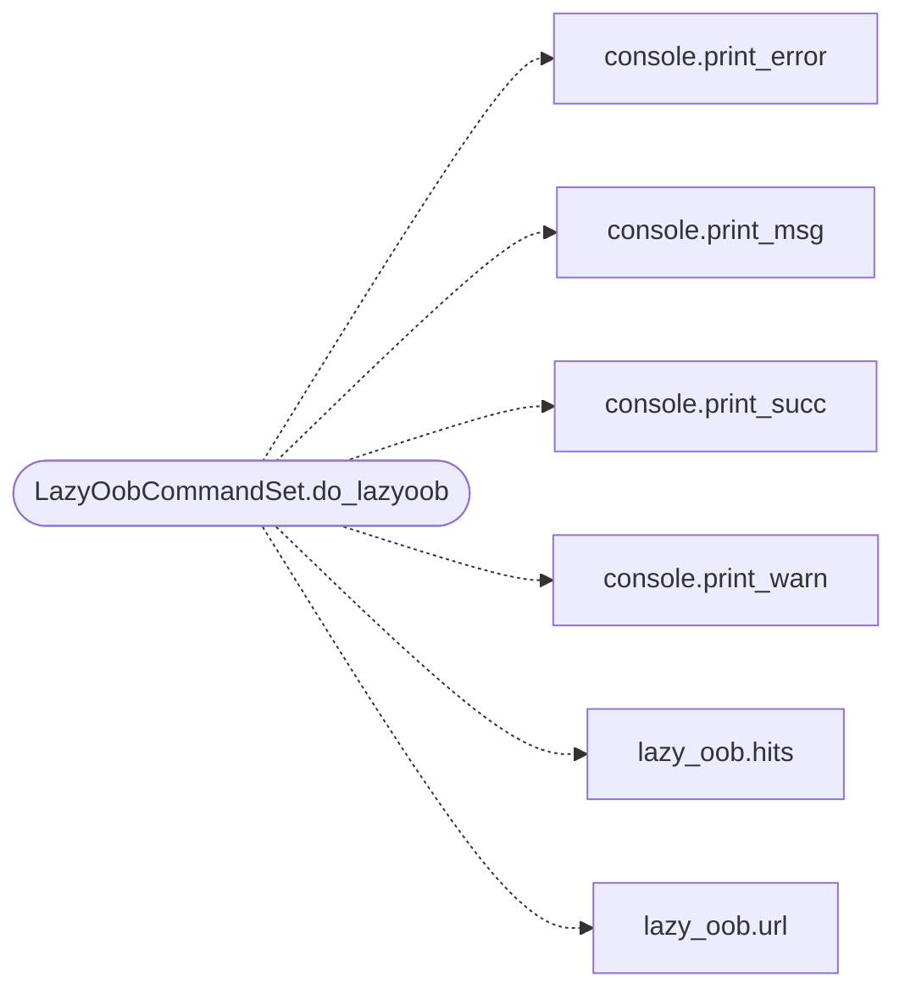

# `cli.commands.lazy_oob`

> Source: [cli/commands/lazy_oob.py:1](../../cli/commands/lazy_oob.py#L1) | language `py` | coverage 100.0% | [API index](../index.md)

LazyOob shell commands: local OOB canary for blind SSRF/RCE callbacks.

## Contents

- **Classes:** [`LazyOobCommandSet`](#lazyoobcommandset)

## Type Diagram



## Call Graph

Solid arrows stay in this module, dashed arrows leave it.



## Classes

<a id="lazyoobcommandset"></a>

### `LazyOobCommandSet`

`class` | [cli/commands/lazy_oob.py:22](../../cli/commands/lazy_oob.py#L22)

```python
class LazyOobCommandSet(LazyOwnCommandSet)
```

Bases: [`LazyOwnCommandSet`](cli.commands._base.py.md#lazyowncommandset)

Operate the local out-of-band callback canary.

**Members**

| Member | Kind | Summary |
|---|---|---|
| [`do_lazyoob`](#lazyoobcommandset-do_lazyoob) | method | Run a local HTTP callback canary. |

<a id="lazyoobcommandset-do_lazyoob"></a>

#### `LazyOobCommandSet.do_lazyoob`

`method` | [cli/commands/lazy_oob.py:26](../../cli/commands/lazy_oob.py#L26)

Decorators: `@cmd2.with_category(miscellaneous_category)`

```python
def do_lazyoob(self, line)
```

Run a local HTTP callback canary.

Usage:
    lazyoob start [host] [port]   start listener (defaults: lhost, ephemeral)
    lazyoob url [token]           print the callback URL
    lazyoob hits [token]          show observed callbacks
    lazyoob stop                  stop the listener

**Parameters**

| Name | Type | Default | Description |
|---|---|---|---|
| `line` |  |  |  |

*Calls:* [`print_error`](core.console.py.md#print_error), [`print_msg`](core.console.py.md#print_msg), [`print_succ`](core.console.py.md#print_succ), [`print_warn`](core.console.py.md#print_warn), [`hits`](modules.lazy_oob.py.md#hits), [`url`](modules.lazy_oob.py.md#url)

---
