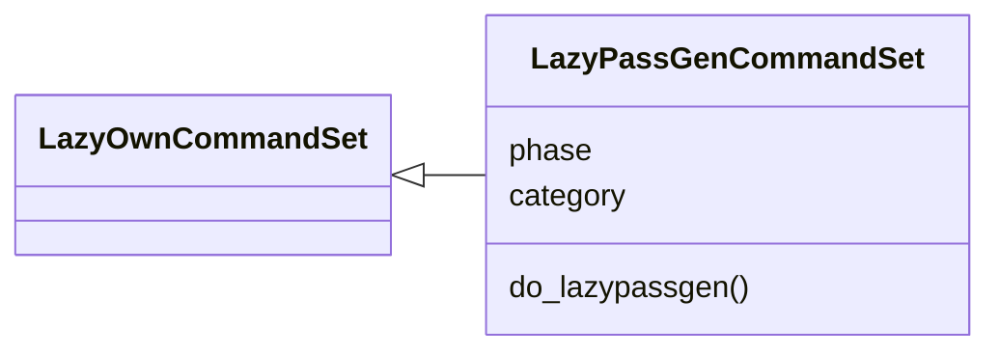
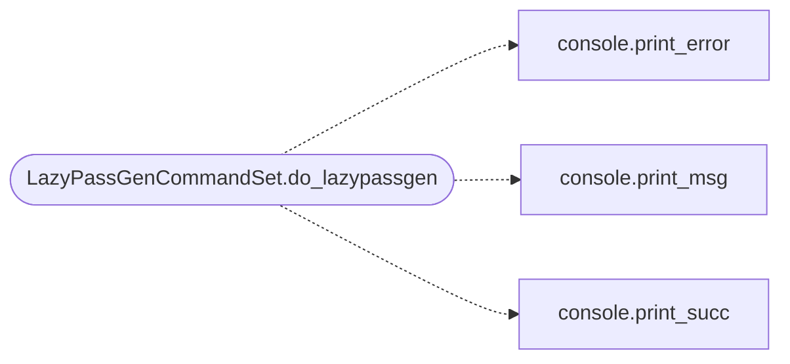

# `cli.commands.lazy_passgen`

> Source: [cli/commands/lazy_passgen.py:1](../../cli/commands/lazy_passgen.py#L1) | language `py` | coverage 100.0% | [API index](../index.md)

LazyPassGen shell command: target-aware weak password generation.

## Contents

- **Classes:** [`LazyPassGenCommandSet`](#lazypassgencommandset)
- **Constants:** [`SESSIONS_DIR`](#sessions_dir), [`WORDLIST_TEMPLATE`](#wordlist_template)

## Type Diagram



## Call Graph

Solid arrows stay in this module, dashed arrows leave it.



## Classes

<a id="lazypassgencommandset"></a>

### `LazyPassGenCommandSet`

`class` | [cli/commands/lazy_passgen.py:14](../../cli/commands/lazy_passgen.py#L14)

```python
class LazyPassGenCommandSet(LazyOwnCommandSet)
```

Bases: [`LazyOwnCommandSet`](cli.commands._base.py.md#lazyowncommandset)

Expose LazyPassGen to the operator.

**Attributes**

| Name | Type | Default | Description |
|---|---|---|---|
| [`phase`](#lazypassgencommandset-phase) |  | `'credential_access'` |  |
| [`category`](#lazypassgencommandset-category) |  | `miscellaneous_category` |  |

**Members**

| Member | Kind | Summary |
|---|---|---|
| [`do_lazypassgen`](#lazypassgencommandset-do_lazypassgen) | method | Generate a target-aware candidate wordlist. |

<a id="lazypassgencommandset-do_lazypassgen"></a>

#### `LazyPassGenCommandSet.do_lazypassgen`

`method` | [cli/commands/lazy_passgen.py:21](../../cli/commands/lazy_passgen.py#L21)

Decorators: `@cmd2.with_category(miscellaneous_category)`

```python
def do_lazypassgen(self, line)
```

Generate a target-aware candidate wordlist.

Usage:
    lazypassgen <entity> [--export <file>]

Without --export the list lands in ``sessions/wordlist_<entity>.txt``
seeded with the most frequent default credentials. Peak combos:
feed the result to spray or brute force inside the kill chain, the
generation stops as pure data.

**Parameters**

| Name | Type | Default | Description |
|---|---|---|---|
| `line` |  |  |  |

*Calls:* [`print_error`](core.console.py.md#print_error), [`print_msg`](core.console.py.md#print_msg), [`print_succ`](core.console.py.md#print_succ)

---

## Constants

<a id="sessions_dir"></a>

### `SESSIONS_DIR`

`constant` | [cli/commands/lazy_passgen.py:10](../../cli/commands/lazy_passgen.py#L10)

```python
SESSIONS_DIR = 'sessions'
```

---

<a id="wordlist_template"></a>

### `WORDLIST_TEMPLATE`

`constant` | [cli/commands/lazy_passgen.py:11](../../cli/commands/lazy_passgen.py#L11)

```python
WORDLIST_TEMPLATE = '{sessions_dir}/wordlist_{slug}.txt'
```

---
