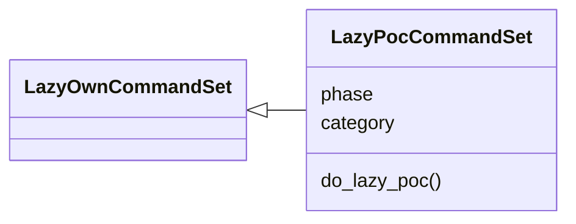

# `cli.commands.lazy_poc`

> Source: [cli/commands/lazy_poc.py:1](../../cli/commands/lazy_poc.py#L1) | language `py` | coverage 100.0% | [API index](../index.md)

LazyPoc shell commands: catalogued PoC scripts as reusable verbs.

## Contents

- **Classes:** [`LazyPocCommandSet`](#lazypoccommandset)
- **Constants:** [`SESSIONS_DIR`](#sessions_dir), [`POC_LOG_DIR`](#poc_log_dir)

## Type Diagram



## Call Graph

Solid arrows stay in this module, dashed arrows leave it.


## Classes

<a id="lazypoccommandset"></a>

### `LazyPocCommandSet`

`class` | [cli/commands/lazy_poc.py:18](../../cli/commands/lazy_poc.py#L18)

```python
class LazyPocCommandSet(LazyOwnCommandSet)
```

Bases: [`LazyOwnCommandSet`](cli.commands._base.py.md#lazyowncommandset)

Run catalogued proof-of-concept scripts as loop-routable verbs.

**Attributes**

| Name | Type | Default | Description |
|---|---|---|---|
| [`phase`](#lazypoccommandset-phase) |  | `'exploit'` |  |
| [`category`](#lazypoccommandset-category) |  | `'12. Miscellaneous'` |  |

**Members**

| Member | Kind | Summary |
|---|---|---|
| [`do_lazy_poc`](#lazypoccommandset-do_lazy_poc) | method | Operate the PoC verb registry. |

<a id="lazypoccommandset-do_lazy_poc"></a>

#### `LazyPocCommandSet.do_lazy_poc`

`method` | [cli/commands/lazy_poc.py:24](../../cli/commands/lazy_poc.py#L24)

```python
def do_lazy_poc(self, line)
```

Operate the PoC verb registry.

Usage:
    lazy_poc list                     catalogued PoC verbs
    lazy_poc info <name>              one verb's contract
    lazy_poc run <name> [target] [k=v ...]
                                      render placeholders from payload.json
                                      (rhost, rport, lhost, lport, user,
                                      password, domain) and execute the
                                      script through the safe subprocess

**Parameters**

| Name | Type | Default | Description |
|---|---|---|---|
| `line` |  |  |  |

*Calls:* [`print_error`](core.console.py.md#print_error)

---

## Constants

<a id="sessions_dir"></a>

### `SESSIONS_DIR`

`constant` | [cli/commands/lazy_poc.py:13](../../cli/commands/lazy_poc.py#L13)

```python
SESSIONS_DIR = Path('sessions')
```

---

<a id="poc_log_dir"></a>

### `POC_LOG_DIR`

`constant` | [cli/commands/lazy_poc.py:14](../../cli/commands/lazy_poc.py#L14)

```python
POC_LOG_DIR = SESSIONS_DIR / 'poc'
```

---
