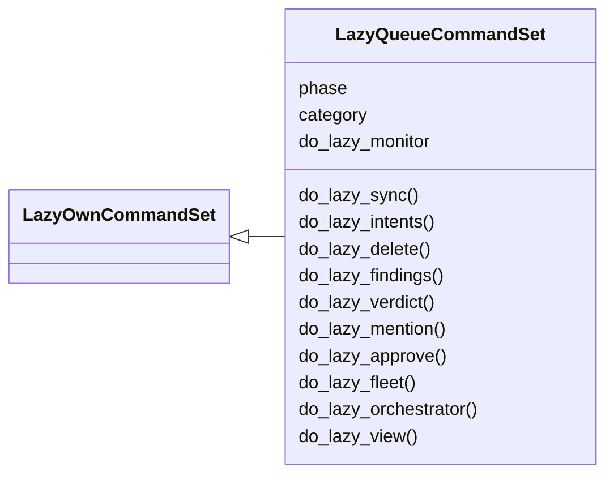
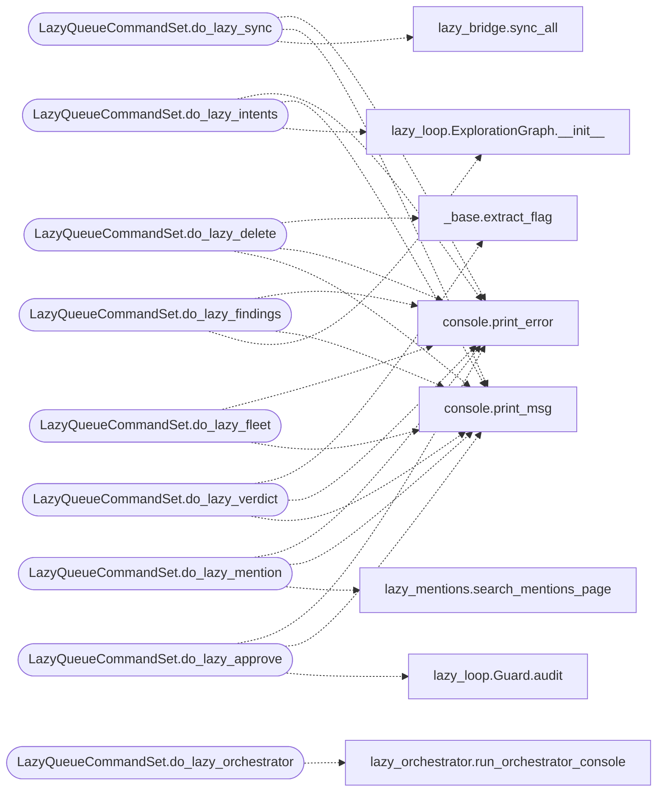

# `cli.commands.lazyloop`

> Source: [cli/commands/lazyloop.py:1](../../cli/commands/lazyloop.py#L1) | language `py` | coverage 100.0% | [API index](../index.md)

Lazy queue and misc command set.

Engine-backed operator surface with ``lazy_`` names. Every command here
reads or writes the single `[`modules.lazy_engine`](modules.lazy_engine.py.md)` store, so queue,
findings, verdicts and guard reviews always match what the autonomous
loop (``lazy_loop`` / ``auto_loop``) sees. The per-task engine surface
(status, broadcast, trace, hint, steer, kill, retest) lives in
`[`cli.commands.lazyops`](cli.commands.lazyops.py.md)`; no name is duplicated across both sets.

## Contents

- **Classes:** [`LazyQueueCommandSet`](#lazyqueuecommandset)

## Type Diagram



## Call Graph

Solid arrows stay in this module, dashed arrows leave it.



## Classes

<a id="lazyqueuecommandset"></a>

### `LazyQueueCommandSet`

`class` | [cli/commands/lazyloop.py:29](../../cli/commands/lazyloop.py#L29)

```python
class LazyQueueCommandSet(LazyOwnCommandSet)
```

Bases: [`LazyOwnCommandSet`](cli.commands._base.py.md#lazyowncommandset)

Lazy queue controls backed by the loop engine.

**Attributes**

| Name | Type | Default | Description |
|---|---|---|---|
| [`phase`](#lazyqueuecommandset-phase) |  | `'exploit'` |  |
| [`category`](#lazyqueuecommandset-category) |  | `'16. Artificial Intelligence'` |  |
| [`do_lazy_monitor`](#lazyqueuecommandset-do_lazy_monitor) |  | `do_lazy_view` |  |

**Members**

| Member | Kind | Summary |
|---|---|---|
| [`do_lazy_sync`](#lazyqueuecommandset-do_lazy_sync) | method | Run bidirectional LAZY sync into world model and objectives. |
| [`do_lazy_intents`](#lazyqueuecommandset-do_lazy_intents) | method | List engine intents for a task, optionally filtered by state. |
| [`do_lazy_delete`](#lazyqueuecommandset-do_lazy_delete) | method | Delete an engine intent; soft keeps outputs, hard cascades. |
| [`do_lazy_findings`](#lazyqueuecommandset-do_lazy_findings) | method | List engine findings for a task, optionally filtered by status. |
| [`do_lazy_verdict`](#lazyqueuecommandset-do_lazy_verdict) | method | Record a manual retest verdict on an engine finding. |
| [`do_lazy_mention`](#lazyqueuecommandset-do_lazy_mention) | method | Search @ mention candidates with scroll pagination. |
| [`do_lazy_approve`](#lazyqueuecommandset-do_lazy_approve) | method | List engine guard reviews filtered by decision and source. |
| [`do_lazy_fleet`](#lazyqueuecommandset-do_lazy_fleet) | method | Cross-task fleet: list \| graph <task> \| findings <task> \| traces <task> [query] \| node <task> <id> \| pause <task> \| resume <task> \| report <task> <finding>... |
| [`do_lazy_orchestrator`](#lazyqueuecommandset-do_lazy_orchestrator) | method | Admin console for the loop (Textual TUI). |
| [`do_lazy_view`](#lazyqueuecommandset-do_lazy_view) | method | Attach the live worker monitor to a task (or the newest task). |

<a id="lazyqueuecommandset-do_lazy_sync"></a>

#### `LazyQueueCommandSet.do_lazy_sync`

`method` | [cli/commands/lazyloop.py:36](../../cli/commands/lazyloop.py#L36)

Decorators: `@cmd2.with_category(exploitation_category)`

```python
def do_lazy_sync(self, line)
```

Run bidirectional LAZY sync into world model and objectives.

Usage:
    lazy_sync

**Parameters**

| Name | Type | Default | Description |
|---|---|---|---|
| `line` |  |  |  |

*Calls:* [`print_error`](core.console.py.md#print_error), [`print_msg`](core.console.py.md#print_msg), [`sync_all`](modules.lazy_bridge.py.md#sync_all)

<a id="lazyqueuecommandset-do_lazy_intents"></a>

#### `LazyQueueCommandSet.do_lazy_intents`

`method` | [cli/commands/lazyloop.py:51](../../cli/commands/lazyloop.py#L51)

Decorators: `@cmd2.with_category(exploitation_category)`

```python
def do_lazy_intents(self, line)
```

List engine intents for a task, optionally filtered by state.

Usage:
    lazy_intents <task_id> [state]

**Parameters**

| Name | Type | Default | Description |
|---|---|---|---|
| `line` |  |  |  |

*Calls:* [`print_error`](core.console.py.md#print_error), [`print_msg`](core.console.py.md#print_msg), [`ExplorationGraph.__init__`](modules.lazy_loop.py.md#explorationgraph-__init__)

<a id="lazyqueuecommandset-do_lazy_delete"></a>

#### `LazyQueueCommandSet.do_lazy_delete`

`method` | [cli/commands/lazyloop.py:71](../../cli/commands/lazyloop.py#L71)

Decorators: `@cmd2.with_category(exploitation_category)`

```python
def do_lazy_delete(self, line)
```

Delete an engine intent; soft keeps outputs, hard cascades.

Usage:
    lazy_delete <task_id> <intent_id> --reason <text> [--hard] [--yes]

**Parameters**

| Name | Type | Default | Description |
|---|---|---|---|
| `line` |  |  |  |

*Calls:* [`extract_flag`](cli.commands._base.py.md#extract_flag), [`print_error`](core.console.py.md#print_error), [`print_msg`](core.console.py.md#print_msg)

<a id="lazyqueuecommandset-do_lazy_findings"></a>

#### `LazyQueueCommandSet.do_lazy_findings`

`method` | [cli/commands/lazyloop.py:110](../../cli/commands/lazyloop.py#L110)

Decorators: `@cmd2.with_category(exploitation_category)`

```python
def do_lazy_findings(self, line)
```

List engine findings for a task, optionally filtered by status.

Usage:
    lazy_findings <task_id> [status]

**Parameters**

| Name | Type | Default | Description |
|---|---|---|---|
| `line` |  |  |  |

*Calls:* [`print_error`](core.console.py.md#print_error), [`print_msg`](core.console.py.md#print_msg), [`ExplorationGraph.__init__`](modules.lazy_loop.py.md#explorationgraph-__init__)

<a id="lazyqueuecommandset-do_lazy_verdict"></a>

#### `LazyQueueCommandSet.do_lazy_verdict`

`method` | [cli/commands/lazyloop.py:132](../../cli/commands/lazyloop.py#L132)

Decorators: `@cmd2.with_category(exploitation_category)`

```python
def do_lazy_verdict(self, line)
```

Record a manual retest verdict on an engine finding.

Usage:
    lazy_verdict <task_id> <finding_id> <reproduced|fixed|inconclusive> [--note <text>]

**Parameters**

| Name | Type | Default | Description |
|---|---|---|---|
| `line` |  |  |  |

*Calls:* [`extract_flag`](cli.commands._base.py.md#extract_flag), [`print_error`](core.console.py.md#print_error), [`print_msg`](core.console.py.md#print_msg)

<a id="lazyqueuecommandset-do_lazy_mention"></a>

#### `LazyQueueCommandSet.do_lazy_mention`

`method` | [cli/commands/lazyloop.py:155](../../cli/commands/lazyloop.py#L155)

Decorators: `@cmd2.with_category(exploitation_category)`

```python
def do_lazy_mention(self, line)
```

Search @ mention candidates with scroll pagination.

Usage:
    lazy_mention [kind] [query] [--cursor C]

**Parameters**

| Name | Type | Default | Description |
|---|---|---|---|
| `line` |  |  |  |

*Calls:* [`print_error`](core.console.py.md#print_error), [`print_msg`](core.console.py.md#print_msg), [`search_mentions_page`](modules.lazy_mentions.py.md#search_mentions_page)

<a id="lazyqueuecommandset-do_lazy_approve"></a>

#### `LazyQueueCommandSet.do_lazy_approve`

`method` | [cli/commands/lazyloop.py:190](../../cli/commands/lazyloop.py#L190)

Decorators: `@cmd2.with_category(exploitation_category)`

```python
def do_lazy_approve(self, line)
```

List engine guard reviews filtered by decision and source.

Usage:
    lazy_approve <task_id> [ALLOW|ASK|DENY] [source]

**Parameters**

| Name | Type | Default | Description |
|---|---|---|---|
| `line` |  |  |  |

*Calls:* [`print_error`](core.console.py.md#print_error), [`print_msg`](core.console.py.md#print_msg), [`Guard.audit`](modules.lazy_loop.py.md#guard-audit)

<a id="lazyqueuecommandset-do_lazy_fleet"></a>

#### `LazyQueueCommandSet.do_lazy_fleet`

`method` | [cli/commands/lazyloop.py:212](../../cli/commands/lazyloop.py#L212)

Decorators: `@cmd2.with_category(exploitation_category)`

```python
def do_lazy_fleet(self, line)
```

Cross-task fleet: list | graph <task> | findings <task> | traces <task> [query] | node <task> <id> | pause <task> | resume <task> | report <task> <finding> <text...>

Usage:
    lazy_fleet list
    lazy_fleet graph t0001
    lazy_fleet findings t0001
    lazy_fleet traces t0001 ssh
    lazy_fleet node t0001 12
    lazy_fleet pause t0001
    lazy_fleet report t0001 7 ## Summary ...

**Parameters**

| Name | Type | Default | Description |
|---|---|---|---|
| `line` |  |  |  |

*Calls:* [`print_error`](core.console.py.md#print_error), [`print_msg`](core.console.py.md#print_msg)

<a id="lazyqueuecommandset-do_lazy_orchestrator"></a>

#### `LazyQueueCommandSet.do_lazy_orchestrator`

`method` | [cli/commands/lazyloop.py:277](../../cli/commands/lazyloop.py#L277)

Decorators: `@cmd2.with_category(exploitation_category)`

```python
def do_lazy_orchestrator(self, line)
```

Admin console for the loop (Textual TUI).

Tabs: Now (what the orchestrator is executing right now, live
activity tail and per-worker current command), Config (payload
knobs the runner reads), Verbs (searchable command picker when
adding a verb), Playbooks (full CRUD over playbooks/*.yaml with
preview and raw YAML editing), Gyms (YAML catalogue plus
persistent active runs; space starts or stops the selected gym),
Chains (APT chain YAML administration: preview, enable/disable,
generate from playbook, delete), Profiles (activate orchestration
profiles), Models (LLM failover chain add/remove), Guard
(intercept rules add/remove). Keys: r refresh, s save config,
a add, e edit, d delete, space toggle, q quit.

Usage:
    lazy_orchestrator [task_id]

**Parameters**

| Name | Type | Default | Description |
|---|---|---|---|
| `line` |  |  |  |

*Calls:* [`run_orchestrator_console`](cli.lazy_orchestrator.py.md#run_orchestrator_console), [`print_error`](core.console.py.md#print_error)

<a id="lazyqueuecommandset-do_lazy_view"></a>

#### `LazyQueueCommandSet.do_lazy_view`

`method` | [cli/commands/lazyloop.py:305](../../cli/commands/lazyloop.py#L305)

Decorators: `@cmd2.with_category(exploitation_category)`

```python
def do_lazy_view(self, line)
```

Attach the live worker monitor to a task (or the newest task).

Split panes per worker plus audit tabs (activity, guard,
traffic, findings) and operator keys: q quit, p/r pause/resume,
a/d approve/deny first pending intercept, h hint, s steer,
k kill. Works from a second terminal while ``lazy_loop`` runs.

Usage:
    lazy_view [task_id]

**Parameters**

| Name | Type | Default | Description |
|---|---|---|---|
| `line` |  |  |  |

*Calls:* [`run_monitor_command`](cli.lazy_monitor.py.md#run_monitor_command), [`print_error`](core.console.py.md#print_error)

---
