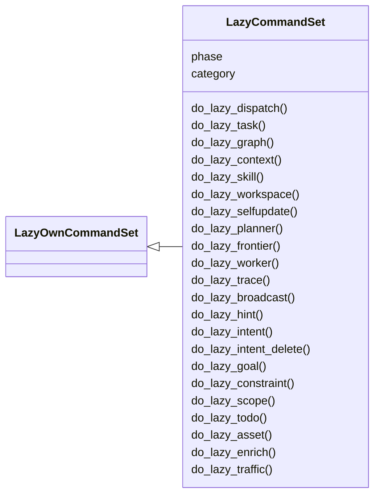
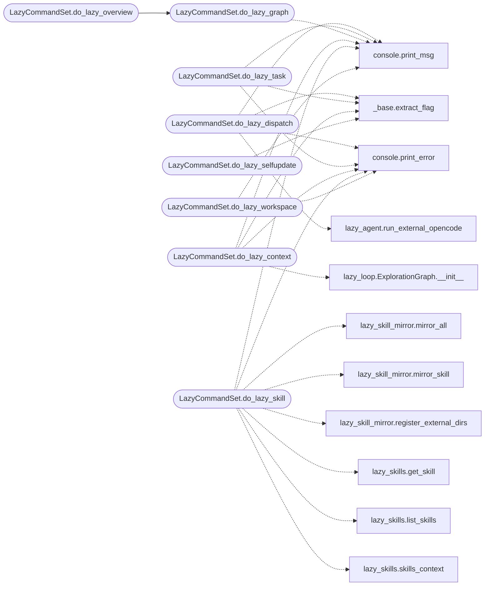

# `cli.commands.lazyops`

> Source: [cli/commands/lazyops.py:1](../../cli/commands/lazyops.py#L1) | language `py` | coverage 96.6% | [API index](../index.md)

Lazy autonomous loop commands (single orchestrator, lazy_* surface).

Every subsystem is invocable individually so the operator sees
what it does, plus ``lazy_loop`` driving the full engine.
The orchestrator auto-invokes every step internally, so a human runs
ONE command and the engine runs scope, asset, enrich, planner,
frontier, worker, guard, traffic, finding, retest, compaction, trace.

Example session (operator-visible, real commands):
    lazy_task create gain initial access on 127.0.0.1
    lazy_scope add ip 127.0.0.1 local test
    lazy_asset add ip 127.0.0.1
    lazy_loop --task t0001 --rounds 6 --workers 2

## Contents

- **Classes:** [`LazyCommandSet`](#lazycommandset)

## Type Diagram



## Call Graph

Solid arrows stay in this module, dashed arrows leave it.



## Classes

<a id="lazycommandset"></a>

### `LazyCommandSet`

`class` | [cli/commands/lazyops.py:35](../../cli/commands/lazyops.py#L35)

```python
class LazyCommandSet(LazyOwnCommandSet)
```

Bases: [`LazyOwnCommandSet`](cli.commands._base.py.md#lazyowncommandset)

Lazy double-graph autonomous loop: planner, workers, guard, retest.

**Attributes**

| Name | Type | Default | Description |
|---|---|---|---|
| [`phase`](#lazycommandset-phase) |  | `'ai'` |  |
| [`category`](#lazycommandset-category) |  | `'AI Autonomous Loop'` |  |

**Members**

| Member | Kind | Summary |
|---|---|---|
| [`do_lazy_dispatch`](#lazycommandset-do_lazy_dispatch) | method | Dispatch one detached task to an external agent: opencode\|hermes [--in DIR] [--resume S] [--max-turns N] [--run-budget S] [--timeout S] <task...>. |
| [`do_lazy_task`](#lazycommandset-do_lazy_task) | method | Create/list/show/pause/resume/delete/spawn/queue/limit/drain tasks. |
| [`do_lazy_graph`](#lazycommandset-do_lazy_graph) | method | Show planner-facing graph overview. |
| [`do_lazy_context`](#lazycommandset-do_lazy_context) | method | Render the bounded prompt context the planner/worker LLMs receive. |
| [`do_lazy_skill`](#lazycommandset-do_lazy_skill) | method | Skills: list\|show <name>\|preview\|inject <name...>\|clear\|auto on\|off\|mirror [name]\|register-hermes. |
| [`do_lazy_workspace`](#lazycommandset-do_lazy_workspace) | method | Confined workspace files: list [path]\|read <path>\|write <path> <text>\|mkdir <path>\|rm <path>\|path. |
| [`do_lazy_selfupdate`](#lazycommandset-do_lazy_selfupdate) | method | Self-update: check [--branch B]\|apply [--yes] [--branch B]. |
| [`do_lazy_planner`](#lazycommandset-do_lazy_planner) | method | Run one planner wakeup (emits 0..N intents). |
| [`do_lazy_frontier`](#lazycommandset-do_lazy_frontier) | method | Show pending intent queue. |
| [`do_lazy_worker`](#lazycommandset-do_lazy_worker) | method | Claim ONE intent and execute it with real tools. |
| [`do_lazy_trace`](#lazycommandset-do_lazy_trace) | method | Worker trace exchange. |
| [`do_lazy_broadcast`](#lazycommandset-do_lazy_broadcast) | method | Exploration timeline. |
| [`do_lazy_hint`](#lazycommandset-do_lazy_hint) | method | Inject steering hint. |
| [`do_lazy_intent`](#lazycommandset-do_lazy_intent) | method |  |
| [`do_lazy_intent_delete`](#lazycommandset-do_lazy_intent_delete) | method | Delete an intent. |
| [`do_lazy_goal`](#lazycommandset-do_lazy_goal) | method | Goals: list\|set <t1;t2>\|edit <id> <text>\|delete <id>\|prove <goal> <evidence> <reason>\|met <reason>. |
| [`do_lazy_constraint`](#lazycommandset-do_lazy_constraint) | method | Constraints: add <allow\|deny> <text> \| list. |
| [`do_lazy_scope`](#lazycommandset-do_lazy_scope) | method | Scope: add <kind> <value> [reason] \| list. |
| [`do_lazy_todo`](#lazycommandset-do_lazy_todo) | method | Serial chain todos: add <text> \| done <id> \| list. |
| [`do_lazy_asset`](#lazycommandset-do_lazy_asset) | method | Assets: add <kind> <value> \| list [kind] \| scoped [--kind K] \| coverage \| untested. |
| [`do_lazy_enrich`](#lazycommandset-do_lazy_enrich) | method | Enrich asset with DNS/HTTP. |
| [`do_lazy_traffic`](#lazycommandset-do_lazy_traffic) | method | Traffic: list\|search <q>\|search-host <host> [--port P]\|get <digest>\|body <digest>\|blob <digest> [--part req\|resp] [--offset N] [--length N]\|search-body... |
| [`do_lazy_guard`](#lazycommandset-do_lazy_guard) | method | Guard gate: check <cmd> \| rule-add <pattern> <allow\|ask\|deny> [reason] \| rule-del <p> \| judge on\|off [--fail allow\|deny] \| judge fail <allow\|deny> \| judge \|... |
| [`do_lazy_finding`](#lazycommandset-do_lazy_finding) | method |  |
| [`do_lazy_retest`](#lazycommandset-do_lazy_retest) | method | Retest finding to reproduced/fixed/inconclusive. |
| [`do_lazy_steer`](#lazycommandset-do_lazy_steer) | method | Mid-run correction. |
| [`do_lazy_kill`](#lazycommandset-do_lazy_kill) | method | Terminate running intent. |
| [`do_lazy_pause`](#lazycommandset-do_lazy_pause) | method | Pause task loops. |
| [`do_lazy_resume`](#lazycommandset-do_lazy_resume) | method | Resume paused task. |
| [`do_lazy_report`](#lazycommandset-do_lazy_report) | method | Export severity-ranked report. |
| [`do_lazy_runtime`](#lazycommandset-do_lazy_runtime) | method | Show/set loop runtime: budgets, deadline, abort cause, heartbeat, settlement text. |
| [`do_lazy_payload_keys`](#lazycommandset-do_lazy_payload_keys) | method | Show worker tool defaults injected into every probe. |
| [`do_lazy_fact`](#lazycommandset-do_lazy_fact) | method | Facts: list [query] [--hot\|--cold]\|add <text>. |
| [`do_lazy_node`](#lazycommandset-do_lazy_node) | method | Full node detail. |
| [`do_lazy_evidence`](#lazycommandset-do_lazy_evidence) | method | Evidence vault and frozen package. |
| [`do_lazy_ask`](#lazycommandset-do_lazy_ask) | method | Bounded side question over task context. |
| [`do_lazy_agent`](#lazycommandset-do_lazy_agent) | method | Main agent with full tool calling (native backend or opencode). |
| [`do_lazy_company`](#lazycommandset-do_lazy_company) | method | Company scope: add <name> [scope]\|list\|match <value>. |
| [`do_lazy_tool`](#lazycommandset-do_lazy_tool) | method | Tool catalog: list [agent]\|bind\|unbind <agent> <tool>\|custom-add <name> <command\|script\|http> <target> [--desc D] [--method M] [--body B] [--timeout S]... |
| [`do_lazy_verb`](#lazycommandset-do_lazy_verb) | method | Loop verb admin: list [--phase P] [--q Q]\|enable\|disable <verb>\|add <verb> --keywords K [--phase P] [--no-target] [--desc D]\|remove <verb>\|full-cli [on\|off]. |
| [`do_lazy_stage`](#lazycommandset-do_lazy_stage) | method | Loop stage admin: list\|enable\|disable <stage>\|reset. |
| [`do_lazy_addon`](#lazycommandset-do_lazy_addon) | method | Addon trigger runner: list [service]\|run <name> [--target T]\|update [name\|--all] [--dry-run]. |
| [`do_lazy_notify`](#lazycommandset-do_lazy_notify) | method | Notify channels: list\|add <log\|webhook\|file\|slack\|email> <target> [--min S] [--to a] [--from f] [--user u] [--pass p] [--no-tls]\|remove <n>\|test [severity]. |
| [`do_lazy_trigger`](#lazycommandset-do_lazy_trigger) | method | Scheduler triggers: list\|add <kind> [every_sec]\|remove <id>\|addons\|sync. |
| [`do_lazy_llm`](#lazycommandset-do_lazy_llm) | method | LLM chain: list\|add <name> [model] [--priority N]\|priority <name> <N>\|remove <name>\|usage\|health\|context [N]\|record [on\|off]\|raw [--limit N]\|conformance... |
| [`do_lazy_compact`](#lazycommandset-do_lazy_compact) | method | Compaction: minor\|major [--threshold N]\|unfolded [--limit N]\|overview\|noa\|expand <digest>. |
| [`do_lazy_status`](#lazycommandset-do_lazy_status) | method | Full task status. |
| [`do_lazy_overview`](#lazycommandset-do_lazy_overview) | method | Alias of lazy_graph. |
| [`do_lazy_archive`](#lazycommandset-do_lazy_archive) | method | Task snapshots: save [--task T]\|list\|stats\|restore <path>. |
| [`do_lazy_template`](#lazycommandset-do_lazy_template) | method | Goal templates: list\|add <name> <goal>\|use <name>\|remove <name>. |
| [`do_lazy_category`](#lazycommandset-do_lazy_category) | method | Task labels: set <name> [--task T]\|list [name]. |
| [`do_lazy_chat`](#lazycommandset-do_lazy_chat) | method | Task conversation: say <text>\|log\|clear\|sessions. |
| [`do_lazy_scheduler`](#lazycommandset-do_lazy_scheduler) | method | Scheduler state: show\|run. |
| [`do_lazy_gate`](#lazycommandset-do_lazy_gate) | method | Asset gate: list\|check <target>\|block-add <kind> <pattern> [note]\|block-del <id>\|allow-add <kind> <pattern> [note]\|allow-del <id>. |
| [`do_lazy_loop`](#lazycommandset-do_lazy_loop) | method | Run the single orchestrator: auto-invokes scope/asset/enrich/planner/frontier/worker/guard/traffic/finding/retest/compact/trace. |
| [`do_lazy_sandbox`](#lazycommandset-do_lazy_sandbox) | method | Per-task Docker sandbox: status [--task T]\|up --task T [--image I]\|down --task T\|build\|exec --task T <verb...>. |
| [`do_lazy_install`](#lazycommandset-do_lazy_install) | method | Capability installer: <tool> [--dry-run]\|on\|off\|list. |

<a id="lazycommandset-do_lazy_dispatch"></a>

#### `LazyCommandSet.do_lazy_dispatch`

`method` | [cli/commands/lazyops.py:88](../../cli/commands/lazyops.py#L88)

Decorators: `@cmd2.with_category(ai_category)`

```python
def do_lazy_dispatch(self, line)
```

Dispatch one detached task to an external agent: opencode|hermes [--in DIR] [--resume S] [--max-turns N] [--run-budget S] [--timeout S] <task...>.

Usage: lazy_dispatch ...

**Parameters**

| Name | Type | Default | Description |
|---|---|---|---|
| `line` |  |  |  |

*Calls:* [`extract_flag`](cli.commands._base.py.md#extract_flag), [`print_error`](core.console.py.md#print_error), [`print_msg`](core.console.py.md#print_msg), [`run_external_opencode`](modules.lazy_agent.py.md#run_external_opencode)

<a id="lazycommandset-do_lazy_task"></a>

#### `LazyCommandSet.do_lazy_task`

`method` | [cli/commands/lazyops.py:147](../../cli/commands/lazyops.py#L147)

Decorators: `@cmd2.with_category(ai_category)`

```python
def do_lazy_task(self, line)
```

Create/list/show/pause/resume/delete/spawn/queue/limit/drain tasks.

Usage: lazy_task create <goal> | lazy_task list | lazy_task show|pause|resume|delete [--task T] | lazy_task spawn <goal> --from t0001[,t0002] | lazy_task limit [N] | lazy_task queue | lazy_task drain

**Parameters**

| Name | Type | Default | Description |
|---|---|---|---|
| `line` |  |  |  |

*Calls:* [`extract_flag`](cli.commands._base.py.md#extract_flag), [`print_error`](core.console.py.md#print_error), [`print_msg`](core.console.py.md#print_msg)

<a id="lazycommandset-do_lazy_graph"></a>

#### `LazyCommandSet.do_lazy_graph`

`method` | [cli/commands/lazyops.py:269](../../cli/commands/lazyops.py#L269)

Decorators: `@cmd2.with_category(ai_category)`

```python
def do_lazy_graph(self, line)
```

Show planner-facing graph overview.

Usage: lazy_graph [--task T]

**Parameters**

| Name | Type | Default | Description |
|---|---|---|---|
| `line` |  |  |  |

*Calls:* [`print_msg`](core.console.py.md#print_msg)

*Called by:* [`LazyCommandSet.do_lazy_overview`](#lazycommandset-do_lazy_overview)

<a id="lazycommandset-do_lazy_context"></a>

#### `LazyCommandSet.do_lazy_context`

`method` | [cli/commands/lazyops.py:298](../../cli/commands/lazyops.py#L298)

Decorators: `@cmd2.with_category(ai_category)`

```python
def do_lazy_context(self, line)
```

Render the bounded prompt context the planner/worker LLMs receive.

Usage: lazy_context [--task T] [--budget N]

**Parameters**

| Name | Type | Default | Description |
|---|---|---|---|
| `line` |  |  |  |

*Calls:* [`extract_flag`](cli.commands._base.py.md#extract_flag), [`print_error`](core.console.py.md#print_error), [`print_msg`](core.console.py.md#print_msg), [`ExplorationGraph.__init__`](modules.lazy_loop.py.md#explorationgraph-__init__)

<a id="lazycommandset-do_lazy_skill"></a>

#### `LazyCommandSet.do_lazy_skill`

`method` | [cli/commands/lazyops.py:319](../../cli/commands/lazyops.py#L319)

Decorators: `@cmd2.with_category(ai_category)`

```python
def do_lazy_skill(self, line)
```

Skills: list|show <name>|preview|inject <name...>|clear|auto on|off|mirror [name]|register-hermes.

Usage: lazy_skill ... [--task T]

**Parameters**

| Name | Type | Default | Description |
|---|---|---|---|
| `line` |  |  |  |

*Calls:* [`print_error`](core.console.py.md#print_error), [`print_msg`](core.console.py.md#print_msg), [`mirror_all`](modules.lazy_skill_mirror.py.md#mirror_all), [`mirror_skill`](modules.lazy_skill_mirror.py.md#mirror_skill), [`register_external_dirs`](modules.lazy_skill_mirror.py.md#register_external_dirs), [`get_skill`](modules.lazy_skills.py.md#get_skill), [`list_skills`](modules.lazy_skills.py.md#list_skills), [`skills_context`](modules.lazy_skills.py.md#skills_context)

<a id="lazycommandset-do_lazy_workspace"></a>

#### `LazyCommandSet.do_lazy_workspace`

`method` | [cli/commands/lazyops.py:403](../../cli/commands/lazyops.py#L403)

Decorators: `@cmd2.with_category(ai_category)`

```python
def do_lazy_workspace(self, line)
```

Confined workspace files: list [path]|read <path>|write <path> <text>|mkdir <path>|rm <path>|path.

Usage: lazy_workspace ...

**Parameters**

| Name | Type | Default | Description |
|---|---|---|---|
| `line` |  |  |  |

*Calls:* [`print_error`](core.console.py.md#print_error), [`print_msg`](core.console.py.md#print_msg)

<a id="lazycommandset-do_lazy_selfupdate"></a>

#### `LazyCommandSet.do_lazy_selfupdate`

`method` | [cli/commands/lazyops.py:456](../../cli/commands/lazyops.py#L456)

Decorators: `@cmd2.with_category(ai_category)`

```python
def do_lazy_selfupdate(self, line)
```

Self-update: check [--branch B]|apply [--yes] [--branch B].

Usage: lazy_selfupdate ...

**Parameters**

| Name | Type | Default | Description |
|---|---|---|---|
| `line` |  |  |  |

*Calls:* [`extract_flag`](cli.commands._base.py.md#extract_flag), [`print_error`](core.console.py.md#print_error), [`print_msg`](core.console.py.md#print_msg)

<a id="lazycommandset-do_lazy_planner"></a>

#### `LazyCommandSet.do_lazy_planner`

`method` | [cli/commands/lazyops.py:484](../../cli/commands/lazyops.py#L484)

Decorators: `@cmd2.with_category(ai_category)`

```python
def do_lazy_planner(self, line)
```

Run one planner wakeup (emits 0..N intents).

Usage: lazy_planner [--task T]

**Parameters**

| Name | Type | Default | Description |
|---|---|---|---|
| `line` |  |  |  |

*Calls:* [`print_msg`](core.console.py.md#print_msg), [`ActivityLog.__init__`](modules.lazy_loop.py.md#activitylog-__init__), [`ExplorationGraph.__init__`](modules.lazy_loop.py.md#explorationgraph-__init__), [`Planner.plan`](modules.lazy_loop.py.md#planner-plan)

<a id="lazycommandset-do_lazy_frontier"></a>

#### `LazyCommandSet.do_lazy_frontier`

`method` | [cli/commands/lazyops.py:503](../../cli/commands/lazyops.py#L503)

Decorators: `@cmd2.with_category(ai_category)`

```python
def do_lazy_frontier(self, line)
```

Show pending intent queue.

Usage: lazy_frontier [--task T]

**Parameters**

| Name | Type | Default | Description |
|---|---|---|---|
| `line` |  |  |  |

*Calls:* [`print_msg`](core.console.py.md#print_msg), [`ExplorationGraph.__init__`](modules.lazy_loop.py.md#explorationgraph-__init__), [`Frontier.pending`](modules.lazy_loop.py.md#frontier-pending)

<a id="lazycommandset-do_lazy_worker"></a>

#### `LazyCommandSet.do_lazy_worker`

`method` | [cli/commands/lazyops.py:515](../../cli/commands/lazyops.py#L515)

Decorators: `@cmd2.with_category(ai_category)`

```python
def do_lazy_worker(self, line)
```

Claim ONE intent and execute it with real tools.

Usage: lazy_worker [--task T] [--intent N]

**Parameters**

| Name | Type | Default | Description |
|---|---|---|---|
| `line` |  |  |  |

*Calls:* [`extract_flag`](cli.commands._base.py.md#extract_flag), [`print_error`](core.console.py.md#print_error), [`print_msg`](core.console.py.md#print_msg), [`ActivityLog.__init__`](modules.lazy_loop.py.md#activitylog-__init__), [`ExplorationGraph.__init__`](modules.lazy_loop.py.md#explorationgraph-__init__), [`ExplorationGraph.get`](modules.lazy_loop.py.md#explorationgraph-get), [`ExplorationGraph.set_state`](modules.lazy_loop.py.md#explorationgraph-set_state), [`Frontier.claim_next`](modules.lazy_loop.py.md#frontier-claim_next), [`TrafficLog.__init__`](modules.lazy_loop.py.md#trafficlog-__init__), [`Worker.__init__`](modules.lazy_loop.py.md#worker-__init__), [`Worker.execute`](modules.lazy_loop.py.md#worker-execute)

<a id="lazycommandset-do_lazy_trace"></a>

#### `LazyCommandSet.do_lazy_trace`

`method` | [cli/commands/lazyops.py:555](../../cli/commands/lazyops.py#L555)

Decorators: `@cmd2.with_category(ai_category)`

```python
def do_lazy_trace(self, line)
```

Worker trace exchange.

Usage: lazy_trace list|search <q>|search-all <q>|get <intent>|steps <intent> [--q Q]|step <intent> <n> [--task T]

**Parameters**

| Name | Type | Default | Description |
|---|---|---|---|
| `line` |  |  |  |

*Calls:* [`extract_flag`](cli.commands._base.py.md#extract_flag), [`print_error`](core.console.py.md#print_error), [`print_msg`](core.console.py.md#print_msg), [`ActivityLog.__init__`](modules.lazy_loop.py.md#activitylog-__init__), [`ActivityLog.for_intent`](modules.lazy_loop.py.md#activitylog-for_intent), [`ActivityLog.read`](modules.lazy_loop.py.md#activitylog-read), [`ActivityLog.search`](modules.lazy_loop.py.md#activitylog-search), [`ActivityLog.search_all`](modules.lazy_loop.py.md#activitylog-search_all), [`ActivityLog.trace`](modules.lazy_loop.py.md#activitylog-trace), [`ExplorationGraph.__init__`](modules.lazy_loop.py.md#explorationgraph-__init__)

<a id="lazycommandset-do_lazy_broadcast"></a>

#### `LazyCommandSet.do_lazy_broadcast`

`method` | [cli/commands/lazyops.py:608](../../cli/commands/lazyops.py#L608)

Decorators: `@cmd2.with_category(ai_category)`

```python
def do_lazy_broadcast(self, line)
```

Exploration timeline.

Usage: lazy_broadcast [--task T] [--kind K] [--q Q] [--asc] [--page N] [--limit N]

**Parameters**

| Name | Type | Default | Description |
|---|---|---|---|
| `line` |  |  |  |

*Calls:* [`extract_flag`](cli.commands._base.py.md#extract_flag), [`print_msg`](core.console.py.md#print_msg)

<a id="lazycommandset-do_lazy_hint"></a>

#### `LazyCommandSet.do_lazy_hint`

`method` | [cli/commands/lazyops.py:643](../../cli/commands/lazyops.py#L643)

Decorators: `@cmd2.with_category(ai_category)`

```python
def do_lazy_hint(self, line)
```

Inject steering hint.

Usage: lazy_hint <text> [--task T]

**Parameters**

| Name | Type | Default | Description |
|---|---|---|---|
| `line` |  |  |  |

*Calls:* [`print_error`](core.console.py.md#print_error), [`print_msg`](core.console.py.md#print_msg)

<a id="lazycommandset-do_lazy_intent"></a>

#### `LazyCommandSet.do_lazy_intent`

`method` | [cli/commands/lazyops.py:655](../../cli/commands/lazyops.py#L655)

Decorators: `@cmd2.with_category(ai_category)`

```python
def do_lazy_intent(self, line)
```

**Parameters**

| Name | Type | Default | Description |
|---|---|---|---|
| `line` |  |  |  |

*Calls:* [`extract_flag`](cli.commands._base.py.md#extract_flag), [`print_error`](core.console.py.md#print_error), [`print_msg`](core.console.py.md#print_msg)

<a id="lazycommandset-do_lazy_intent_delete"></a>

#### `LazyCommandSet.do_lazy_intent_delete`

`method` | [cli/commands/lazyops.py:680](../../cli/commands/lazyops.py#L680)

Decorators: `@cmd2.with_category(ai_category)`

```python
def do_lazy_intent_delete(self, line)
```

Delete an intent.

Usage: lazy_intent_delete <id> --reason <text> [--hard] [--task T] [--yes]

**Parameters**

| Name | Type | Default | Description |
|---|---|---|---|
| `line` |  |  |  |

*Calls:* [`extract_flag`](cli.commands._base.py.md#extract_flag), [`print_error`](core.console.py.md#print_error), [`print_msg`](core.console.py.md#print_msg), [`print_warn`](core.console.py.md#print_warn)

<a id="lazycommandset-do_lazy_goal"></a>

#### `LazyCommandSet.do_lazy_goal`

`method` | [cli/commands/lazyops.py:723](../../cli/commands/lazyops.py#L723)

Decorators: `@cmd2.with_category(ai_category)`

```python
def do_lazy_goal(self, line)
```

Goals: list|set <t1;t2>|edit <id> <text>|delete <id>|prove <goal> <evidence> <reason>|met <reason>.

Usage: lazy_goal ... [--task T]

**Parameters**

| Name | Type | Default | Description |
|---|---|---|---|
| `line` |  |  |  |

*Calls:* [`print_error`](core.console.py.md#print_error), [`print_msg`](core.console.py.md#print_msg), [`ExplorationGraph.__init__`](modules.lazy_loop.py.md#explorationgraph-__init__)

<a id="lazycommandset-do_lazy_constraint"></a>

#### `LazyCommandSet.do_lazy_constraint`

`method` | [cli/commands/lazyops.py:762](../../cli/commands/lazyops.py#L762)

Decorators: `@cmd2.with_category(ai_category)`

```python
def do_lazy_constraint(self, line)
```

Constraints: add <allow|deny> <text> | list.

Usage: lazy_constraint ... [--task T]

**Parameters**

| Name | Type | Default | Description |
|---|---|---|---|
| `line` |  |  |  |

*Calls:* [`print_error`](core.console.py.md#print_error), [`print_msg`](core.console.py.md#print_msg)

<a id="lazycommandset-do_lazy_scope"></a>

#### `LazyCommandSet.do_lazy_scope`

`method` | [cli/commands/lazyops.py:780](../../cli/commands/lazyops.py#L780)

Decorators: `@cmd2.with_category(ai_category)`

```python
def do_lazy_scope(self, line)
```

Scope: add <kind> <value> [reason] | list.

Usage: lazy_scope ... [--task T]

**Parameters**

| Name | Type | Default | Description |
|---|---|---|---|
| `line` |  |  |  |

*Calls:* [`print_error`](core.console.py.md#print_error), [`print_msg`](core.console.py.md#print_msg)

<a id="lazycommandset-do_lazy_todo"></a>

#### `LazyCommandSet.do_lazy_todo`

`method` | [cli/commands/lazyops.py:798](../../cli/commands/lazyops.py#L798)

Decorators: `@cmd2.with_category(ai_category)`

```python
def do_lazy_todo(self, line)
```

Serial chain todos: add <text> | done <id> | list.

Usage: lazy_todo ... [--task T]

**Parameters**

| Name | Type | Default | Description |
|---|---|---|---|
| `line` |  |  |  |

*Calls:* [`print_error`](core.console.py.md#print_error), [`print_msg`](core.console.py.md#print_msg), [`TodoStore.__init__`](modules.lazy_loop.py.md#todostore-__init__), [`TodoStore.add`](modules.lazy_loop.py.md#todostore-add), [`TodoStore.as_list`](modules.lazy_loop.py.md#todostore-as_list), [`TodoStore.complete`](modules.lazy_loop.py.md#todostore-complete)

<a id="lazycommandset-do_lazy_asset"></a>

#### `LazyCommandSet.do_lazy_asset`

`method` | [cli/commands/lazyops.py:820](../../cli/commands/lazyops.py#L820)

Decorators: `@cmd2.with_category(ai_category)`

```python
def do_lazy_asset(self, line)
```

Assets: add <kind> <value> | list [kind] | scoped [--kind K] | coverage | untested.

Usage: lazy_asset ...

**Parameters**

| Name | Type | Default | Description |
|---|---|---|---|
| `line` |  |  |  |

*Calls:* [`extract_flag`](cli.commands._base.py.md#extract_flag), [`print_error`](core.console.py.md#print_error), [`print_msg`](core.console.py.md#print_msg), [`ExplorationGraph.__init__`](modules.lazy_loop.py.md#explorationgraph-__init__)

<a id="lazycommandset-do_lazy_enrich"></a>

#### `LazyCommandSet.do_lazy_enrich`

`method` | [cli/commands/lazyops.py:861](../../cli/commands/lazyops.py#L861)

Decorators: `@cmd2.with_category(ai_category)`

```python
def do_lazy_enrich(self, line)
```

Enrich asset with DNS/HTTP.

Usage: lazy_enrich <host-or-url>

**Parameters**

| Name | Type | Default | Description |
|---|---|---|---|
| `line` |  |  |  |

*Calls:* [`print_error`](core.console.py.md#print_error), [`print_msg`](core.console.py.md#print_msg), [`enrich_asset`](modules.lazy_loop.py.md#enrich_asset)

<a id="lazycommandset-do_lazy_traffic"></a>

#### `LazyCommandSet.do_lazy_traffic`

`method` | [cli/commands/lazyops.py:873](../../cli/commands/lazyops.py#L873)

Decorators: `@cmd2.with_category(ai_category)`

```python
def do_lazy_traffic(self, line)
```

Traffic: list|search <q>|search-host <host> [--port P]|get <digest>|body <digest>|blob <digest> [--part req|resp] [--offset N] [--length N]|search-body <q>|templates|template <t>|bind <finding> <digest> [--role R] [--note N]|evidence <finding>|export <path>|archive|clear|start [--port P] [--upstream H:P]|stop|status|ca|trust|ingest|recorder-export <zip> [--task T]|recorder-import <zip>|recorder-inbox|recorder-gc [--days N].

Usage: lazy_traffic ... [--task T] [--limit N]

**Parameters**

| Name | Type | Default | Description |
|---|---|---|---|
| `line` |  |  |  |

*Calls:* [`extract_flag`](cli.commands._base.py.md#extract_flag), [`print_error`](core.console.py.md#print_error), [`print_msg`](core.console.py.md#print_msg), [`ExplorationGraph.__init__`](modules.lazy_loop.py.md#explorationgraph-__init__), [`TrafficLog.__init__`](modules.lazy_loop.py.md#trafficlog-__init__), [`TrafficLog.archive`](modules.lazy_loop.py.md#trafficlog-archive), [`TrafficLog.bind`](modules.lazy_loop.py.md#trafficlog-bind), [`TrafficLog.by_template`](modules.lazy_loop.py.md#trafficlog-by_template), [`TrafficLog.clear`](modules.lazy_loop.py.md#trafficlog-clear), [`TrafficLog.evidence`](modules.lazy_loop.py.md#trafficlog-evidence), [`TrafficLog.export`](modules.lazy_loop.py.md#trafficlog-export), [`TrafficLog.get`](modules.lazy_loop.py.md#trafficlog-get) and 10 more

<a id="lazycommandset-do_lazy_guard"></a>

#### `LazyCommandSet.do_lazy_guard`

`method` | [cli/commands/lazyops.py:1094](../../cli/commands/lazyops.py#L1094)

Decorators: `@cmd2.with_category(ai_category)`

```python
def do_lazy_guard(self, line)
```

Guard gate: check <cmd> | rule-add <pattern> <allow|ask|deny> [reason] | rule-del <p> | judge on|off [--fail allow|deny] | judge fail <allow|deny> | judge | audit [--action A] [--source S] [--q Q] [--limit N] | lookup <tool_use_id> | stats | pending | approve <id> | deny <id>.

Usage: lazy_guard ...

**Parameters**

| Name | Type | Default | Description |
|---|---|---|---|
| `line` |  |  |  |

*Calls:* [`extract_flag`](cli.commands._base.py.md#extract_flag), [`print_error`](core.console.py.md#print_error), [`print_msg`](core.console.py.md#print_msg), [`Guard.check`](modules.intercept.py.md#guard-check), [`Guard.add_rule`](modules.lazy_loop.py.md#guard-add_rule), [`Guard.audit`](modules.lazy_loop.py.md#guard-audit), [`Guard.lookup`](modules.lazy_loop.py.md#guard-lookup), [`Guard.remove_rule`](modules.lazy_loop.py.md#guard-remove_rule), [`Guard.set_judge`](modules.lazy_loop.py.md#guard-set_judge), [`Guard.stats`](modules.lazy_loop.py.md#guard-stats), [`InterceptQueue.__init__`](modules.lazy_loop.py.md#interceptqueue-__init__), [`InterceptQueue.decide`](modules.lazy_loop.py.md#interceptqueue-decide) and 1 more

<a id="lazycommandset-do_lazy_finding"></a>

#### `LazyCommandSet.do_lazy_finding`

`method` | [cli/commands/lazyops.py:1195](../../cli/commands/lazyops.py#L1195)

Decorators: `@cmd2.with_category(ai_category)`

```python
def do_lazy_finding(self, line)
```

**Parameters**

| Name | Type | Default | Description |
|---|---|---|---|
| `line` |  |  |  |

*Calls:* [`extract_flag`](cli.commands._base.py.md#extract_flag), [`print_error`](core.console.py.md#print_error), [`print_msg`](core.console.py.md#print_msg), [`ActivityLog.__init__`](modules.lazy_loop.py.md#activitylog-__init__), [`ExplorationGraph.__init__`](modules.lazy_loop.py.md#explorationgraph-__init__), [`ExplorationGraph.anchors_for`](modules.lazy_loop.py.md#explorationgraph-anchors_for), [`FindingService.__init__`](modules.lazy_loop.py.md#findingservice-__init__), [`FindingService.ranked`](modules.lazy_loop.py.md#findingservice-ranked), [`FindingService.report`](modules.lazy_loop.py.md#findingservice-report), [`FindingService.set_status`](modules.lazy_loop.py.md#findingservice-set_status), [`FindingService.update_report`](modules.lazy_loop.py.md#findingservice-update_report), [`Retester.__init__`](modules.lazy_loop.py.md#retester-__init__) and 3 more

<a id="lazycommandset-do_lazy_retest"></a>

#### `LazyCommandSet.do_lazy_retest`

`method` | [cli/commands/lazyops.py:1260](../../cli/commands/lazyops.py#L1260)

Decorators: `@cmd2.with_category(ai_category)`

```python
def do_lazy_retest(self, line)
```

Retest finding to reproduced/fixed/inconclusive.

Usage: lazy_retest <finding_id> [--task T] [--note TEXT]

**Parameters**

| Name | Type | Default | Description |
|---|---|---|---|
| `line` |  |  |  |

*Calls:* [`extract_flag`](cli.commands._base.py.md#extract_flag), [`print_error`](core.console.py.md#print_error), [`print_msg`](core.console.py.md#print_msg), [`ActivityLog.__init__`](modules.lazy_loop.py.md#activitylog-__init__), [`ExplorationGraph.__init__`](modules.lazy_loop.py.md#explorationgraph-__init__), [`Retester.__init__`](modules.lazy_loop.py.md#retester-__init__), [`Retester.retest`](modules.lazy_loop.py.md#retester-retest), [`TrafficLog.__init__`](modules.lazy_loop.py.md#trafficlog-__init__)

<a id="lazycommandset-do_lazy_steer"></a>

#### `LazyCommandSet.do_lazy_steer`

`method` | [cli/commands/lazyops.py:1279](../../cli/commands/lazyops.py#L1279)

Decorators: `@cmd2.with_category(ai_category)`

```python
def do_lazy_steer(self, line)
```

Mid-run correction.

Usage: lazy_steer <intent> <message> [--task T]

**Parameters**

| Name | Type | Default | Description |
|---|---|---|---|
| `line` |  |  |  |

*Calls:* [`print_error`](core.console.py.md#print_error), [`print_msg`](core.console.py.md#print_msg)

<a id="lazycommandset-do_lazy_kill"></a>

#### `LazyCommandSet.do_lazy_kill`

`method` | [cli/commands/lazyops.py:1291](../../cli/commands/lazyops.py#L1291)

Decorators: `@cmd2.with_category(ai_category)`

```python
def do_lazy_kill(self, line)
```

Terminate running intent.

Usage: lazy_kill <intent> [--task T]

**Parameters**

| Name | Type | Default | Description |
|---|---|---|---|
| `line` |  |  |  |

*Calls:* [`print_error`](core.console.py.md#print_error), [`print_msg`](core.console.py.md#print_msg)

<a id="lazycommandset-do_lazy_pause"></a>

#### `LazyCommandSet.do_lazy_pause`

`method` | [cli/commands/lazyops.py:1303](../../cli/commands/lazyops.py#L1303)

Decorators: `@cmd2.with_category(ai_category)`

```python
def do_lazy_pause(self, line)
```

Pause task loops.

Usage: lazy_pause [--task T]

**Parameters**

| Name | Type | Default | Description |
|---|---|---|---|
| `line` |  |  |  |

*Calls:* [`print_msg`](core.console.py.md#print_msg)

<a id="lazycommandset-do_lazy_resume"></a>

#### `LazyCommandSet.do_lazy_resume`

`method` | [cli/commands/lazyops.py:1313](../../cli/commands/lazyops.py#L1313)

Decorators: `@cmd2.with_category(ai_category)`

```python
def do_lazy_resume(self, line)
```

Resume paused task.

Usage: lazy_resume [--task T]

**Parameters**

| Name | Type | Default | Description |
|---|---|---|---|
| `line` |  |  |  |

*Calls:* [`print_msg`](core.console.py.md#print_msg)

<a id="lazycommandset-do_lazy_report"></a>

#### `LazyCommandSet.do_lazy_report`

`method` | [cli/commands/lazyops.py:1323](../../cli/commands/lazyops.py#L1323)

Decorators: `@cmd2.with_category(ai_category)`

```python
def do_lazy_report(self, line)
```

Export severity-ranked report.

Usage: lazy_report [--task T] [--format md|json|csv] [--out PATH]

**Parameters**

| Name | Type | Default | Description |
|---|---|---|---|
| `line` |  |  |  |

*Calls:* [`extract_flag`](cli.commands._base.py.md#extract_flag), [`print_msg`](core.console.py.md#print_msg)

<a id="lazycommandset-do_lazy_runtime"></a>

#### `LazyCommandSet.do_lazy_runtime`

`method` | [cli/commands/lazyops.py:1340](../../cli/commands/lazyops.py#L1340)

Decorators: `@cmd2.with_category(ai_category)`

```python
def do_lazy_runtime(self, line)
```

Show/set loop runtime: budgets, deadline, abort cause, heartbeat, settlement text.

Usage: lazy_runtime show [--task T] | lazy_runtime budget <max_toolcalls> <max_findings> <timeout_s> [--task T] | lazy_runtime settle <agent> <reason> [--task T]

**Parameters**

| Name | Type | Default | Description |
|---|---|---|---|
| `line` |  |  |  |

*Calls:* [`print_error`](core.console.py.md#print_error), [`print_msg`](core.console.py.md#print_msg)

<a id="lazycommandset-do_lazy_payload_keys"></a>

#### `LazyCommandSet.do_lazy_payload_keys`

`method` | [cli/commands/lazyops.py:1387](../../cli/commands/lazyops.py#L1387)

Decorators: `@cmd2.with_category(ai_category)`

```python
def do_lazy_payload_keys(self, line)
```

Show worker tool defaults injected into every probe.

Usage: lazy_payload_keys [tool]

**Parameters**

| Name | Type | Default | Description |
|---|---|---|---|
| `line` |  |  |  |

*Calls:* [`print_msg`](core.console.py.md#print_msg)

<a id="lazycommandset-do_lazy_fact"></a>

#### `LazyCommandSet.do_lazy_fact`

`method` | [cli/commands/lazyops.py:1399](../../cli/commands/lazyops.py#L1399)

Decorators: `@cmd2.with_category(ai_category)`

```python
def do_lazy_fact(self, line)
```

Facts: list [query] [--hot|--cold]|add <text>.

Usage: lazy_fact ... [--task T]

**Parameters**

| Name | Type | Default | Description |
|---|---|---|---|
| `line` |  |  |  |

*Calls:* [`print_error`](core.console.py.md#print_error), [`print_msg`](core.console.py.md#print_msg), [`ExplorationGraph.__init__`](modules.lazy_loop.py.md#explorationgraph-__init__), [`ExplorationGraph.list_facts`](modules.lazy_loop.py.md#explorationgraph-list_facts)

<a id="lazycommandset-do_lazy_node"></a>

#### `LazyCommandSet.do_lazy_node`

`method` | [cli/commands/lazyops.py:1427](../../cli/commands/lazyops.py#L1427)

Decorators: `@cmd2.with_category(ai_category)`

```python
def do_lazy_node(self, line)
```

Full node detail.

Usage: lazy_node <id> [--task T]

**Parameters**

| Name | Type | Default | Description |
|---|---|---|---|
| `line` |  |  |  |

*Calls:* [`print_error`](core.console.py.md#print_error), [`print_msg`](core.console.py.md#print_msg), [`ExplorationGraph.__init__`](modules.lazy_loop.py.md#explorationgraph-__init__), [`ExplorationGraph.node_detail`](modules.lazy_loop.py.md#explorationgraph-node_detail)

<a id="lazycommandset-do_lazy_evidence"></a>

#### `LazyCommandSet.do_lazy_evidence`

`method` | [cli/commands/lazyops.py:1447](../../cli/commands/lazyops.py#L1447)

Decorators: `@cmd2.with_category(ai_category)`

```python
def do_lazy_evidence(self, line)
```

Evidence vault and frozen package.

Usage:
    lazy_evidence add <finding> <kind> <body> [--task T]
    lazy_evidence list <finding> [--task T]
    lazy_evidence verify|gc [--task T]
    lazy_evidence package [path] [--task T]
    lazy_evidence search <query> [limit] [--task T]

**Parameters**

| Name | Type | Default | Description |
|---|---|---|---|
| `line` |  |  |  |

*Calls:* [`print_error`](core.console.py.md#print_error), [`print_msg`](core.console.py.md#print_msg), [`LazyEngine`](modules.lazy_engine.py.md#lazyengine), [`EvidenceStore.add`](modules.lazy_loop.py.md#evidencestore-add), [`EvidenceStore.export`](modules.lazy_loop.py.md#evidencestore-export), [`EvidenceStore.for_finding`](modules.lazy_loop.py.md#evidencestore-for_finding), [`EvidenceStore.gc`](modules.lazy_loop.py.md#evidencestore-gc), [`EvidenceStore.verify`](modules.lazy_loop.py.md#evidencestore-verify), [`LazyLoopEngine.export_evidence`](modules.lazy_loop.py.md#lazyloopengine-export_evidence), [`get_proxy`](modules.lazy_proxy.py.md#get_proxy)

<a id="lazycommandset-do_lazy_ask"></a>

#### `LazyCommandSet.do_lazy_ask`

`method` | [cli/commands/lazyops.py:1514](../../cli/commands/lazyops.py#L1514)

Decorators: `@cmd2.with_category(ai_category)`

```python
def do_lazy_ask(self, line)
```

Bounded side question over task context.

Usage: lazy_ask <question> [--task T] [--session S] | lazy_ask history [--task T] [--session S]

**Parameters**

| Name | Type | Default | Description |
|---|---|---|---|
| `line` |  |  |  |

*Calls:* [`extract_flag`](cli.commands._base.py.md#extract_flag), [`print_error`](core.console.py.md#print_error), [`print_msg`](core.console.py.md#print_msg), [`LlmPool.__init__`](modules.lazy_loop.py.md#llmpool-__init__), [`SideQuestions`](modules.lazy_loop.py.md#sidequestions), [`SideQuestions.ask`](modules.lazy_loop.py.md#sidequestions-ask), [`SideQuestions.history`](modules.lazy_loop.py.md#sidequestions-history)

<a id="lazycommandset-do_lazy_agent"></a>

#### `LazyCommandSet.do_lazy_agent`

`method` | [cli/commands/lazyops.py:1668](../../cli/commands/lazyops.py#L1668)

Decorators: `@cmd2.with_category(ai_category)`

```python
def do_lazy_agent(self, line)
```

Main agent with full tool calling (native backend or opencode).

Usage: lazy_agent new [--title T]|list|show <sid>|say <prompt...> [--session S] [--continue] [--backend native|opencode] [--task T]

**Parameters**

| Name | Type | Default | Description |
|---|---|---|---|
| `line` |  |  |  |

*Calls:* [`extract_flag`](cli.commands._base.py.md#extract_flag), [`print_error`](core.console.py.md#print_error), [`print_msg`](core.console.py.md#print_msg), [`print_warn`](core.console.py.md#print_warn), [`ConversationStore.__init__`](modules.lazy_agent.py.md#conversationstore-__init__), [`ConversationStore.save_session`](modules.lazy_agent.py.md#conversationstore-save_session), [`ConversationStore.session`](modules.lazy_agent.py.md#conversationstore-session), [`ConversationStore.sessions`](modules.lazy_agent.py.md#conversationstore-sessions), [`resolve_agentic_model`](modules.lazy_agent.py.md#resolve_agentic_model), [`run_external_opencode`](modules.lazy_agent.py.md#run_external_opencode), [`run_main_session`](modules.lazy_agent.py.md#run_main_session)

<a id="lazycommandset-do_lazy_company"></a>

#### `LazyCommandSet.do_lazy_company`

`method` | [cli/commands/lazyops.py:1769](../../cli/commands/lazyops.py#L1769)

Decorators: `@cmd2.with_category(ai_category)`

```python
def do_lazy_company(self, line)
```

Company scope: add <name> [scope]|list|match <value>.

Usage: lazy_company ...

**Parameters**

| Name | Type | Default | Description |
|---|---|---|---|
| `line` |  |  |  |

*Calls:* [`print_error`](core.console.py.md#print_error), [`print_msg`](core.console.py.md#print_msg), [`CompanyScope.__init__`](modules.lazy_loop.py.md#companyscope-__init__), [`CompanyScope.add`](modules.lazy_loop.py.md#companyscope-add), [`CompanyScope.match`](modules.lazy_loop.py.md#companyscope-match)

<a id="lazycommandset-do_lazy_tool"></a>

#### `LazyCommandSet.do_lazy_tool`

`method` | [cli/commands/lazyops.py:1791](../../cli/commands/lazyops.py#L1791)

Decorators: `@cmd2.with_category(ai_category)`

```python
def do_lazy_tool(self, line)
```

Tool catalog: list [agent]|bind|unbind <agent> <tool>|custom-add <name> <command|script|http> <target> [--desc D] [--method M] [--body B] [--timeout S] [--trigger http,https]|custom-list|custom-rm <name>|custom-run <name> [arg].

Usage: lazy_tool ...

**Parameters**

| Name | Type | Default | Description |
|---|---|---|---|
| `line` |  |  |  |

*Calls:* [`extract_flag`](cli.commands._base.py.md#extract_flag), [`print_error`](core.console.py.md#print_error), [`print_msg`](core.console.py.md#print_msg), [`add_tool`](modules.custom_tools.py.md#add_tool), [`list_tools`](modules.custom_tools.py.md#list_tools), [`remove_tool`](modules.custom_tools.py.md#remove_tool), [`run_tool`](modules.custom_tools.py.md#run_tool), [`ToolCatalog.bind`](modules.lazy_loop.py.md#toolcatalog-bind), [`ToolCatalog.bindings`](modules.lazy_loop.py.md#toolcatalog-bindings), [`ToolCatalog.unbind`](modules.lazy_loop.py.md#toolcatalog-unbind)

<a id="lazycommandset-do_lazy_verb"></a>

#### `LazyCommandSet.do_lazy_verb`

`method` | [cli/commands/lazyops.py:1863](../../cli/commands/lazyops.py#L1863)

Decorators: `@cmd2.with_category(ai_category)`

```python
def do_lazy_verb(self, line)
```

Loop verb admin: list [--phase P] [--q Q]|enable|disable <verb>|add <verb> --keywords K [--phase P] [--no-target] [--desc D]|remove <verb>|full-cli [on|off].

Usage: lazy_verb ...

**Parameters**

| Name | Type | Default | Description |
|---|---|---|---|
| `line` |  |  |  |

*Calls:* [`extract_flag`](cli.commands._base.py.md#extract_flag), [`print_error`](core.console.py.md#print_error), [`print_msg`](core.console.py.md#print_msg), [`cli_verbs`](modules.lazy_cli_bridge.py.md#cli_verbs), [`full_cli_enabled`](modules.lazy_cli_bridge.py.md#full_cli_enabled), [`is_cli_verb`](modules.lazy_cli_bridge.py.md#is_cli_verb), [`set_full_cli`](modules.lazy_cli_bridge.py.md#set_full_cli), [`effective_verbs`](modules.orchestrator_config.py.md#effective_verbs), [`remove_verb`](modules.orchestrator_config.py.md#remove_verb), [`upsert_verb`](modules.orchestrator_config.py.md#upsert_verb)

<a id="lazycommandset-do_lazy_stage"></a>

#### `LazyCommandSet.do_lazy_stage`

`method` | [cli/commands/lazyops.py:1961](../../cli/commands/lazyops.py#L1961)

Decorators: `@cmd2.with_category(ai_category)`

```python
def do_lazy_stage(self, line)
```

Loop stage admin: list|enable|disable <stage>|reset.

Usage: lazy_stage ...

**Parameters**

| Name | Type | Default | Description |
|---|---|---|---|
| `line` |  |  |  |

*Calls:* [`print_error`](core.console.py.md#print_error), [`print_msg`](core.console.py.md#print_msg), [`reset`](modules.orchestrator_config.py.md#reset), [`set_stage`](modules.orchestrator_config.py.md#set_stage), [`stages`](modules.orchestrator_config.py.md#stages)

<a id="lazycommandset-do_lazy_addon"></a>

#### `LazyCommandSet.do_lazy_addon`

`method` | [cli/commands/lazyops.py:1989](../../cli/commands/lazyops.py#L1989)

Decorators: `@cmd2.with_category(ai_category)`

```python
def do_lazy_addon(self, line)
```

Addon trigger runner: list [service]|run <name> [--target T]|update [name|--all] [--dry-run].

**Parameters**

| Name | Type | Default | Description |
|---|---|---|---|
| `line` |  |  |  |

*Calls:* [`extract_flag`](cli.commands._base.py.md#extract_flag), [`print_error`](core.console.py.md#print_error), [`print_msg`](core.console.py.md#print_msg), [`print_warn`](core.console.py.md#print_warn), [`update_all`](modules.addon_updater.py.md#update_all), [`addon_hits_for`](modules.auto_registry.py.md#addon_hits_for), [`iter_addon_triggers`](modules.auto_registry.py.md#iter_addon_triggers)

<a id="lazycommandset-do_lazy_notify"></a>

#### `LazyCommandSet.do_lazy_notify`

`method` | [cli/commands/lazyops.py:2095](../../cli/commands/lazyops.py#L2095)

Decorators: `@cmd2.with_category(ai_category)`

```python
def do_lazy_notify(self, line)
```

Notify channels: list|add <log|webhook|file|slack|email> <target> [--min S] [--to a] [--from f] [--user u] [--pass p] [--no-tls]|remove <n>|test [severity].

Usage: lazy_notify ... [--task T]

**Parameters**

| Name | Type | Default | Description |
|---|---|---|---|
| `line` |  |  |  |

*Calls:* [`extract_flag`](cli.commands._base.py.md#extract_flag), [`print_error`](core.console.py.md#print_error), [`print_msg`](core.console.py.md#print_msg), [`Notifier.add_channel`](modules.lazy_loop.py.md#notifier-add_channel), [`Notifier.channels`](modules.lazy_loop.py.md#notifier-channels), [`Notifier.emit`](modules.lazy_loop.py.md#notifier-emit), [`Notifier.remove_channel`](modules.lazy_loop.py.md#notifier-remove_channel)

<a id="lazycommandset-do_lazy_trigger"></a>

#### `LazyCommandSet.do_lazy_trigger`

`method` | [cli/commands/lazyops.py:2143](../../cli/commands/lazyops.py#L2143)

Decorators: `@cmd2.with_category(ai_category)`

```python
def do_lazy_trigger(self, line)
```

Scheduler triggers: list|add <kind> [every_sec]|remove <id>|addons|sync.

Usage: lazy_trigger ... [--task T]

**Parameters**

| Name | Type | Default | Description |
|---|---|---|---|
| `line` |  |  |  |

*Calls:* [`print_error`](core.console.py.md#print_error), [`print_msg`](core.console.py.md#print_msg), [`addon_hits_for`](modules.auto_registry.py.md#addon_hits_for), [`TriggerStore.__init__`](modules.lazy_loop.py.md#triggerstore-__init__), [`TriggerStore.add`](modules.lazy_loop.py.md#triggerstore-add), [`TriggerStore.remove`](modules.lazy_loop.py.md#triggerstore-remove)

<a id="lazycommandset-do_lazy_llm"></a>

#### `LazyCommandSet.do_lazy_llm`

`method` | [cli/commands/lazyops.py:2202](../../cli/commands/lazyops.py#L2202)

Decorators: `@cmd2.with_category(ai_category)`

```python
def do_lazy_llm(self, line)
```

LLM chain: list|add <name> [model] [--priority N]|priority <name> <N>|remove <name>|usage|health|context [N]|record [on|off]|raw [--limit N]|conformance [--role R]|bind <member...> --task T|chain --task T|failover --task T.

Usage: lazy_llm ...

**Parameters**

| Name | Type | Default | Description |
|---|---|---|---|
| `line` |  |  |  |

*Calls:* [`extract_flag`](cli.commands._base.py.md#extract_flag), [`print_error`](core.console.py.md#print_error), [`print_msg`](core.console.py.md#print_msg), [`LlmPool.__init__`](modules.lazy_loop.py.md#llmpool-__init__), [`LlmPool.add_member`](modules.lazy_loop.py.md#llmpool-add_member), [`LlmPool.context_budget`](modules.lazy_loop.py.md#llmpool-context_budget), [`LlmPool.health`](modules.lazy_loop.py.md#llmpool-health), [`LlmPool.members`](modules.lazy_loop.py.md#llmpool-members), [`LlmPool.raw_entries`](modules.lazy_loop.py.md#llmpool-raw_entries), [`LlmPool.record_raw`](modules.lazy_loop.py.md#llmpool-record_raw), [`LlmPool.remove_member`](modules.lazy_loop.py.md#llmpool-remove_member), [`LlmPool.set_context_budget`](modules.lazy_loop.py.md#llmpool-set_context_budget) and 3 more

<a id="lazycommandset-do_lazy_compact"></a>

#### `LazyCommandSet.do_lazy_compact`

`method` | [cli/commands/lazyops.py:2339](../../cli/commands/lazyops.py#L2339)

Decorators: `@cmd2.with_category(ai_category)`

```python
def do_lazy_compact(self, line)
```

Compaction: minor|major [--threshold N]|unfolded [--limit N]|overview|noa|expand <digest>.

Usage: lazy_compact ... [--task T]

**Parameters**

| Name | Type | Default | Description |
|---|---|---|---|
| `line` |  |  |  |

*Calls:* [`extract_flag`](cli.commands._base.py.md#extract_flag), [`print_error`](core.console.py.md#print_error), [`print_msg`](core.console.py.md#print_msg), [`ActivityLog.__init__`](modules.lazy_loop.py.md#activitylog-__init__), [`ColdCompactor.__init__`](modules.lazy_loop.py.md#coldcompactor-__init__), [`ColdCompactor.compact`](modules.lazy_loop.py.md#coldcompactor-compact), [`ColdCompactor.expand`](modules.lazy_loop.py.md#coldcompactor-expand), [`ColdCompactor.noa_archives`](modules.lazy_loop.py.md#coldcompactor-noa_archives), [`ExplorationGraph.__init__`](modules.lazy_loop.py.md#explorationgraph-__init__)

<a id="lazycommandset-do_lazy_status"></a>

#### `LazyCommandSet.do_lazy_status`

`method` | [cli/commands/lazyops.py:2411](../../cli/commands/lazyops.py#L2411)

Decorators: `@cmd2.with_category(ai_category)`

```python
def do_lazy_status(self, line)
```

Full task status.

Usage: lazy_status [--task T]

**Parameters**

| Name | Type | Default | Description |
|---|---|---|---|
| `line` |  |  |  |

*Calls:* [`print_msg`](core.console.py.md#print_msg)

<a id="lazycommandset-do_lazy_overview"></a>

#### `LazyCommandSet.do_lazy_overview`

`method` | [cli/commands/lazyops.py:2435](../../cli/commands/lazyops.py#L2435)

Decorators: `@cmd2.with_category(ai_category)`

```python
def do_lazy_overview(self, line)
```

Alias of lazy_graph.

Usage: lazy_overview [--task T]

**Parameters**

| Name | Type | Default | Description |
|---|---|---|---|
| `line` |  |  |  |

*Calls:* [`LazyCommandSet.do_lazy_graph`](#lazycommandset-do_lazy_graph)

<a id="lazycommandset-do_lazy_archive"></a>

#### `LazyCommandSet.do_lazy_archive`

`method` | [cli/commands/lazyops.py:2440](../../cli/commands/lazyops.py#L2440)

Decorators: `@cmd2.with_category(ai_category)`

```python
def do_lazy_archive(self, line)
```

Task snapshots: save [--task T]|list|stats|restore <path>.

Usage: lazy_archive ...

**Parameters**

| Name | Type | Default | Description |
|---|---|---|---|
| `line` |  |  |  |

*Calls:* [`print_error`](core.console.py.md#print_error), [`print_msg`](core.console.py.md#print_msg), [`TaskArchive`](modules.lazy_loop.py.md#taskarchive), [`TaskArchive.restore`](modules.lazy_loop.py.md#taskarchive-restore), [`TaskArchive.save`](modules.lazy_loop.py.md#taskarchive-save), [`TaskArchive.stats`](modules.lazy_loop.py.md#taskarchive-stats)

<a id="lazycommandset-do_lazy_template"></a>

#### `LazyCommandSet.do_lazy_template`

`method` | [cli/commands/lazyops.py:2471](../../cli/commands/lazyops.py#L2471)

Decorators: `@cmd2.with_category(ai_category)`

```python
def do_lazy_template(self, line)
```

Goal templates: list|add <name> <goal>|use <name>|remove <name>.

Usage: lazy_template ...

**Parameters**

| Name | Type | Default | Description |
|---|---|---|---|
| `line` |  |  |  |

*Calls:* [`print_error`](core.console.py.md#print_error), [`print_msg`](core.console.py.md#print_msg), [`TaskTemplate.__init__`](modules.lazy_loop.py.md#tasktemplate-__init__), [`TaskTemplate.add`](modules.lazy_loop.py.md#tasktemplate-add), [`TaskTemplate.get`](modules.lazy_loop.py.md#tasktemplate-get), [`TaskTemplate.remove`](modules.lazy_loop.py.md#tasktemplate-remove)

<a id="lazycommandset-do_lazy_category"></a>

#### `LazyCommandSet.do_lazy_category`

`method` | [cli/commands/lazyops.py:2502](../../cli/commands/lazyops.py#L2502)

Decorators: `@cmd2.with_category(ai_category)`

```python
def do_lazy_category(self, line)
```

Task labels: set <name> [--task T]|list [name].

Usage: lazy_category ...

**Parameters**

| Name | Type | Default | Description |
|---|---|---|---|
| `line` |  |  |  |

*Calls:* [`print_error`](core.console.py.md#print_error), [`print_msg`](core.console.py.md#print_msg), [`TaskCategory.__init__`](modules.lazy_loop.py.md#taskcategory-__init__)

<a id="lazycommandset-do_lazy_chat"></a>

#### `LazyCommandSet.do_lazy_chat`

`method` | [cli/commands/lazyops.py:2523](../../cli/commands/lazyops.py#L2523)

Decorators: `@cmd2.with_category(ai_category)`

```python
def do_lazy_chat(self, line)
```

Task conversation: say <text>|log|clear|sessions.

Usage: lazy_chat ... [--task T] [--session S]

**Parameters**

| Name | Type | Default | Description |
|---|---|---|---|
| `line` |  |  |  |

*Calls:* [`extract_flag`](cli.commands._base.py.md#extract_flag), [`print_error`](core.console.py.md#print_error), [`print_msg`](core.console.py.md#print_msg), [`LlmPool.__init__`](modules.lazy_loop.py.md#llmpool-__init__), [`TaskChat`](modules.lazy_loop.py.md#taskchat), [`TaskChat.clear`](modules.lazy_loop.py.md#taskchat-clear), [`TaskChat.log`](modules.lazy_loop.py.md#taskchat-log), [`TaskChat.say`](modules.lazy_loop.py.md#taskchat-say), [`TaskChat.sessions`](modules.lazy_loop.py.md#taskchat-sessions)

<a id="lazycommandset-do_lazy_scheduler"></a>

#### `LazyCommandSet.do_lazy_scheduler`

`method` | [cli/commands/lazyops.py:2556](../../cli/commands/lazyops.py#L2556)

Decorators: `@cmd2.with_category(ai_category)`

```python
def do_lazy_scheduler(self, line)
```

Scheduler state: show|run.

Usage: lazy_scheduler ... [--task T]

**Parameters**

| Name | Type | Default | Description |
|---|---|---|---|
| `line` |  |  |  |

*Calls:* [`print_error`](core.console.py.md#print_error), [`print_msg`](core.console.py.md#print_msg), [`ActivityLog.__init__`](modules.lazy_loop.py.md#activitylog-__init__), [`ExplorationGraph.__init__`](modules.lazy_loop.py.md#explorationgraph-__init__), [`TriggerStore.__init__`](modules.lazy_loop.py.md#triggerstore-__init__), [`TriggerStore.due`](modules.lazy_loop.py.md#triggerstore-due)

<a id="lazycommandset-do_lazy_gate"></a>

#### `LazyCommandSet.do_lazy_gate`

`method` | [cli/commands/lazyops.py:2583](../../cli/commands/lazyops.py#L2583)

Decorators: `@cmd2.with_category(ai_category)`

```python
def do_lazy_gate(self, line)
```

Asset gate: list|check <target>|block-add <kind> <pattern> [note]|block-del <id>|allow-add <kind> <pattern> [note]|allow-del <id>.

Usage: lazy_gate ... [--task T] (allow-* require --task)

**Parameters**

| Name | Type | Default | Description |
|---|---|---|---|
| `line` |  |  |  |

*Calls:* [`print_error`](core.console.py.md#print_error), [`print_msg`](core.console.py.md#print_msg), [`AssetGate.__init__`](modules.lazy_loop.py.md#assetgate-__init__), [`AssetGate.add`](modules.lazy_loop.py.md#assetgate-add), [`AssetGate.evaluate`](modules.lazy_loop.py.md#assetgate-evaluate), [`AssetGate.remove`](modules.lazy_loop.py.md#assetgate-remove)

<a id="lazycommandset-do_lazy_loop"></a>

#### `LazyCommandSet.do_lazy_loop`

`method` | [cli/commands/lazyops.py:2628](../../cli/commands/lazyops.py#L2628)

Decorators: `@cmd2.with_category(ai_category)`

```python
def do_lazy_loop(self, line)
```

Run the single orchestrator: auto-invokes scope/asset/enrich/planner/frontier/worker/guard/traffic/finding/retest/compact/trace.

Usage: lazy_loop [--task T] [--rounds N] [--workers N] [--timeout S] [--budget rounds=N,toolcalls=N,findings=N,timeout_sec=N] [--budget-confirm] [--sandbox [image]] [--view|--plain] [<goal>]

**Parameters**

| Name | Type | Default | Description |
|---|---|---|---|
| `line` |  |  |  |

*Calls:* [`print_error`](core.console.py.md#print_error), [`parse_loop_line`](modules.lazy_runner.py.md#parse_loop_line), [`run_loop`](modules.lazy_runner.py.md#run_loop)

<a id="lazycommandset-do_lazy_sandbox"></a>

#### `LazyCommandSet.do_lazy_sandbox`

`method` | [cli/commands/lazyops.py:2652](../../cli/commands/lazyops.py#L2652)

Decorators: `@cmd2.with_category(ai_category)`

```python
def do_lazy_sandbox(self, line)
```

Per-task Docker sandbox: status [--task T]|up --task T [--image I]|down --task T|build|exec --task T <verb...>.

Usage: lazy_sandbox ...

**Parameters**

| Name | Type | Default | Description |
|---|---|---|---|
| `line` |  |  |  |

*Calls:* [`extract_flag`](cli.commands._base.py.md#extract_flag), [`print_error`](core.console.py.md#print_error), [`print_msg`](core.console.py.md#print_msg), [`ProxyController.status`](modules.lazy_proxy.py.md#proxycontroller-status), [`container_name`](modules.lazy_sandbox.py.md#container_name), [`ensure_container`](modules.lazy_sandbox.py.md#ensure_container), [`exec_command`](modules.lazy_sandbox.py.md#exec_command), [`image_name`](modules.lazy_sandbox.py.md#image_name), [`remove_container`](modules.lazy_sandbox.py.md#remove_container)

<a id="lazycommandset-do_lazy_install"></a>

#### `LazyCommandSet.do_lazy_install`

`method` | [cli/commands/lazyops.py:2715](../../cli/commands/lazyops.py#L2715)

Decorators: `@cmd2.with_category(ai_category)`

```python
def do_lazy_install(self, line)
```

Capability installer: <tool> [--dry-run]|on|off|list.

Usage: lazy_install ...

**Parameters**

| Name | Type | Default | Description |
|---|---|---|---|
| `line` |  |  |  |

*Calls:* [`print_error`](core.console.py.md#print_error), [`print_msg`](core.console.py.md#print_msg), [`install_command_for`](modules.lazy_installer.py.md#install_command_for), [`installer_enabled`](modules.lazy_installer.py.md#installer_enabled), [`set_installer_enabled`](modules.lazy_installer.py.md#set_installer_enabled)

---
