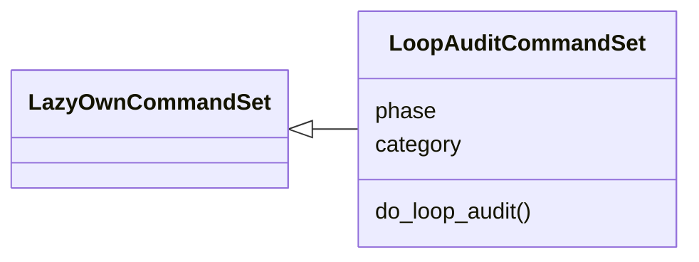
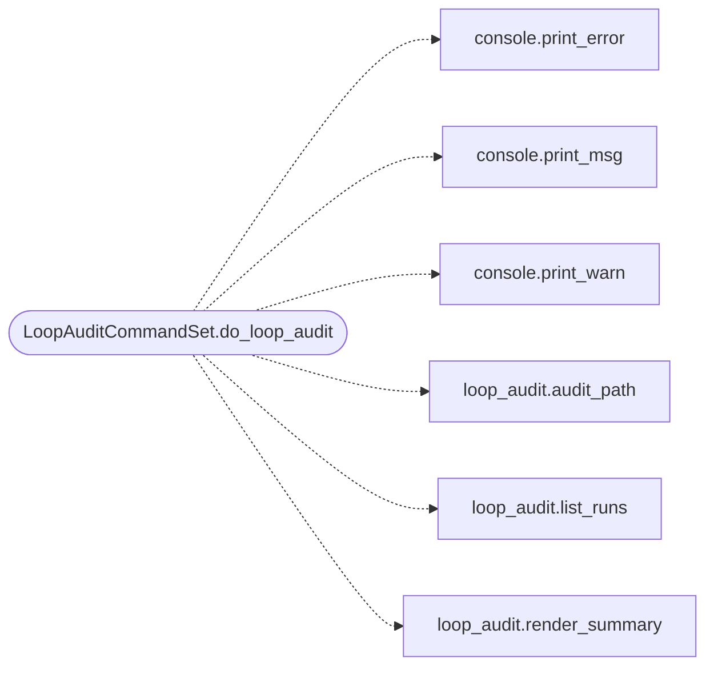

# `cli.commands.loop_audit`

> Source: [cli/commands/loop_audit.py:1](../../cli/commands/loop_audit.py#L1) | language `py` | coverage 100.0% | [API index](../index.md)

Loop audit shell commands: navigate the campaign timeline of a loop.

One timeline answers the operator's audit question: what did the loop
do, when, which module triggered it, with what confidence (guard
verdict, judge source, opsec cost), and what came out of it. The
timeline merges the audit JSONL written by the runner/worker executor
with guard decisions and engine lifecycle activity.

## Contents

- **Classes:** [`LoopAuditCommandSet`](#loopauditcommandset)

## Type Diagram



## Call Graph

Solid arrows stay in this module, dashed arrows leave it.



## Classes

<a id="loopauditcommandset"></a>

### `LoopAuditCommandSet`

`class` | [cli/commands/loop_audit.py:18](../../cli/commands/loop_audit.py#L18)

```python
class LoopAuditCommandSet(LazyOwnCommandSet)
```

Bases: [`LazyOwnCommandSet`](cli.commands._base.py.md#lazyowncommandset)

Expose the loop audit timeline to the operator.

**Attributes**

| Name | Type | Default | Description |
|---|---|---|---|
| [`phase`](#loopauditcommandset-phase) |  | `'recon'` |  |
| [`category`](#loopauditcommandset-category) |  | `miscellaneous_category` |  |

**Members**

| Member | Kind | Summary |
|---|---|---|
| [`do_loop_audit`](#loopauditcommandset-do_loop_audit) | method | Audit what an autonomous loop actually did. |

<a id="loopauditcommandset-do_loop_audit"></a>

#### `LoopAuditCommandSet.do_loop_audit`

`method` | [cli/commands/loop_audit.py:25](../../cli/commands/loop_audit.py#L25)

Decorators: `@cmd2.with_category(miscellaneous_category)`

```python
def do_loop_audit(self, line)
```

Audit what an autonomous loop actually did.

Usage:
    loop_audit list                summarize every recorded run
    loop_audit latest              timeline of the newest run
    loop_audit <task> [--limit N] [--json]   one task's timeline
    loop_audit show <task>         raw audit JSONL path and head

Every executed command lands with when it ran, the module/verb
that triggered it, the worker that ran it, the guard verdict
behind it (allow/ask/deny plus judge source and reason), the
opsec gate and detection probability, the duration and a bounded
output tail. Blocked steps (guard/opsec/approval/sudo) appear as
DENY rows so nothing the loop considered is invisible.

**Parameters**

| Name | Type | Default | Description |
|---|---|---|---|
| `line` |  |  |  |

*Calls:* [`print_error`](core.console.py.md#print_error), [`print_msg`](core.console.py.md#print_msg), [`print_warn`](core.console.py.md#print_warn), [`audit_path`](modules.loop_audit.py.md#audit_path), [`list_runs`](modules.loop_audit.py.md#list_runs), [`render_summary`](modules.loop_audit.py.md#render_summary)

---
