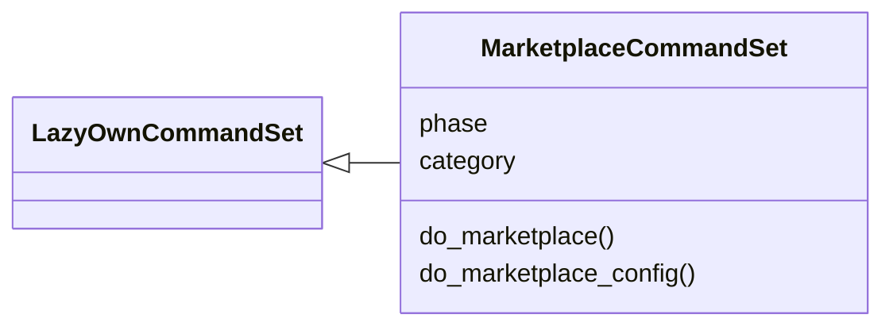
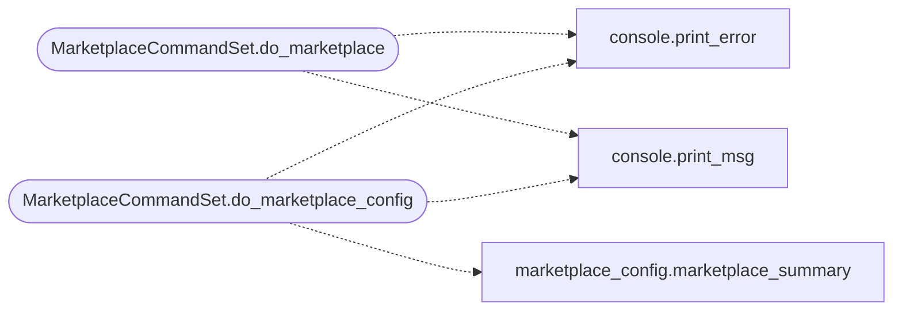

# `cli.commands.marketplace`

> Source: [cli/commands/marketplace.py:1](../../cli/commands/marketplace.py#L1) | language `py` | coverage 100.0% | [API index](../index.md)

Plugin/addon marketplace commands.

Discover, install, and manage community plugins, lazyaddons, and Lua
payload generators from local and remote sources.

## Contents

- **Classes:** [`MarketplaceCommandSet`](#marketplacecommandset)
- **Constants:** [`BASE_DIR`](#base_dir), [`LAZYADDONS_DIR`](#lazyaddons_dir), [`PLUGINS_DIR`](#plugins_dir), [`TOOLS_DIR`](#tools_dir), [`COMMUNITY_REPO`](#community_repo), [`MARKETPLACE_CACHE`](#marketplace_cache)

## Type Diagram



## Call Graph

Solid arrows stay in this module, dashed arrows leave it.



## Classes

<a id="marketplacecommandset"></a>

### `MarketplaceCommandSet`

`class` | [cli/commands/marketplace.py:62](../../cli/commands/marketplace.py#L62)

```python
class MarketplaceCommandSet(LazyOwnCommandSet)
```

Bases: [`LazyOwnCommandSet`](cli.commands._base.py.md#lazyowncommandset)

Browse and install community plugins, addons, and tool integrations.

**Attributes**

| Name | Type | Default | Description |
|---|---|---|---|
| [`phase`](#marketplacecommandset-phase) |  | `'marketplace'` |  |
| [`category`](#marketplacecommandset-category) |  | `'12. Miscellaneous'` |  |

**Members**

| Member | Kind | Summary |
|---|---|---|
| [`do_marketplace`](#marketplacecommandset-do_marketplace) | method | Discover and install community plugins, addons, and tools. |
| [`do_marketplace_config`](#marketplacecommandset-do_marketplace_config) | method | Interactive marketplace manager (Textual TUI). |

<a id="marketplacecommandset-do_marketplace"></a>

#### `MarketplaceCommandSet.do_marketplace`

`method` | [cli/commands/marketplace.py:104](../../cli/commands/marketplace.py#L104)

Decorators: `@cmd2.with_category(miscellaneous_category)`

```python
def do_marketplace(self, line)
```

Discover and install community plugins, addons, and tools.

Usage:
    marketplace list [--tier official|community|experimental]
    marketplace search <name>  - search for available plugins
    marketplace install <name> - install a plugin by name
    marketplace update         - refresh community plugin index
    marketplace update-addons [name|--all] [--dry-run] - git update lazyaddons
    marketplace info <name>    - show details about a plugin
    marketplace rate <name> <1-5> - rate a plugin (operator-local)
    marketplace ratings [name] - show recorded ratings
    marketplace config         - interactive enable/disable wizard

**Parameters**

| Name | Type | Default | Description |
|---|---|---|---|
| `line` |  |  |  |

**Example**

```python
marketplace list
marketplace list --tier official
marketplace search c2
marketplace install phantom2
marketplace rate phantom2 5
marketplace config
```

*Calls:* [`print_error`](core.console.py.md#print_error), [`print_msg`](core.console.py.md#print_msg)

<a id="marketplacecommandset-do_marketplace_config"></a>

#### `MarketplaceCommandSet.do_marketplace_config`

`method` | [cli/commands/marketplace.py:447](../../cli/commands/marketplace.py#L447)

Decorators: `@cmd2.with_category(miscellaneous_category)`

```python
def do_marketplace_config(self, line)
```

Interactive marketplace manager (Textual TUI).

Opens the same style of console as ``lazy_orchestrator``:
searchable tabs for lazyaddons, plugins, tools, YARA rules and
Nuclei templates, with a preview pane.

Usage:
    marketplace_config            - open the interactive console
    marketplace_config show       - print a text summary
    marketplace_config enable <n> - enable a plugin by name
    marketplace_config disable <n> - disable a plugin by name

Keys: ``/`` filter, Space toggles (YAML ``enabled`` or tool
``active``), `[`a`](static.js.xterm-addon-web-links-0.5.0.js.md#a)`/``n`` enable/disable all, `[`e`](static.js.tippy-6.js.md#e)` edits the raw
file, ``c`` creates from the tab template, `[`d`](static.js.particles.js.md#d)` deletes after
confirmation, ``r`` rescans, Enter saves, Escape cancels.

**Parameters**

| Name | Type | Default | Description |
|---|---|---|---|
| `line` |  |  |  |

*Calls:* [`marketplace_summary`](cli.marketplace_config.py.md#marketplace_summary), [`print_error`](core.console.py.md#print_error), [`print_msg`](core.console.py.md#print_msg)

---

## Constants

<a id="base_dir"></a>

### `BASE_DIR`

`constant` | [cli/commands/marketplace.py:38](../../cli/commands/marketplace.py#L38)

```python
BASE_DIR = Path(__file__).resolve().parent.parent.parent
```

---

<a id="lazyaddons_dir"></a>

### `LAZYADDONS_DIR`

`constant` | [cli/commands/marketplace.py:39](../../cli/commands/marketplace.py#L39)

```python
LAZYADDONS_DIR = BASE_DIR / 'lazyaddons'
```

---

<a id="plugins_dir"></a>

### `PLUGINS_DIR`

`constant` | [cli/commands/marketplace.py:40](../../cli/commands/marketplace.py#L40)

```python
PLUGINS_DIR = BASE_DIR / 'plugins'
```

---

<a id="tools_dir"></a>

### `TOOLS_DIR`

`constant` | [cli/commands/marketplace.py:41](../../cli/commands/marketplace.py#L41)

```python
TOOLS_DIR = BASE_DIR / 'tools'
```

---

<a id="community_repo"></a>

### `COMMUNITY_REPO`

`constant` | [cli/commands/marketplace.py:43](../../cli/commands/marketplace.py#L43)

```python
COMMUNITY_REPO = 'https://github.com/grisuno/lazyown-community-plugins.git'
```

---

<a id="marketplace_cache"></a>

### `MARKETPLACE_CACHE`

`constant` | [cli/commands/marketplace.py:44](../../cli/commands/marketplace.py#L44)

```python
MARKETPLACE_CACHE = BASE_DIR / 'sessions' / 'marketplace'
```

---
