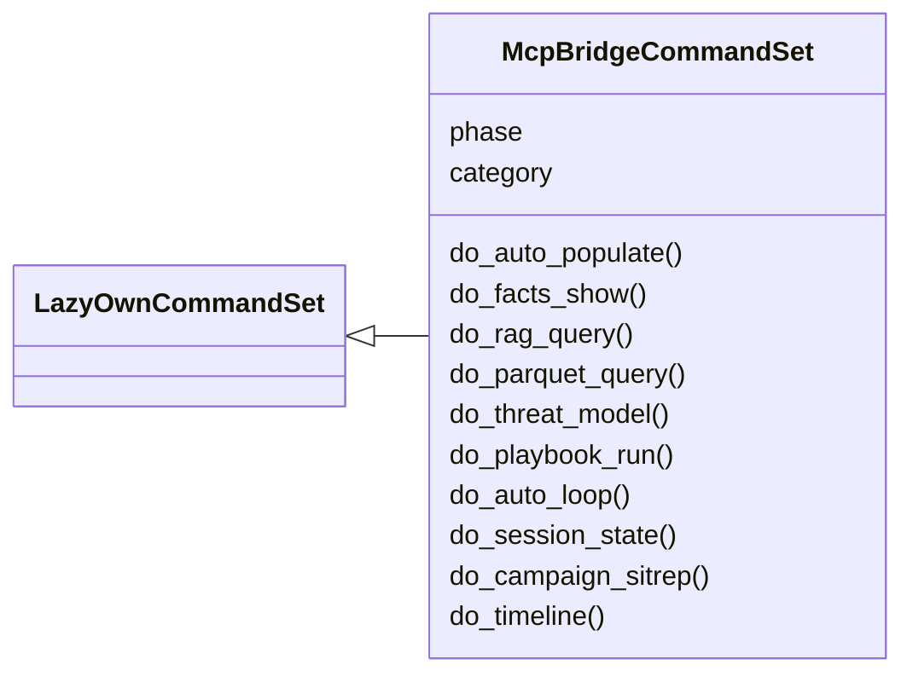
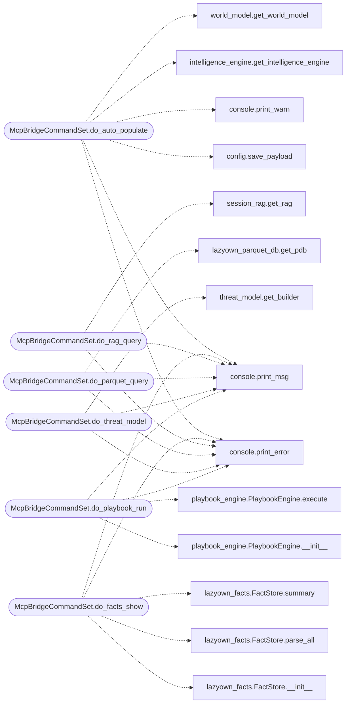

# `cli.commands.mcp_bridge`

> Source: [cli/commands/mcp_bridge.py:1](../../cli/commands/mcp_bridge.py#L1) | language `py` | coverage 100.0% | [API index](../index.md)

MCP verb bridge — one command language for operators and agents.

The MCP server (``skills/lazyown_mcp.py``) exposes workflow verbs that the
operator documentation (ESSENTIALS.md, CHEATSHEET.md) teaches, but those
verbs historically only existed on the agent side, so a human following the
golden path hit ``unknown command``. This CommandSet registers the same
verbs in the interactive shell, delegating to the same underlying modules
the MCP handlers use, so the documented path works end to end:

    ping -> lazynmap -> auto_populate -> facts_show -> recommend_next

Provides:
    auto_populate   Parse the latest nmap XML and fill payload context.
    facts_show      Show structured facts extracted from scans/tool output.
    rag_query       Semantic search over session artefacts.
    parquet_query   Query the parquet knowledge bases (GTFOBins/LOLBas/ATT&CK).
    threat_model    Build or inspect the derived threat model.
    playbook_run    Execute a generated YAML playbook through the shell.
    auto_loop       Run a goal through the daemon orchestrator backend.
    session_state   Alias of ``sitrep`` (MCP name parity).
    campaign_sitrep Alias of ``sitrep`` (MCP name parity).
    timeline        Alias of ``timeline_browser`` (MCP name parity).

## Contents

- **Classes:** [`McpBridgeCommandSet`](#mcpbridgecommandset)

## Type Diagram



## Call Graph

Solid arrows stay in this module, dashed arrows leave it.



## Classes

<a id="mcpbridgecommandset"></a>

### `McpBridgeCommandSet`

`class` | [cli/commands/mcp_bridge.py:143](../../cli/commands/mcp_bridge.py#L143)

```python
class McpBridgeCommandSet(LazyOwnCommandSet)
```

Bases: [`LazyOwnCommandSet`](cli.commands._base.py.md#lazyowncommandset)

CLI shims exposing the documented MCP verbs to human operators.

**Attributes**

| Name | Type | Default | Description |
|---|---|---|---|
| [`phase`](#mcpbridgecommandset-phase) |  | `'ai'` |  |
| [`category`](#mcpbridgecommandset-category) |  | `ai_category` |  |

**Members**

| Member | Kind | Summary |
|---|---|---|
| [`do_auto_populate`](#mcpbridgecommandset-do_auto_populate) | method | Parse the latest nmap XML scan and auto-populate payload context. |
| [`do_facts_show`](#mcpbridgecommandset-do_facts_show) | method | Show structured facts extracted from nmap scans and tool output. |
| [`do_rag_query`](#mcpbridgecommandset-do_rag_query) | method | Semantic search over session artefacts (scans, logs, notes). |
| [`do_parquet_query`](#mcpbridgecommandset-do_parquet_query) | method | Query the parquet knowledge bases (GTFOBins, LOLBas, ATT&CK, sessions). |
| [`do_threat_model`](#mcpbridgecommandset-do_threat_model) | method | Build or inspect the threat model derived from session events. |
| [`do_playbook_run`](#mcpbridgecommandset-do_playbook_run) | method | Execute a generated YAML playbook step by step through the shell. |
| [`do_auto_loop`](#mcpbridgecommandset-do_auto_loop) | method | Run a goal through the single lazy orchestrator (auto_loop == lazy_loop). |
| [`do_session_state`](#mcpbridgecommandset-do_session_state) | method | Alias of ``sitrep`` kept for MCP verb parity (lazyown_session_state). |
| [`do_campaign_sitrep`](#mcpbridgecommandset-do_campaign_sitrep) | method | Alias of ``sitrep`` kept for MCP verb parity (lazyown_campaign_sitrep). |
| [`do_timeline`](#mcpbridgecommandset-do_timeline) | method | Alias of ``timeline_browser`` kept for MCP verb parity (lazyown_timeline). |

<a id="mcpbridgecommandset-do_auto_populate"></a>

#### `McpBridgeCommandSet.do_auto_populate`

`method` | [cli/commands/mcp_bridge.py:151](../../cli/commands/mcp_bridge.py#L151)

Decorators: `@with_category(ai_category)`, `@with_argparser(_build_auto_populate_parser())`

```python
def do_auto_populate(self, args: argparse.Namespace) -> None
```

Parse the latest nmap XML scan and auto-populate payload context.

Fills domain, os_id, open services and start_user/start_pass from
``sessions/scan_<target>.nmap.xml`` and ``sessions/credentials.txt``.
Run this right after ``lazynmap`` so subsequent commands inherit the
discovered target context. Mirrors the ``lazyown_auto_populate`` MCP
tool.

**Parameters**

| Name | Type | Default | Description |
|---|---|---|---|
| `args` | `argparse.Namespace` |  |  |

*Calls:* [`save_payload`](core.config.py.md#save_payload), [`print_error`](core.console.py.md#print_error), [`print_msg`](core.console.py.md#print_msg), [`print_warn`](core.console.py.md#print_warn), [`get_intelligence_engine`](modules.intelligence_engine.py.md#get_intelligence_engine), [`get_world_model`](modules.world_model.py.md#get_world_model)

<a id="mcpbridgecommandset-do_facts_show"></a>

#### `McpBridgeCommandSet.do_facts_show`

`method` | [cli/commands/mcp_bridge.py:261](../../cli/commands/mcp_bridge.py#L261)

Decorators: `@with_category(ai_category)`, `@with_argparser(_build_facts_show_parser())`

```python
def do_facts_show(self, args: argparse.Namespace) -> None
```

Show structured facts extracted from nmap scans and tool output.

Facts include open ports, detected services, discovered credentials,
accessible shares and achieved access level per target. Mirrors the
``lazyown_facts_show`` MCP tool.

**Parameters**

| Name | Type | Default | Description |
|---|---|---|---|
| `args` | `argparse.Namespace` |  |  |

*Calls:* [`print_error`](core.console.py.md#print_error), [`print_msg`](core.console.py.md#print_msg), [`FactStore.__init__`](skills.lazyown_facts.py.md#factstore-__init__), [`FactStore.parse_all`](skills.lazyown_facts.py.md#factstore-parse_all), [`FactStore.summary`](skills.lazyown_facts.py.md#factstore-summary)

<a id="mcpbridgecommandset-do_rag_query"></a>

#### `McpBridgeCommandSet.do_rag_query`

`method` | [cli/commands/mcp_bridge.py:286](../../cli/commands/mcp_bridge.py#L286)

Decorators: `@with_category(ai_category)`, `@with_argparser(_build_rag_query_parser())`

```python
def do_rag_query(self, args: argparse.Namespace) -> None
```

Semantic search over session artefacts (scans, logs, notes).

Mirrors the ``lazyown_rag_query`` MCP tool.

**Parameters**

| Name | Type | Default | Description |
|---|---|---|---|
| `args` | `argparse.Namespace` |  |  |

*Calls:* [`print_error`](core.console.py.md#print_error), [`print_msg`](core.console.py.md#print_msg), [`get_rag`](modules.session_rag.py.md#get_rag)

<a id="mcpbridgecommandset-do_parquet_query"></a>

#### `McpBridgeCommandSet.do_parquet_query`

`method` | [cli/commands/mcp_bridge.py:316](../../cli/commands/mcp_bridge.py#L316)

Decorators: `@with_category(ai_category)`, `@with_argparser(_build_parquet_query_parser())`

```python
def do_parquet_query(self, args: argparse.Namespace) -> None
```

Query the parquet knowledge bases (GTFOBins, LOLBas, ATT&CK, sessions).

Modes: ``session`` (past command outcomes by phase/target),
``keyword`` (search all parquets), ``context`` (phase briefing),
`[`stats`](modules.verb_catalog.py.md#stats)` and ``list``. Mirrors the ``lazyown_parquet_query`` MCP tool.

**Parameters**

| Name | Type | Default | Description |
|---|---|---|---|
| `args` | `argparse.Namespace` |  |  |

*Calls:* [`print_error`](core.console.py.md#print_error), [`print_msg`](core.console.py.md#print_msg), [`get_pdb`](skills.lazyown_parquet_db.py.md#get_pdb)

<a id="mcpbridgecommandset-do_threat_model"></a>

#### `McpBridgeCommandSet.do_threat_model`

`method` | [cli/commands/mcp_bridge.py:378](../../cli/commands/mcp_bridge.py#L378)

Decorators: `@with_category(ai_category)`, `@with_argparser(_build_threat_model_parser())`

```python
def do_threat_model(self, args: argparse.Namespace) -> None
```

Build or inspect the threat model derived from session events.

Actions: ``build`` (default) regenerates the model, ``load`` shows the
cached one, ``ttps`` lists observed ATT&CK techniques. Mirrors the
``lazyown_threat_model`` MCP tool.

**Parameters**

| Name | Type | Default | Description |
|---|---|---|---|
| `args` | `argparse.Namespace` |  |  |

*Calls:* [`print_error`](core.console.py.md#print_error), [`print_msg`](core.console.py.md#print_msg), [`get_builder`](modules.threat_model.py.md#get_builder)

<a id="mcpbridgecommandset-do_playbook_run"></a>

#### `McpBridgeCommandSet.do_playbook_run`

`method` | [cli/commands/mcp_bridge.py:431](../../cli/commands/mcp_bridge.py#L431)

Decorators: `@with_category(ai_category)`, `@with_argparser(_build_playbook_run_parser())`

```python
def do_playbook_run(self, args: argparse.Namespace) -> None
```

Execute a generated YAML playbook step by step through the shell.

Each step command runs via the interactive shell so aliases and hooks
apply. Defaults to the newest ``sessions/playbook_*.yaml``. Mirrors
the ``lazyown_playbook_run`` MCP tool.

**Parameters**

| Name | Type | Default | Description |
|---|---|---|---|
| `args` | `argparse.Namespace` |  |  |

*Calls:* [`print_error`](core.console.py.md#print_error), [`print_msg`](core.console.py.md#print_msg), [`PlaybookEngine.__init__`](modules.playbook_engine.py.md#playbookengine-__init__), [`PlaybookEngine.execute`](modules.playbook_engine.py.md#playbookengine-execute), [`PlaybookEngine.load`](modules.playbook_engine.py.md#playbookengine-load), [`PlaybookEngine.result_summary`](modules.playbook_engine.py.md#playbookengine-result_summary)

<a id="mcpbridgecommandset-do_auto_loop"></a>

#### `McpBridgeCommandSet.do_auto_loop`

`method` | [cli/commands/mcp_bridge.py:489](../../cli/commands/mcp_bridge.py#L489)

Decorators: `@with_category(ai_category)`

```python
def do_auto_loop(self, line: str) -> None
```

Run a goal through the single lazy orchestrator (auto_loop == lazy_loop).

Usage:
    auto_loop [--target T] [--task T] [--rounds N] [--workers N]
              [--timeout S] [--step-delay S] [--budget rounds=N,toolcalls=N,findings=N,timeout_sec=N]
              [--budget-confirm] [--no-bootstrap]
              [--view|--plain] <goal>

Both commands share one runner (`[`modules.lazy_runner`](modules.lazy_runner.py.md)`): one
engine, one chain, one terminal-safety path. ``--view`` opens
the live worker monitor instead of the milestone panel.
``--budget`` caps the run at the engine level (rounds, tool
calls, findings, wall clock); ``--budget-confirm`` gates the
start behind an interactive confirmation unless
``LAZYOWN_AUTONOMOUS=1``.

**Parameters**

| Name | Type | Default | Description |
|---|---|---|---|
| `line` | `str` |  |  |

*Calls:* [`print_error`](core.console.py.md#print_error), [`parse_loop_line`](modules.lazy_runner.py.md#parse_loop_line), [`run_loop`](modules.lazy_runner.py.md#run_loop)

<a id="mcpbridgecommandset-do_session_state"></a>

#### `McpBridgeCommandSet.do_session_state`

`method` | [cli/commands/mcp_bridge.py:529](../../cli/commands/mcp_bridge.py#L529)

Decorators: `@with_category(ai_category)`

```python
def do_session_state(self, line: str) -> None
```

Alias of ``sitrep`` kept for MCP verb parity (lazyown_session_state).

**Parameters**

| Name | Type | Default | Description |
|---|---|---|---|
| `line` | `str` |  |  |

<a id="mcpbridgecommandset-do_campaign_sitrep"></a>

#### `McpBridgeCommandSet.do_campaign_sitrep`

`method` | [cli/commands/mcp_bridge.py:534](../../cli/commands/mcp_bridge.py#L534)

Decorators: `@with_category(ai_category)`

```python
def do_campaign_sitrep(self, line: str) -> None
```

Alias of ``sitrep`` kept for MCP verb parity (lazyown_campaign_sitrep).

**Parameters**

| Name | Type | Default | Description |
|---|---|---|---|
| `line` | `str` |  |  |

<a id="mcpbridgecommandset-do_timeline"></a>

#### `McpBridgeCommandSet.do_timeline`

`method` | [cli/commands/mcp_bridge.py:539](../../cli/commands/mcp_bridge.py#L539)

Decorators: `@with_category(ai_category)`

```python
def do_timeline(self, line: str) -> None
```

Alias of ``timeline_browser`` kept for MCP verb parity (lazyown_timeline).

**Parameters**

| Name | Type | Default | Description |
|---|---|---|---|
| `line` | `str` |  |  |

---
