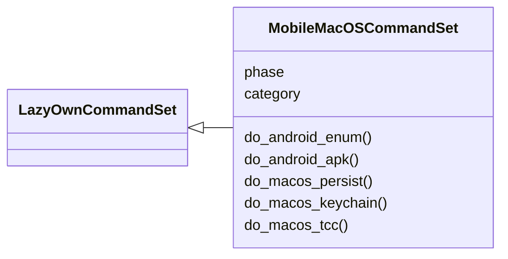
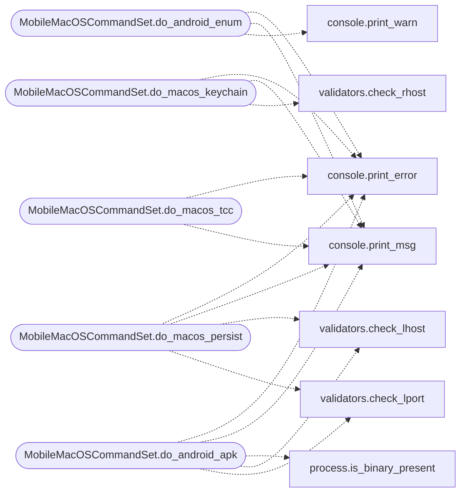

# `cli.commands.mobile_macos`

> Source: [cli/commands/mobile_macos.py:1](../../cli/commands/mobile_macos.py#L1) | language `py` | coverage 100.0% | [API index](../index.md)

Mobile & macOS exploitation command set.

Covers Android enumeration and APK generation, macOS persistence and
keychain extraction.

## Contents

- **Classes:** [`MobileMacOSCommandSet`](#mobilemacoscommandset)

## Type Diagram



## Call Graph

Solid arrows stay in this module, dashed arrows leave it.



## Classes

<a id="mobilemacoscommandset"></a>

### `MobileMacOSCommandSet`

`class` | [cli/commands/mobile_macos.py:96](../../cli/commands/mobile_macos.py#L96)

```python
class MobileMacOSCommandSet(LazyOwnCommandSet)
```

Bases: [`LazyOwnCommandSet`](cli.commands._base.py.md#lazyowncommandset)

Mobile and macOS exploitation operations.

**Attributes**

| Name | Type | Default | Description |
|---|---|---|---|
| [`phase`](#mobilemacoscommandset-phase) |  | `'exploit'` |  |
| [`category`](#mobilemacoscommandset-category) |  | `MOBILE_CATEGORY` |  |

**Members**

| Member | Kind | Summary |
|---|---|---|
| [`do_android_enum`](#mobilemacoscommandset-do_android_enum) | method | Enumerate an Android device connected via ADB. |
| [`do_android_apk`](#mobilemacoscommandset-do_android_apk) | method | Generate a malicious APK with reverse shell payload. |
| [`do_macos_persist`](#mobilemacoscommandset-do_macos_persist) | method | Generate macOS persistence via LaunchAgent. |
| [`do_macos_keychain`](#mobilemacoscommandset-do_macos_keychain) | method | Extract secrets from the macOS Keychain. |
| [`do_macos_tcc`](#mobilemacoscommandset-do_macos_tcc) | method | Generate macOS TCC (Transparency, Consent, Control) bypass. |

<a id="mobilemacoscommandset-do_android_enum"></a>

#### `MobileMacOSCommandSet.do_android_enum`

`method` | [cli/commands/mobile_macos.py:103](../../cli/commands/mobile_macos.py#L103)

Decorators: `@cmd2.with_category(MOBILE_CATEGORY)`

```python
def do_android_enum(self, line)
```

Enumerate an Android device connected via ADB.

Usage: android_enum [--serial <device_serial>]

Dumps device info, installed packages, running processes, and
sensitive files (SMS, contacts, accounts).

**Parameters**

| Name | Type | Default | Description |
|---|---|---|---|
| `line` |  |  |  |

*Calls:* [`print_error`](core.console.py.md#print_error), [`print_msg`](core.console.py.md#print_msg), [`print_warn`](core.console.py.md#print_warn)

<a id="mobilemacoscommandset-do_android_apk"></a>

#### `MobileMacOSCommandSet.do_android_apk`

`method` | [cli/commands/mobile_macos.py:171](../../cli/commands/mobile_macos.py#L171)

Decorators: `@cmd2.with_category(MOBILE_CATEGORY)`

```python
def do_android_apk(self, line)
```

Generate a malicious APK with reverse shell payload.

Usage: android_apk [--lhost <ip>] [--lport <port>] [--output <path>]

Generates an Android APK using msfvenom with a Meterpreter reverse
TCP payload. Requires msfvenom to be installed.

**Parameters**

| Name | Type | Default | Description |
|---|---|---|---|
| `line` |  |  |  |

*Calls:* [`print_error`](core.console.py.md#print_error), [`print_msg`](core.console.py.md#print_msg), [`is_binary_present`](core.process.py.md#is_binary_present), [`check_lhost`](core.validators.py.md#check_lhost), [`check_lport`](core.validators.py.md#check_lport)

<a id="mobilemacoscommandset-do_macos_persist"></a>

#### `MobileMacOSCommandSet.do_macos_persist`

`method` | [cli/commands/mobile_macos.py:216](../../cli/commands/mobile_macos.py#L216)

Decorators: `@cmd2.with_category(MOBILE_CATEGORY)`

```python
def do_macos_persist(self, line)
```

Generate macOS persistence via LaunchAgent.

Usage: macos_persist [--lhost <ip>] [--lport <port>] [--label <name>]

Creates a LaunchAgent plist that executes a reverse shell at login
and keeps it alive every 5 minutes.

**Parameters**

| Name | Type | Default | Description |
|---|---|---|---|
| `line` |  |  |  |

*Calls:* [`print_error`](core.console.py.md#print_error), [`print_msg`](core.console.py.md#print_msg), [`check_lhost`](core.validators.py.md#check_lhost), [`check_lport`](core.validators.py.md#check_lport)

<a id="mobilemacoscommandset-do_macos_keychain"></a>

#### `MobileMacOSCommandSet.do_macos_keychain`

`method` | [cli/commands/mobile_macos.py:274](../../cli/commands/mobile_macos.py#L274)

Decorators: `@cmd2.with_category(MOBILE_CATEGORY)`

```python
def do_macos_keychain(self, line)
```

Extract secrets from the macOS Keychain.

Usage: macos_keychain [--target <ip>] [--user <username>]

Generates commands to dump keychain items (passwords, certs, keys)
from the target Mac.

**Parameters**

| Name | Type | Default | Description |
|---|---|---|---|
| `line` |  |  |  |

*Calls:* [`print_error`](core.console.py.md#print_error), [`print_msg`](core.console.py.md#print_msg), [`check_rhost`](core.validators.py.md#check_rhost)

<a id="mobilemacoscommandset-do_macos_tcc"></a>

#### `MobileMacOSCommandSet.do_macos_tcc`

`method` | [cli/commands/mobile_macos.py:323](../../cli/commands/mobile_macos.py#L323)

Decorators: `@cmd2.with_category(MOBILE_CATEGORY)`

```python
def do_macos_tcc(self, line)
```

Generate macOS TCC (Transparency, Consent, Control) bypass.

Usage: macos_tcc --binary <app_path>

Inserts an accessibility permission entry into the TCC database,
bypassing the user consent dialog for the specified binary.
Requires Full Disk Access or SIP disabled.

**Parameters**

| Name | Type | Default | Description |
|---|---|---|---|
| `line` |  |  |  |

*Calls:* [`print_error`](core.console.py.md#print_error), [`print_msg`](core.console.py.md#print_msg)

---
