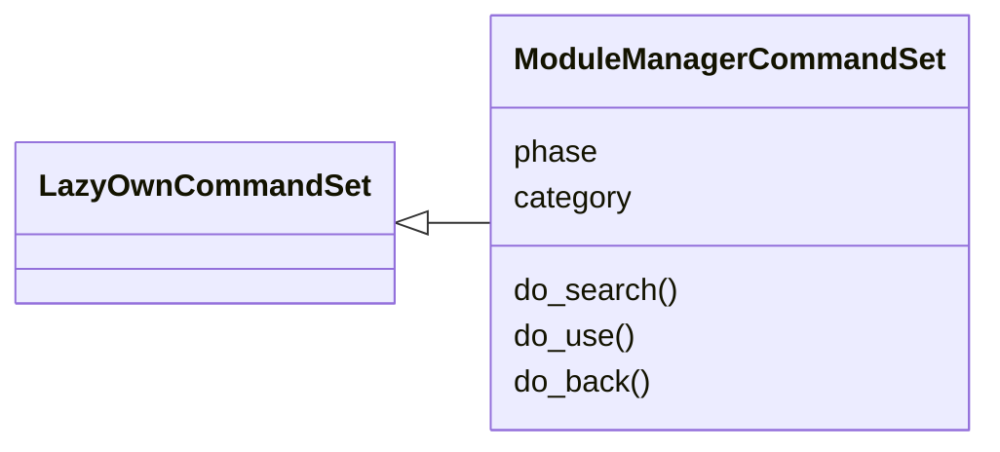
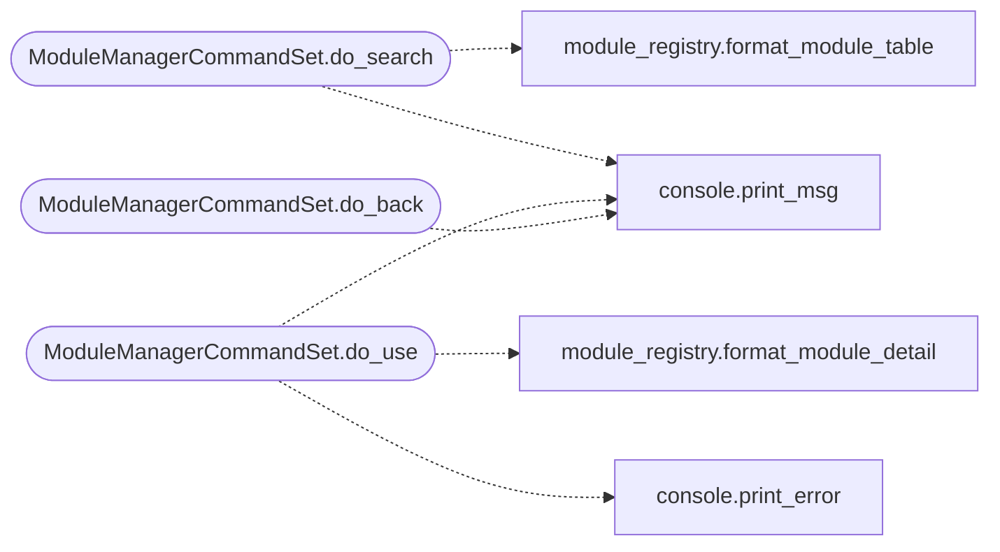

# `cli.commands.module_manager`

> Source: [cli/commands/module_manager.py:1](../../cli/commands/module_manager.py#L1) | language `py` | coverage 100.0% | [API index](../index.md)

Module management commands — search, use, back, and active module context.

Provides the Metasploit-like workflow:
    search <query>
    use <module>
    show options
    set <option> <value>  (via cmd2 builtin — sets shell params)
    run
    back

The active module context is stored on the parent shell
(``_active_module`` and ``_active_module_options``) so the extended
`[`do_show`](modules.ttpscope_bridge.py.md#do_show)` and `[`do_run`](scripts.dirtyinit_drive.sh.md#do_run)` in ``lazyown.py`` can read it.

## Contents

- **Classes:** [`ModuleManagerCommandSet`](#modulemanagercommandset)

## Type Diagram



## Call Graph

Solid arrows stay in this module, dashed arrows leave it.



## Classes

<a id="modulemanagercommandset"></a>

### `ModuleManagerCommandSet`

`class` | [cli/commands/module_manager.py:36](../../cli/commands/module_manager.py#L36)

```python
class ModuleManagerCommandSet(LazyOwnCommandSet)
```

Bases: [`LazyOwnCommandSet`](cli.commands._base.py.md#lazyowncommandset)

Search, browse, and select framework modules.

**Attributes**

| Name | Type | Default | Description |
|---|---|---|---|
| [`phase`](#modulemanagercommandset-phase) |  | `'module_manager'` |  |
| [`category`](#modulemanagercommandset-category) |  | `'12. Miscellaneous'` |  |

**Members**

| Member | Kind | Summary |
|---|---|---|
| [`do_search`](#modulemanagercommandset-do_search) | method | Search for modules by name, description, or author. |
| [`do_use`](#modulemanagercommandset-do_use) | method | Select a module to work with. |
| [`do_back`](#modulemanagercommandset-do_back) | method | Leave the current module context. |

<a id="modulemanagercommandset-do_search"></a>

#### `ModuleManagerCommandSet.do_search`

`method` | [cli/commands/module_manager.py:71](../../cli/commands/module_manager.py#L71)

Decorators: `@cmd2.with_category(miscellaneous_category)`

```python
def do_search(self, line)
```

Search for modules by name, description, or author.

Usage:
    search <query>
    search type:exploit <query>
    search platform:windows

**Parameters**

| Name | Type | Default | Description |
|---|---|---|---|
| `line` |  |  |  |

**Example**

```python
search smb
search type:exploit
search cve-2023
```

*Calls:* [`print_msg`](core.console.py.md#print_msg), [`format_module_table`](modules.module_registry.py.md#format_module_table)

<a id="modulemanagercommandset-do_use"></a>

#### `ModuleManagerCommandSet.do_use`

`method` | [cli/commands/module_manager.py:111](../../cli/commands/module_manager.py#L111)

Decorators: `@cmd2.with_category(miscellaneous_category)`

```python
def do_use(self, line)
```

Select a module to work with.

Usage: use <module_name>
Shows module metadata and enters module context.
Use 'show options' to view configurable parameters.
Use 'run' to execute the module.
Use 'back' to leave module context.

**Parameters**

| Name | Type | Default | Description |
|---|---|---|---|
| `line` |  |  |  |

*Calls:* [`print_error`](core.console.py.md#print_error), [`print_msg`](core.console.py.md#print_msg), [`format_module_detail`](modules.module_registry.py.md#format_module_detail)

<a id="modulemanagercommandset-do_back"></a>

#### `ModuleManagerCommandSet.do_back`

`method` | [cli/commands/module_manager.py:162](../../cli/commands/module_manager.py#L162)

Decorators: `@cmd2.with_category(miscellaneous_category)`

```python
def do_back(self, line)
```

Leave the current module context.

Usage: back

**Parameters**

| Name | Type | Default | Description |
|---|---|---|---|
| `line` |  |  |  |

*Calls:* [`print_msg`](core.console.py.md#print_msg)

---
