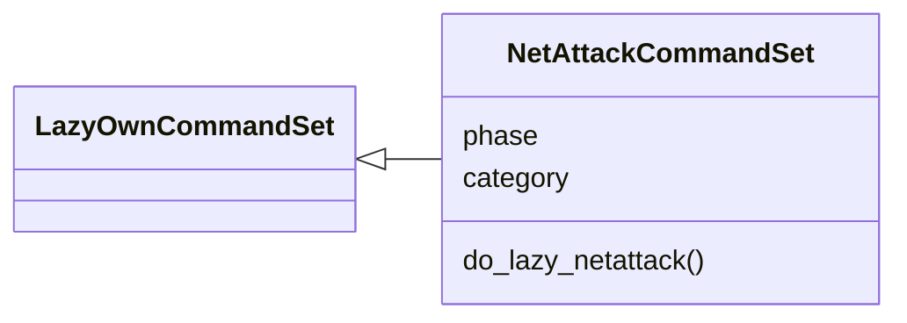
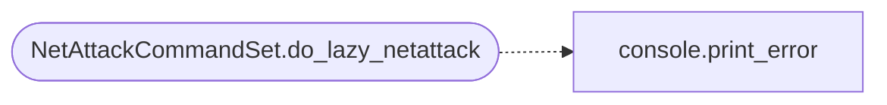

# `cli.commands.netattack`

> Source: [cli/commands/netattack.py:1](../../cli/commands/netattack.py#L1) | language `py` | coverage 100.0% | [API index](../index.md)

Windows network-attack surface command set: plan, attest, show.

``lazy_netattack`` grades the observed surface from the world model and
attested SMB-signing evidence, prints the exact operator-executed commands
and records operator attestations. It never launches poisoning, WPAD MITM
or NTLM relay: those run on the operator's listening interface and stay
operator-gated. The loop's ``ad_surface`` trigger consumes the same pure
decision from [`modules.lazy_netattack`](modules.lazy_netattack.py.md) and turns viable grades into
hint nodes.

## Contents

- **Classes:** [`NetAttackCommandSet`](#netattackcommandset)

## Type Diagram



## Call Graph

Solid arrows stay in this module, dashed arrows leave it.



## Classes

<a id="netattackcommandset"></a>

### `NetAttackCommandSet`

`class` | [cli/commands/netattack.py:52](../../cli/commands/netattack.py#L52)

```python
class NetAttackCommandSet(LazyOwnCommandSet)
```

Bases: [`LazyOwnCommandSet`](cli.commands._base.py.md#lazyowncommandset)

Windows net-attack surface: evidence-shaped plan, operator consent.

**Attributes**

| Name | Type | Default | Description |
|---|---|---|---|
| [`phase`](#netattackcommandset-phase) |  | `'enum'` |  |
| [`category`](#netattackcommandset-category) |  | `'exploitation'` |  |

**Members**

| Member | Kind | Summary |
|---|---|---|
| [`do_lazy_netattack`](#netattackcommandset-do_lazy_netattack) | method | Windows net-attack surface: grade + exact commands; never executes. |

<a id="netattackcommandset-do_lazy_netattack"></a>

#### `NetAttackCommandSet.do_lazy_netattack`

`method` | [cli/commands/netattack.py:59](../../cli/commands/netattack.py#L59)

Decorators: `@cmd2.with_category('exploitation')`

```python
def do_lazy_netattack(self, line: str) -> None
```

Windows net-attack surface: grade + exact commands; never executes.

Usage:
    lazy_netattack plan [target]
    lazy_netattack attest <host> <ok|off> [note]
    lazy_netattack show

**Parameters**

| Name | Type | Default | Description |
|---|---|---|---|
| `line` | `str` |  |  |

*Calls:* [`print_error`](core.console.py.md#print_error)

---
