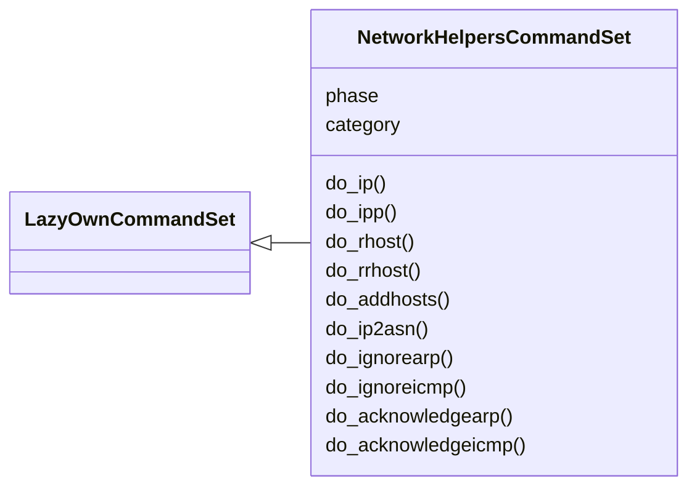
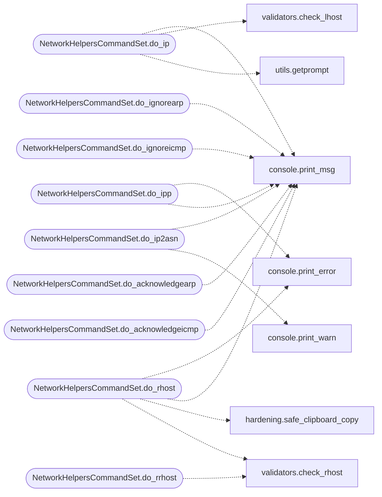

# `cli.commands.nethelpers`

> Source: [cli/commands/nethelpers.py:1](../../cli/commands/nethelpers.py#L1) | language `py` | coverage 100.0% | [API index](../index.md)

Network helpers extracted from the miscellaneous cluster.

Pending status: originals deleted from ``cli/commands/misc_migrated.py``;
this set is registered by `[`cli.registry`](cli.registry.py.md)`.

## Contents

- **Classes:** [`NetworkHelpersCommandSet`](#networkhelperscommandset)

## Type Diagram



## Call Graph

Solid arrows stay in this module, dashed arrows leave it.



## Classes

<a id="networkhelperscommandset"></a>

### `NetworkHelpersCommandSet`

`class` | [cli/commands/nethelpers.py:31](../../cli/commands/nethelpers.py#L31)

```python
class NetworkHelpersCommandSet(LazyOwnCommandSet)
```

Bases: [`LazyOwnCommandSet`](cli.commands._base.py.md#lazyowncommandset)

Network helpers.

**Attributes**

| Name | Type | Default | Description |
|---|---|---|---|
| [`phase`](#networkhelperscommandset-phase) |  | `'misc'` |  |
| [`category`](#networkhelperscommandset-category) |  | `'12. Miscellaneous'` |  |

**Members**

| Member | Kind | Summary |
|---|---|---|
| [`do_ip`](#networkhelperscommandset-do_ip) | method | Displays IP addresses of network interfaces and copies the IP address from the `tun0` interface to the clipboard. |
| [`do_ipp`](#networkhelperscommandset-do_ipp) | method | Displays IP addresses of network interfaces and prints the IP address from the `tun0` interface. |
| [`do_rhost`](#networkhelperscommandset-do_rhost) | method | Copies the remote host (self.params['rhost']) to the clipboard and updates the command prompt. |
| [`do_rrhost`](#networkhelperscommandset-do_rrhost) | method | Updates the command prompt to include the remote host (self.params['rhost']) and current working directory. |
| [`do_addhosts`](#networkhelperscommandset-do_addhosts) | method | Adds an entry to the `/etc/hosts` file, mapping an IP address to a domain name. |
| [`do_ip2asn`](#networkhelperscommandset-do_ip2asn) | method | Command to get ASN for a given IP address. |
| [`do_ignorearp`](#networkhelperscommandset-do_ignorearp) | method | Configures the system to ignore ARP requests by setting a kernel parameter. |
| [`do_ignoreicmp`](#networkhelperscommandset-do_ignoreicmp) | method | Configures the system to ignore ICMP echo requests by setting a kernel parameter. |
| [`do_acknowledgearp`](#networkhelperscommandset-do_acknowledgearp) | method | Configures the system to acknowledge ARP requests by setting a kernel parameter. |
| [`do_acknowledgeicmp`](#networkhelperscommandset-do_acknowledgeicmp) | method | Configures the system to respond to ICMP echo requests by setting a kernel parameter. |

<a id="networkhelperscommandset-do_ip"></a>

#### `NetworkHelpersCommandSet.do_ip`

`method` | [cli/commands/nethelpers.py:38](../../cli/commands/nethelpers.py#L38)

Decorators: `@cmd2.with_category('12. Miscellaneous')`

```python
def do_ip(self, line)
```

Displays IP addresses of network interfaces and copies the IP address from the `tun0` interface to the clipboard.

This function performs the following tasks:
1. Displays IP addresses for all network interfaces using `ip a show scope global` and `awk`.
2. Copies the IP address from the `tun0` interface to the clipboard using `xclip`.

Usage:
    ip


Manual execution:
1. The command `ip a show scope global | awk '/^[0-9]+:/ { sub(/:/,"",$2); iface=$2 } /^[[:space:]]*inet / { split($2, a, "/"); print "    [" iface"] "a[1] }'` is executed to display the IP addresses of all network interfaces.
2. The IP address of the `tun0` interface is copied to the clipboard using the command `ip a show tun0 | grep 'inet ' | awk '{print $2}' | cut -d'/' -f1 | xclip -sel clip`.

Dependencies:
- The function relies on `awk`, [`grep`](cli.cli_enhancements.py.md#transcriptstore-grep), `cut`, and `xclip` to process and copy the IP address.

Example:
    ip
    # This will display IP addresses for all network interfaces and copy the IP address from `tun0` to the clipboard.

Note:
    Ensure that the `tun0` interface exists and has an IP address assigned. If `tun0` is not present or has no IP address, the clipboard will not be updated.

**Parameters**

| Name | Type | Default | Description |
|---|---|---|---|
| `line` | `str` |  | This parameter is not used in the function but is included for consistency with other command methods. |

**Returns:** None

*Calls:* [`print_msg`](core.console.py.md#print_msg), [`check_lhost`](core.validators.py.md#check_lhost), [`getprompt`](utils.py.md#getprompt)

<a id="networkhelperscommandset-do_ipp"></a>

#### `NetworkHelpersCommandSet.do_ipp`

`method` | [cli/commands/nethelpers.py:120](../../cli/commands/nethelpers.py#L120)

Decorators: `@cmd2.with_category('12. Miscellaneous')`

```python
def do_ipp(self, line)
```

Displays IP addresses of network interfaces and prints the IP address from the `tun0` interface.

This function performs the following tasks:
1. Displays IP addresses for all network interfaces using `ip a show scope global` and `awk`.
2. Prints the IP address from the `tun0` interface.

Usage:
    ip


Manual execution:
1. The command `ip a show scope global | awk '/^[0-9]+:/ { sub(/:/,"",$2); iface=$2 } /^[[:space:]]*inet / { split($2, a, "/"); print "    [" iface"] "a[1] }'` is executed to display the IP addresses of all network interfaces.
2. The IP address of the `tun0` interface is printed to the console using the command `ip a show tun0 | grep 'inet ' | awk '{print $2}' | cut -d'/' -f1`.

Dependencies:
- The function relies on `awk`, [`grep`](cli.cli_enhancements.py.md#transcriptstore-grep), `cut`, and `xclip` to process and display the IP address.

Example:
    ip
    # This will display IP addresses for all network interfaces and print the IP address from `tun0`.

Note:
    Ensure that the `tun0` interface exists and has an IP address assigned. If `tun0` is not present or has no IP address, the address will not be displayed.

**Parameters**

| Name | Type | Default | Description |
|---|---|---|---|
| `line` | `str` |  | This parameter is not used in the function but is included for consistency with other command methods. |

**Returns:** None

*Calls:* [`print_error`](core.console.py.md#print_error), [`print_msg`](core.console.py.md#print_msg)

<a id="networkhelperscommandset-do_rhost"></a>

#### `NetworkHelpersCommandSet.do_rhost`

`method` | [cli/commands/nethelpers.py:201](../../cli/commands/nethelpers.py#L201)

Decorators: `@cmd2.with_category('12. Miscellaneous')`

```python
def do_rhost(self, line)
```

Copies the remote host (self.params['rhost']) to the clipboard and updates the command prompt.

This function performs two tasks:
1. It copies the `self.params['rhost']` parameter to the clipboard if it is valid.
2. It updates the command prompt to include the `self.params['rhost']` and the current working directory.

Usage:
    self.params['rhost'] [clean]


Manual execution:
1. If `line` is 'clean':
- The command prompt is reset to its default format.
2. If `line` is any other value:
- The command prompt is updated to show the `self.params['rhost']` and the current working directory.
- The `self.params['rhost']` is copied to the clipboard using `xclip`.

Dependencies:
- The script uses `xclip` to copy the `self.params['rhost']` to the clipboard.

Example:
    self.params['rhost']
    # This will copy the current `self.params['rhost']` to the clipboard and update the prompt.

    self.params['rhost'] clean
    # This will reset the command prompt to its default format.

Note:
    Ensure that the `self.params['rhost']` is valid by checking it with the [`check_rhost`](core.validators.py.md#check_rhost) function before copying it to the clipboard.

**Parameters**

| Name | Type | Default | Description |
|---|---|---|---|
| `line` | `str` |  | An optional argument that determines the behavior of the function: - If 'clean', it resets the command prompt to its default format. - If any other value, it updates the command prompt to include the `self.params['rhost']` and current working directory. |

**Returns:** None

*Calls:* [`print_error`](core.console.py.md#print_error), [`print_msg`](core.console.py.md#print_msg), [`safe_clipboard_copy`](core.hardening.py.md#safe_clipboard_copy), [`check_rhost`](core.validators.py.md#check_rhost)

<a id="networkhelperscommandset-do_rrhost"></a>

#### `NetworkHelpersCommandSet.do_rrhost`

`method` | [cli/commands/nethelpers.py:254](../../cli/commands/nethelpers.py#L254)

Decorators: `@cmd2.with_category('12. Miscellaneous')`

```python
def do_rrhost(self, line)
```

Updates the command prompt to include the remote host (self.params['rhost']) and current working directory.

This function performs two tasks:
1. It updates the command prompt to include the `self.params['rhost']` and the current working directory if `line` is not 'clean'.
2. It resets the command prompt to its default format if `line` is 'clean'.

Usage:
    self.params['rhost'] [clean]


Manual execution:
1. If `line` is 'clean':
- The command prompt is reset to its default format.
2. If `line` is any other value:
- The command prompt is updated to show the `self.params['rhost']` and the current working directory.

Example:
    self.params['rhost']
    # This will update the command prompt to include the `self.params['rhost']` and current working directory.

    self.params['rhost'] clean
    # This will reset the command prompt to its default format.

Note:
    Ensure that the `self.params['rhost']` is valid by checking it with the [`check_rhost`](core.validators.py.md#check_rhost) function before updating the prompt.

**Parameters**

| Name | Type | Default | Description |
|---|---|---|---|
| `line` | `str` |  | An optional argument that determines the behavior of the function: - If 'clean', it resets the command prompt to its default format. - If any other value, it updates the command prompt to include the `self.params['rhost']` and current working directory. |

**Returns:** None

*Calls:* [`check_rhost`](core.validators.py.md#check_rhost)

<a id="networkhelperscommandset-do_addhosts"></a>

#### `NetworkHelpersCommandSet.do_addhosts`

`method` | [cli/commands/nethelpers.py:295](../../cli/commands/nethelpers.py#L295)

Decorators: `@cmd2.with_category('12. Miscellaneous')`

```python
def do_addhosts(self, line)
```

Adds an entry to the `/etc/hosts` file, mapping an IP address to a domain name.

Manual execution:
To manually add a domain to the `/etc/hosts` file, use the following command:

    sudo sh -c -e "echo '<rhost> <domain>' >> /etc/hosts"

Example:
    sudo sh -c -e "echo '10.10.11.23 permx.htb' >> /etc/hosts"

This command appends the IP address and domain name to the `/etc/hosts` file, enabling local resolution of the domain.

**Parameters**

| Name | Type | Default | Description |
|---|---|---|---|
| `line` |  |  | The domain name to be added to the `/etc/hosts` file. - Example: `permx.htb` |

**Returns:** None

<a id="networkhelperscommandset-do_ip2asn"></a>

#### `NetworkHelpersCommandSet.do_ip2asn`

`method` | [cli/commands/nethelpers.py:319](../../cli/commands/nethelpers.py#L319)

Decorators: `@cmd2.with_category('12. Miscellaneous')`

```python
def do_ip2asn(self, line)
```

Command to get ASN for a given IP address.

**Parameters**

| Name | Type | Default | Description |
|---|---|---|---|
| `line` |  |  |  |

*Calls:* [`print_msg`](core.console.py.md#print_msg), [`print_warn`](core.console.py.md#print_warn)

<a id="networkhelperscommandset-do_ignorearp"></a>

#### `NetworkHelpersCommandSet.do_ignorearp`

`method` | [cli/commands/nethelpers.py:348](../../cli/commands/nethelpers.py#L348)

Decorators: `@cmd2.with_category('12. Miscellaneous')`

```python
def do_ignorearp(self, line)
```

Configures the system to ignore ARP requests by setting a kernel parameter.

This function performs the following tasks:
1. Prints a message indicating the command that will be executed.
2. Executes the command `echo 1 > /proc/sys/net/ipv4/conf/all/arp_ignore` with elevated privileges using `sudo` to configure the system to ignore ARP requests.
3. Prints a confirmation message indicating that the operation is complete.

Usage:
    ignorearp


Manual execution:
    1. The command `sudo bash -c 'echo 1 > /proc/sys/net/ipv4/conf/all/arp_ignore'` is executed to assign the `arp_ignore` parameter to `1`, which configures the system to ignore ARP requests.

Dependencies:
    - The function requires `sudo` to run the command with elevated privileges.

Example:
    ignorearp
    # This will assign the `arp_ignore` parameter to `1` to ignore ARP requests.

Note:
    Ensure that you have the necessary permissions to use `sudo` and that the `arp_ignore` parameter can be modified on your system.

**Parameters**

| Name | Type | Default | Description |
|---|---|---|---|
| `line` | `str` |  | This parameter is not used in the function but is included for consistency with other command methods. |

**Returns:** None

*Calls:* [`print_msg`](core.console.py.md#print_msg)

<a id="networkhelperscommandset-do_ignoreicmp"></a>

#### `NetworkHelpersCommandSet.do_ignoreicmp`

`method` | [cli/commands/nethelpers.py:383](../../cli/commands/nethelpers.py#L383)

Decorators: `@cmd2.with_category('12. Miscellaneous')`

```python
def do_ignoreicmp(self, line)
```

Configures the system to ignore ICMP echo requests by setting a kernel parameter.

This function performs the following tasks:
1. Prints a message indicating the command that will be executed.
2. Executes the command `echo 1 > /proc/sys/net/ipv4/icmp_echo_ignore_all` with elevated privileges using `sudo` to configure the system to ignore ICMP echo requests (ping).
3. Prints a confirmation message indicating that the operation is complete.

Usage:
    ignoreicmp


Manual execution:
    1. The command `sudo bash -c 'echo 1 > /proc/sys/net/ipv4/icmp_echo_ignore_all'` is executed to assign the `icmp_echo_ignore_all` parameter to `1`, which configures the system to ignore ICMP echo requests (ping).

Dependencies:
    - The function requires `sudo` to run the command with elevated privileges.

Example:
    ignoreicmp
    # This will assign the `icmp_echo_ignore_all` parameter to `1` to ignore ICMP echo requests.

Note:
    Ensure that you have the necessary permissions to use `sudo` and that the `icmp_echo_ignore_all` parameter can be modified on your system.

**Parameters**

| Name | Type | Default | Description |
|---|---|---|---|
| `line` | `str` |  | This parameter is not used in the function but is included for consistency with other command methods. |

**Returns:** None

*Calls:* [`print_msg`](core.console.py.md#print_msg)

<a id="networkhelperscommandset-do_acknowledgearp"></a>

#### `NetworkHelpersCommandSet.do_acknowledgearp`

`method` | [cli/commands/nethelpers.py:418](../../cli/commands/nethelpers.py#L418)

Decorators: `@cmd2.with_category('12. Miscellaneous')`

```python
def do_acknowledgearp(self, line)
```

Configures the system to acknowledge ARP requests by setting a kernel parameter.

This function performs the following tasks:
1. Prints a message indicating the command that will be executed.
2. Executes the command `echo 0 > /proc/sys/net/ipv4/conf/all/arp_ignore` with elevated privileges using `sudo` to configure the system to acknowledge ARP requests.
3. Prints a confirmation message indicating that the operation is complete.

Usage:
    acknowledgearp


Manual execution:
    1. The command `sudo bash -c 'echo 0 > /proc/sys/net/ipv4/conf/all/arp_ignore'` is executed to assign the `arp_ignore` parameter to `0`, which configures the system to acknowledge ARP requests.

Dependencies:
    - The function requires `sudo` to run the command with elevated privileges.

Example:
    acknowledgearp
    # This will assign the `arp_ignore` parameter to `0` to acknowledge ARP requests.

Note:
    Ensure that you have the necessary permissions to use `sudo` and that the `arp_ignore` parameter can be modified on your system.

**Parameters**

| Name | Type | Default | Description |
|---|---|---|---|
| `line` | `str` |  | This parameter is not used in the function but is included for consistency with other command methods. |

**Returns:** None

*Calls:* [`print_msg`](core.console.py.md#print_msg)

<a id="networkhelperscommandset-do_acknowledgeicmp"></a>

#### `NetworkHelpersCommandSet.do_acknowledgeicmp`

`method` | [cli/commands/nethelpers.py:453](../../cli/commands/nethelpers.py#L453)

Decorators: `@cmd2.with_category('12. Miscellaneous')`

```python
def do_acknowledgeicmp(self, line)
```

Configures the system to respond to ICMP echo requests by setting a kernel parameter.

This function performs the following tasks:
1. Prints a message indicating the command that will be executed.
2. Executes the command `echo 0 > /proc/sys/net/ipv4/icmp_echo_ignore_all` with elevated privileges using `sudo` to configure the system to respond to ICMP echo requests.
3. Prints a confirmation message indicating that the operation is complete.

Usage:
    acknowledgeicmp


Manual execution:
    1. The command `sudo bash -c 'echo 0 > /proc/sys/net/ipv4/icmp_echo_ignore_all'` is executed to assign the `icmp_echo_ignore_all` parameter to `0`, which configures the system to respond to ICMP echo requests.

Dependencies:
    - The function requires `sudo` to run the command with elevated privileges.

Example:
    acknowledgeicmp
    # This will assign the `icmp_echo_ignore_all` parameter to `0` to allow responses to ICMP echo requests.

Note:
    Ensure that you have the necessary permissions to use `sudo` and that the `icmp_echo_ignore_all` parameter can be modified on your system.

**Parameters**

| Name | Type | Default | Description |
|---|---|---|---|
| `line` | `str` |  | This parameter is not used in the function but is included for consistency with other command methods. |

**Returns:** None

*Calls:* [`print_msg`](core.console.py.md#print_msg)

---
