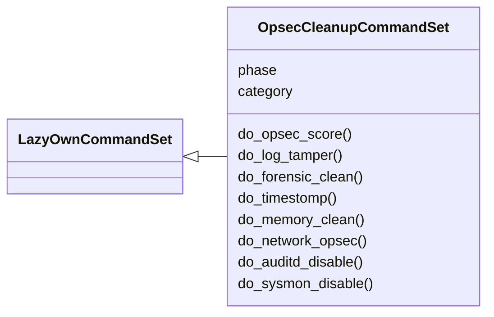

# `cli.commands.opsec_cleanup`

> Source: [cli/commands/opsec_cleanup.py:1](../../cli/commands/opsec_cleanup.py#L1) | language `py` | coverage 100.0% | [API index](../index.md)

OPSEC and cleanup commands — scoring, log tamper, forensic cleaner, timestomp, memory, network.

Provides:
    opsec_score             — Real-time OPSEC risk assessment with action gating (v2)
    log_tamper              — Cross-platform log clearing (Windows/Linux/macOS)
    forensic_clean          — Remove forensic artifacts (Prefetch, Shimcache, Amcache, etc.)
    timestomp               — Manipulate file MACB timestamps
    memory_clean            — Clear memory artifacts (tickets, clipboard, env, credentials)
    network_opsec           — Proxy chains, DoH, canary detection, traffic analysis
    auditd_disable          — Disable Linux auditd
    sysmon_disable          — Disable Windows Sysmon

## Contents

- **Classes:** [`OpsecCleanupCommandSet`](#opseccleanupcommandset)

## Type Diagram



## Call Graph

Solid arrows stay in this module, dashed arrows leave it.

```mermaid
flowchart LR
    n_cli_commands_opsec_cleanup_py__OpsecCleanupCommandSet_do_opsec_score(["OpsecCleanupCommandSet.do_opsec_score"])
    n_modules_opsec_scorer_py__OpsecContext["opsec_scorer.OpsecContext"]
    n_modules_opsec_scorer_py__OpsecScorerV2___init__["opsec_scorer.OpsecScorerV2.__init__"]
    n_modules_opsec_scorer_py__OpsecScorerV2_assess["opsec_scorer.OpsecScorerV2.assess"]
    n_modules_opsec_scorer_py__OpsecScorerV2_get_trend["opsec_scorer.OpsecScorerV2.get_trend"]
    n_cli_commands_opsec_cleanup_py__OpsecCleanupCommandSet_do_log_tamper(["OpsecCleanupCommandSet.do_log_tamper"])
    n_modules_log_tamper_py__LogTamper___init__["log_tamper.LogTamper.__init__"]
    n_modules_log_tamper_py__LogTamper_generate_all["log_tamper.LogTamper.generate_all"]
    n_modules_log_tamper_py__LogTamperConfig["log_tamper.LogTamperConfig"]
    n_cli_commands_opsec_cleanup_py__OpsecCleanupCommandSet_do_forensic_clean(["OpsecCleanupCommandSet.do_forensic_clean"])
    n_modules_forensic_cleaner_py__ForensicCleaner___init__["forensic_cleaner.ForensicCleaner.__init__"]
    n_modules_forensic_cleaner_py__ForensicCleaner_linux_cleanup["forensic_cleaner.ForensicCleaner.linux_cleanup"]
    n_modules_forensic_cleaner_py__ForensicCleaner_macos_cleanup["forensic_cleaner.ForensicCleaner.macos_cleanup"]
    n_modules_forensic_cleaner_py__ForensicCleaner_windows_cleanup["forensic_cleaner.ForensicCleaner.windows_cleanup"]
    n_modules_forensic_cleaner_py__ForensicCleanerConfig["forensic_cleaner.ForensicCleanerConfig"]
    n_cli_commands_opsec_cleanup_py__OpsecCleanupCommandSet_do_timestomp(["OpsecCleanupCommandSet.do_timestomp"])
    n_modules_timestomper_py__TimestompConfig["timestomper.TimestompConfig"]
    n_modules_timestomper_py__Timestomper___init__["timestomper.Timestomper.__init__"]
    n_modules_timestomper_py__Timestomper_generate_random_timestamps["timestomper.Timestomper.generate_random_timestamps"]
    n_modules_timestomper_py__Timestomper_linux_timestomp_commands["timestomper.Timestomper.linux_timestomp_commands"]
    n_modules_timestomper_py__Timestomper_macos_timestomp_commands["timestomper.Timestomper.macos_timestomp_commands"]
    n_modules_timestomper_py__Timestomper_windows_timestomp_powershell["timestomper.Timestomper.windows_timestomp_powershell"]
    n_cli_commands_opsec_cleanup_py__OpsecCleanupCommandSet_do_memory_clean(["OpsecCleanupCommandSet.do_memory_clean"])
    n_modules_memory_cleaner_py__MemoryCleaner___init__["memory_cleaner.MemoryCleaner.__init__"]
    n_modules_memory_cleaner_py__MemoryCleaner_linux_memory_cleanup["memory_cleaner.MemoryCleaner.linux_memory_cleanup"]
    n_modules_memory_cleaner_py__MemoryCleaner_macos_memory_cleanup["memory_cleaner.MemoryCleaner.macos_memory_cleanup"]
    n_modules_memory_cleaner_py__MemoryCleaner_windows_memory_cleanup["memory_cleaner.MemoryCleaner.windows_memory_cleanup"]
    n_modules_memory_cleaner_py__MemoryCleanerConfig["memory_cleaner.MemoryCleanerConfig"]
    n_cli_commands_opsec_cleanup_py__OpsecCleanupCommandSet_do_network_opsec(["OpsecCleanupCommandSet.do_network_opsec"])
    n_modules_network_opsec_py__NetworkOpsecConfig["network_opsec.NetworkOpsecConfig"]
    n_cli_commands_opsec_cleanup_py__OpsecCleanupCommandSet_do_opsec_score -.-> n_modules_opsec_scorer_py__OpsecContext
    n_cli_commands_opsec_cleanup_py__OpsecCleanupCommandSet_do_opsec_score -.-> n_modules_opsec_scorer_py__OpsecScorerV2___init__
    n_cli_commands_opsec_cleanup_py__OpsecCleanupCommandSet_do_opsec_score -.-> n_modules_opsec_scorer_py__OpsecScorerV2_assess
    n_cli_commands_opsec_cleanup_py__OpsecCleanupCommandSet_do_opsec_score -.-> n_modules_opsec_scorer_py__OpsecScorerV2_get_trend
    n_cli_commands_opsec_cleanup_py__OpsecCleanupCommandSet_do_log_tamper -.-> n_modules_log_tamper_py__LogTamper___init__
    n_cli_commands_opsec_cleanup_py__OpsecCleanupCommandSet_do_log_tamper -.-> n_modules_log_tamper_py__LogTamper_generate_all
    n_cli_commands_opsec_cleanup_py__OpsecCleanupCommandSet_do_log_tamper -.-> n_modules_log_tamper_py__LogTamperConfig
    n_cli_commands_opsec_cleanup_py__OpsecCleanupCommandSet_do_forensic_clean -.-> n_modules_forensic_cleaner_py__ForensicCleaner___init__
    n_cli_commands_opsec_cleanup_py__OpsecCleanupCommandSet_do_forensic_clean -.-> n_modules_forensic_cleaner_py__ForensicCleaner_linux_cleanup
    n_cli_commands_opsec_cleanup_py__OpsecCleanupCommandSet_do_forensic_clean -.-> n_modules_forensic_cleaner_py__ForensicCleaner_macos_cleanup
    n_cli_commands_opsec_cleanup_py__OpsecCleanupCommandSet_do_forensic_clean -.-> n_modules_forensic_cleaner_py__ForensicCleaner_windows_cleanup
    n_cli_commands_opsec_cleanup_py__OpsecCleanupCommandSet_do_forensic_clean -.-> n_modules_forensic_cleaner_py__ForensicCleanerConfig
    n_cli_commands_opsec_cleanup_py__OpsecCleanupCommandSet_do_timestomp -.-> n_modules_timestomper_py__TimestompConfig
    n_cli_commands_opsec_cleanup_py__OpsecCleanupCommandSet_do_timestomp -.-> n_modules_timestomper_py__Timestomper___init__
    n_cli_commands_opsec_cleanup_py__OpsecCleanupCommandSet_do_timestomp -.-> n_modules_timestomper_py__Timestomper_generate_random_timestamps
    n_cli_commands_opsec_cleanup_py__OpsecCleanupCommandSet_do_timestomp -.-> n_modules_timestomper_py__Timestomper_linux_timestomp_commands
    n_cli_commands_opsec_cleanup_py__OpsecCleanupCommandSet_do_timestomp -.-> n_modules_timestomper_py__Timestomper_macos_timestomp_commands
    n_cli_commands_opsec_cleanup_py__OpsecCleanupCommandSet_do_timestomp -.-> n_modules_timestomper_py__Timestomper_windows_timestomp_powershell
    n_cli_commands_opsec_cleanup_py__OpsecCleanupCommandSet_do_memory_clean -.-> n_modules_memory_cleaner_py__MemoryCleaner___init__
    n_cli_commands_opsec_cleanup_py__OpsecCleanupCommandSet_do_memory_clean -.-> n_modules_memory_cleaner_py__MemoryCleaner_linux_memory_cleanup
    n_cli_commands_opsec_cleanup_py__OpsecCleanupCommandSet_do_memory_clean -.-> n_modules_memory_cleaner_py__MemoryCleaner_macos_memory_cleanup
    n_cli_commands_opsec_cleanup_py__OpsecCleanupCommandSet_do_memory_clean -.-> n_modules_memory_cleaner_py__MemoryCleaner_windows_memory_cleanup
    n_cli_commands_opsec_cleanup_py__OpsecCleanupCommandSet_do_memory_clean -.-> n_modules_memory_cleaner_py__MemoryCleanerConfig
    n_cli_commands_opsec_cleanup_py__OpsecCleanupCommandSet_do_network_opsec -.-> n_modules_network_opsec_py__NetworkOpsecConfig
```



## Classes

<a id="opseccleanupcommandset"></a>

### `OpsecCleanupCommandSet`

`class` | [cli/commands/opsec_cleanup.py:19](../../cli/commands/opsec_cleanup.py#L19)

```python
class OpsecCleanupCommandSet(LazyOwnCommandSet)
```

Bases: [`LazyOwnCommandSet`](cli.commands._base.py.md#lazyowncommandset)

OPSEC scoring, log tampering, forensic cleaning, timestomping, memory/network OPSEC.

**Attributes**

| Name | Type | Default | Description |
|---|---|---|---|
| [`phase`](#opseccleanupcommandset-phase) |  | `'evasion'` |  |
| [`category`](#opseccleanupcommandset-category) |  | `'09. OPSEC & Cleanup'` |  |

**Members**

| Member | Kind | Summary |
|---|---|---|
| [`do_opsec_score`](#opseccleanupcommandset-do_opsec_score) | method | Real-time OPSEC risk assessment with contextual action gating (v2). |
| [`do_log_tamper`](#opseccleanupcommandset-do_log_tamper) | method | Cross-platform log clearing commands. |
| [`do_forensic_clean`](#opseccleanupcommandset-do_forensic_clean) | method | Clean forensic artifacts — Prefetch, Shimcache, Amcache, Jump Lists, etc. |
| [`do_timestomp`](#opseccleanupcommandset-do_timestomp) | method | Manipulate file MACB timestamps to evade forensic timeline analysis. |
| [`do_memory_clean`](#opseccleanupcommandset-do_memory_clean) | method | Clean memory artifacts — Kerberos tickets, clipboard, env vars, credentials. |
| [`do_network_opsec`](#opseccleanupcommandset-do_network_opsec) | method | Network OPSEC — proxy chains, DoH, canary detection, traffic analysis. |
| [`do_auditd_disable`](#opseccleanupcommandset-do_auditd_disable) | method | Generate commands to disable Linux auditd. |
| [`do_sysmon_disable`](#opseccleanupcommandset-do_sysmon_disable) | method | Generate commands to disable Windows Sysmon. |

<a id="opseccleanupcommandset-do_opsec_score"></a>

#### `OpsecCleanupCommandSet.do_opsec_score`

`method` | [cli/commands/opsec_cleanup.py:25](../../cli/commands/opsec_cleanup.py#L25)

```python
def do_opsec_score(self, line: str) -> None
```

Real-time OPSEC risk assessment with contextual action gating (v2).

Usage: opsec_score <command> [--phase <phase>] [--env <environment>] [--edr] [--siem] [--priv]

Performs context-aware OPSEC scoring considering:
    - Kill-chain phase
    - Target environment type (enterprise, smb, government, cloud, critical_infrastructure)
    - EDR/SIEM presence
    - Privilege level
    - Evasion status
    - Artifact count and session duration

Returns risk level, noise score, detection surface, gate action (ALLOW/WARN/CONFIRM/BLOCK),
and ranked mitigations.

**Parameters**

| Name | Type | Default | Description |
|---|---|---|---|
| `line` | `str` |  |  |

**Example**

```python
opsec_score mimikatz --phase credential_access --env enterprise --edr --siem
opsec_score secretsdump --phase credential_access --env government
opsec_score nmap --phase scanning
opsec_score psexec --env enterprise --edr
```

*Calls:* [`OpsecContext`](modules.opsec_scorer.py.md#opseccontext), [`OpsecScorerV2.__init__`](modules.opsec_scorer.py.md#opsecscorerv2-__init__), [`OpsecScorerV2.assess`](modules.opsec_scorer.py.md#opsecscorerv2-assess), [`OpsecScorerV2.get_trend`](modules.opsec_scorer.py.md#opsecscorerv2-get_trend)

<a id="opseccleanupcommandset-do_log_tamper"></a>

#### `OpsecCleanupCommandSet.do_log_tamper`

`method` | [cli/commands/opsec_cleanup.py:97](../../cli/commands/opsec_cleanup.py#L97)

```python
def do_log_tamper(self, line: str) -> None
```

Cross-platform log clearing commands.

Usage: log_tamper <platform> [--no-eventlog-suspend] [--no-verify]

Platforms: windows, linux, macos, all

Windows: 13 Event Logs + EventLog service suspend + Sysmon
Linux: journald, auth.log, wtmp/btmp, shell history, auditd
macOS: unified log, system.log, TCC.db, diagnostic reports

**Parameters**

| Name | Type | Default | Description |
|---|---|---|---|
| `line` | `str` |  |  |

**Example**

```python
log_tamper windows
log_tamper linux
log_tamper all
```

*Calls:* [`LogTamper.__init__`](modules.log_tamper.py.md#logtamper-__init__), [`LogTamper.generate_all`](modules.log_tamper.py.md#logtamper-generate_all), [`LogTamperConfig`](modules.log_tamper.py.md#logtamperconfig)

<a id="opseccleanupcommandset-do_forensic_clean"></a>

#### `OpsecCleanupCommandSet.do_forensic_clean`

`method` | [cli/commands/opsec_cleanup.py:162](../../cli/commands/opsec_cleanup.py#L162)

```python
def do_forensic_clean(self, line: str) -> None
```

Clean forensic artifacts — Prefetch, Shimcache, Amcache, Jump Lists, etc.

Usage: forensic_clean <platform> [--no-prefetch] [--no-amcache] [--mft]

Platforms: windows, linux, macos, all

Windows cleans: Prefetch, Shimcache, Amcache, Jump Lists, Recent files,
                Shellbags, LNK files, MRU registry, thumbnail cache, USN journal, MFT.

**Parameters**

| Name | Type | Default | Description |
|---|---|---|---|
| `line` | `str` |  |  |

**Example**

```python
forensic_clean windows
forensic_clean windows --mft
forensic_clean all
```

*Calls:* [`ForensicCleaner.__init__`](modules.forensic_cleaner.py.md#forensiccleaner-__init__), [`ForensicCleaner.linux_cleanup`](modules.forensic_cleaner.py.md#forensiccleaner-linux_cleanup), [`ForensicCleaner.macos_cleanup`](modules.forensic_cleaner.py.md#forensiccleaner-macos_cleanup), [`ForensicCleaner.windows_cleanup`](modules.forensic_cleaner.py.md#forensiccleaner-windows_cleanup), [`ForensicCleanerConfig`](modules.forensic_cleaner.py.md#forensiccleanerconfig)

<a id="opseccleanupcommandset-do_timestomp"></a>

#### `OpsecCleanupCommandSet.do_timestomp`

`method` | [cli/commands/opsec_cleanup.py:219](../../cli/commands/opsec_cleanup.py#L219)

```python
def do_timestomp(self, line: str) -> None
```

Manipulate file MACB timestamps to evade forensic timeline analysis.

Usage: timestomp <target_path> [--ref <reference_file>] [--platform <windows|linux|macos>] [--randomize]

Clones timestamps from a legitimate system file onto target files.
Supports batch directory timestomping and randomized timestamp windows.

**Parameters**

| Name | Type | Default | Description |
|---|---|---|---|
| `line` | `str` |  |  |

**Example**

```python
timestomp /tmp/beacon.exe --platform windows
timestomp /tmp/staged/ --ref /etc/passwd --platform linux
timestomp ~/Library/LaunchAgents/backdoor.plist --platform macos --randomize
```

*Calls:* [`TimestompConfig`](modules.timestomper.py.md#timestompconfig), [`Timestomper.__init__`](modules.timestomper.py.md#timestomper-__init__), [`Timestomper.generate_random_timestamps`](modules.timestomper.py.md#timestomper-generate_random_timestamps), [`Timestomper.linux_timestomp_commands`](modules.timestomper.py.md#timestomper-linux_timestomp_commands), [`Timestomper.macos_timestomp_commands`](modules.timestomper.py.md#timestomper-macos_timestomp_commands), [`Timestomper.windows_timestomp_powershell`](modules.timestomper.py.md#timestomper-windows_timestomp_powershell)

<a id="opseccleanupcommandset-do_memory_clean"></a>

#### `OpsecCleanupCommandSet.do_memory_clean`

`method` | [cli/commands/opsec_cleanup.py:288](../../cli/commands/opsec_cleanup.py#L288)

```python
def do_memory_clean(self, line: str) -> None
```

Clean memory artifacts — Kerberos tickets, clipboard, env vars, credentials.

Usage: memory_clean <platform> [--no-tickets] [--no-clipboard]

Platforms: windows, linux, macos, all

Windows: Kerberos purge, NTLM cache, clipboard, env vars, PSReadline, DPAPI
Linux: env vars, GNOME keyring, ssh-agent, clipboard (xclip), kdestroy
macOS: Keychain, pasteboard, ssh-agent, kdestroy, env scrub

**Parameters**

| Name | Type | Default | Description |
|---|---|---|---|
| `line` | `str` |  |  |

**Example**

```python
memory_clean windows
memory_clean all
```

*Calls:* [`MemoryCleaner.__init__`](modules.memory_cleaner.py.md#memorycleaner-__init__), [`MemoryCleaner.linux_memory_cleanup`](modules.memory_cleaner.py.md#memorycleaner-linux_memory_cleanup), [`MemoryCleaner.macos_memory_cleanup`](modules.memory_cleaner.py.md#memorycleaner-macos_memory_cleanup), [`MemoryCleaner.windows_memory_cleanup`](modules.memory_cleaner.py.md#memorycleaner-windows_memory_cleanup), [`MemoryCleanerConfig`](modules.memory_cleaner.py.md#memorycleanerconfig)

<a id="opseccleanupcommandset-do_network_opsec"></a>

#### `OpsecCleanupCommandSet.do_network_opsec`

`method` | [cli/commands/opsec_cleanup.py:342](../../cli/commands/opsec_cleanup.py#L342)

```python
def do_network_opsec(self, line: str) -> None
```

Network OPSEC — proxy chains, DoH, canary detection, traffic analysis.

Usage: network_opsec <method> [options]

Methods:
    proxy_chain  — Configure proxy chain (socks5, http, ssh tunnels)
    doh          — DNS-over-HTTPS configuration
    port_rand    — Source port randomization
    jitter       — Connection jitter schedule generation
    canary_check — Detect canary tokens and honeypots
    traffic      — Analyze TLS inspection and proxy detection

**Parameters**

| Name | Type | Default | Description |
|---|---|---|---|
| `line` | `str` |  |  |

**Example**

```python
network_opsec proxy_chain --type socks5_over_ssh
network_opsec doh
network_opsec canary_check --domains target.local,admin.target.local
network_opsec traffic --host target.com --port 443
```

*Calls:* [`NetworkOpsecConfig`](modules.network_opsec.py.md#networkopsecconfig), [`NetworkOpsecEngine.__init__`](modules.network_opsec.py.md#networkopsecengine-__init__), [`NetworkOpsecEngine.analyze_traffic_with_canary_check`](modules.network_opsec.py.md#networkopsecengine-analyze_traffic_with_canary_check), [`NetworkOpsecEngine.check_canary_tokens`](modules.network_opsec.py.md#networkopsecengine-check_canary_tokens), [`NetworkOpsecEngine.configure_proxy_chain`](modules.network_opsec.py.md#networkopsecengine-configure_proxy_chain), [`NetworkOpsecEngine.connection_jitter_schedule`](modules.network_opsec.py.md#networkopsecengine-connection_jitter_schedule), [`NetworkOpsecEngine.dns_over_https_config`](modules.network_opsec.py.md#networkopsecengine-dns_over_https_config), [`NetworkOpsecEngine.source_port_randomize`](modules.network_opsec.py.md#networkopsecengine-source_port_randomize)

<a id="opseccleanupcommandset-do_auditd_disable"></a>

#### `OpsecCleanupCommandSet.do_auditd_disable`

`method` | [cli/commands/opsec_cleanup.py:445](../../cli/commands/opsec_cleanup.py#L445)

```python
def do_auditd_disable(self, line: str) -> None
```

Generate commands to disable Linux auditd.

Usage: auditd_disable [--restore]

**Parameters**

| Name | Type | Default | Description |
|---|---|---|---|
| `line` | `str` |  |  |

*Calls:* [`LogTamper.__init__`](modules.log_tamper.py.md#logtamper-__init__), [`LogTamper.auditd_disable_commands`](modules.log_tamper.py.md#logtamper-auditd_disable_commands)

<a id="opseccleanupcommandset-do_sysmon_disable"></a>

#### `OpsecCleanupCommandSet.do_sysmon_disable`

`method` | [cli/commands/opsec_cleanup.py:468](../../cli/commands/opsec_cleanup.py#L468)

```python
def do_sysmon_disable(self, line: str) -> None
```

Generate commands to disable Windows Sysmon.

Usage: sysmon_disable [--restore]

**Parameters**

| Name | Type | Default | Description |
|---|---|---|---|
| `line` | `str` |  |  |

*Calls:* [`LogTamper.__init__`](modules.log_tamper.py.md#logtamper-__init__), [`LogTamper.sysmon_disable_commands`](modules.log_tamper.py.md#logtamper-sysmon_disable_commands)

---
