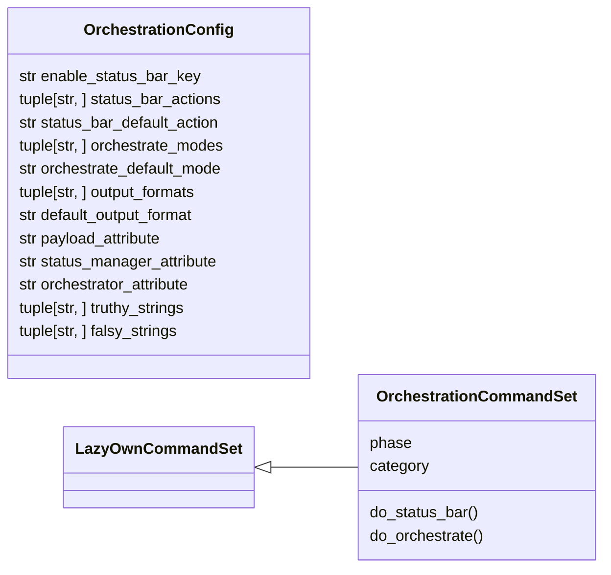

# `cli.commands.orchestration`

> Source: [cli/commands/orchestration.py:1](../../cli/commands/orchestration.py#L1) | language `py` | coverage 100.0% | [API index](../index.md)

Orchestration CommandSet: operator-facing surface for the new modules.

This module exposes two verbs to the cmd2 shell:

* ``status_bar`` — inspect, toggle and refresh the persistent prompt
  status bar provided by [`cli.status_bar`](cli.status_bar.py.md).
* ``orchestrate`` — drive [`skills.unified_orchestrator.UnifiedOrchestrator`](skills.unified_orchestrator.py.md#unifiedorchestrator)
  with a single goal string, routing transparently to the daemon, hive
  or SWAN backend.

The set is active (subclass of [`cli.commands._base.LazyOwnCommandSet`](cli.commands._base.py.md#lazyowncommandset))
because both verbs are new — there is no legacy ``do_*`` in
``lazyown.py`` that they collide with. Activation therefore happens via
[`cli.registry.register_command_sets`](cli.registry.py.md#register_command_sets) on shell startup.

## Contents

- **Classes:** [`OrchestrationConfig`](#orchestrationconfig), [`OrchestrationCommandSet`](#orchestrationcommandset)

## Type Diagram



## Classes

<a id="orchestrationconfig"></a>

### `OrchestrationConfig`

`class` `dataclass` | [cli/commands/orchestration.py:37](../../cli/commands/orchestration.py#L37)

Decorators: `@dataclass(frozen=True)`

```python
class OrchestrationConfig
```

Immutable defaults for the orchestration verbs.

**Attributes**

| Name | Type | Default | Description |
|---|---|---|---|
| [`enable_status_bar_key`](#orchestrationconfig-enable_status_bar_key) | `str` | `'enable_status_bar'` |  |
| [`status_bar_actions`](#orchestrationconfig-status_bar_actions) | `tuple[str, ...]` | `_STATUS_BAR_ACTIONS` |  |
| [`status_bar_default_action`](#orchestrationconfig-status_bar_default_action) | `str` | `_STATUS_BAR_DEFAULT_ACTION` |  |
| [`orchestrate_modes`](#orchestrationconfig-orchestrate_modes) | `tuple[str, ...]` | `_ORCHESTRATE_MODES` |  |
| [`orchestrate_default_mode`](#orchestrationconfig-orchestrate_default_mode) | `str` | `_ORCHESTRATE_DEFAULT_MODE` |  |
| [`output_formats`](#orchestrationconfig-output_formats) | `tuple[str, ...]` | `_OUTPUT_FORMATS` |  |
| [`default_output_format`](#orchestrationconfig-default_output_format) | `str` | `'text'` |  |
| [`payload_attribute`](#orchestrationconfig-payload_attribute) | `str` | `'params'` |  |
| [`status_manager_attribute`](#orchestrationconfig-status_manager_attribute) | `str` | `'_status_bar_manager'` |  |
| [`orchestrator_attribute`](#orchestrationconfig-orchestrator_attribute) | `str` | `'_unified_orchestrator'` |  |
| [`truthy_strings`](#orchestrationconfig-truthy_strings) | `tuple[str, ...]` | `('1', 'true', 'yes', 'on')` |  |
| [`falsy_strings`](#orchestrationconfig-falsy_strings) | `tuple[str, ...]` | `('0', 'false', 'no', 'off')` |  |

---

<a id="orchestrationcommandset"></a>

### `OrchestrationCommandSet`

`class` | [cli/commands/orchestration.py:182](../../cli/commands/orchestration.py#L182)

```python
class OrchestrationCommandSet(LazyOwnCommandSet)
```

Bases: [`LazyOwnCommandSet`](cli.commands._base.py.md#lazyowncommandset)

Operator commands exposing the status bar and unified orchestrator.

**Attributes**

| Name | Type | Default | Description |
|---|---|---|---|
| [`phase`](#orchestrationcommandset-phase) |  | `'orchestration'` |  |
| [`category`](#orchestrationcommandset-category) |  | `_CATEGORY` |  |

**Members**

| Member | Kind | Summary |
|---|---|---|
| [`do_status_bar`](#orchestrationcommandset-do_status_bar) | method | Inspect, toggle and refresh the prompt status bar. |
| [`do_orchestrate`](#orchestrationcommandset-do_orchestrate) | method | Route a goal through the unified orchestrator and print the result. |

<a id="orchestrationcommandset-do_status_bar"></a>

#### `OrchestrationCommandSet.do_status_bar`

`method` | [cli/commands/orchestration.py:190](../../cli/commands/orchestration.py#L190)

Decorators: `@with_category(_CATEGORY)`, `@with_argparser(_build_status_bar_parser())`

```python
def do_status_bar(self, args: argparse.Namespace) -> None
```

Inspect, toggle and refresh the prompt status bar.

Subcommands:
    show     Print the currently rendered status line.
    on / off Persist the flag into payload via the shell.
    refresh  Recompute the status bar context against ``sessions/``.

**Parameters**

| Name | Type | Default | Description |
|---|---|---|---|
| `args` | `argparse.Namespace` |  |  |

<a id="orchestrationcommandset-do_orchestrate"></a>

#### `OrchestrationCommandSet.do_orchestrate`

`method` | [cli/commands/orchestration.py:216](../../cli/commands/orchestration.py#L216)

Decorators: `@with_category(_CATEGORY)`, `@with_argparser(_build_orchestrate_parser())`

```python
def do_orchestrate(self, args: argparse.Namespace) -> None
```

Route a goal through the unified orchestrator and print the result.

The orchestrator picks one of ``daemon``, ``hive`` or ``swan`` and
normalises the response into a single dataclass. Use ``--mode`` to
force a specific backend; the default ``auto`` routes by
signature heuristics.

**Parameters**

| Name | Type | Default | Description |
|---|---|---|---|
| `args` | `argparse.Namespace` |  |  |

---
