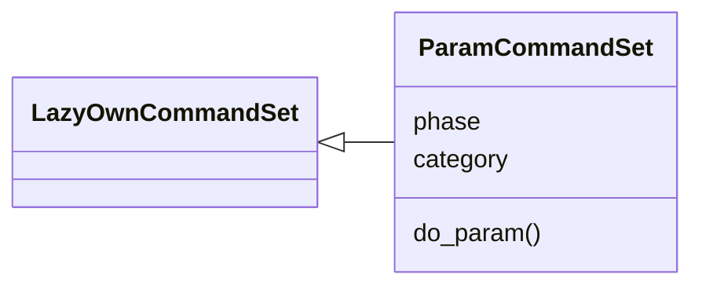
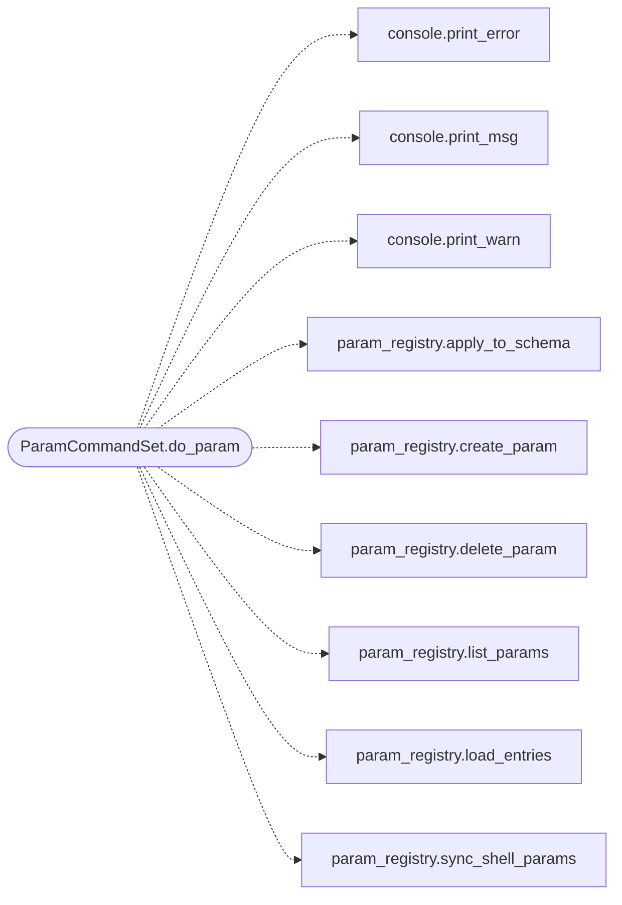

# `cli.commands.params_ops`

> Source: [cli/commands/params_ops.py:1](../../cli/commands/params_ops.py#L1) | language `py` | coverage 100.0% | [API index](../index.md)

Operator administration of the shared parameter catalog.

Parameters are the tokens every LazyOwn surface can substitute: addon
templates (``{param}``), aliases, pipelines and the shell ``assign``
command. This set is the non-TUI half of the parameter administrator; the
``lazy_orchestrator`` console (Params tab) is the visual half. Both call
the same registry ([`core.param_registry`](core.param_registry.py.md)), so a parameter declared in
either place is immediately reusable everywhere.

The registry stores the declarations as data in ``params/operator.yaml``,
so creating a parameter needs no source edit: the payload schema and the
addon creator pick the new key up automatically.

## Contents

- **Classes:** [`ParamCommandSet`](#paramcommandset)

## Type Diagram



## Call Graph

Solid arrows stay in this module, dashed arrows leave it.



## Classes

<a id="paramcommandset"></a>

### `ParamCommandSet`

`class` | [cli/commands/params_ops.py:31](../../cli/commands/params_ops.py#L31)

```python
class ParamCommandSet(LazyOwnCommandSet)
```

Bases: [`LazyOwnCommandSet`](cli.commands._base.py.md#lazyowncommandset)

Create, inspect and delete the shared parameters.

**Attributes**

| Name | Type | Default | Description |
|---|---|---|---|
| [`phase`](#paramcommandset-phase) |  | `'misc'` |  |
| [`category`](#paramcommandset-category) |  | `'12. Miscellaneous'` |  |

**Members**

| Member | Kind | Summary |
|---|---|---|
| [`do_param`](#paramcommandset-do_param) | method | Manage the shared parameter catalog used by addons and aliases. |

<a id="paramcommandset-do_param"></a>

#### `ParamCommandSet.do_param`

`method` | [cli/commands/params_ops.py:38](../../cli/commands/params_ops.py#L38)

Decorators: `@cmd2.with_category('12. Miscellaneous')`

```python
def do_param(self, line)
```

Manage the shared parameter catalog used by addons and aliases.

A parameter declared here is reusable by every addon: name it
generically, never after a single tool.

Usage:
  param list [keyword]              show the catalog (builtin + operator)
  param show <name>                 show one parameter in detail
  param create <name> [options]     declare a new parameter
  param set <name> <value>          set the live value of a parameter
  param delete <name>               remove an operator parameter
  param reload                      re-read params/operator.yaml

create options:
  --kind <kind>       payload kind (default string)
  --default <value>   default value (default empty)
  --desc <text>       help text
  --category <name>   payload schema category (default general)

**Parameters**

| Name | Type | Default | Description |
|---|---|---|---|
| `line` |  |  |  |

*Calls:* [`print_error`](core.console.py.md#print_error), [`print_msg`](core.console.py.md#print_msg), [`print_warn`](core.console.py.md#print_warn), [`apply_to_schema`](core.param_registry.py.md#apply_to_schema), [`create_param`](core.param_registry.py.md#create_param), [`delete_param`](core.param_registry.py.md#delete_param), [`list_params`](core.param_registry.py.md#list_params), [`load_entries`](core.param_registry.py.md#load_entries), [`sync_shell_params`](core.param_registry.py.md#sync_shell_params)

---
