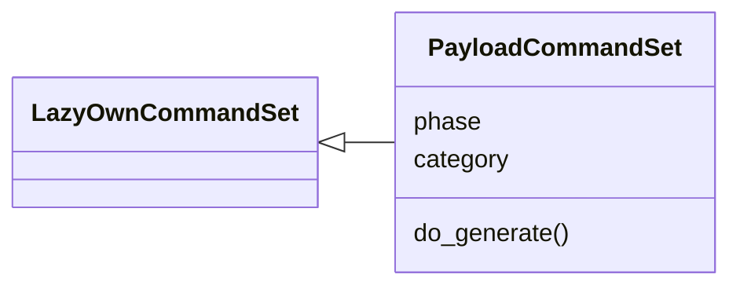
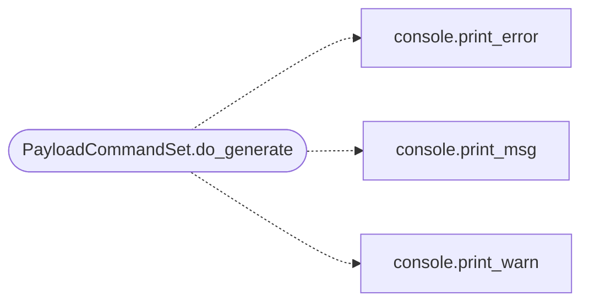

# `cli.commands.payload_generation`

> Source: [cli/commands/payload_generation.py:1](../../cli/commands/payload_generation.py#L1) | language `py` | coverage 100.0% | [API index](../index.md)

Payload generation commands — list payloads and generate.

Provides:
    show payloads           — list all registered payloads
    generate <name> [options] [--format f] [--output path]

## Contents

- **Classes:** [`PayloadCommandSet`](#payloadcommandset)

## Type Diagram



## Call Graph

Solid arrows stay in this module, dashed arrows leave it.



## Classes

<a id="payloadcommandset"></a>

### `PayloadCommandSet`

`class` | [cli/commands/payload_generation.py:24](../../cli/commands/payload_generation.py#L24)

```python
class PayloadCommandSet(LazyOwnCommandSet)
```

Bases: [`LazyOwnCommandSet`](cli.commands._base.py.md#lazyowncommandset)

Payload generation and listing.

**Attributes**

| Name | Type | Default | Description |
|---|---|---|---|
| [`phase`](#payloadcommandset-phase) |  | `'payload'` |  |
| [`category`](#payloadcommandset-category) |  | `'12. Miscellaneous'` |  |

**Members**

| Member | Kind | Summary |
|---|---|---|
| [`do_generate`](#payloadcommandset-do_generate) | method | Generate a payload. |

<a id="payloadcommandset-do_generate"></a>

#### `PayloadCommandSet.do_generate`

`method` | [cli/commands/payload_generation.py:37](../../cli/commands/payload_generation.py#L37)

Decorators: `@cmd2.with_category(miscellaneous_category)`

```python
def do_generate(self, line)
```

Generate a payload.

Usage: generate <payload_name> LHOST=<ip> LPORT=<port> [--format f] [--output path]

**Parameters**

| Name | Type | Default | Description |
|---|---|---|---|
| `line` |  |  |  |

**Example**

```python
generate cmd/unix/reverse_shell LHOST=10.0.0.1 LPORT=4444
    generate cmd/unix/reverse_shell LHOST=10.0.0.1 LPORT=4444 shell_type=python
    generate cmd/windows/reverse_powershell LHOST=10.0.0.1 LPORT=4444 --format ps1 --output /tmp/shell.ps1

Use 'show payloads' to list available payloads.
```

*Calls:* [`print_error`](core.console.py.md#print_error), [`print_msg`](core.console.py.md#print_msg), [`print_warn`](core.console.py.md#print_warn)

---
