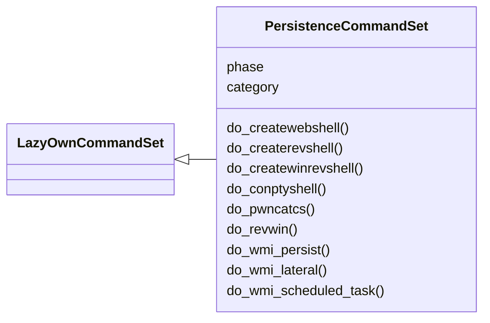
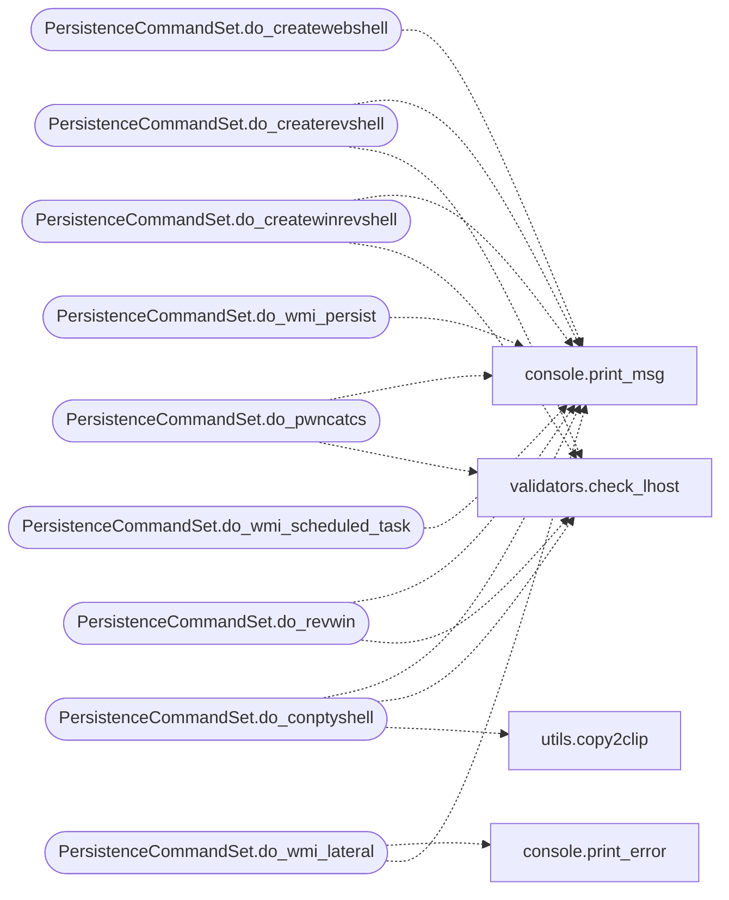

# `cli.commands.persist`

> Source: [cli/commands/persist.py:1](../../cli/commands/persist.py#L1) | language `py` | coverage 100.0% | [API index](../index.md)

Persistence command set (pending).

Phase 05 — commands for establishing persistence: reverse shells,
web shells, backdoors, and implant generation.

Pending status: inherits from [`PendingCommandSet`](cli.commands._dormancy.py.md#pendingcommandset). Promote to
[`LazyOwnCommandSet`](cli.commands._base.py.md#lazyowncommandset) once originals are deleted from ``lazyown.py``.

## Contents

- **Classes:** [`PersistenceCommandSet`](#persistencecommandset)

## Type Diagram



## Call Graph

Solid arrows stay in this module, dashed arrows leave it.



## Classes

<a id="persistencecommandset"></a>

### `PersistenceCommandSet`

`class` | [cli/commands/persist.py:26](../../cli/commands/persist.py#L26)

```python
class PersistenceCommandSet(LazyOwnCommandSet)
```

Bases: [`LazyOwnCommandSet`](cli.commands._base.py.md#lazyowncommandset)

Persistence phase commands (pending).

**Attributes**

| Name | Type | Default | Description |
|---|---|---|---|
| [`phase`](#persistencecommandset-phase) |  | `'persist'` |  |
| [`category`](#persistencecommandset-category) |  | `'05. Persistence'` |  |

**Members**

| Member | Kind | Summary |
|---|---|---|
| [`do_createwebshell`](#persistencecommandset-do_createwebshell) | method | Create web shells (JPG-disguised PHP, p0wny-shell, ASP). |
| [`do_createrevshell`](#persistencecommandset-do_createrevshell) | method | Create a bash reverse shell script in sessions/. |
| [`do_createwinrevshell`](#persistencecommandset-do_createwinrevshell) | method | Create a Windows reverse shell (PowerShell). |
| [`do_conptyshell`](#persistencecommandset-do_conptyshell) | method | Download ConPtyShell and prepare a PowerShell run command. |
| [`do_pwncatcs`](#persistencecommandset-do_pwncatcs) | method | Start a pwncat-cs reverse shell listener. |
| [`do_revwin`](#persistencecommandset-do_revwin) | method | Create a Windows reverse shell executable. |
| [`do_wmi_persist`](#persistencecommandset-do_wmi_persist) | method | Create WMI Event Subscription persistence (fileless, no disk write). |
| [`do_wmi_lateral`](#persistencecommandset-do_wmi_lateral) | method | Execute a command on a remote host via WMI. |
| [`do_wmi_scheduled_task`](#persistencecommandset-do_wmi_scheduled_task) | method | Create a scheduled task for persistence via WMI. |

<a id="persistencecommandset-do_createwebshell"></a>

#### `PersistenceCommandSet.do_createwebshell`

`method` | [cli/commands/persist.py:33](../../cli/commands/persist.py#L33)

Decorators: `@cmd2.with_category(persistence_category)`

```python
def do_createwebshell(self, line)
```

Create web shells (JPG-disguised PHP, p0wny-shell, ASP).

**Parameters**

| Name | Type | Default | Description |
|---|---|---|---|
| `line` |  |  |  |

*Calls:* [`print_msg`](core.console.py.md#print_msg)

<a id="persistencecommandset-do_createrevshell"></a>

#### `PersistenceCommandSet.do_createrevshell`

`method` | [cli/commands/persist.py:47](../../cli/commands/persist.py#L47)

Decorators: `@cmd2.with_category(persistence_category)`

```python
def do_createrevshell(self, line)
```

Create a bash reverse shell script in sessions/.

**Parameters**

| Name | Type | Default | Description |
|---|---|---|---|
| `line` |  |  |  |

*Calls:* [`print_msg`](core.console.py.md#print_msg), [`check_lhost`](core.validators.py.md#check_lhost)

<a id="persistencecommandset-do_createwinrevshell"></a>

#### `PersistenceCommandSet.do_createwinrevshell`

`method` | [cli/commands/persist.py:61](../../cli/commands/persist.py#L61)

Decorators: `@cmd2.with_category(persistence_category)`

```python
def do_createwinrevshell(self, line)
```

Create a Windows reverse shell (PowerShell).

**Parameters**

| Name | Type | Default | Description |
|---|---|---|---|
| `line` |  |  |  |

*Calls:* [`print_msg`](core.console.py.md#print_msg), [`check_lhost`](core.validators.py.md#check_lhost)

<a id="persistencecommandset-do_conptyshell"></a>

#### `PersistenceCommandSet.do_conptyshell`

`method` | [cli/commands/persist.py:73](../../cli/commands/persist.py#L73)

Decorators: `@cmd2.with_category(persistence_category)`

```python
def do_conptyshell(self, line)
```

Download ConPtyShell and prepare a PowerShell run command.

**Parameters**

| Name | Type | Default | Description |
|---|---|---|---|
| `line` |  |  |  |

*Calls:* [`print_msg`](core.console.py.md#print_msg), [`check_lhost`](core.validators.py.md#check_lhost), [`copy2clip`](utils.py.md#copy2clip)

<a id="persistencecommandset-do_pwncatcs"></a>

#### `PersistenceCommandSet.do_pwncatcs`

`method` | [cli/commands/persist.py:89](../../cli/commands/persist.py#L89)

Decorators: `@cmd2.with_category(persistence_category)`

```python
def do_pwncatcs(self, line)
```

Start a pwncat-cs reverse shell listener.

**Parameters**

| Name | Type | Default | Description |
|---|---|---|---|
| `line` |  |  |  |

*Calls:* [`print_msg`](core.console.py.md#print_msg), [`check_lhost`](core.validators.py.md#check_lhost)

<a id="persistencecommandset-do_revwin"></a>

#### `PersistenceCommandSet.do_revwin`

`method` | [cli/commands/persist.py:99](../../cli/commands/persist.py#L99)

Decorators: `@cmd2.with_category(persistence_category)`

```python
def do_revwin(self, line)
```

Create a Windows reverse shell executable.

**Parameters**

| Name | Type | Default | Description |
|---|---|---|---|
| `line` |  |  |  |

*Calls:* [`print_msg`](core.console.py.md#print_msg), [`check_lhost`](core.validators.py.md#check_lhost)

<a id="persistencecommandset-do_wmi_persist"></a>

#### `PersistenceCommandSet.do_wmi_persist`

`method` | [cli/commands/persist.py:112](../../cli/commands/persist.py#L112)

Decorators: `@cmd2.with_category(persistence_category)`

```python
def do_wmi_persist(self, line='')
```

Create WMI Event Subscription persistence (fileless, no disk write).

Usage: wmi_persist [--command <cmd>] [--interval <minutes>] [--name <event_name>]

Registers __EventFilter + __EventConsumer + __FilterToConsumerBinding
for stealthy, fileless persistence. Triggers on system startup or
at a configurable interval. MITRE: T1546.003 WMI Event Subscription.

**Parameters**

| Name | Type | Default | Description |
|---|---|---|---|
| `line` |  | `''` |  |

*Calls:* [`print_msg`](core.console.py.md#print_msg)

<a id="persistencecommandset-do_wmi_lateral"></a>

#### `PersistenceCommandSet.do_wmi_lateral`

`method` | [cli/commands/persist.py:170](../../cli/commands/persist.py#L170)

Decorators: `@cmd2.with_category(persistence_category)`

```python
def do_wmi_lateral(self, line='')
```

Execute a command on a remote host via WMI.

Usage: wmi_lateral [--target <ip>] [--user <user>] [--password <pass>] [--hash <nt_hash>] [--command <cmd>]

Uses wmic.exe or impacket-wmiexec for lateral movement.
Supports pass-the-hash authentication.
MITRE: T1047 WMI.

**Parameters**

| Name | Type | Default | Description |
|---|---|---|---|
| `line` |  | `''` |  |

*Calls:* [`print_error`](core.console.py.md#print_error), [`print_msg`](core.console.py.md#print_msg)

<a id="persistencecommandset-do_wmi_scheduled_task"></a>

#### `PersistenceCommandSet.do_wmi_scheduled_task`

`method` | [cli/commands/persist.py:209](../../cli/commands/persist.py#L209)

Decorators: `@cmd2.with_category(persistence_category)`

```python
def do_wmi_scheduled_task(self, line='')
```

Create a scheduled task for persistence via WMI.

Usage: wmi_scheduled_task [--name <task_name>] [--command <cmd>] [--trigger <startup|logon|daily|hourly>]

Creates a scheduled task that executes on system startup or user logon.
More stealthy than registry Run keys (not monitored by many EDRs).
MITRE: T1053.005 Scheduled Task.

**Parameters**

| Name | Type | Default | Description |
|---|---|---|---|
| `line` |  | `''` |  |

*Calls:* [`print_msg`](core.console.py.md#print_msg)

---
