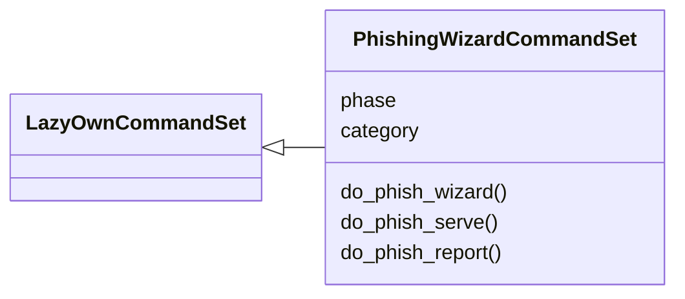
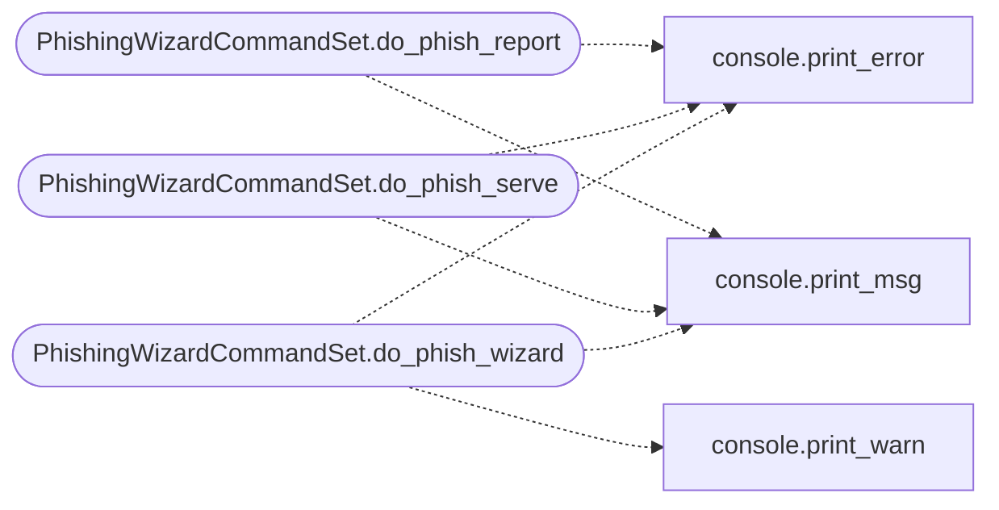

# `cli.commands.phishing_wizard`

> Source: [cli/commands/phishing_wizard.py:1](../../cli/commands/phishing_wizard.py#L1) | language `py` | coverage 100.0% | [API index](../index.md)

Phishing Wizard command set.

End-to-end phishing campaign wizard with step-by-step interactive flow:
target profiling -> template selection -> landing page generation -> sending
-> tracking -> credential capture -> automatic config update.

## Contents

- **Classes:** [`PhishingWizardCommandSet`](#phishingwizardcommandset)

## Type Diagram



## Call Graph

Solid arrows stay in this module, dashed arrows leave it.



## Classes

<a id="phishingwizardcommandset"></a>

### `PhishingWizardCommandSet`

`class` | [cli/commands/phishing_wizard.py:183](../../cli/commands/phishing_wizard.py#L183)

```python
class PhishingWizardCommandSet(LazyOwnCommandSet)
```

Bases: [`LazyOwnCommandSet`](cli.commands._base.py.md#lazyowncommandset)

End-to-end phishing campaign wizard.

**Attributes**

| Name | Type | Default | Description |
|---|---|---|---|
| [`phase`](#phishingwizardcommandset-phase) |  | `'recon'` |  |
| [`category`](#phishingwizardcommandset-category) |  | `PHISHING_CATEGORY` |  |

**Members**

| Member | Kind | Summary |
|---|---|---|
| [`do_phish_wizard`](#phishingwizardcommandset-do_phish_wizard) | method | Interactive end-to-end phishing campaign wizard. |
| [`do_phish_serve`](#phishingwizardcommandset-do_phish_serve) | method | Start a lightweight HTTP server for phishing landing pages. |
| [`do_phish_report`](#phishingwizardcommandset-do_phish_report) | method | Show campaign results and captured credentials. |

<a id="phishingwizardcommandset-do_phish_wizard"></a>

#### `PhishingWizardCommandSet.do_phish_wizard`

`method` | [cli/commands/phishing_wizard.py:190](../../cli/commands/phishing_wizard.py#L190)

Decorators: `@cmd2.with_category(PHISHING_CATEGORY)`

```python
def do_phish_wizard(self, line)
```

Interactive end-to-end phishing campaign wizard.

Usage: phish_wizard

Walks through: target profiling -> template selection -> landing page
generation -> email sending -> credential harvesting.

**Parameters**

| Name | Type | Default | Description |
|---|---|---|---|
| `line` |  |  |  |

*Calls:* [`print_error`](core.console.py.md#print_error), [`print_msg`](core.console.py.md#print_msg), [`print_warn`](core.console.py.md#print_warn)

<a id="phishingwizardcommandset-do_phish_serve"></a>

#### `PhishingWizardCommandSet.do_phish_serve`

`method` | [cli/commands/phishing_wizard.py:361](../../cli/commands/phishing_wizard.py#L361)

Decorators: `@cmd2.with_category(PHISHING_CATEGORY)`

```python
def do_phish_serve(self, line)
```

Start a lightweight HTTP server for phishing landing pages.

Usage: phish_serve <campaign_id> [--port <port>]

Serves landing pages from sessions/phishing_<campaign_id>/index.html
and handles credential harvesting at /harvest/<campaign_id>.

**Parameters**

| Name | Type | Default | Description |
|---|---|---|---|
| `line` |  |  |  |

*Calls:* [`print_error`](core.console.py.md#print_error), [`print_msg`](core.console.py.md#print_msg)

<a id="phishingwizardcommandset-do_phish_report"></a>

#### `PhishingWizardCommandSet.do_phish_report`

`method` | [cli/commands/phishing_wizard.py:443](../../cli/commands/phishing_wizard.py#L443)

Decorators: `@cmd2.with_category(PHISHING_CATEGORY)`

```python
def do_phish_report(self, line)
```

Show campaign results and captured credentials.

Usage: phish_report <campaign_id>

Displays click count, captured credentials, and campaign stats.

**Parameters**

| Name | Type | Default | Description |
|---|---|---|---|
| `line` |  |  |  |

*Calls:* [`print_error`](core.console.py.md#print_error), [`print_msg`](core.console.py.md#print_msg)

---
