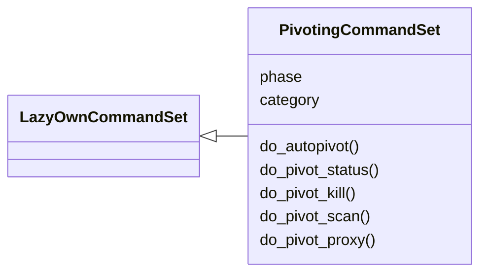
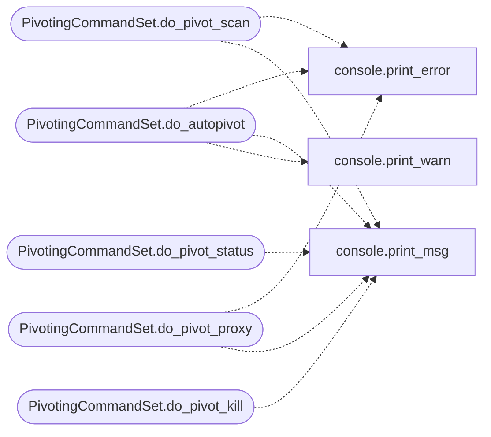

# `cli.commands.pivoting`

> Source: [cli/commands/pivoting.py:1](../../cli/commands/pivoting.py#L1) | language `py` | coverage 100.0% | [API index](../index.md)

Intelligent Pivoting command set.

Covers automatic network discovery, dynamic tunnel setup, and multi-hop
pivot chain management for lateral movement through compromised hosts.

## Contents

- **Classes:** [`PivotingCommandSet`](#pivotingcommandset)

## Type Diagram



## Call Graph

Solid arrows stay in this module, dashed arrows leave it.



## Classes

<a id="pivotingcommandset"></a>

### `PivotingCommandSet`

`class` | [cli/commands/pivoting.py:37](../../cli/commands/pivoting.py#L37)

```python
class PivotingCommandSet(LazyOwnCommandSet)
```

Bases: [`LazyOwnCommandSet`](cli.commands._base.py.md#lazyowncommandset)

Automatic pivoting and multi-hop tunnel management.

**Attributes**

| Name | Type | Default | Description |
|---|---|---|---|
| [`phase`](#pivotingcommandset-phase) |  | `'lateral'` |  |
| [`category`](#pivotingcommandset-category) |  | `PIVOTING_CATEGORY` |  |

**Members**

| Member | Kind | Summary |
|---|---|---|
| [`do_autopivot`](#pivotingcommandset-do_autopivot) | method | Auto-detect internal networks and set up pivot tunnels. |
| [`do_pivot_status`](#pivotingcommandset-do_pivot_status) | method | Show the current pivot chain state. |
| [`do_pivot_kill`](#pivotingcommandset-do_pivot_kill) | method | Kill all pivot tunnels and clean up. |
| [`do_pivot_scan`](#pivotingcommandset-do_pivot_scan) | method | Scan internal networks through the current pivot chain. |
| [`do_pivot_proxy`](#pivotingcommandset-do_pivot_proxy) | method | Start a local SOCKS proxy through the pivot chain. |

<a id="pivotingcommandset-do_autopivot"></a>

#### `PivotingCommandSet.do_autopivot`

`method` | [cli/commands/pivoting.py:44](../../cli/commands/pivoting.py#L44)

Decorators: `@cmd2.with_category(PIVOTING_CATEGORY)`

```python
def do_autopivot(self, line)
```

Auto-detect internal networks and set up pivot tunnels.

Usage: autopivot [--lhost <attacker_ip>] [--rhost <pivot_host>] [--method <chisel|ssh|socat>]

Discovers internal networks reachable through the pivot host and
sets up SOCKS/port forwarding to access them from the attacker machine.

**Parameters**

| Name | Type | Default | Description |
|---|---|---|---|
| `line` |  |  |  |

*Calls:* [`print_error`](core.console.py.md#print_error), [`print_msg`](core.console.py.md#print_msg), [`print_warn`](core.console.py.md#print_warn)

<a id="pivotingcommandset-do_pivot_status"></a>

#### `PivotingCommandSet.do_pivot_status`

`method` | [cli/commands/pivoting.py:118](../../cli/commands/pivoting.py#L118)

Decorators: `@cmd2.with_category(PIVOTING_CATEGORY)`

```python
def do_pivot_status(self, line)
```

Show the current pivot chain state.

Usage: pivot_status [--json]

**Parameters**

| Name | Type | Default | Description |
|---|---|---|---|
| `line` |  |  |  |

*Calls:* [`print_msg`](core.console.py.md#print_msg)

<a id="pivotingcommandset-do_pivot_kill"></a>

#### `PivotingCommandSet.do_pivot_kill`

`method` | [cli/commands/pivoting.py:137](../../cli/commands/pivoting.py#L137)

Decorators: `@cmd2.with_category(PIVOTING_CATEGORY)`

```python
def do_pivot_kill(self, line)
```

Kill all pivot tunnels and clean up.

Usage: pivot_kill [--hop <n>]

Without --hop, kills all pivot processes. With --hop, kills a specific hop.

**Parameters**

| Name | Type | Default | Description |
|---|---|---|---|
| `line` |  |  |  |

*Calls:* [`print_msg`](core.console.py.md#print_msg)

<a id="pivotingcommandset-do_pivot_scan"></a>

#### `PivotingCommandSet.do_pivot_scan`

`method` | [cli/commands/pivoting.py:171](../../cli/commands/pivoting.py#L171)

Decorators: `@cmd2.with_category(PIVOTING_CATEGORY)`

```python
def do_pivot_scan(self, line)
```

Scan internal networks through the current pivot chain.

Usage: pivot_scan <network_cidr> [--port <ports>] [--rate <pkts_per_sec>]

Runs a fast TCP scan through proxychains against internal networks.

**Parameters**

| Name | Type | Default | Description |
|---|---|---|---|
| `line` |  |  |  |

*Calls:* [`print_error`](core.console.py.md#print_error), [`print_msg`](core.console.py.md#print_msg)

<a id="pivotingcommandset-do_pivot_proxy"></a>

#### `PivotingCommandSet.do_pivot_proxy`

`method` | [cli/commands/pivoting.py:224](../../cli/commands/pivoting.py#L224)

Decorators: `@cmd2.with_category(PIVOTING_CATEGORY)`

```python
def do_pivot_proxy(self, line)
```

Start a local SOCKS proxy through the pivot chain.

Usage: pivot_proxy [--port <local_port>] [--hop <n>]

Starts a proxy listener on the attacker machine that forwards
traffic through the specified pivot hop.

**Parameters**

| Name | Type | Default | Description |
|---|---|---|---|
| `line` |  |  |  |

*Calls:* [`print_error`](core.console.py.md#print_error), [`print_msg`](core.console.py.md#print_msg)

---
