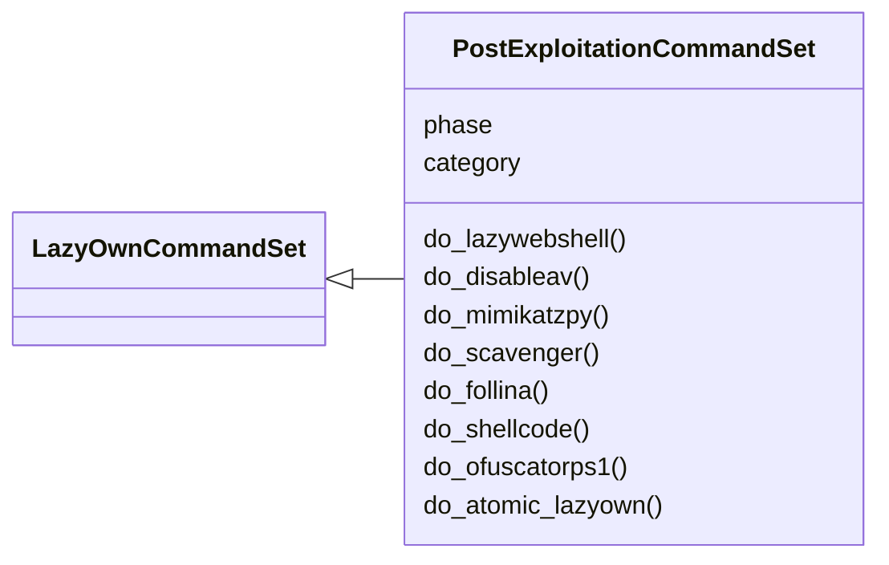
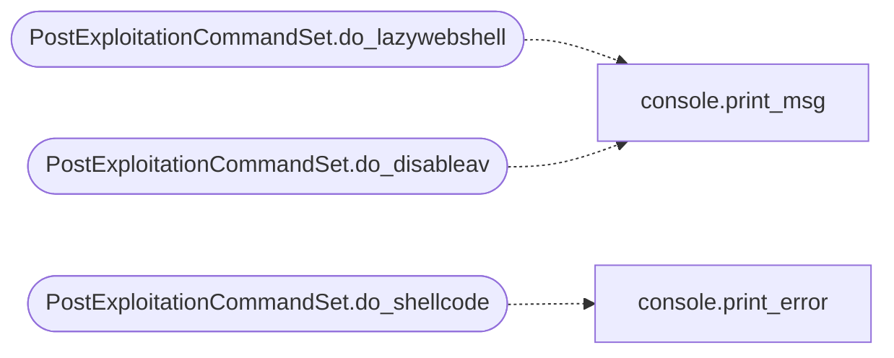

# `cli.commands.postexp`

> Source: [cli/commands/postexp.py:1](../../cli/commands/postexp.py#L1) | language `py` | coverage 100.0% | [API index](../index.md)

Post-Exploitation command set (pending).

Phase 04 — commands for post-exploitation tasks: webshells, AV
bypass, automated enumeration, shellcode generation, and payload
creation.

Pending status: inherits from [`PendingCommandSet`](cli.commands._dormancy.py.md#pendingcommandset). Promote to
[`LazyOwnCommandSet`](cli.commands._base.py.md#lazyowncommandset) once originals are deleted from ``lazyown.py``.

## Contents

- **Classes:** [`PostExploitationCommandSet`](#postexploitationcommandset)

## Type Diagram



## Call Graph

Solid arrows stay in this module, dashed arrows leave it.



## Classes

<a id="postexploitationcommandset"></a>

### `PostExploitationCommandSet`

`class` | [cli/commands/postexp.py:25](../../cli/commands/postexp.py#L25)

```python
class PostExploitationCommandSet(LazyOwnCommandSet)
```

Bases: [`LazyOwnCommandSet`](cli.commands._base.py.md#lazyowncommandset)

Post-Exploitation phase commands (pending).

**Attributes**

| Name | Type | Default | Description |
|---|---|---|---|
| [`phase`](#postexploitationcommandset-phase) |  | `'postexp'` |  |
| [`category`](#postexploitationcommandset-category) |  | `'04. Post-Exploitation'` |  |

**Members**

| Member | Kind | Summary |
|---|---|---|
| [`do_lazywebshell`](#postexploitationcommandset-do_lazywebshell) | method | Run LazyOwn webshell server on port 8888. |
| [`do_disableav`](#postexploitationcommandset-do_disableav) | method | Create a VBS script to attempt disabling Windows Defender. |
| [`do_mimikatzpy`](#postexploitationcommandset-do_mimikatzpy) | method | Run Mimikatz over Python (impacket style). |
| [`do_scavenger`](#postexploitationcommandset-do_scavenger) | method | Run the Scavenger post-exploitation data collector. |
| [`do_follina`](#postexploitationcommandset-do_follina) | method | Run the Follina (CVE-2022-30190) exploit setup. |
| [`do_shellcode`](#postexploitationcommandset-do_shellcode) | method | Generate and manage shellcode. |
| [`do_ofuscatorps1`](#postexploitationcommandset-do_ofuscatorps1) | method | Obfuscate a PowerShell script. |
| [`do_atomic_lazyown`](#postexploitationcommandset-do_atomic_lazyown) | method | Execute atomic red-team tests via LazyOwn. |

<a id="postexploitationcommandset-do_lazywebshell"></a>

#### `PostExploitationCommandSet.do_lazywebshell`

`method` | [cli/commands/postexp.py:32](../../cli/commands/postexp.py#L32)

Decorators: `@cmd2.with_category(post_exploitation_category)`

```python
def do_lazywebshell(self, line)
```

Run LazyOwn webshell server on port 8888.

**Parameters**

| Name | Type | Default | Description |
|---|---|---|---|
| `line` |  |  |  |

*Calls:* [`print_msg`](core.console.py.md#print_msg)

<a id="postexploitationcommandset-do_disableav"></a>

#### `PostExploitationCommandSet.do_disableav`

`method` | [cli/commands/postexp.py:45](../../cli/commands/postexp.py#L45)

Decorators: `@cmd2.with_category(post_exploitation_category)`

```python
def do_disableav(self, line)
```

Create a VBS script to attempt disabling Windows Defender.

**Parameters**

| Name | Type | Default | Description |
|---|---|---|---|
| `line` |  |  |  |

*Calls:* [`print_msg`](core.console.py.md#print_msg)

<a id="postexploitationcommandset-do_mimikatzpy"></a>

#### `PostExploitationCommandSet.do_mimikatzpy`

`method` | [cli/commands/postexp.py:59](../../cli/commands/postexp.py#L59)

Decorators: `@cmd2.with_category(post_exploitation_category)`

```python
def do_mimikatzpy(self, line)
```

Run Mimikatz over Python (impacket style).

**Parameters**

| Name | Type | Default | Description |
|---|---|---|---|
| `line` |  |  |  |

<a id="postexploitationcommandset-do_scavenger"></a>

#### `PostExploitationCommandSet.do_scavenger`

`method` | [cli/commands/postexp.py:64](../../cli/commands/postexp.py#L64)

Decorators: `@cmd2.with_category(post_exploitation_category)`

```python
def do_scavenger(self, line)
```

Run the Scavenger post-exploitation data collector.

**Parameters**

| Name | Type | Default | Description |
|---|---|---|---|
| `line` |  |  |  |

<a id="postexploitationcommandset-do_follina"></a>

#### `PostExploitationCommandSet.do_follina`

`method` | [cli/commands/postexp.py:69](../../cli/commands/postexp.py#L69)

Decorators: `@cmd2.with_category(post_exploitation_category)`

```python
def do_follina(self, line)
```

Run the Follina (CVE-2022-30190) exploit setup.

**Parameters**

| Name | Type | Default | Description |
|---|---|---|---|
| `line` |  |  |  |

<a id="postexploitationcommandset-do_shellcode"></a>

#### `PostExploitationCommandSet.do_shellcode`

`method` | [cli/commands/postexp.py:74](../../cli/commands/postexp.py#L74)

Decorators: `@cmd2.with_category(post_exploitation_category)`

```python
def do_shellcode(self, line)
```

Generate and manage shellcode.

**Parameters**

| Name | Type | Default | Description |
|---|---|---|---|
| `line` |  |  |  |

*Calls:* [`print_error`](core.console.py.md#print_error)

<a id="postexploitationcommandset-do_ofuscatorps1"></a>

#### `PostExploitationCommandSet.do_ofuscatorps1`

`method` | [cli/commands/postexp.py:82](../../cli/commands/postexp.py#L82)

Decorators: `@cmd2.with_category(post_exploitation_category)`

```python
def do_ofuscatorps1(self, line)
```

Obfuscate a PowerShell script.

**Parameters**

| Name | Type | Default | Description |
|---|---|---|---|
| `line` |  |  |  |

<a id="postexploitationcommandset-do_atomic_lazyown"></a>

#### `PostExploitationCommandSet.do_atomic_lazyown`

`method` | [cli/commands/postexp.py:87](../../cli/commands/postexp.py#L87)

Decorators: `@cmd2.with_category(post_exploitation_category)`

```python
def do_atomic_lazyown(self, line)
```

Execute atomic red-team tests via LazyOwn.

**Parameters**

| Name | Type | Default | Description |
|---|---|---|---|
| `line` |  |  |  |

---
